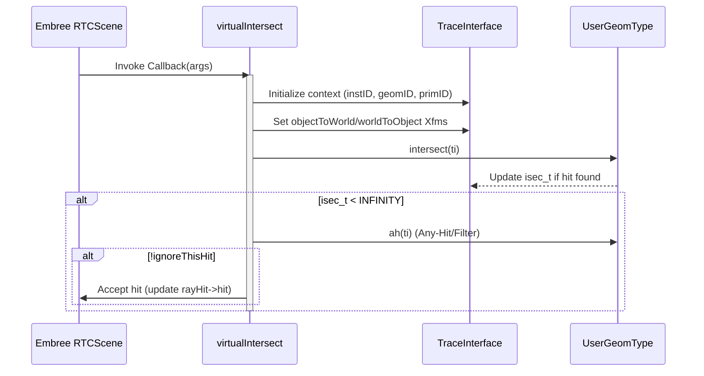

<!-- source: DeepWiki mcp.deepwiki.com · repo NVIDIA/barney · page 3.4 Embree CPU Backend · fetched 2026-10-26 -->

# Embree CPU Backend

<details>
<summary>Relevant source files</summary>

The following files were used as context for generating this wiki page:

- [rtcore/cuda/Group.h](rtcore/cuda/Group.h)
- [rtcore/embree/Denoiser.h](rtcore/embree/Denoiser.h)
- [rtcore/embree/Group.cpp](rtcore/embree/Group.cpp)
- [rtcore/embree/Group.h](rtcore/embree/Group.h)
- [rtcore/optix/Device.cpp](rtcore/optix/Device.cpp)
- [rtcore/optix/Group.cpp](rtcore/optix/Group.cpp)
- [rtcore/optix/Group.h](rtcore/optix/Group.h)

</details>


The Embree CPU backend provides a high-performance ray tracing implementation for Barney on x86 and ARM architectures. It leverages Intel's Embree library to handle acceleration structure construction and ray traversal. This backend is encapsulated within the `rtc::embree` namespace and implements the core `rtcore` interfaces for devices, geometries, and groups.

## Architecture Overview

The Embree backend mirrors the structure of Barney's GPU backends but operates entirely in host memory using SIMD-optimized kernels. It supports various ISA targets including SSE4.2, AVX2, AVX-512, and NEON via Embree's internal abstraction.

### System Mapping: Code Entity Space

The following diagram illustrates how high-level Barney concepts map to specific Embree backend implementation classes.

**Embree Backend Entity Map**
```mermaid
graph TD
    subgraph "rtcore Interface"
        RTCDevice["rtc::Device"]
        RTCGroup["rtc::Group"]
        RTCGeom["rtc::Geom"]
    end

    subgraph "Embree Implementation (rtc::embree)"
        EDevice["embree::Device"]
        EGroup["embree::Group"]
        EGeom["embree::Geom"]
        ETriGroup["embree::TrianglesGroup"]
        EUserGroup["embree::UserGeomGroup"]
        EInstGroup["embree::InstanceGroup"]
    end

    subgraph "Intel Embree C API"
        RTCDevice_t["RTCDevice"]
        RTCScene_t["RTCScene"]
        RTCGeometry_t["RTCGeometry"]
    end

    RTCDevice --> EDevice
    RTCGroup --> EGroup
    RTCGeom --> EGeom

    EDevice -->|owns| RTCDevice_t
    EGroup -->|owns| RTCScene_t
    EGeom -->|references| RTCGeometry_t
    
    EGroup <|-- ETriGroup
    EGroup <|-- EUserGroup
    EGroup <|-- EInstGroup
```
Sources: [rtcore/embree/Device.h:10-30](), [rtcore/embree/Group.h:12-29](), [rtcore/embree/Group.h:47-79]()

---

## Device and Resource Management

The `embree::Device` class manages the lifetime of the underlying `RTCDevice` handle. Unlike GPU backends that manage VRAM, the Embree backend works with standard system memory.

- **Initialization**: Creates an `RTCDevice` which serves as the factory for all other Embree objects.
- **Denoising**: If `BARNEY_OIDN_CPU` is enabled, the device can create a `DenoiserOIDN` which utilizes Intel Open Image Denoise (OIDN) [rtcore/embree/Denoiser.h:34-49]().
- **Synchronization**: Since CPU execution is generally synchronous relative to the host, `Device::sync()` typically ensures all pending background tasks (like BVH builds) are completed.

Sources: [rtcore/embree/Denoiser.h:16-30](), [rtcore/embree/Denoiser.h:34-49]()

---

## Geometry and Group Hierarchy

The backend organizes scene data into `Group` objects, which correspond to `RTCScene` handles in Embree.

### Geometry Types
1. **Triangles**: Implemented via `TrianglesGroup`. It creates `RTC_GEOMETRY_TYPE_TRIANGLE` geometries and attaches shared buffers for indices and vertices [rtcore/embree/Group.cpp:136-168]().
2. **User Geometry**: Implemented via `UserGeomGroup`. It uses `RTC_GEOMETRY_TYPE_USER` and requires the definition of bounds and intersection callbacks [rtcore/embree/Group.cpp:91-118]().

### Acceleration Structure Building
The `buildAccel()` function is responsible for committing geometries to the `RTCScene`.

- For **Triangles**, vertex and index buffers are wrapped in `RTCBuffer` objects using `rtcNewSharedBuffer` to avoid data duplication [rtcore/embree/Group.cpp:142-158]().
- For **User Geometries**, the backend registers `virtualBoundsFunc` and `virtualIntersect` to handle custom intersection logic [rtcore/embree/Group.cpp:107-110]().

### Instancing
`InstanceGroup` manages a collection of other groups with associated affine transformations. It creates `RTC_GEOMETRY_TYPE_INSTANCE` geometries.
- It maintains both `xfms` (Object-to-World) and `inverseXfms` (World-to-Object) [rtcore/embree/Group.h:76-77]().
- The `inverseXfms` are computed during `buildAccel()` using `rcp(xfm)` [rtcore/embree/Group.cpp:198-200]().

Sources: [rtcore/embree/Group.h:47-79](), [rtcore/embree/Group.cpp:91-118](), [rtcore/embree/Group.cpp:127-170](), [rtcore/embree/Group.cpp:186-205]()

---

## Data Flow: Intersection Callbacks

For non-triangle primitives (User Geometry), the Embree backend bridges the Embree callback mechanism to Barney's `TraceInterface`.

**Intersection Callback Flow**


### Implementation Details
- **`virtualBoundsFunc`**: Extracts the geometry data and calls the primitive-specific bounds function to populate the `RTCBounds` structure [rtcore/embree/Group.cpp:15-32]().
- **`virtualIntersect`**: 
    - Maps the `RTCIntersectFunctionNArguments` to a Barney `TraceInterface` [rtcore/embree/Group.cpp:43-50]().
    - Retrieves the instance transformations from the `InstanceGroup` using the `instID` provided by the Embree context [rtcore/embree/Group.cpp:51-54]().
    - Executes the user-defined intersection logic and optionally an "any-hit" filter [rtcore/embree/Group.cpp:60-78]().

Sources: [rtcore/embree/Group.cpp:15-32](), [rtcore/embree/Group.cpp:34-79]()

---

## CPU Denoising

The backend includes a stub/wrapper for OIDN (Open Image Denoise). 

- **DenoiserOIDN**: Manages an `OIDNDevice` and `OIDNFilter` [rtcore/embree/Denoiser.h:47-48]().
- **Data Buffers**: It tracks input RGBA, normals, and output RGBA buffers [rtcore/embree/Denoiser.h:22-24]().
- **Upscaling**: Supports an `upscaleMode` which allows rendering at a lower resolution and upscaling during the denoising pass [rtcore/embree/Denoiser.h:28-29]().

Sources: [rtcore/embree/Denoiser.h:16-50]()

---

