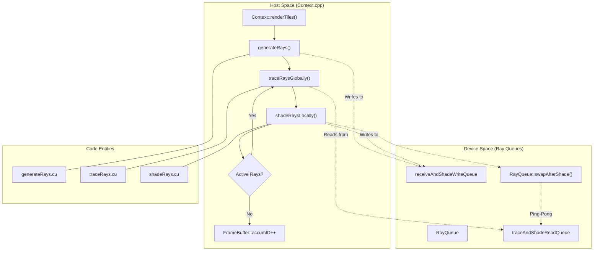
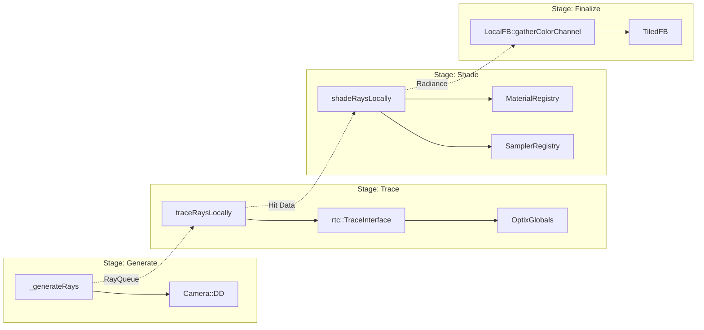

<!-- source: DeepWiki mcp.deepwiki.com · repo NVIDIA/barney · page 4 Rendering Pipeline · fetched 2026-10-26 -->

# Rendering Pipeline

Relevant source files

The following files were used as context for generating this wiki page:

- [barney/Context.cpp](barney/Context.cpp)
- [barney/fb/LocalFB.cpp](barney/fb/LocalFB.cpp)
- [barney/kernels/generateRays.cu](barney/kernels/generateRays.cu)
- [barney/kernels/traceRays.cu](barney/kernels/traceRays.cu)
- [barney/kernels/traceRays.dev.cu](barney/kernels/traceRays.dev.cu)
- [barney/render/RayQueue.cpp](barney/render/RayQueue.cpp)
- [rtcore/cuda/ComputeInterface.h](rtcore/cuda/ComputeInterface.h)

The Barney rendering pipeline is a high-performance, wave-front path tracing architecture designed for distributed multi-GPU and MPI environments. It manages the lifecycle of rays from initial generation to final framebuffer accumulation through a series of specialized kernels and global distribution strategies.

### Pipeline Execution Flow

The top-level rendering loop is orchestrated by `Context::renderTiles` [barney/Context.cpp:142-185](). For each sample per pixel (controlled by `renderer->pathsPerPixel`), the pipeline executes the following sequence:

1.  **Ray Generation**: Primary rays are created based on the camera model and assigned to a wave-front queue.
2.  **Global Trace Loop**: A loop continues until all rays in the current wave-front have either escaped the scene or reached a termination criterion (e.g., maximum bounces).
    *   **Trace**: Rays are intersected against the scene geometry (BVH).
    *   **Shade**: Hit points are evaluated, materials are sampled, and new secondary rays are generated.
3.  **Accumulation**: Radiance results are written to the `FrameBuffer` and accumulated over time.

The following diagram illustrates the relationship between the host-side orchestration and the device-side data structures:

**Rendering Pipeline: Host Orchestration to Device Entities**

**Sources:** [barney/Context.cpp:142-185](), [barney/render/RayQueue.cpp:71-97](), [barney/render/RayQueue.h:10-125]()

---

## 4.1 Ray Generation and Camera Models
The pipeline begins with `_generateRays`, a CUDA kernel that operates on image tiles [barney/kernels/generateRays.cu:44-67](). Each thread in a tile generates a primary ray based on the active `Camera::DD` configuration. Barney supports several camera models, including perspective (with depth-of-field), orthographic, and omnidirectional [barney/kernels/generateRays.cu:93-145]().

The `accumID` is used to drive progressive rendering, providing the seed for random jittering of pixel samples and lens positions to achieve anti-aliasing and motion blur [barney/kernels/generateRays.cu:84-91]().

For details, see [Ray Generation and Camera Models](#4.1).

**Sources:** [barney/kernels/generateRays.cu:44-145](), [barney/Camera.h:1-50]()

---

## 4.2 Global Trace Strategies
Because Barney is designed for large-scale data that may be distributed across multiple GPUs or MPI ranks, tracing is managed by the `GlobalTraceImpl` abstraction [barney/Context.cpp:191-197](). 

Depending on the configuration, Barney employs different strategies:
*   **Local**: Rays stay on the local GPU (single-GPU).
*   **MPI/All2All**: Rays are forwarded to the specific GPU/node that contains the part of the model they need to intersect.

This stage ensures that regardless of where the data lives, every ray in the `RayQueue` finds its intersection [barney/render/RayQueue.cpp:45-61]().

For details, see [Global Trace Strategies](#4.2).

**Sources:** [barney/Context.cpp:191-197](), [barney/render/RayQueue.cpp:45-61]()

---

## 4.3 Shading and Path Tracing
Once rays have been traced and hit points found, `shadeRaysLocally` is invoked [barney/Context.cpp:172](). The shading kernel evaluates the Material BSDFs, calculates direct lighting, and determines if a path should continue. 

Key aspects of this stage include:
*   **Ray/PathState**: Tracking the throughput and state of each path [barney/render/Ray.h:1-100]().
*   **Shadow Rays**: Secondary rays used for occlusion testing.
*   **Volume Scattering**: Handling interactions with volumetric data using Woodcock tracking or similar techniques.

For details, see [Shading and Path Tracing](#4.3).

**Sources:** [barney/Context.cpp:172](), [barney/render/Ray.h:1-100]()

---

## 4.4 Framebuffer Management
The `FrameBuffer` class hierarchy manages the storage and accumulation of rendered pixels. In distributed modes, `TiledFB` handles local tile storage, while `DistFB` manages the final compositing of tiles across MPI ranks [barney/fb/FrameBuffer.h:1-100]().

The pipeline supports multiple auxiliary channels (depth, normals, object IDs) and handles the final conversion from linear color space to sRGB for display [barney/fb/LocalFB.cpp:60-70]().

For details, see [Framebuffer Management](#4.4).

**Sources:** [barney/fb/LocalFB.cpp:60-70](), [barney/fb/FrameBuffer.h:1-100]()

---

### System Entity Mapping

The following diagram maps high-level pipeline stages to the specific classes and kernels that implement them.

**Pipeline Stage to Code Entity Mapping**

**Sources:** [barney/kernels/generateRays.cu:44-67](), [barney/kernels/traceRays.cu:16-19](), [barney/fb/LocalFB.cpp:60-70](), [barney/render/OptixGlobals.h:1-50]()

---

