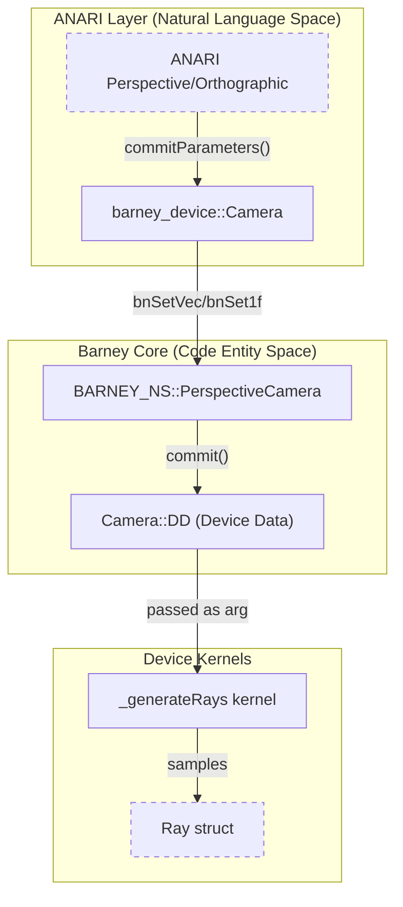
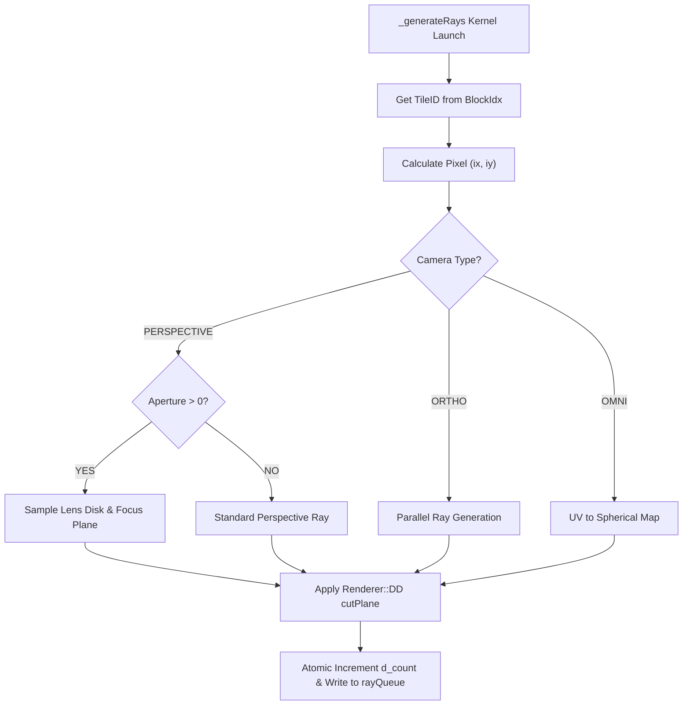

<!-- source: DeepWiki mcp.deepwiki.com · repo NVIDIA/barney · page 4.1 Ray Generation and Camera Models · fetched 2026-10-26 -->

# Ray Generation and Camera Models

Relevant source files

The following files were used as context for generating this wiki page:

- [anari/Camera.cpp](anari/Camera.cpp)
- [anari/Camera.h](anari/Camera.h)
- [barney/Camera.cu](barney/Camera.cu)
- [barney/Camera.h](barney/Camera.h)
- [barney/kernels/generateRays.cu](barney/kernels/generateRays.cu)
- [barney/kernels/traceRays.cu](barney/kernels/traceRays.cu)

The ray generation stage is the entry point of the rendering pipeline, responsible for transforming 2D image coordinates into 3D rays based on the camera model. Barney uses a tiled rendering approach where primary rays are generated per-tile and injected into a ray queue for subsequent intersection and shading.

## Ray Generation Overview

Ray generation is implemented as a GPU kernel that processes a set of frame buffer tiles. Each CUDA block typically handles one tile, and each thread within the block generates one or more rays for a specific pixel.

### Tile-Based Generation
Rays are generated only for the tiles owned by the local device [barney/kernels/generateRays.cu:62-65](). The kernel `_generateRays` iterates through `TileDesc` structures to determine the screen-space offsets for each pixel [barney/kernels/generateRays.cu:72-78]().

### Data Flow: Host to Device
The following diagram illustrates how camera parameters flow from the ANARI API layer through the Barney core into the ray generation kernel.

**Camera Data Flow Diagram**

Sources: [anari/Camera.cpp:127-146](), [barney/Camera.cu:81-100](), [barney/kernels/generateRays.cu:44-47]()

## Camera Models and Device Data

Barney uses a unified device-side structure `Camera::DD` to represent different camera types without requiring virtual function calls on the GPU [barney/Camera.h:22-27]().

### Camera::DD Structure
The `Camera::DD` struct contains a `Type` enum and a union of configuration structs for each supported model [barney/Camera.h:32-62]():

| Camera Type | Key Parameters in `Camera::DD` | Description |
| :--- | :--- | :--- |
| `PERSPECTIVE` | `dir_00`, `dir_du`, `dir_dv`, `lens_00`, `apertureRadius`, `focusDistance` | Standard pinhole or Depth-of-Field camera. |
| `ORTHOGRAPHIC` | `org_00`, `org_du`, `org_dv`, `dir`, `height`, `aspect` | Parallel projection camera. |
| `OMNIDIRECTIONAL`| `toWorld` (affine3f) | Equirectangular (360-degree) projection. |

Sources: [barney/Camera.h:34-62]()

### Perspective and Depth of Field (DOF)
For perspective cameras, Barney calculates the ray direction by interpolating across the focal plane using `dir_du` and `dir_dv` [barney/kernels/generateRays.cu:96-99](). If `apertureRadius > 0.f`, the kernel implements a thin-lens model:
1.  A random point is sampled on a disk representing the lens [barney/kernels/generateRays.cu:113-120]().
2.  The ray origin is shifted to this lens point [barney/kernels/generateRays.cu:124]().
3.  The ray direction is recalculated to pass through the point on the focal plane at `focusDistance` [barney/kernels/generateRays.cu:107-125]().

### Omnidirectional (Equirectangular)
The omnidirectional camera maps the [0,1] normalized image coordinates to spherical coordinates ($\phi, \theta$) [barney/kernels/generateRays.cu:32-33](). These are converted to a unit vector in world space using the camera's `toWorld` transformation matrix [barney/kernels/generateRays.cu:143-144]().

## Progressive Rendering and Accumulation

Barney achieves progressive refinement through an `accumID` (accumulation ID).

*   **Jittering**: For `accumID > 0`, the kernel applies a random jitter to the pixel coordinates (anti-aliasing) and the lens sample (DOF) [barney/kernels/generateRays.cu:88-89]().
*   **Initial Sample**: For `accumID == 0`, the kernel samples the exact center of the pixel and the center of the lens to provide a clean, deterministic first frame [barney/kernels/generateRays.cu:88-89](), [barney/kernels/generateRays.cu:110-111]().
*   **Randomness**: The `Random` sampler is seeded using a combination of the pixel coordinates and the `accumID` to ensure unique samples per frame [barney/kernels/generateRays.cu:84-85]().

## Cutting Planes

The ray generation kernel also handles the global cutting plane. If a cutting plane is defined in the `Renderer::DD` struct [barney/kernels/generateRays.cu:172](), the generated ray is clipped:
*   If the camera is on the visible side, the ray's `tMax` is restricted where it exits the half-space [barney/kernels/generateRays.cu:180-183]().
*   If the camera is on the invisible side, the ray origin is advanced to the plane's intersection point so that interior geometry becomes visible [barney/kernels/generateRays.cu:188-190]().

**Ray Generation Logic Flow**

Sources: [barney/kernels/generateRays.cu:71-192]()

## Implementation Details

### Ray and PathState Initialization
The kernel initializes the `Ray` and `PathState` structures for each pixel. This includes clearing hit information, setting `tMax` to infinity, and initializing the `rngSeed` for subsequent path tracing bounces [barney/kernels/generateRays.cu:80-86](), [barney/kernels/generateRays.cu:167-170]().

### Debugging Features
The kernel supports per-pixel debugging. If `enablePerRayDebug` is active, rays corresponding to the center of the screen are flagged with `_dbg` or `crosshair` bits, allowing shading kernels to print diagnostic information for specific pixels [barney/kernels/generateRays.cu:152-163]().

Sources: [barney/kernels/generateRays.cu:1-192](), [barney/Camera.cu:1-255](), [barney/Camera.h:1-75](), [anari/Camera.cpp:1-151]()

---

