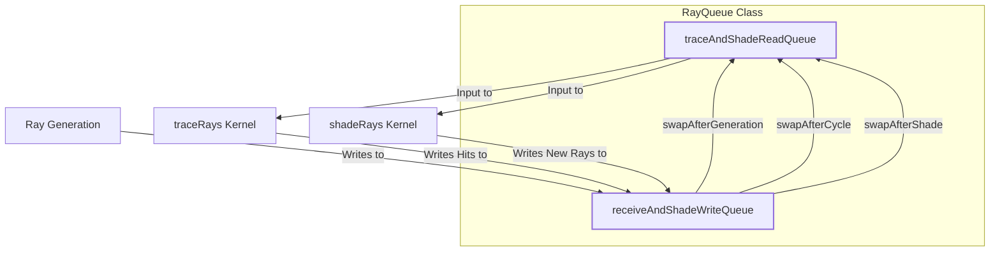
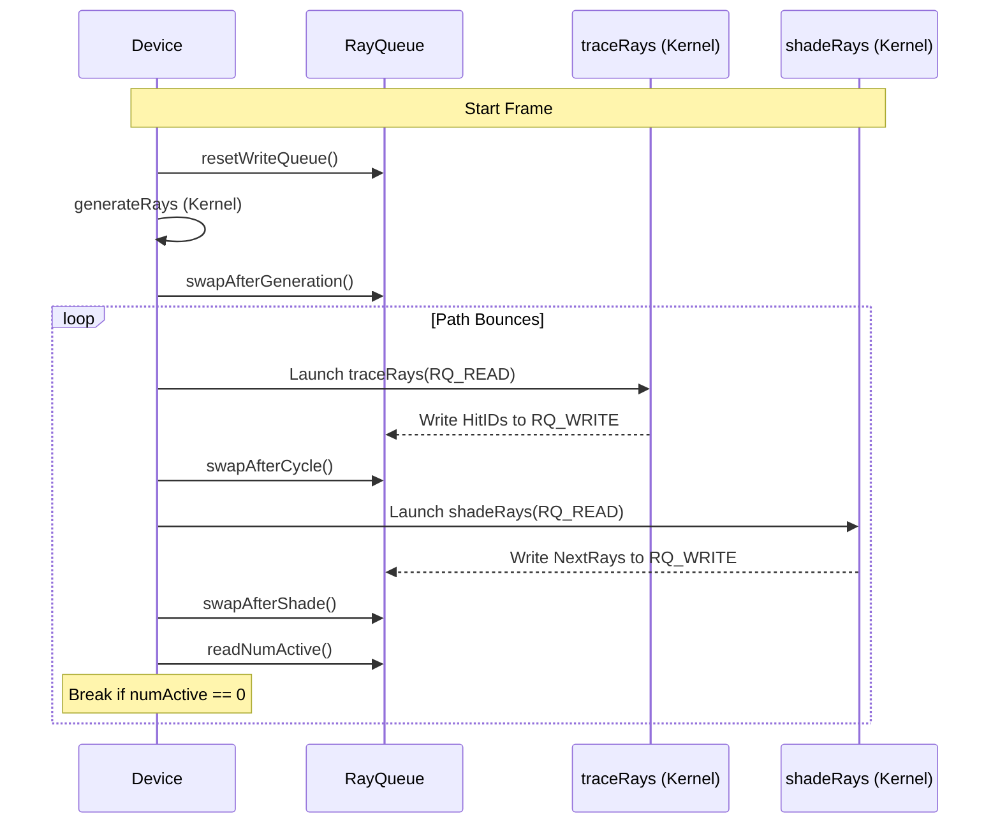

<!-- source: DeepWiki mcp.deepwiki.com · repo NVIDIA/barney · page 4.2 Global Trace Strategies · fetched 2026-10-26 -->

# Global Trace Strategies

Relevant source files

The following files were used as context for generating this wiki page:

- [barney/DeviceGroup.cpp](barney/DeviceGroup.cpp)
- [barney/DeviceGroup.h](barney/DeviceGroup.h)
- [barney/WorkerTopo.cpp](barney/WorkerTopo.cpp)
- [barney/geometry/IsoSurface.h](barney/geometry/IsoSurface.h)
- [barney/kernels/shadeRays.cu](barney/kernels/shadeRays.cu)
- [barney/render/RayQueue.cpp](barney/render/RayQueue.cpp)
- [barney/render/World.cpp](barney/render/World.cpp)
- [rtcore/embree/AppInterface.h](rtcore/embree/AppInterface.h)

Global trace strategies in Barney manage the distribution and execution of ray tracing across multiple GPUs and MPI ranks. This subsystem is encapsulated by the `GlobalTraceImpl` abstraction, which coordinates how rays are generated, forwarded to the appropriate data groups (islands), and shaded.

## GlobalTraceImpl Abstraction

The tracing process is decoupled from the specific rendering kernel to support different multi-GPU and MPI topologies. The system uses a "Ray Queue" mechanism where rays are stored in device memory buffers and processed in cycles.

### Key Components

| Component | Description |
| :--- | :--- |
| `Device` | Represents a single hardware device (GPU or CPU core) and holds its specific `RayQueue` and `traceRays` kernel. [barney/DeviceGroup.h:34-68]() |
| `RayQueue` | Manages dual buffers (`read` and `write`) for rays, path states, and hit IDs. It allows for asynchronous double-buffering during trace/shade cycles. [barney/render/RayQueue.h:10-125]() |
| `WorkerTopo` | Defines the mapping of global ranks to "islands" (data groups). Each island contains a subset of the global scene data. [barney/WorkerTopo.cpp:9-62]() |

### Ray Queue Data Flow
The `RayQueue` class maintains two primary `SingleQueue` instances: `traceAndShadeReadQueue` and `receiveAndShadeWriteQueue`. These are swapped at specific stages of the pipeline to facilitate data movement between generation, tracing, and shading.

**Diagram: Ray Queue Buffer Swapping**

Sources: [barney/render/RayQueue.h:10-125](), [barney/DeviceGroup.h:61-62]()

---

## Implementation Strategies

Barney provides several implementations of the trace strategy depending on the execution environment (single-node vs. MPI) and the data distribution.

### 1. RQSLocal (Single-Node Local)
Used when all data fits on a single node or when no MPI-based ray exchange is required. It cycles through the ray queue locally, executing the `traceRays` and `shadeRays` kernels until all paths are terminated or reach the maximum depth.

### 2. RQSMPI (MPI-Based Forwarding)
Used in distributed-memory environments where different MPI ranks hold different parts of the scene (data-parallel).
*   **Ray Forwarding**: If a ray leaves the local data bounds or is generated for a remote island, it is serialized and sent via MPI to the rank owning that data.
*   **Queue Cycling**: The rank receives remote rays, adds them to its local `RayQueue`, traces them, and sends results back or forwards them to the next bounce destination.

### 3. TwoStage (Optimized Exchange)
An optimized strategy for high-performance clusters that separates intra-node (GPU-to-GPU via NVLink/PCIe) and inter-node (MPI) exchanges.
*   **Stage 1**: Rays are gathered locally on the node and sorted by destination rank.
*   **Stage 2**: A single large MPI exchange moves rays between nodes, minimizing the number of MPI messages.

### 4. All2all
A specialized strategy that utilizes `MPI_Alltoallv` for global ray redistribution. This is typically used when the workload is highly unbalanced or when every rank needs to communicate with every other rank in a single sync point.

---

## Execution Flow: Generation to Shading

The rendering pipeline follows a strict sequence of kernel launches and queue swaps coordinated by the selected strategy.

**Diagram: Global Trace Execution Logic**

Sources: [barney/DeviceGroup.cpp:40-69](), [barney/kernels/shadeRays.cu:1-138](), [barney/render/RayQueue.cpp:45-97]()

---

## Data Distribution and Islands

Rays are distributed across "Islands" as defined by the `WorkerTopo`. An island is a group of GPUs that collectively hold a complete copy of a specific "Data Slot".

*   **Island Size**: The number of GPUs within one data group. [barney/WorkerTopo.cpp:124-125]()
*   **Data Parallelism**: If `islandSize > 1`, Barney operates in a mode where data is replicated or partitioned within the island, and rays are traced against the local `GlobalModel`. [barney/WorkerTopo.cpp:86-89]()
*   **Global Rank**: Every device has a `_globalRank` within the `WorkerTopo`, which is used to determine which rays it is responsible for tracing. [barney/DeviceGroup.cpp:63-66]()

### Topology Discovery
The `WorkerTopo` computes the topology by hashing hostnames and physical device IDs to detect which GPUs share a physical node and which are remote.

| Function | Role |
| :--- | :--- |
| `WorkerTopo::WorkerTopo` | Maps global ranks to `islandID` and `islandRank`. [barney/WorkerTopo.cpp:10-62]() |
| `WorkerTopo::find` | Locates a device ID based on worker index and local index. [barney/WorkerTopo.cpp:128-136]() |
| `Device::worldRank` | Returns the MPI rank associated with the device. [barney/DeviceGroup.cpp:98-99]() |

Sources: [barney/WorkerTopo.cpp:10-138](), [barney/DeviceGroup.h:34-68]()

---

