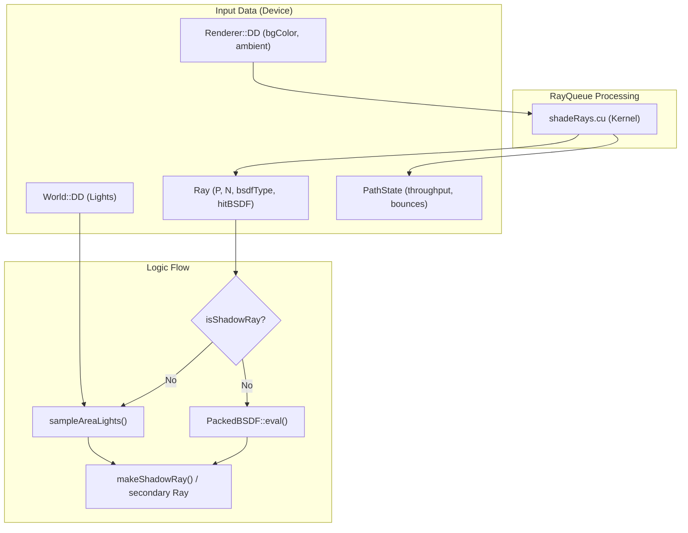
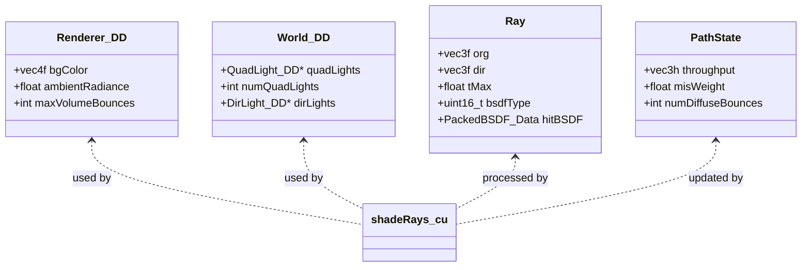

<!-- source: DeepWiki mcp.deepwiki.com · repo NVIDIA/barney · page 4.3 Shading and Path Tracing · fetched 2026-10-26 -->

# Shading and Path Tracing

Relevant source files

The following files were used as context for generating this wiki page:

- [barney/DeviceGroup.cpp](barney/DeviceGroup.cpp)
- [barney/DeviceGroup.h](barney/DeviceGroup.h)
- [barney/WorkerTopo.cpp](barney/WorkerTopo.cpp)
- [barney/geometry/IsoSurface.h](barney/geometry/IsoSurface.h)
- [barney/kernels/shadeRays.cu](barney/kernels/shadeRays.cu)
- [barney/render/GeometryAttributes.h](barney/render/GeometryAttributes.h)
- [barney/render/HitAttributes.h](barney/render/HitAttributes.h)
- [barney/render/Ray.h](barney/render/Ray.h)
- [barney/render/Renderer.cpp](barney/render/Renderer.cpp)
- [barney/render/Renderer.h](barney/render/Renderer.h)
- [rtcore/cuda/ProgramInterface.h](rtcore/cuda/ProgramInterface.h)
- [rtcore/cuda/TraceInterface.h](rtcore/cuda/TraceInterface.h)
- [rtcore/embree/AppInterface.h](rtcore/embree/AppInterface.h)

The shading subsystem in Barney is responsible for evaluating material properties, computing direct and indirect lighting, and managing the path state of rays as they traverse the scene. This process is primarily implemented in CUDA kernels that operate on ray queues, utilizing a dispatch mechanism for different Bidirectional Scattering Distribution Functions (BSDFs).

## The Shading Kernel (`shadeRays.cu`)

The core of the shading logic resides in the `shadeRays` kernel. This kernel processes rays that have successfully intersected geometry or volumes, computes the resulting radiance, and generates secondary rays (shadow rays or bounce rays) to continue the path tracing process.

### Data Flow and Interaction
The shading kernel interacts with several key device-side data structures to perform its calculations:
- **`Ray`**: Contains the physical properties of the ray (origin, direction) and hit information (intersection point $P$, normal $N$, and BSDF data).
- **`PathState`**: Maintains path-specific metadata that is not transmitted across the network in distributed modes, such as throughput and bounce counts.
- **`Renderer::DD`**: Provides global renderer configuration like ambient radiance and background colors.
- **`World::DD`**: Contains pointers to light sources (quad, directional, and point lights).

| Component | Role | Source |
| :--- | :--- | :--- |
| `shadeRays` | Main CUDA kernel for evaluating hits and sampling lights. | [barney/kernels/shadeRays.cu:13-16]() |
| `sampleAreaLights` | Samples `QuadLight` sources using a reservoir-based approach. | [barney/kernels/shadeRays.cu:47-52]() |
| `sampleDirLights` | Samples infinite directional lights. | [barney/kernels/shadeRays.cu:141-147]() |
| `Renderer::DD` | Device-side constants (background, ambient radiance, max bounces). | [barney/render/Renderer.h:20-30]() |

Sources: [barney/kernels/shadeRays.cu:13-150](), [barney/render/Renderer.h:20-30]()

## Ray and PathState Structures

Barney distinguishes between the physical ray/hit data and the logical state of the path.

### Ray Struct
The `Ray` struct [barney/render/Ray.h:49-99]() is a unified structure used for both surface and volume hits. It uses a bitfield and a union to store BSDF information efficiently.
- **`hitBSDF`**: A union `PackedBSDF::Data` that holds parameters for different material types (Lambert, PBR, etc.).
- **`bsdfType`**: A 4-bit field indicating which BSDF to evaluate.
- **`isShadowRay`**: A flag used to skip material evaluation and perform simple visibility tests.

### PathState Struct
The `PathState` struct [barney/render/Ray.h:18-26]() tracks the progression of a Monte Carlo path:
- **`throughput`**: The accumulated color/energy of the path (stored as `vec3h` half-precision).
- **`misWeight`**: The Multiple Importance Sampling weight used for balancing light sampling and BSDF sampling.
- **`numDiffuseBounces` / `numVolumeBounces`**: Counters to enforce termination criteria.

Sources: [barney/render/Ray.h:18-99]()

## PackedBSDF Dispatch Mechanism

Barney uses a "Packed BSDF" approach to handle material diversity without virtual function overhead on the GPU. The `PackedBSDF` class [barney/render/Ray.h:102-105]() acts as a wrapper around the `bsdfType` and `hitBSDF` data stored in the `Ray`.

During shading, the `bsdfType` is used to switch between different evaluation and sampling routines (e.g., `Lambertian`, `NVisii` (PBR), `Glass`, or `Phase` for volumes).

### Volume Bounces and Multi-Scattering
If `BARNEY_USE_MULTI_SCATTERING` is enabled, the shading system supports multiple scattering events within volumes.
- **`setVolumeHit`**: Configures the `Ray` with a `Phase` BSDF [barney/render/Ray.h:118-128]().
- **`numVolumeBounces`**: Tracked in `PathState` and capped by `Renderer::DD::maxVolumeBounces` [barney/render/Renderer.h:27]().

Sources: [barney/render/Ray.h:51-65](), [barney/render/Renderer.h:26-30]()

## Direct Lighting and MIS

The shading kernel performs Direct Light Sampling (Next Event Estimation) by picking light sources from the `World::DD`.

### Shadow Rays
Shadow rays are generated using the `makeShadowRay` utility [barney/render/Ray.h:153-163](). They are initialized with `isShadowRay = true` and `bsdfType = PackedBSDF::NONE`. The `tMax` is set to the distance to the light source to check for occlusions.

### Multiple Importance Sampling (MIS)
Barney implements MIS to combine BSDF sampling and light sampling [barney/kernels/shadeRays.cu:22]().
1. **Light Sampling**: A light is sampled, and a shadow ray is traced. The `misWeight` is calculated based on the light's PDF and the BSDF's PDF.
2. **BSDF Sampling**: A secondary ray is generated by sampling the BSDF. If this ray hits a light source (or the environment map), the contribution is weighted using MIS.

Sources: [barney/kernels/shadeRays.cu:20-43](), [barney/render/Ray.h:153-163]()

## Shading Implementation Diagram

The following diagram illustrates how the `shadeRays` kernel coordinates between the various device data structures and the BSDF logic.

Sources: [barney/kernels/shadeRays.cu:13-150](), [barney/render/Ray.h:49-99](), [barney/render/Renderer.h:20-30]()

## Device Data Hierarchy

This diagram maps the high-level system components to the specific C++ structs used in the shading device code.

Sources: [barney/render/Renderer.h:20-30](), [barney/render/Ray.h:18-99](), [barney/kernels/shadeRays.cu:7-12]()

---

