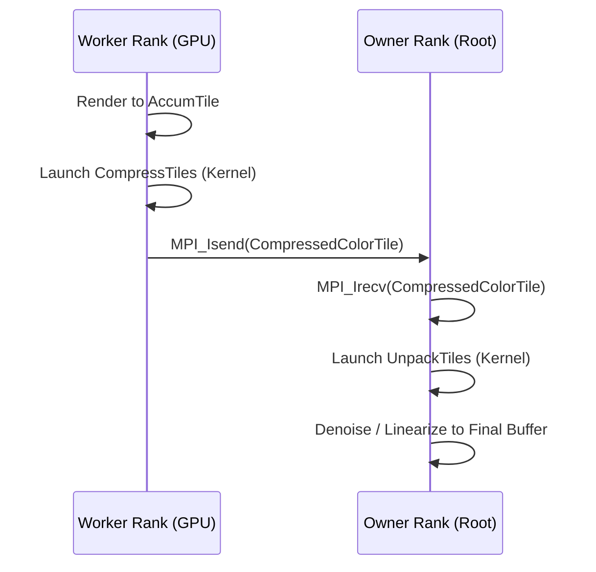

<!-- source: DeepWiki mcp.deepwiki.com · repo NVIDIA/barney · page 4.4 Framebuffer Management · fetched 2026-10-26 -->

# Framebuffer Management

<details>
<summary>Relevant source files</summary>

The following files were used as context for generating this wiki page:

- [anari/Frame.h](anari/Frame.h)
- [anari/Geometry.cpp](anari/Geometry.cpp)
- [anari/Sampler.cpp](anari/Sampler.cpp)
- [anari/Sampler.h](anari/Sampler.h)
- [anari/SpatialField.cpp](anari/SpatialField.cpp)
- [anari/common.h](anari/common.h)
- [barney/Context.cpp](barney/Context.cpp)
- [barney/common/Data.cpp](barney/common/Data.cpp)
- [barney/fb/DistFB.cu](barney/fb/DistFB.cu)
- [barney/fb/FrameBuffer.cu](barney/fb/FrameBuffer.cu)
- [barney/fb/FrameBuffer.h](barney/fb/FrameBuffer.h)
- [barney/fb/LocalFB.cpp](barney/fb/LocalFB.cpp)
- [barney/fb/TiledFB.cu](barney/fb/TiledFB.cu)
- [barney/kernels/traceRays.dev.cu](barney/kernels/traceRays.dev.cu)
- [rtcore/cuda/ComputeInterface.h](rtcore/cuda/ComputeInterface.h)

</details>


The Barney framebuffer system manages the storage, accumulation, and finalization of rendered pixels across multiple GPUs and MPI ranks. It utilizes a hierarchical approach to handle distributed data: pixels are initially rendered into tiled accumulation buffers on individual GPUs, then linearized, potentially denoised or upscaled, and finally gathered into a contiguous format for application access.

## Framebuffer Hierarchy

Barney implements a three-tier hierarchy for framebuffer management, abstracting the complexities of multi-GPU and MPI-based rendering.

| Class | Role | Implementation Detail |
| :--- | :--- | :--- |
| `TiledFB` | **Per-GPU Storage** | Manages `AccumTile` and `AuxChannelTile` arrays on a single device. Handles local linearization. |
| `LocalFB` | **Single-Node Aggregator** | Coordinates multiple `TiledFB` instances on one node. Used for single-node multi-GPU setups. |
| `DistFB` | **Distributed Aggregator** | Extends `FrameBuffer` for MPI. Manages tile compression and gathering across the network to a root rank. |

### Data Flow and Code Entities

The following diagram illustrates the relationship between the ANARI layer, the Barney API, and the internal framebuffer classes.

**Diagram: Framebuffer Entity Relationships**
```mermaid
graph TD
    subgraph "ANARI Layer"
        A["barney_device::Frame"] -- "manages" --> B["BNFrameBuffer (Handle)"]
    end

    subgraph "Barney Core (barney/fb)"
        B -- "points to" --> C["BARNEY_NS::FrameBuffer"]
        C <|-- D["BARNEY_NS::LocalFB"]
        C <|-- E["BARNEY_NS::DistFB"]
        
        D -- "contains" --> F["BARNEY_NS::TiledFB"]
        E -- "contains" --> F
    end

    subgraph "Device Storage"
        F -- "manages" --> G["AccumTile (Color/Normal)"]
        F -- "manages" --> H["AuxChannelTile (Depth/ID)"]
    end
```
Sources: [barney/fb/FrameBuffer.h:14-18](), [barney/fb/TiledFB.h:171-180](), [anari/Frame.h:96-96](), [barney/fb/LocalFB.h:9-12](), [barney/fb/DistFB.h:117-118]()

---

## Tile Layout and Linearization

Rendering in Barney is tile-based to optimize GPU utilization and ray coherence. Each tile is typically 16x16 pixels (`tileSize` is defined as 16).

### Tiled Storage
- **`AccumTile`**: Stores `vec4f` accumulation data and `vec3f` normals for a single tile [barney/fb/TiledFB.h:25-36]().
- **`AuxChannelTile`**: Stores `uint32_t` or `float` data for auxiliary channels like Depth, Primitive ID, Instance ID, and Object ID [barney/fb/TiledFB.h:40-45]().

### Linearization Kernels
Linearization is the process of moving data from these tiles into a linear (row-major) array. This is handled by specialized CUDA/RTC kernels:

1.  **`linearizeColorAndNormalKernel`**: Takes `AccumTile` data, applies an accumulation scale (`1/accumID`), and writes to the output buffer. It supports `BN_FLOAT4`, `BN_UFIXED8_RGBA`, and `BN_UFIXED8_RGBA_SRGB` formats [barney/fb/TiledFB.cu:13-50]().
2.  **`linearizeAuxTilesKernel`**: Directly maps `AuxChannelTile` data to the linear output [barney/fb/TiledFB.cu:88-107]().

Sources: [barney/fb/TiledFB.cu:13-50](), [barney/fb/TiledFB.cu:88-107](), [barney/fb/TiledFB.h:25-45]()

---

## Auxiliary Channels

Barney supports several auxiliary channels for visualization and post-processing. These are managed as bitmask flags during the `BNFrameBuffer` resize operation [barney/fb/FrameBuffer.h:31-33]().

| Channel Flag | Data Type | Description |
| :--- | :--- | :--- |
| `BN_FB_DEPTH` | `float` | Z-buffer depth. |
| `BN_FB_PRIMID` | `uint32_t` | Primitive ID at the hit point. |
| `BN_FB_OBJID` | `uint32_t` | Object ID (user-defined). |
| `BN_FB_INSTID` | `uint32_t` | Instance ID for instanced geometry. |
| `BN_FB_NORMAL` | `vec3f` | Shading normals (used for denoising). |

Auxiliary channels are gathered via `gatherAuxChannel` and written to application memory using `writeAuxChannel` [barney/fb/LocalFB.cpp:82-89]().

Sources: [barney/fb/FrameBuffer.h:31-33](), [barney/common/Data.cpp:133-147](), [barney/fb/LocalFB.cpp:82-89]()

---

## Color Space and Post-Processing

The `FrameBuffer::finalizeFrame` method coordinates the final steps before the image is presented to the user.

### Color Space Conversion
Barney performs linear-to-sRGB conversion within the linearization kernels if requested. The `linear_to_srgb` function is applied to the `vec4f` accumulation result before quantizing to `ufixed8` [barney/fb/TiledFB.cu:42-43]().

### Denoising and Upscaling
Barney integrates with NVIDIA OptiX Denoiser and Open Image Denoise (OIDN).
- **Denoising**: If `enableDenoising` is true, the `rtc::Denoiser` is invoked on the gathered linear color and normal channels [barney/fb/FrameBuffer.cu:193-209]().
- **AI Upscaling**: Barney supports 2x nearest-neighbor upscaling. If `enableUpscaling` is active, the renderer works at half-resolution, and kernels like `upscale2xVec4fKernel` expand the result to the final display size [barney/fb/FrameBuffer.cu:171-183]().

Sources: [barney/fb/FrameBuffer.cu:185-225](), [barney/fb/TiledFB.cu:42-43](), [barney/fb/FrameBuffer.h:130-142]()

---

## Distributed Framebuffer (MPI)

In MPI configurations, `DistFB` handles the collection of tiles from worker nodes to the "owner" (root) rank.

### Tile Compression
To reduce network traffic, tiles are compressed before transmission.
- **`CompressTiles`**: A kernel that calculates a scale factor for each tile and packs color into `rgba8` [barney/fb/DistFB.cu:82-110]().
- **`UnpackTiles`**: A kernel on the owner rank that decompresses the tiles back into linear `float4` or `rgba8` [barney/fb/DistFB.cu:25-80]().

### MPI Gathering Logic
The `DistFB::gatherColorChannel` method manages asynchronous MPI communication:
1.  **Workers**: Launch `CompressTiles` on their local GPUs and use `MPI_Isend` to send `CompressedColorTile` data to the owner [barney/fb/DistFB.cu:169-197]().
2.  **Owner**: Prepares `MPI_Irecv` buffers for all expected tiles from all GPUs in the cluster. Once received, it launches `UnpackTiles` to assemble the final image [barney/fb/DistFB.cu:131-167]().

**Diagram: Distributed Gathering Process**

Sources: [barney/fb/DistFB.cu:122-197](), [barney/fb/DistFB.h:47-65]()

---

