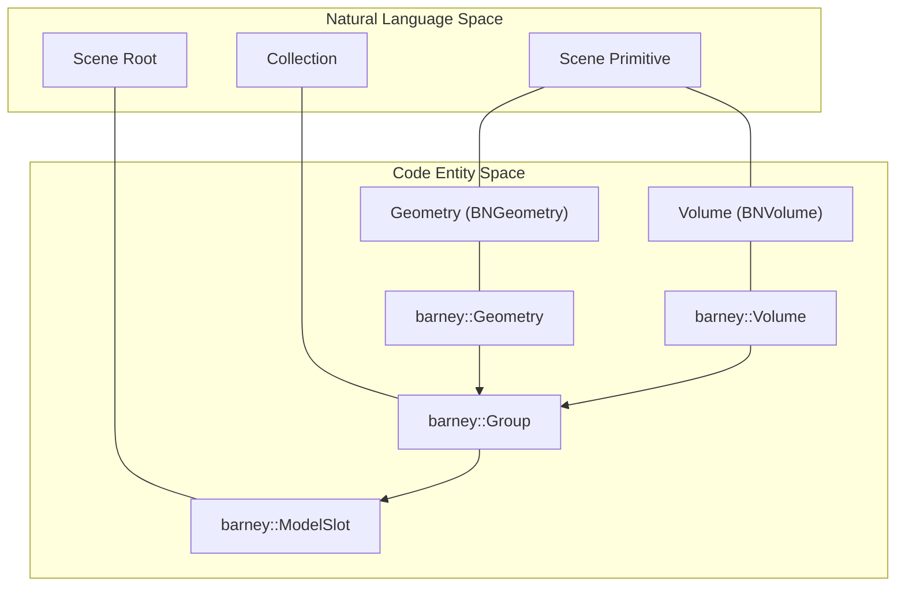
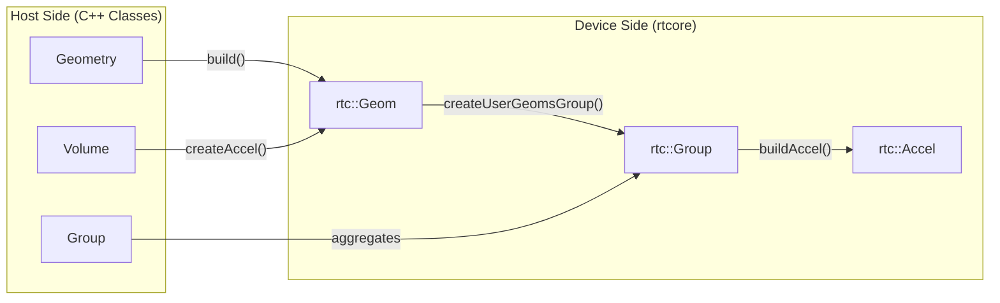

<!-- source: DeepWiki mcp.deepwiki.com · repo NVIDIA/barney · page 5 Scene Objects and Geometry · fetched 2026-10-26 -->

# Scene Objects and Geometry

Relevant source files

The following files were used as context for generating this wiki page:

- [barney/Group.cpp](barney/Group.cpp)
- [barney/amr/BlockStructuredCuBQLSampler.cu](barney/amr/BlockStructuredCuBQLSampler.cu)
- [barney/amr/BlockStructuredCuBQLSampler.h](barney/amr/BlockStructuredCuBQLSampler.h)
- [barney/amr/BlockStructuredField.cu](barney/amr/BlockStructuredField.cu)
- [barney/amr/BlockStructuredMC.dev.cu](barney/amr/BlockStructuredMC.dev.cu)
- [barney/common/CuBQL.h](barney/common/CuBQL.h)
- [barney/geometry/Geometry.cpp](barney/geometry/Geometry.cpp)
- [barney/geometry/Geometry.h](barney/geometry/Geometry.h)
- [barney/geometry/IsoSurface.cpp](barney/geometry/IsoSurface.cpp)
- [barney/umesh/mc/UMeshCuBQLSampler.cu](barney/umesh/mc/UMeshCuBQLSampler.cu)
- [barney/volume/MCAccelerator.h](barney/volume/MCAccelerator.h)

Barney organizes scene data through a hierarchical structure of geometries, volumes, and groups, culminating in a top-level model. The system is designed to handle large-scale data by distributing these objects across multiple GPUs and MPI ranks. This page provides a high-level overview of how these objects are defined, how they are aggregated, and how the underlying Ray Tracing Core (rtcore) acceleration structures (BVHs) are built.

### Object Hierarchy Overview

The scene hierarchy follows a "bottom-up" construction logic where primitive geometries and volumes are aggregated into groups, which are then referenced by a model.

1.  **Geometries and Volumes**: The base primitives (Triangles, Spheres, Scalar Fields, etc.).
2.  **Groups**: Containers that aggregate multiple geometries and volumes [barney/Group.cpp:19-29]().
3.  **Models**: The top-level scene container that manages the global acceleration structure.

### Scene Entity Relationship

The following diagram illustrates the relationship between the natural language concepts and the C++ classes within the Barney codebase.

Sources: [barney/geometry/Geometry.h:31-45](), [barney/Group.cpp:19-29](), [barney/ModelSlot.h:1-20]()

---

## Geometry and Acceleration

Barney supports both hardware-native primitives (Triangles) and custom primitives (User Geometries) such as spheres, cylinders, and iso-surfaces [barney/geometry/Geometry.cpp:26-41]().

### Geometry Management
The `barney::Geometry` class acts as the base for all geometric primitives. It manages per-device data through the `PLD` (Per Logical Device) structure, ensuring that each GPU in a `DevGroup` has its own local handles to the underlying `rtc::Geom` objects [barney/geometry/Geometry.h:83-89]().

### BVH Construction
Acceleration structures are built lazily. When `bnBuild` is called, it triggers the `build()` method on groups and geometries. 
- **Triangles**: Use the backend's native BVH builder (e.g., OptiX/Embree) [barney/Group.cpp:121-126]().
- **User Geometries**: Require a `boundsProg` to define primitive boundaries and an `isProg` for intersection logic [barney/volume/MCAccelerator.h:65-75]().
- **Volumes**: Often use a "Macro-Cell" (MC) accelerator, which builds a grid-based BVH to skip empty space [barney/volume/MCAccelerator.h:25-32]().

For details on specific primitives and their intersection programs, see [Geometry Types](#5.1).

---

## Scene Hierarchy: Groups and Models

Groups are the primary mechanism for spatial organization and data distribution in Barney.

### BNGroup
A `barney::Group` aggregates `barney::Geometry` and `barney::Volume` objects [barney/Group.cpp:19-29](). Internally, it separates these into `triangleGeomGroup` and `userGeomGroup` to optimize how the Ray Tracing Core handles different primitive types [barney/Group.cpp:68-85]().

### BNModel and Instancing
The `ModelSlot` (representing a `BNModel`) serves as the root of the scene. It can contain instances of groups, allowing for memory-efficient repetition of geometry. In distributed modes, different parts of the model may reside on different data groups.

### System Data Flow

The following diagram shows how high-level geometry definitions are processed into device-side Ray Tracing Core (RTC) objects.

Sources: [barney/geometry/Geometry.cpp:71-84](), [barney/Group.cpp:88-127](), [barney/volume/MCAccelerator.h:183-200]()

For details on how transforms, instances, and MPI-based model distribution work, see [Scene Hierarchy: Groups, Models, and Instances](#5.2).

---

## Volume Acceleration Structures

Volumes in Barney are not just data grids; they are integrated into the scene as "User Geometries." 

- **Macro-Cell Grids**: Classes like `MCVolumeAccel` and `MCIsoSurfaceAccel` create a specialized BVH over a grid of min/max scalar values to accelerate ray marching [barney/volume/MCAccelerator.h:25-32]().
- **Spatial Samplers**: For unstructured or AMR (Adaptive Mesh Refinement) data, Barney uses `cuBQL` to build spatial index structures (Wide BVHs) that facilitate fast point-in-cell lookups [barney/amr/BlockStructuredCuBQLSampler.h:19-29]().

| Feature | Implementation Class | Primary Purpose |
| :--- | :--- | :--- |
| **Space Skipping** | `MCGrid` | Skip transparent regions in volumes [barney/volume/MCGrid.h]() |
| **Point Lookup** | `cuBQL::WideBVH` | Fast sampling in AMR/Unstructured data [barney/amr/BlockStructuredCuBQLSampler.h:21]() |
| **Intersection** | `DDA` | Digital Differential Analyzer for grid traversal [barney/volume/DDA.h]() |

Sources: [barney/volume/MCAccelerator.h:25-32](), [barney/amr/BlockStructuredCuBQLSampler.cu:37-84](), [barney/amr/BlockStructuredField.cu:80-119]()

---

