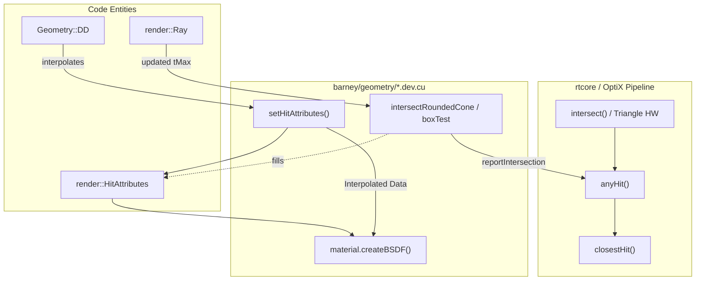
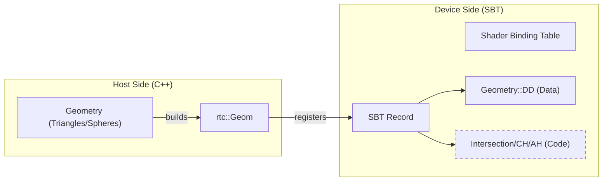

<!-- source: DeepWiki mcp.deepwiki.com · repo NVIDIA/barney · page 5.1 Geometry Types · fetched 2026-10-26 -->

# Geometry Types

Relevant source files

The following files were used as context for generating this wiki page:

- [barney/amr/BlockStructuredCuBQLSampler.cu](barney/amr/BlockStructuredCuBQLSampler.cu)
- [barney/amr/BlockStructuredCuBQLSampler.h](barney/amr/BlockStructuredCuBQLSampler.h)
- [barney/amr/BlockStructuredField.cu](barney/amr/BlockStructuredField.cu)
- [barney/amr/BlockStructuredMC.dev.cu](barney/amr/BlockStructuredMC.dev.cu)
- [barney/common/CuBQL.h](barney/common/CuBQL.h)
- [barney/geometry/Capsules.dev.cu](barney/geometry/Capsules.dev.cu)
- [barney/geometry/Cones.dev.cu](barney/geometry/Cones.dev.cu)
- [barney/geometry/Cylinders.dev.cu](barney/geometry/Cylinders.dev.cu)
- [barney/geometry/Geometry.h](barney/geometry/Geometry.h)
- [barney/geometry/IsoSurface.cpp](barney/geometry/IsoSurface.cpp)
- [barney/geometry/Spheres.dev.cu](barney/geometry/Spheres.dev.cu)
- [barney/geometry/Triangles.dev.cu](barney/geometry/Triangles.dev.cu)
- [barney/packedBSDF/NVisii.h](barney/packedBSDF/NVisii.h)
- [barney/umesh/mc/UMeshCuBQLSampler.cu](barney/umesh/mc/UMeshCuBQLSampler.cu)
- [rtcore/cuda/Buffer.cpp](rtcore/cuda/Buffer.cpp)
- [rtcore/cuda/Buffer.h](rtcore/cuda/Buffer.h)
- [rtcore/cuda/TraceKernel.h](rtcore/cuda/TraceKernel.h)

Barney supports a variety of geometry primitives ranging from standard hardware-accelerated triangles to specialized user-defined shapes like capsules, cones, and isosurfaces. Geometries are defined in world space but processed in object space during intersection via the OptiX/rtcore transformation pipeline.

## Implementation Pattern: `.dev.cu` and Device Data

Barney follows a strict host/device split. Each geometry type (e.g., `Triangles`) has a host-side class that manages memory and a device-side struct (conventionally named `DD` for Device Data) that contains raw pointers and parameters accessible by CUDA kernels.

The core intersection and shading logic for each geometry type is implemented in a `.dev.cu` file. These files use the `RTC_DECLARE_GLOBALS` macro to access `OptixGlobals` and define a "Programs" struct containing static device functions for intersection, bounding box calculation, and hit shading.

### The Geometry::DD Struct
All geometry types inherit from the base `Geometry::DD` struct, which provides common functionality for attribute interpolation.

| Member | Type | Description |
| :--- | :--- | :--- |
| `attributes` | `GeometryAttributes::DD` | Pointers to vertex/primitive attributes (colors, texcoords, etc.) [barney/geometry/Geometry.h:42]() |
| `userID` | `int` | User-provided ID for AOV/Object ID buffers [barney/geometry/Geometry.h:43]() |
| `materialID` | `int` | Index into the global material array [barney/geometry/Geometry.h:44]() |

### Data Flow: Intersection to Shading
The following diagram illustrates how a ray interacts with a geometry primitive and how data flows from the intersection program to the final BSDF evaluation.

**Geometry Interaction Data Flow**

Sources: [barney/geometry/Triangles.dev.cu:88-120](), [barney/geometry/Geometry.h:98-143]()

---

## Supported Geometry Types

### 1. Triangles
Triangles are the primary primitive, typically accelerated by hardware (RT Cores). Barney supports per-vertex normals and multiple sets of vertex attributes.

*   **Intersection:** Handled by the backend (OptiX/Embree).
*   **Attributes:** Supports `PER_VERTEX`, `PER_PRIM`, and `FACE_VARYING` interpolation [barney/geometry/Triangles.dev.cu:97-110]().
*   **Transparency:** Implemented in `anyHit` using a stochastic alpha test [barney/geometry/Triangles.dev.cu:125-134]().

### 2. Spheres
Spheres are implemented as OptiX User Geometry.
*   **Optimization:** Uses the "move-your-origin" trick to maintain numerical stability by shifting the ray origin closer to the sphere center before intersection [barney/geometry/Spheres.dev.cu:132-135]().
*   **Intersection:** Standard quadratic equation solver [barney/geometry/Spheres.dev.cu:141-160]().

### 3. Cylinders and Cones
Both types support varying radii at end-points and can be capped or uncapped.
*   **Cylinders:** Capped cylinders use a tube intersection clipped by two planar caps [barney/geometry/Cylinders.dev.cu:151-175]().
*   **Cones:** Implemented using a specialized cone intersector that handles the sloping surface and end-caps [barney/geometry/Cones.dev.cu:92-160]().

### 4. Capsules
Capsules (rounded cones) are defined by two endpoints and two radii.
*   **Implementation:** Uses a specialized `intersectRoundedCone` routine [barney/geometry/Capsules.dev.cu:19-98]().
*   **Robustness:** Like spheres, capsules utilize a `boxTest` and origin-shifting to prevent precision issues with long, thin primitives [barney/geometry/Capsules.dev.cu:176-195]().

### 5. IsoSurfaces
IsoSurfaces are implicit geometries generated from scalar fields (Volumes). They use a specialized intersection program that traverses the volume's acceleration structure (e.g., `MCVolumeAccel`) to find the exact surface where $S(x) = isoValue$.

---

## Registration and the SBT

Barney uses a registration macro system to link host-side classes with device-side programs. This ensures the correct function pointers are placed in the Shader Binding Table (SBT).

| Macro | Purpose |
| :--- | :--- |
| `RTC_EXPORT_TRIANGLES_GEOM` | Registers triangle-based geometry with standard hardware intersection [barney/geometry/Triangles.dev.cu:140](). |
| `RTC_EXPORT_USER_GEOM` | Registers custom intersection/bounds programs for primitives like Spheres or Capsules [barney/geometry/Spheres.dev.cu:206](). |
| `RTC_IMPORT_USER_GEOM` | Imports a geometry type defined in another translation unit, often used for volume-based geometries [barney/amr/BlockStructuredField.cu:16-19](). |

**SBT Layout and Geometry Mapping**

Sources: [barney/geometry/Geometry.h:83-89](), [barney/geometry/Triangles.dev.cu:13-32]()

## Attribute Interpolation Logic

The `Geometry::DD::setHitAttributes` function is a template that handles the mapping of ANARI-style attributes to hit data. It supports multiple scopes:

1.  **CONSTANT:** A single value for the entire geometry.
2.  **PER_PRIM:** One value per triangle/sphere/capsule.
3.  **PER_VERTEX:** Interpolated across the primitive using barycentrics or linear weights.
4.  **FACE_VARYING:** Specialized interpolation where attributes (like UVs) may be discontinuous at vertices.
5.  **INSTANCE:** Attributes inherited from the `BNInstance` (e.g., per-instance color).

Sources: [barney/geometry/Geometry.h:105-143]()

---

