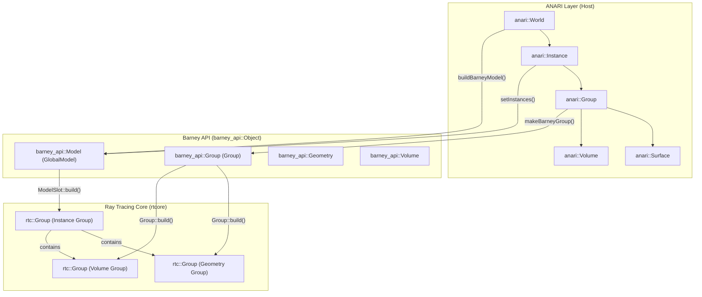
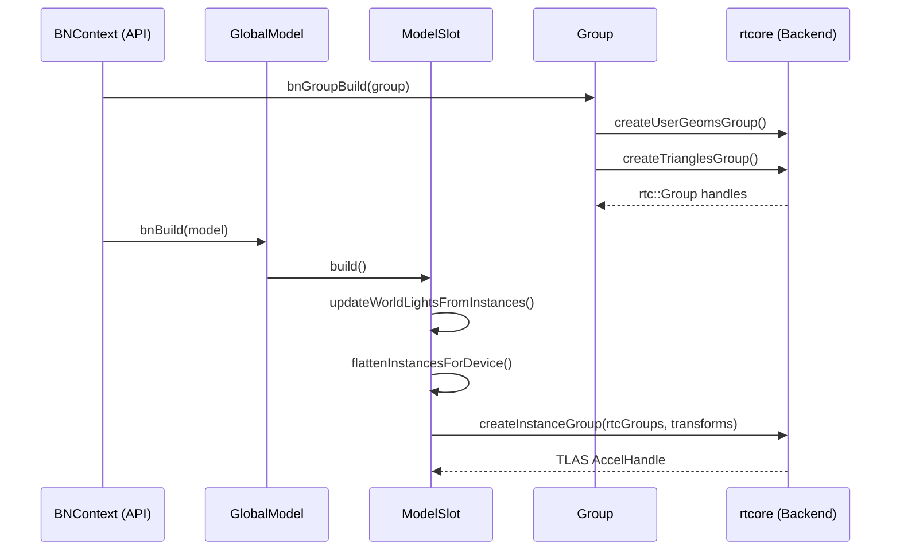

<!-- source: DeepWiki mcp.deepwiki.com · repo NVIDIA/barney · page 5.2 Scene Hierarchy: Groups, Models, and Instances · fetched 2026-10-26 -->

# Scene Hierarchy: Groups, Models, and Instances

Relevant source files

The following files were used as context for generating this wiki page:

- [anari/BarneyGlobalState.cpp](anari/BarneyGlobalState.cpp)
- [anari/Group.cpp](anari/Group.cpp)
- [anari/Group.h](anari/Group.h)
- [anari/World.cpp](anari/World.cpp)
- [barney/GlobalModel.h](barney/GlobalModel.h)
- [barney/Group.cpp](barney/Group.cpp)
- [barney/ModelSlot.cpp](barney/ModelSlot.cpp)
- [barney/ModelSlot.h](barney/ModelSlot.h)
- [barney/api/Context.h](barney/api/Context.h)

Barney organizes scene data into a hierarchical structure designed for both high-performance ray tracing and distributed data management. The hierarchy consists of three primary levels: **Geometries/Volumes**, **Groups**, and **Models**. This structure allows Barney to handle massive datasets by partitioning data across multiple GPUs or MPI ranks while supporting efficient instancing and transformation updates.

## Scene Organization Overview

The scene hierarchy follows a "bottom-up" construction where primitives are aggregated into groups, which are then instanced into models.

1.  **Primitives**: Individual `BNGeometry` (surfaces) and `BNVolume` (volumetric fields) objects.
2.  **BNGroup**: A container that aggregates multiple geometries and volumes into a single coordinate space. A group is the smallest unit of BVH (Bounding Volume Hierarchy) construction for geometry.
3.  **BNModel**: The top-level container. It contains one or more **Slots**, where each slot represents a local view of a potentially distributed world.
4.  **Instances**: Associations between a `BNGroup` and an `affine3f` transform within a `BNModel`.

### Data Hierarchy Mapping
The following diagram bridges the conceptual ANARI scene objects to the internal Barney API and the underlying `rtcore` (Ray Tracing Core) entities.

**Diagram: ANARI to Barney Scene Mapping**

**Sources:** [anari/World.cpp:139-143](), [anari/Group.cpp:121-132](), [barney/Group.cpp:88-127](), [barney/ModelSlot.cpp:183-210]()

---

## BNGroup: Geometry and Volume Aggregation

A `BNGroup` (implemented by `barney_api::Group` and `BARNEY_NS::Group`) is the primary unit of acceleration structure management. It maintains lists of geometries and volumes that are spatially grouped together.

### Implementation Details
*   **Per-Device Data (PLD)**: Because Barney supports multi-GPU contexts, `Group` maintains a `PLD` (Per Logical Device) structure containing the backend-specific `rtc::Group` handles for triangles, user geometries, and volumes [barney/Group.cpp:10-15](), [barney/Group.cpp:68-85]().
*   **Acceleration Construction**: Calling `bnGroupBuild` (which triggers `Group::build`) iterates through all attached geometries and volumes, calls their respective `build()` methods, and then creates backend-specific groups (e.g., `rtc::createUserGeomsGroup`) [barney/Group.cpp:88-127]().
*   **Lights**: Groups can also contain light sources. These are stored in a `lights` data member and are extracted during the model build phase to be transformed into world space [barney/Group.cpp:48-54](), [barney/ModelSlot.cpp:90-127]().

**Sources:** [barney/api/Context.h:141-145](), [barney/Group.cpp:19-29](), [barney/Group.cpp:88-127]()

---

## BNModel and ModelSlot

A `BNModel` (implemented as `GlobalModel`) represents the entire renderable scene. Internally, it is composed of multiple `ModelSlot` objects [barney/GlobalModel.h:36]().

### The Slot Mechanism
In a distributed environment (MPI), different ranks may hold different parts of the data. A `ModelSlot` represents the local data assigned to a specific rank/GPU combination.
*   **GlobalModel**: Acts as the API-facing handle that broadcasts commands to the appropriate slots [barney/GlobalModel.h:14-17]().
*   **ModelSlot**: Manages the `render::World` for a specific data slot and handles the flattening of instances into the final top-level acceleration structure (TLAS) [barney/ModelSlot.cpp:22-33]().

### Instancing and Transforms
Instancing is performed at the `ModelSlot` level. Users provide an array of `BNGroup` handles and corresponding `affine3f` transforms.
*   **Transform Updates**: `updateInstanceTransforms` allows for efficient modification of instance positions without rebuilding the entire BVH. It calls `refitAccel` on the underlying `rtc::Group` [barney/ModelSlot.cpp:158-181]().
*   **Attributes**: Instances can have per-instance attributes (e.g., `instID`, `attribute0-4`), which are stored in the `render::World` and passed to shading kernels [barney/ModelSlot.cpp:69-88]().

**Sources:** [barney/GlobalModel.h:38-55](), [barney/ModelSlot.h:21-49](), [barney/ModelSlot.cpp:45-67](), [barney/ModelSlot.cpp:158-181]()

---

## The Build Process: `bnBuild` and BVH Construction

The construction of the scene hierarchy is a multi-stage process triggered by `bnBuild` (or `bnGroupBuild`).

### Build Lifecycle
1.  **Group Build**: Geometries are processed, and their individual BVHs are built. The `rtc` backend (OptiX, HIPRT, etc.) creates `rtc::Group` objects for the underlying primitives [barney/Group.cpp:115-126]().
2.  **Model Build**: The `ModelSlot` flattens the instance list. Since a single `BNGroup` might contain multiple `rtc::Group` objects (e.g., one for triangles, one for user-defined volumes), the `ModelSlot` expands these into a flat list of `rtc` instances [barney/ModelSlot.cpp:129-156]().
3.  **TLAS Generation**: The backend creates the top-level acceleration structure using the flattened list of `rtc::Group` handles and their transforms [barney/ModelSlot.cpp:196-210]().

**Diagram: Hierarchy Data Flow and BVH Construction**

**Sources:** [barney/Group.cpp:88-127](), [barney/ModelSlot.cpp:183-210](), [barney/ModelSlot.cpp:129-156]()

---

## ANARI World Synchronization

The ANARI device layer maps `ANARIWorld` to a `BNModel`. It tracks changes using timestamps to determine if a "Full Rebuild" or a "Transform-Only Update" is required.

*   **Structural Change**: Triggered when the list of instances, surfaces, or volumes changes. This results in a call to `World::fullRebuild()`, which recreates the Barney groups and instances [anari/World.cpp:201-230]().
*   **Non-Structural Change**: Triggered when only transforms or instance attributes change. This results in `World::transformOnlyUpdate()`, which leverages `bnUpdateInstanceTransforms` for faster updates [anari/World.cpp:194-196]().
*   **Zero Instance**: ANARI allows surfaces/volumes to be attached directly to the `World`. Barney handles this by creating a hidden "Zero Group" and "Zero Instance" to wrap these objects [anari/World.cpp:19-27](), [anari/World.cpp:82-130]().

**Sources:** [anari/World.cpp:168-199](), [anari/World.cpp:19-27](), [anari/BarneyGlobalState.cpp:29-39]()

---

