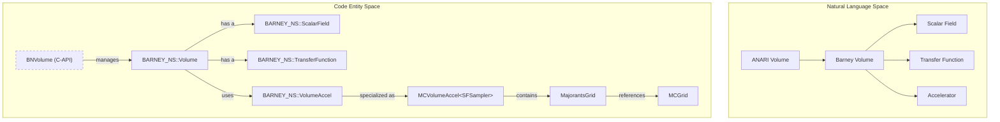
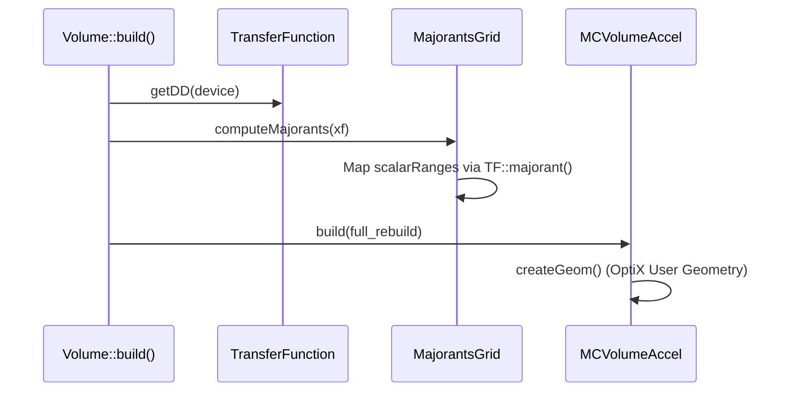

<!-- source: DeepWiki mcp.deepwiki.com · repo NVIDIA/barney · page 6 Volume Rendering · fetched 2026-10-26 -->

# Volume Rendering

Relevant source files

The following files were used as context for generating this wiki page:

- [.gitignore](.gitignore)
- [anari/SpatialField.h](anari/SpatialField.h)
- [anari/Surface.h](anari/Surface.h)
- [anari/Volume.cpp](anari/Volume.cpp)
- [anari/Volume.h](anari/Volume.h)
- [barney/geometry/Geometry.cpp](barney/geometry/Geometry.cpp)
- [barney/volume/MCAccelerator.h](barney/volume/MCAccelerator.h)
- [barney/volume/MCGrid.cu](barney/volume/MCGrid.cu)
- [barney/volume/MCGrid.h](barney/volume/MCGrid.h)
- [barney/volume/ScalarField.h](barney/volume/ScalarField.h)
- [barney/volume/ScalarFieldRegistry.h](barney/volume/ScalarFieldRegistry.h)
- [barney/volume/TransferFunction.cpp](barney/volume/TransferFunction.cpp)
- [barney/volume/TransferFunction.h](barney/volume/TransferFunction.h)
- [barney/volume/Volume.cpp](barney/volume/Volume.cpp)
- [barney/volume/Volume.h](barney/volume/Volume.h)

Barney provides a high-performance volume rendering pipeline designed for large-scale scientific visualization. The system supports a variety of scalar field representations, including structured grids, sparse VDB volumes, unstructured meshes, and Adaptive Mesh Refinement (AMR) data. The core rendering strategy utilizes **Woodcock Tracking** for unbiased volumetric sampling, accelerated by a **Macro-Cell (MC) grid** for efficient empty-space skipping and majorant calculation.

## System Architecture

The volume rendering pipeline is built around the interaction between `ScalarField`, `TransferFunction`, and `VolumeAccel`. A `Volume` object encapsulates a scalar field and its associated optical properties.

### Data Flow and Entity Mapping
The following diagram illustrates how high-level ANARI volume objects map to internal Barney classes and device-side data structures.

**Sources:** [barney/volume/Volume.h:61-171](), [anari/Volume.h:16-40](), [barney/volume/MCAccelerator.h:25-79]()

## Scalar Fields and Samplers

Barney abstracts different data layouts through the `ScalarField` class and its corresponding `SFSampler` templates. This allows the rendering kernels to remain agnostic of the underlying grid type (e.g., structured vs. unstructured) while performing spatial queries.

- **Structured and NanoVDB Volumes**: Handles regular 3D grids and sparse VDB structures. For details, see [Structured and NanoVDB Volumes](#6.1).
- **Unstructured Mesh (UMesh) Volumes**: Supports complex scientific grids like tetrahedra and polyhedra. For details, see [Unstructured Mesh (UMesh) Volumes](#6.2).
- **Block-Structured AMR Volumes**: Manages multi-resolution Adaptive Mesh Refinement data. For details, see [Block-Structured AMR Volumes](#6.3).

**Sources:** [anari/SpatialField.h:16-48](), [barney/volume/Volume.h:63-100]()

## Macro-Cell Acceleration

To avoid expensive sampling in empty or low-opacity regions, Barney uses a **Macro-Cell Grid** (`MCGrid`). This grid stores the min/max scalar ranges for spatial blocks.

1.  **MCGrid**: A passive grid of scalar ranges (`range1f`) covering the volume's spatial extent [barney/volume/MCGrid.h:35-79]().
2.  **MajorantsGrid**: An extension of the MCGrid that maps scalar ranges through the current `TransferFunction` to compute **majorants** (maximum possible extinction) [barney/volume/MCGrid.h:117-128]().
3.  **DDA Traversal**: The `MCVolumeAccel` uses a Digital Differential Analyzer (DDA) to step through active macro-cells during ray marching [barney/volume/MCAccelerator.h:13-32]().

**Sources:** [barney/volume/MCGrid.cu:119-173](), [barney/volume/MCAccelerator.h:165-208](), [barney/volume/TransferFunction.h:89-116]()

## Woodcock Tracking

Barney implements volumetric integration using **Woodcock Tracking** (also known as Delta Tracking). This method uses the majorants provided by the `MajorantsGrid` to determine probabilistic step sizes, allowing for unbiased sampling even in volumes with highly non-linear transfer functions.

The `Woodcock::sampleRange` function performs the following:
- Generates a step size `dt` based on the local majorant and a random number [barney/volume/Volume.h:201-203]().
- Samples the scalar field and maps it through the transfer function [barney/volume/Volume.h:208-209]().
- Performs a rejection test to decide if a "real" collision occurred [barney/volume/Volume.h:217-220]().

**Sources:** [barney/volume/Volume.h:188-223]()

## Transfer Functions and Opticals

The `TransferFunction` class maps scalar values to color and density.
- **1D Transfer Functions**: Maps scalars to RGBA values where 'A' represents density [barney/volume/TransferFunction.h:13-33]().
- **Principled Volume**: Supports physically-based parameters like anisotropy and scattering albedo for multi-scattering effects [barney/volume/Volume.h:157-161]().

For details on optical mapping and acceleration updates, see [Transfer Functions and Volume Acceleration](#6.4).

**Sources:** [anari/Volume.cpp:79-173](), [barney/volume/TransferFunction.cpp:40-55]()

## Child Pages
- [Structured and NanoVDB Volumes](#6.1)
- [Unstructured Mesh (UMesh) Volumes](#6.2)
- [Block-Structured AMR Volumes](#6.3)
- [Transfer Functions and Volume Acceleration](#6.4)

---

