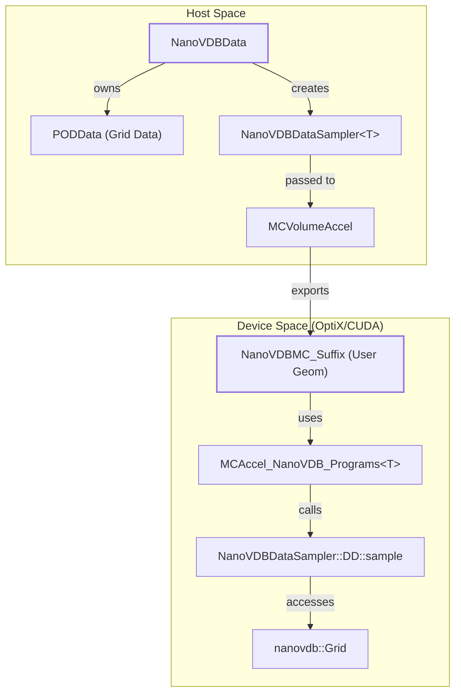
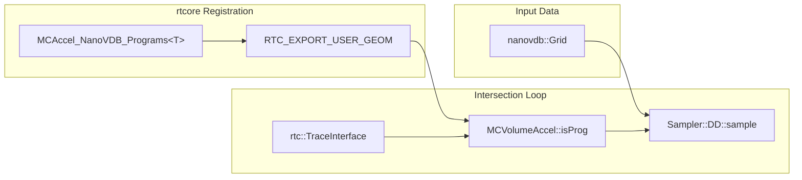

<!-- source: DeepWiki mcp.deepwiki.com · repo NVIDIA/barney · page 6.1 Structured and NanoVDB Volumes · fetched 2026-10-26 -->

# Structured and NanoVDB Volumes

Relevant source files

The following files were used as context for generating this wiki page:

- [barney/umesh/mc/UMeshCuBQLSampler.h](barney/umesh/mc/UMeshCuBQLSampler.h)
- [barney/umesh/mc/UMeshMC.dev.cu](barney/umesh/mc/UMeshMC.dev.cu)
- [barney/volume/MCGrid.cuh](barney/volume/MCGrid.cuh)
- [barney/volume/NanoVDB.cu](barney/volume/NanoVDB.cu)
- [barney/volume/NanoVDB.dev.cu](barney/volume/NanoVDB.dev.cu)
- [barney/volume/NanoVDB.h](barney/volume/NanoVDB.h)
- [barney/volume/ScalarField.cpp](barney/volume/ScalarField.cpp)
- [barney/volume/StructuredData.cu](barney/volume/StructuredData.cu)
- [barney/volume/StructuredData.h](barney/volume/StructuredData.h)
- [unitTests/isosurface-umesh.py](unitTests/isosurface-umesh.py)
- [unitTests/isosurface-umesh2.py](unitTests/isosurface-umesh2.py)
- [unitTests/omnicamera.py](unitTests/omnicamera.py)

This page covers the implementation and management of regular and sparse volume data in Barney. It details the `StructuredData` class for regular 3D grids and the `NanoVDBData` class for sparse VDB structures, including their respective sampling mechanisms, macro-cell generation, and hardware acceleration integration.

## Structured Volumes (StructuredData)

`StructuredData` represents a regular 3D grid of scalar values defined by dimensions, origin, and spacing [barney/volume/StructuredData.h:33-46](). It leverages 3D textures for hardware-accelerated trilinear interpolation during sampling [barney/volume/StructuredData.h:102-116]().

### Data Representation and Sampling
The volume is defined by its dimensions (`numScalars`), world-space origin (`gridOrigin`), and spacing (`gridSpacing`) [barney/volume/StructuredData.h:72-76](). Barney maintains two internal textures for each structured field: one with linear filtering for standard sampling and one with nearest-neighbor filtering for macro-cell generation [barney/volume/StructuredData.cu:162-169]().

The `StructuredDataSampler::DD::sample` function maps a world-space point `P` into cell-grid coordinates to perform a 3D texture lookup [barney/volume/StructuredData.h:105-114]().

### Macro-Cell Generation
To accelerate volume traversal, Barney generates a macro-cell grid (`MCGrid`). For structured data, this is done via the `StructuredData_computeMCs` kernel [barney/volume/StructuredData.cu:29-35]().
- **Aggregation**: By default, $8^3$ cells are aggregated into a single macro-cell (`cellsPerMC = 8`) [barney/volume/StructuredData.cu:25]().
- **Range Computation**: The kernel iterates through the scalars within the macro-cell's footprint, samples them using the nearest-neighbor texture, and computes the min/max scalar range [barney/volume/StructuredData.cu:44-57]().

Sources: [barney/volume/StructuredData.h:17-117](), [barney/volume/StructuredData.cu:10-182]()

---

## NanoVDB Volumes (NanoVDBData)

`NanoVDBData` implements support for sparse volumes using the NanoVDB format. It allows Barney to render large-scale sparse datasets with minimal memory overhead compared to dense grids [barney/volume/NanoVDB.h:34-45]().

### Supported Data Types
Barney utilizes a template-based sampler, `NanoVDBDataSampler<T>`, to support various bit-depths and compression formats provided by NanoVDB [barney/volume/NanoVDB.h:74-78]().

| BuildType | Suffix | EnumName | Description |
| :--- | :--- | :--- | :--- |
| `float` | `float` | `Float` | Standard 32-bit float |
| `nanovdb::Fp4` | `Fp4` | `Fp4` | 4-bit fixed point |
| `nanovdb::Fp8` | `Fp8` | `Fp8` | 8-bit fixed point |
| `nanovdb::Fp16` | `Fp16` | `Fp16` | 16-bit half precision |
| `nanovdb::FpN` | `FpN` | `FpN` | Variable bit-depth |

Sources: [barney/volume/NanoVDB.h:23-28](), [barney/volume/NanoVDB.cu:151-183]()

### NanoVDB Sampling Logic
The sampling process involves transforming world coordinates to index space and applying a half-voxel shift to align with cell-centered sampling [barney/volume/NanoVDB.h:103-113]().

1. **Coordinate Mapping**: World position `P` is converted to index position via `worldToIndexF` [barney/volume/NanoVDB.h:110]().
2. **Clamping**: The index position is clamped to the `indexBounds` to ensure correct boundary extrapolation [barney/volume/NanoVDB.h:117-122]().
3. **Accessor/Sampler**: A `nanovdb::math::SampleFromVoxels` sampler is used to evaluate the value at the calculated index [barney/volume/NanoVDB.h:124-127]().

Sources: [barney/volume/NanoVDB.h:98-128]()

---

## Macro-Cell Acceleration

Both volume types integrate with the `MCVolumeAccel` and `MCIsoSurfaceAccel` frameworks. These classes provide the OptiX/CUDA user geometry intersection programs required for space-skipping and isosurface rendering [barney/volume/NanoVDB.dev.cu:16-46]().

### NanoVDB Macro-Cell Build
The `NanoVDBData::buildMCs` function initializes an `MCGrid` and launches the `NanoVDBData_computeMCs` kernel [barney/volume/NanoVDB.cu:75-115]().
- **Dynamic Dispatch**: The build process switches based on the `gridType` to launch the correctly templated kernel for the specific bit-depth (e.g., `float`, `Fp16`) [barney/volume/NanoVDB.cu:99-111]().
- **Leaf Traversal**: The kernel iterates through the `nanovdb::CoordBBox` corresponding to each macro-cell and uses a `nanovdb::ReadAccessor` to find the scalar range [barney/volume/NanoVDB.cu:46-60]().

### Entity Relationship: Sampling and Acceleration
The following diagram illustrates how the host-side volume data structures relate to the device-side samplers and acceleration programs.

**Volume Entity Mapping**

Sources: [barney/volume/NanoVDB.h:34-96](), [barney/volume/NanoVDB.cu:151-166](), [barney/volume/NanoVDB.dev.cu:16-46]()

---

## OptiX User Geometry Exports

Barney uses macros to export specialized intersection and bounding box programs for every supported NanoVDB type. This ensures that the ray tracer can efficiently handle different data formats without runtime branching inside the hot intersection loop.

### Export Pattern
The `RTC_EXPORT_USER_GEOM` macro is used in `.dev.cu` files to register the intersection logic with the Ray Tracing Core (`rtcore`) [barney/volume/NanoVDB.dev.cu:81-92]().

**Data Flow: From Grid to Intersection**

| Program Type | Function in Code | Role |
| :--- | :--- | :--- |
| **Bounds** | `MCAccel_NanoVDB_Programs::bounds` | Returns the bounding box of the volume for BVH construction [barney/volume/NanoVDB.dev.cu:18-28](). |
| **Intersect** | `MCAccel_NanoVDB_Programs::intersect` | Performs DDA traversal through macro-cells and integrates along the ray [barney/volume/NanoVDB.dev.cu:30-37](). |

Sources: [barney/volume/NanoVDB.dev.cu:16-93](), [barney/volume/NanoVDB.cu:18-25]()

---

