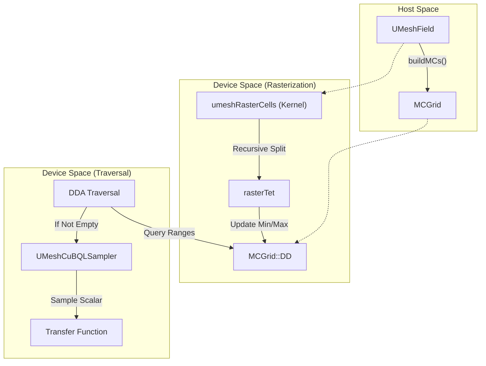
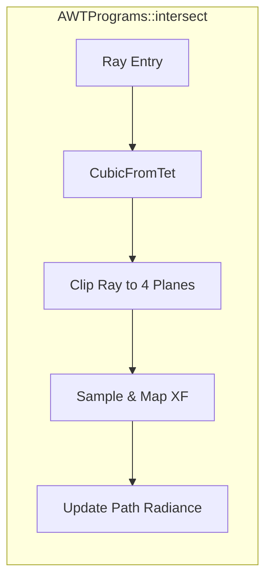

<!-- source: DeepWiki mcp.deepwiki.com · repo NVIDIA/barney · page 6.2 Unstructured Mesh (UMesh) Volumes · fetched 2026-10-26 -->

# Unstructured Mesh (UMesh) Volumes

Relevant source files

The following files were used as context for generating this wiki page:

- [barney/amr/BlockStructuredCuBQLSampler.cu](barney/amr/BlockStructuredCuBQLSampler.cu)
- [barney/amr/BlockStructuredCuBQLSampler.h](barney/amr/BlockStructuredCuBQLSampler.h)
- [barney/amr/BlockStructuredField.cu](barney/amr/BlockStructuredField.cu)
- [barney/amr/BlockStructuredMC.dev.cu](barney/amr/BlockStructuredMC.dev.cu)
- [barney/common/CuBQL.h](barney/common/CuBQL.h)
- [barney/geometry/Geometry.h](barney/geometry/Geometry.h)
- [barney/geometry/IsoSurface.cpp](barney/geometry/IsoSurface.cpp)
- [barney/include/barney.h](barney/include/barney.h)
- [barney/umesh/common/UMeshField.cu](barney/umesh/common/UMeshField.cu)
- [barney/umesh/common/UMeshField.h](barney/umesh/common/UMeshField.h)
- [barney/umesh/mc/UMeshCuBQLSampler.cu](barney/umesh/mc/UMeshCuBQLSampler.cu)
- [barney/umesh/os/AWT.cu](barney/umesh/os/AWT.cu)
- [barney/umesh/os/AWT.dev.cu](barney/umesh/os/AWT.dev.cu)
- [barney/umesh/os/AWT.h](barney/umesh/os/AWT.h)
- [barney/umesh/os/ObjectSpace-common.h](barney/umesh/os/ObjectSpace-common.h)

The Unstructured Mesh (UMesh) subsystem in Barney provides support for scientific visualization of non-rectilinear grids. It handles complex element types including tetrahedra, pyramids, prisms (wedges), hexahedra, and polyhedra. The system supports both cell-centered and vertex-centered scalar data and implements multiple acceleration strategies for efficient volume rendering and isosurface extraction.

## UMeshField Data Representation

`UMeshField` is the core class representing unstructured scalar fields. It manages the geometry (vertices and indices) and the associated scalar values.

### Supported Element Types
Barney supports element types based on VTK numbering and ANARI specifications:
- **Tetrahedron**: 4 vertices [barney/include/barney.h:186-186]()
- **Hexahedron**: 8 vertices [barney/include/barney.h:187-187]()
- **Prism/Wedge**: 6 vertices [barney/include/barney.h:188-188]()
- **Pyramid**: 5 vertices [barney/include/barney.h:189-189]()
- **Polyhedron**: Variable face-stream definition [barney/include/barney.h:190-190]()

### Data Layout and Access
The `UMeshField::DD` (Device Data) struct provides the device-side pointers and sampling functions:
- `vertices`: `vec3f` array of point positions [barney/umesh/common/UMeshField.h:104-104]().
- `scalars`: `float` array of data values (either per-vertex or per-cell) [barney/umesh/common/UMeshField.h:105-105]().
- `cellOffsets` and `indices`: Define the connectivity of the mesh [barney/umesh/common/UMeshField.h:106-107]().
- `cellTypes`: Array of `uint8_t` specifying the type for each cell [barney/umesh/common/UMeshField.h:108-108]().

### UMesh Entity Mapping
| Code Entity | Role |
| :--- | :--- |
| `UMeshField` | Host-side object managing mesh data and life-cycle [barney/umesh/common/UMeshField.h:31-31](). |
| `UMeshField::DD` | Device-side struct with sampling logic (`tetScalar`, `hexScalar`, etc.) [barney/umesh/common/UMeshField.h:50-114](). |
| `UMeshCuBQLSampler` | Spatial acceleration structure for point-in-element queries [barney/umesh/mc/UMeshCuBQLSampler.h:14-14](). |

**Sources:** [barney/include/barney.h:185-191](), [barney/umesh/common/UMeshField.h:31-114]()

---

## Spatial Acceleration and Sampling

To evaluate a scalar value at an arbitrary point $P$, Barney must first find which cell(s) contain $P$. This is handled by the `UMeshCuBQLSampler`.

### CuBQL BVH Construction
The sampler builds a BVH over the individual mesh elements using the `cuBQL` library. 
1. **Bounds Computation**: `computeElementBBs` generates bounding boxes for every cell in the mesh [barney/umesh/common/UMeshField.cu:124-162]().
2. **BVH Build**: Depending on the backend, it uses `cuBQL::gpuBuilder` or `cuBQL::cpu::spatialMedian` to construct a wide BVH [barney/umesh/mc/UMeshCuBQLSampler.cu:60-74]().
3. **Point Query**: During rendering, `cuBQL::fixedBoxQuery` is used to find candidate cells for a point $P$ [barney/amr/BlockStructuredCuBQLSampler.h:74-81]().

### Scalar Evaluation Logic
Once candidate cells are found, `UMeshField::DD` evaluates the interpolation functions:
- **Tetrahedra**: Linear interpolation using barycentric coordinates [barney/umesh/common/UMeshField.h:65-68]().
- **Polyhedra**: Uses a face-stream reader and triangle fans to determine containment via ray parity and calculates inverse-distance weights for vertex scalars [barney/umesh/common/UMeshField.h:94-102]().

**Sources:** [barney/umesh/mc/UMeshCuBQLSampler.cu:35-80](), [barney/umesh/common/UMeshField.cu:124-162](), [barney/umesh/common/UMeshField.h:168-175]()

---

## Macro-Cell Acceleration (MCVolumeAccel)

For volume rendering, Barney uses a Macro-Cell (MC) grid to perform space skipping and DDA traversal.

### Macro-Cell Rasterization
The function `umeshRasterCells` is a CUDA kernel that populates the `MCGrid` by "rasterizing" mesh elements into the macro-cell grid [barney/umesh/common/UMeshField.cu:118-121]().
- For **Tetrahedra**: A recursive `rasterTet` function splits the tetrahedron until it reaches a sub-pixel or sub-grid size, then updates the `MCGrid` min/max ranges [barney/umesh/common/UMeshField.cu:38-100]().
- For **Other Elements**: The axis-aligned bounding box (AABB) of the cell is used for rasterization [barney/umesh/common/UMeshField.cu:158-159]().

### System Data Flow: MC Acceleration

**Sources:** [barney/umesh/common/UMeshField.cu:38-115](), [barney/umesh/common/UMeshField.cu:164-202]()

---

## Adaptive Wyvill Tree (AWT) Acceleration

The `AWTAccel` provides an alternative acceleration strategy, particularly useful for high-quality intersection of isosurfaces or optimized volume sampling in object space.

### Implementation Details
- **Cubic Approximation**: For tetrahedra, the AWT uses a `Cubic` struct to approximate the scalar function along a ray segment [barney/umesh/os/AWT.dev.cu:84-108]().
- **Clipping**: Ray segments are clipped against the four planes of a tetrahedron using the `clip` function [barney/umesh/os/AWT.dev.cu:110-131]().
- **Object-Space Sampling**: The `CubicSampler` evaluates the approximated cubic function and maps it through the transfer function [barney/umesh/os/AWT.dev.cu:218-237]().

### AWT Intersection Logic

**Sources:** [barney/umesh/os/AWT.dev.cu:26-78](), [barney/umesh/os/AWT.dev.cu:159-216]()

---

## Acceleration Strategy Comparison

| Feature | MCVolumeAccel | AWTAccel |
| :--- | :--- | :--- |
| **Primary Use** | Standard Volume Rendering | Optimized Isosurface / Object Space |
| **Traversal** | DDA on Uniform MC Grid [barney/amr/BlockStructuredMC.dev.cu:18-18]() | BVH-based Object Space [barney/umesh/os/ObjectSpace-common.h:22-22]() |
| **Sampler** | `UMeshCuBQLSampler` [barney/umesh/common/UMeshField.cu:9-9]() | `CubicSampler` [barney/umesh/os/AWT.dev.cu:218-218]() |
| **Element Logic** | Point-in-cell search | Ray-cell clipping [barney/umesh/os/AWT.dev.cu:110-110]() |

**Sources:** [barney/umesh/common/UMeshField.cu:19-24](), [barney/umesh/os/ObjectSpace-common.h:22-42](), [barney/amr/BlockStructuredMC.dev.cu:6-15]()

---

