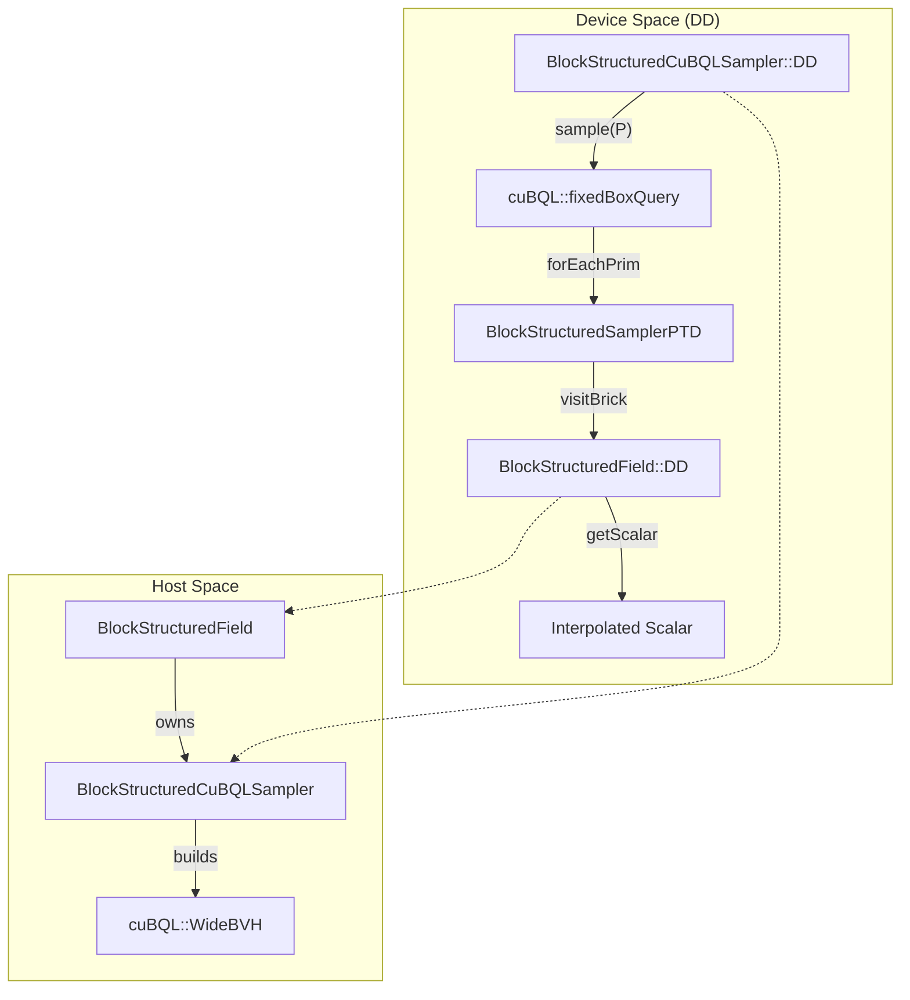
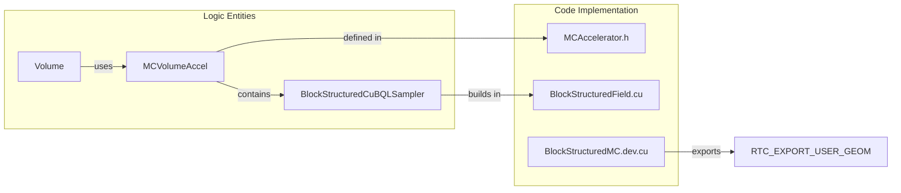

<!-- source: DeepWiki mcp.deepwiki.com · repo NVIDIA/barney · page 6.3 Block-Structured AMR Volumes · fetched 2026-10-26 -->

# Block-Structured AMR Volumes

Relevant source files

The following files were used as context for generating this wiki page:

- [barney/amr/BlockStructuredCuBQLSampler.cu](barney/amr/BlockStructuredCuBQLSampler.cu)
- [barney/amr/BlockStructuredCuBQLSampler.h](barney/amr/BlockStructuredCuBQLSampler.h)
- [barney/amr/BlockStructuredField.cu](barney/amr/BlockStructuredField.cu)
- [barney/amr/BlockStructuredMC.dev.cu](barney/amr/BlockStructuredMC.dev.cu)
- [barney/common/CuBQL.h](barney/common/CuBQL.h)
- [barney/geometry/Geometry.cpp](barney/geometry/Geometry.cpp)
- [barney/geometry/Geometry.h](barney/geometry/Geometry.h)
- [barney/geometry/IsoSurface.cpp](barney/geometry/IsoSurface.cpp)
- [barney/umesh/mc/UMeshCuBQLSampler.cu](barney/umesh/mc/UMeshCuBQLSampler.cu)
- [barney/volume/MCAccelerator.h](barney/volume/MCAccelerator.h)

Block-structured Adaptive Mesh Refinement (AMR) volumes in Barney are represented by the `BlockStructuredField` class. This data type handles hierarchical grids where data is organized into multiple blocks (or "bricks") across different refinement levels. Barney utilizes a spatial acceleration structure powered by `cuBQL` to perform efficient point-in-element queries and a macro-cell grid for space-skipping during volume traversal.

## Block-Structured Field Representation

A block-structured AMR field consists of a collection of blocks, where each block has a specific origin, dimensions, and refinement level. The `BlockStructuredField` manages these properties and provides the necessary device-side data for sampling.

### Data Layout and Block Structure
The implementation uses several arrays to define the AMR hierarchy:
- **Origins**: `vec3i` coordinates of the lower corner of each block [barney/amr/BlockStructuredField.h:58]().
- **Dimensions**: `vec3i` count of cells in each dimension for a block [barney/amr/BlockStructuredField.h:59]().
- **Levels**: Integer level index for each block, determining its resolution relative to the base level [barney/amr/BlockStructuredField.h:60]().
- **Refinement Ratios**: Factors defining how much a level is refined compared to its parent [barney/amr/BlockStructuredField.h:65]().

The `Block` struct is a helper used in device code to abstract these parameters and compute world-space bounds and cell-level scalar values [barney/amr/BlockStructuredField.h:17-48]().

### Device Data (DD)
The `BlockStructuredField::DD` structure provides the pointers required for device-side kernels to access the AMR data.

| Member | Type | Description |
| :--- | :--- | :--- |
| `perBlock.origins` | `const vec3i*` | Grid coordinates for each block origin. |
| `perBlock.dims` | `const vec3i*` | Number of cells (x,y,z) per block. |
| `perBlock.levels` | `const int*` | Level index per block. |
| `perLevel.refinements` | `const int*` | Refinement factors per level. |
| `scalars` | `const float*` | Flat array of scalar values for all blocks. |

**Sources:** [barney/amr/BlockStructuredField.h:54-76](), [barney/amr/BlockStructuredField.cu:134-153]()

## Spatial Queries with BlockStructuredCuBQLSampler

To evaluate a scalar value at a spatial point $P$, Barney must identify which blocks contain $P$. Because AMR blocks can overlap (with higher-level blocks taking precedence or being blended), Barney uses a `cuBQL` (CUDA Bounding Quantization Library) BVH to accelerate this search.

### The Sampler Lifecycle
1. **BVH Construction**: The `BlockStructuredCuBQLSampler::build` function computes the bounding boxes for all blocks using `computeElementBBs` [barney/amr/BlockStructuredField.cu:165-206]() and then invokes the `cuBQL::gpuBuilder` to construct a `WideBVH` [barney/amr/BlockStructuredCuBQLSampler.cu:37-84]().
2. **Point Query**: During sampling, `BlockStructuredCuBQLSampler::DD::sample` performs a `fixedBoxQuery` against the BVH using the point $P$ as a zero-sized box [barney/amr/BlockStructuredCuBQLSampler.h:69-81]().
3. **Basis Evaluation**: For every block found to contain $P$, the sampler calls `addBasisFunctions`, which accumulates weighted scalar values [barney/amr/BlockStructuredCuBQLSampler.h:52-66]().

### System Mapping: AMR Sampling
The following diagram illustrates the flow from a spatial sample request to the underlying AMR block data.

**AMR Sampler Data Flow**

**Sources:** [barney/amr/BlockStructuredCuBQLSampler.h:19-50](), [barney/amr/BlockStructuredCuBQLSampler.cu:37-84]()

## Macro-Cell Acceleration

For volume rendering, Barney uses a `MCVolumeAccel` to perform space-skipping. This requires a macro-cell grid (`MCGrid`) that stores the min/max scalar ranges for regions of space.

### Rasterization
The macro-cell grid is populated by the `BSField_rasterGrids` kernel [barney/amr/BlockStructuredField.cu:31-57](). This kernel:
1. Iterates through every block in the AMR field.
2. For every cell in the block, it calculates the world-space bounds.
3. Calls `rasterBox` to update the `MCGrid` with the cell's scalar value [barney/amr/BlockStructuredField.cu:52]().

### Traversal Implementation
The AMR volume is integrated into the ray tracing pipeline via `BlockStructuredMC.dev.cu`. This file exports the user geometry programs required by the RT backend (e.g., OptiX) [barney/amr/BlockStructuredMC.dev.cu:57-60](). It uses the `DDA` (Digital Differential Analyzer) traversal logic to step through the macro-cells [barney/amr/BlockStructuredMC.dev.cu:18]().

**Entity Association: Volume Acceleration**

**Sources:** [barney/volume/MCAccelerator.h:25-79](), [barney/amr/BlockStructuredField.cu:80-119](), [barney/amr/BlockStructuredMC.dev.cu:17-61]()

## Key Functions and Classes

### `BlockStructuredField`
- **`buildMCs()`**: Computes the world bounds of the AMR hierarchy and launches the rasterization kernel to build the macro-cell grid [barney/amr/BlockStructuredField.cu:80-119]().
- **`computeElementBBs()`**: A parallel kernel that calculates the axis-aligned bounding box (AABB) for every block, which is required for BVH construction [barney/amr/BlockStructuredField.cu:212-215]().
- **`createAccel()`**: Factory method that instantiates the `BlockStructuredCuBQLSampler` and the associated `MCVolumeAccel` [barney/amr/BlockStructuredField.cu:155-163]().

### `BlockStructuredCuBQLSampler`
- **`build()`**: Orchestrates the allocation of temporary memory on the GPU and calls the `cuBQL` builder [barney/amr/BlockStructuredCuBQLSampler.cu:37-84]().
- **`DD::sample()`**: The device-side entry point for scalar sampling. It uses `cuBQL::fixedBoxQuery::forEachPrim` to find overlapping blocks and returns the weighted average of the scalar values [barney/amr/BlockStructuredCuBQLSampler.h:69-81]().

**Sources:** [barney/amr/BlockStructuredField.cu:1-220](), [barney/amr/BlockStructuredCuBQLSampler.cu:1-86](), [barney/amr/BlockStructuredCuBQLSampler.h:1-83]()

---

