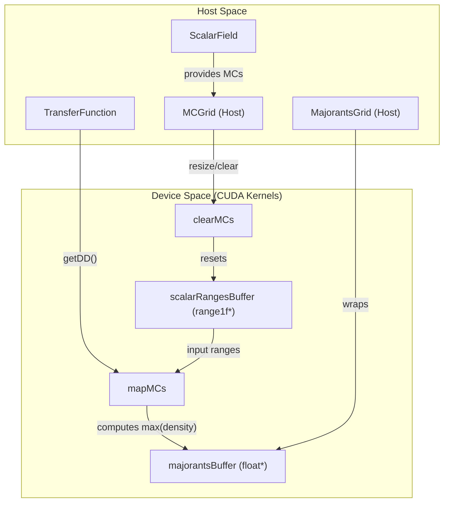
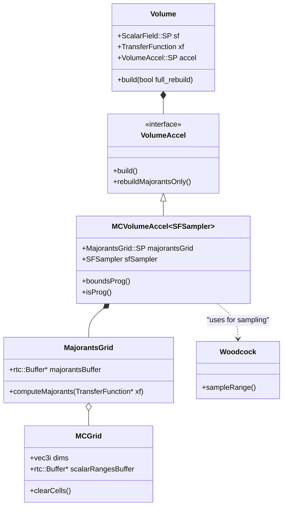

<!-- source: DeepWiki mcp.deepwiki.com · repo NVIDIA/barney · page 6.4 Transfer Functions and Volume Acceleration · fetched 2026-10-26 -->

# Transfer Functions and Volume Acceleration

Relevant source files

The following files were used as context for generating this wiki page:

- [barney/geometry/Geometry.cpp](barney/geometry/Geometry.cpp)
- [barney/volume/MCAccelerator.h](barney/volume/MCAccelerator.h)
- [barney/volume/MCGrid.cu](barney/volume/MCGrid.cu)
- [barney/volume/MCGrid.h](barney/volume/MCGrid.h)
- [barney/volume/PrincipledVolume.h](barney/volume/PrincipledVolume.h)
- [barney/volume/TransferFunction.cpp](barney/volume/TransferFunction.cpp)
- [barney/volume/TransferFunction.h](barney/volume/TransferFunction.h)
- [barney/volume/Volume.h](barney/volume/Volume.h)

This section describes the mechanisms Barney uses to map scalar fields to optical properties and the acceleration structures employed to efficiently skip empty space and perform Woodcock tracking.

## Transfer Functions

The `TransferFunction` class manages the mapping of scalar values to color and density. It supports a user-defined domain, a set of RGBA values for linear interpolation, and a global `baseDensity` multiplier [barney/volume/TransferFunction.h:12-56]().

### Optical Mapping
On the device, `TransferFunction::DD::map` performs the lookup. It transforms the input scalar $s$ into a normalized coordinate within the domain, clamps it, and performs a linear interpolation between the two nearest entries in the `values` buffer [barney/volume/TransferFunction.h:66-86](). The resulting `w` component represents a density value (extinction coefficient), not a standard alpha opacity [barney/volume/TransferFunction.h:13-20]().

### Principled Volume
Barney includes a `PrincipledVolumeParams` struct for Cycles-style volume shading. This allows for physically-based scattering, absorption, and emission (including blackbody radiation) evaluated directly from the scalar field [barney/volume/PrincipledVolume.h:12-27](). When enabled, the `Volume::DD::sampleAndMap` function combines the standard Transfer Function results with principled coefficients [barney/volume/Volume.h:65-80]().

## Macro-Cell Acceleration (MCGrid)

To accelerate volume rendering, Barney uses a grid of "macro-cells" (`MCGrid`). Each macro-cell represents a spatial region and stores the `range1f` (min/max) of all scalar values contained within that region [barney/volume/MCGrid.h:35-47]().

### Majorants
The `MajorantsGrid` extends the `MCGrid` by storing a "majorant" for each cell—the maximum possible extinction coefficient within that cell's scalar range [barney/volume/MCGrid.h:117-127](). This majorant is computed by mapping the cell's scalar range through the current `TransferFunction` using the `mapMCs` CUDA kernel [barney/volume/MCGrid.cu:94-116]().

### Data Flow: Scalar Range to Majorant
The following diagram illustrates how scalar data is processed into acceleration data.

**Volume Acceleration Data Flow**

Sources: [barney/volume/MCGrid.h:35-158](), [barney/volume/MCGrid.cu:63-116](), [barney/volume/Volume.h:165-171]()

## Volume Accelerators

Barney provides specialized accelerators for volumes and isosurfaces that utilize the `MCGrid` for space skipping.

### MCVolumeAccel
`MCVolumeAccel` is the primary accelerator for volume rendering. It creates a single-primitive user geometry in the underlying ray tracing engine (e.g., OptiX) that represents the entire volume bounds [barney/volume/MCAccelerator.h:25-79]().
- **Build Process**: During `build()`, it retrieves the macro-cells from the scalar field, computes majorants based on the current transfer function, and creates the device-side geometry [barney/volume/MCAccelerator.h:165-208]().
- **Traversal**: It uses a Digital Differential Analyzer (DDA) approach to step through the `MCGrid`.

### MCIsoSurfaceAccel
Similar to the volume accelerator, `MCIsoSurfaceAccel` uses the `MCGrid` to accelerate isosurface intersection [barney/volume/MCAccelerator.h:81-130](). It uses the min/max scalar ranges in each macro-cell to quickly discard cells that cannot contain the target isovalue.

### Woodcock Tracking
For heterogeneous volumes, Barney implements Woodcock tracking (null-collision sampling) in the `Woodcock` helper class [barney/volume/Volume.h:188-190](). It uses the majorant provided by the `MajorantsGrid` to determine step sizes and performs stochastic acceptance/rejection based on the actual sampled density at each step [barney/volume/Volume.h:199-222]().

## Implementation Mapping

The relationship between the high-level acceleration concepts and the C++ classes is shown below.

**Acceleration System Entity Map**

Sources: [barney/volume/Volume.h:61-171](), [barney/volume/MCAccelerator.h:25-79](), [barney/volume/MCGrid.h:35-158]()

### Key Functions and Classes
- **`MCGrid::DD`**: The device-side descriptor for macro-cell ranges, providing `cellID` and `cellBounds` calculations [barney/volume/MCGrid.h:40-79]().
- **`MajorantsGrid::computeMajorants`**: Triggers the CUDA kernel to update majorants whenever the transfer function changes without needing a full BVH rebuild [barney/volume/MCGrid.cu:119-145]().
- **`Volume::DD::sampleAndMap`**: The core device function that samples the scalar field and immediately applies the transfer function or principled volume mapping [barney/volume/Volume.h:65-80]().
- **`fastLog`**: A high-performance logarithmic approximation used within the Woodcock tracking loop to calculate step increments [barney/volume/Volume.h:174-184]().

Sources: [barney/volume/MCAccelerator.h:1-130](), [barney/volume/MCGrid.h:1-161](), [barney/volume/MCGrid.cu:1-253](), [barney/volume/Volume.h:1-238](), [barney/volume/TransferFunction.h:1-118](), [barney/volume/PrincipledVolume.h:1-161]()

---

