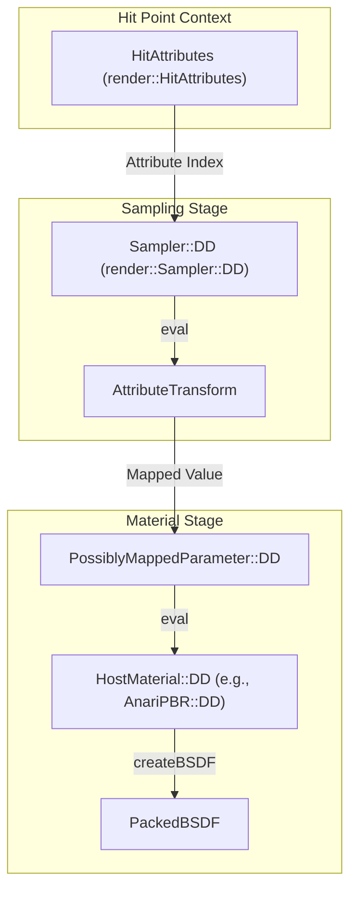
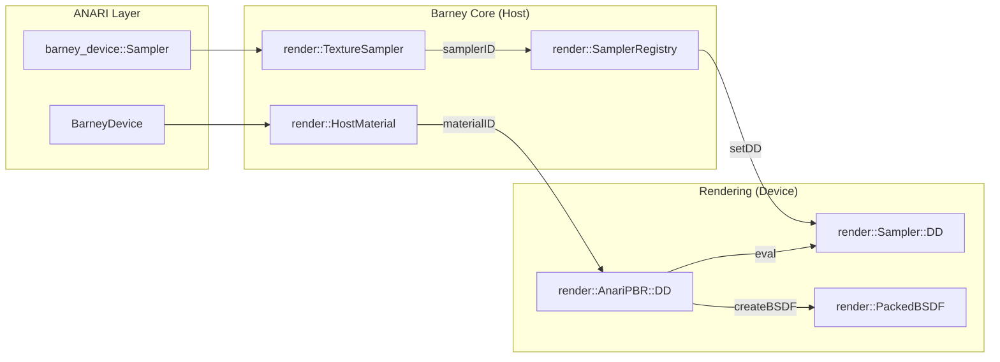

<!-- source: DeepWiki mcp.deepwiki.com · repo NVIDIA/barney · page 7 Materials, Samplers, and Shading · fetched 2026-10-26 -->

# Materials, Samplers, and Shading

Relevant source files

The following files were used as context for generating this wiki page:

- [anari/Sampler.cpp](anari/Sampler.cpp)
- [anari/Sampler.h](anari/Sampler.h)
- [anari/common.h](anari/common.h)
- [barney/fb/TiledFB.cu](barney/fb/TiledFB.cu)
- [barney/material/AnariMatte.h](barney/material/AnariMatte.h)
- [barney/material/AnariPBR.h](barney/material/AnariPBR.h)
- [barney/material/Material.h](barney/material/Material.h)
- [barney/packedBSDF/Lambertian.h](barney/packedBSDF/Lambertian.h)
- [barney/packedBSDF/PackedBSDF.h](barney/packedBSDF/PackedBSDF.h)
- [barney/render/Sampler.cpp](barney/render/Sampler.cpp)
- [barney/render/Sampler.h](barney/render/Sampler.h)

This page provides a high-level overview of how Barney handles surface appearance, texture lookups, and light transport. The system is designed to map high-level ANARI material descriptions into efficient device-side representations while managing complex texture sampling and lighting configurations across distributed GPU memory.

## Shading Architecture Overview

Barney's shading system bridges the gap between the host-side scene graph and the device-side ray tracing kernels. It is built on three primary pillars:

1.  **Material System**: Translates ANARI material parameters (like `matte` or `PBR`) into a `PackedBSDF` union used during path tracing.
2.  **Texture Samplers**: Manages 1D, 2D, and 3D data lookups, coordinate transformations, and attribute mapping.
3.  **Light System**: Defines the illumination environment, including point, directional, and quad lights, as well as high-dynamic-range (HDRI) environment maps.

### From ANARI to Device Data (DD)

The system follows the "Host/Device Split" pattern common in Barney. Host-side objects (e.g., `HostMaterial`, `Sampler`) manage state and API interactions, while their `DD` (Device Data) counterparts are lightweight structs containing pointers or handles suitable for use in CUDA/OptiX kernels [barney/render/Sampler.h:46-78]().

### Shading Logic Flow

The following diagram illustrates how attributes from a ray hit are processed through samplers and materials to produce a BSDF for shading.

**Shading Data Flow**

**Sources:** [barney/render/Sampler.h:61-62](), [barney/material/Material.h:28-41](), [barney/material/AnariPBR.h:14-32]()

---

## Material System

Barney implements a virtual material system where host-side materials (derived from `HostMaterial`) generate device-side representations. To maintain a stable Shader Binding Table (SBT), Barney uses a `PackedBSDF` union. This allows the geometry kernels to handle any material type without requiring specialized hit programs for every material variation.

Key components include:
*   **AnariMatte**: A simplified Lambertian diffuse material [barney/material/AnariMatte.h:16-47]().
*   **AnariPBR**: A Physically Based Rendering material supporting metallic-roughness workflows, transmission (glass), and emission [barney/material/AnariPBR.h:13-59]().
*   **PossiblyMappedParameter**: A utility that allows a material parameter (like `baseColor`) to be a constant value, a vertex attribute, or a texture sampler [barney/material/Material.h:19-55]().

For details, see [Material System](#7.1).

---

## Texture Samplers

Samplers in Barney handle the complexity of mapping geometry attributes (like UV coordinates) to data lookups. The system supports:
*   **Image Samplers**: 1D, 2D, and 3D textures with configurable wrap and filter modes [barney/render/Sampler.h:153-188]().
*   **Transform Samplers**: Apply affine transformations to input attributes before they are used by materials [barney/render/Sampler.h:118-125]().
*   **Primitive Samplers**: Map per-primitive data arrays to shading attributes [barney/render/Sampler.h:127-148]().

Samplers are managed by a `SamplerRegistry` which assigns unique IDs to samplers, allowing materials to reference them on the device via simple integer handles [barney/render/Sampler.h:109-110]().

For details, see [Texture Samplers](#7.2).

---

## Lights

The lighting system provides the radiance sources for the path tracer. Barney supports several light types that map directly to ANARI specifications:
*   **Directional & Point Lights**: Standard analytical light sources.
*   **Quad Lights**: Area lights for soft shadows and realistic reflections.
*   **Environment Maps**: Importance-sampled HDRI textures for global illumination [anari/Sampler.cpp:26-151]().

The shading kernel (typically `shadeRays.cu`) iterates through these lights, performing visibility tests and sampling according to the light's distribution.

For details, see [Lights](#7.3).

---

## Code Entity Map

The following table and diagram map the conceptual "Natural Language" components to their specific implementations in the codebase.

| Concept | Host-Side Class | Device-Side Struct (DD) | File Path |
| :--- | :--- | :--- | :--- |
| **Material** | `render::HostMaterial` | `render::DeviceMaterial` | [barney/material/Material.h]() |
| **BSDF** | N/A | `render::PackedBSDF` | [barney/packedBSDF/PackedBSDF.h]() |
| **Sampler** | `render::Sampler` | `render::Sampler::DD` | [barney/render/Sampler.h]() |
| **Parameter** | `PossiblyMappedParameter` | `PossiblyMappedParameter::DD` | [barney/material/Material.h]() |

**Material and Sampling Entity Relationship**

**Sources:** [barney/render/Sampler.cpp:101-105](), [barney/material/Material.h:88-97](), [barney/material/AnariPBR.h:14-23](), [anari/Sampler.h:14-36]()

---

