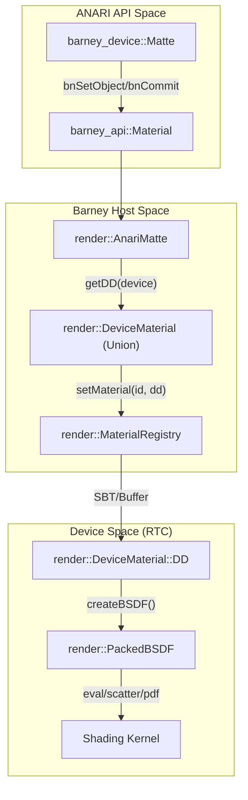
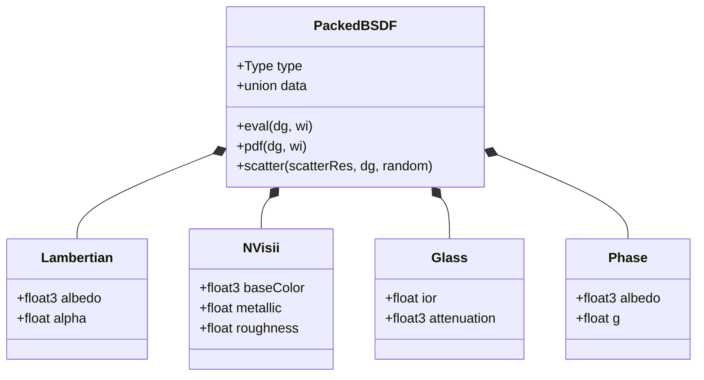

<!-- source: DeepWiki mcp.deepwiki.com · repo NVIDIA/barney · page 7.1 Material System · fetched 2026-10-26 -->

# Material System

Relevant source files

The following files were used as context for generating this wiki page:

- [anari/Material.cpp](anari/Material.cpp)
- [anari/Material.h](anari/Material.h)
- [barney/light/EnvMap.h](barney/light/EnvMap.h)
- [barney/material/AnariMatte.cpp](barney/material/AnariMatte.cpp)
- [barney/material/AnariMatte.h](barney/material/AnariMatte.h)
- [barney/material/AnariPBR.h](barney/material/AnariPBR.h)
- [barney/material/Material.cpp](barney/material/Material.cpp)
- [barney/material/Material.h](barney/material/Material.h)
- [barney/packedBSDF/Lambertian.h](barney/packedBSDF/Lambertian.h)
- [barney/packedBSDF/PackedBSDF.h](barney/packedBSDF/PackedBSDF.h)
- [barney/packedBSDF/Phase.h](barney/packedBSDF/Phase.h)
- [barney/render/DG.h](barney/render/DG.h)

The Barney material system bridges high-level ANARI material definitions to high-performance device-side BSDF evaluations. It utilizes a "Host/Device" split where `HostMaterial` objects manage parameter state and the `MaterialRegistry` handles the distribution of `DeviceMaterial` data to GPU/CPU backends.

## System Architecture

The material system is organized into three layers:
1.  **ANARI Layer**: Implements the Khronos ANARI specification for `Matte` and `PhysicallyBased` materials.
2.  **Host Layer**: Manages parameter binding (constants, textures, or attributes) via `PossiblyMappedParameter`.
3.  **Device Layer**: Provides high-performance BSDF evaluation through the `PackedBSDF` union.

### Data Flow and Lifecycle
The lifecycle follows the standard Barney create-set-commit pattern. When `bnCommit` is called on a material, the `HostMaterial` generates a `DeviceMaterial` (a variant/union type) and registers it with the `MaterialRegistry`.

**Material Implementation Flow**

Sources: [anari/Material.cpp:98-112](), [barney/material/Material.cpp:101-108](), [barney/material/AnariMatte.h:50-76]()

## Host Material Management

### HostMaterial and MaterialRegistry
`HostMaterial` is the base class for all materials on the host. Every material is assigned a unique `materialID` upon construction by the `MaterialRegistry` [barney/material/Material.cpp:67-72](). This ID is used to index into device-side arrays during shading.

The `MaterialRegistry` manages the memory for material data across all devices in a `DevGroup` [barney/material/Material.h:88-96]().

### PossiblyMappedParameter
A core utility in Barney is `PossiblyMappedParameter`, which allows any material input (like `color` or `roughness`) to be driven by one of three sources:
1.  **VALUE**: A constant scalar or vector [barney/material/Material.h:23-26]().
2.  **ATTRIBUTE**: A per-vertex or per-primitive attribute (e.g., `color0`, `attribute1`) [barney/material/Material.h:60-65]().
3.  **SAMPLER**: A texture sampler (1D, 2D, or 3D) [barney/material/Material.h:54-58]().

On the device, the `PossiblyMappedParameter::DD::eval` function dispatches to the correct data source [barney/material/Material.h:100-116]().

Sources: [barney/material/Material.h:19-55](), [barney/material/Material.cpp:15-35]()

## Material Subtypes

### AnariMatte
Maps to the ANARI `matte` subtype. It is a simplified diffuse material [anari/Material.h:69-81]().
- **Parameters**: `color`, `opacity`.
- **Implementation**: On the device, it typically creates a `packedBSDF::Lambertian` [barney/material/AnariMatte.h:50-76]().

### AnariPBR
Maps to the ANARI `physicallyBased` subtype. It implements a complex PBR model [anari/Material.h:205-224]().
- **Parameters**: `baseColor`, `metallic`, `roughness`, `transmission`, `ior`, `opacity`, `emission`.
- **Logic**: If `transmission` is significant and `ior` is not 1.0, it dispatches to a `Glass` BSDF; otherwise, it uses the `NVisii` (Disney-style) BSDF [barney/material/AnariPBR.h:62-95]().

Sources: [barney/material/AnariMatte.h:16-26](), [barney/material/AnariPBR.h:13-32]()

## Device-Side BSDFs (PackedBSDF)

`PackedBSDF` is a union-based container that holds the actual scattering logic used in the path tracer. This design avoids virtual function calls on the GPU.

**BSDF Entity Mapping**

Sources: [barney/packedBSDF/PackedBSDF.h:20-38](), [barney/render/DG.h:65-83]()

### Supported BSDF Models

| BSDF Type | Code Entity | Description |
| :--- | :--- | :--- |
| **Lambertian** | `packedBSDF::Lambertian` | Ideal diffuse reflection using cosine-weighted hemisphere sampling [barney/packedBSDF/Lambertian.h:16-43](). |
| **NVisii** | `packedBSDF::NVisii` | A Disney-principled microfacet model supporting metallic/roughness workflows [barney/packedBSDF/NVisii.h](). |
| **Glass** | `packedBSDF::Glass` | Handles specular reflection and transmission with Fresnel equations [barney/packedBSDF/Glass.h](). |
| **Phase** | `packedBSDF::Phase` | Henyey-Greenstein or isotropic phase function for volumetric scattering [barney/packedBSDF/Phase.h:16-39](). |

### Evaluation Logic
The `PackedBSDF` methods (`eval`, `pdf`, `scatter`, `getOpacity`) act as switchboards that call the corresponding method on the active union member based on the `type` field [barney/packedBSDF/PackedBSDF.h:77-136]().

- **eval**: Returns the BSDF value and PDF for a given incoming direction `wi` [barney/packedBSDF/PackedBSDF.h:78-89]().
- **scatter**: Samples a new ray direction and calculates the throughput weight [barney/packedBSDF/PackedBSDF.h:122-136]().
- **getOpacity**: Used for shadow rays and alpha testing [barney/packedBSDF/PackedBSDF.h:106-119]().

Sources: [barney/packedBSDF/PackedBSDF.h:20-74](), [barney/packedBSDF/Lambertian.h:45-85](), [barney/packedBSDF/Phase.h:49-113]()

---

