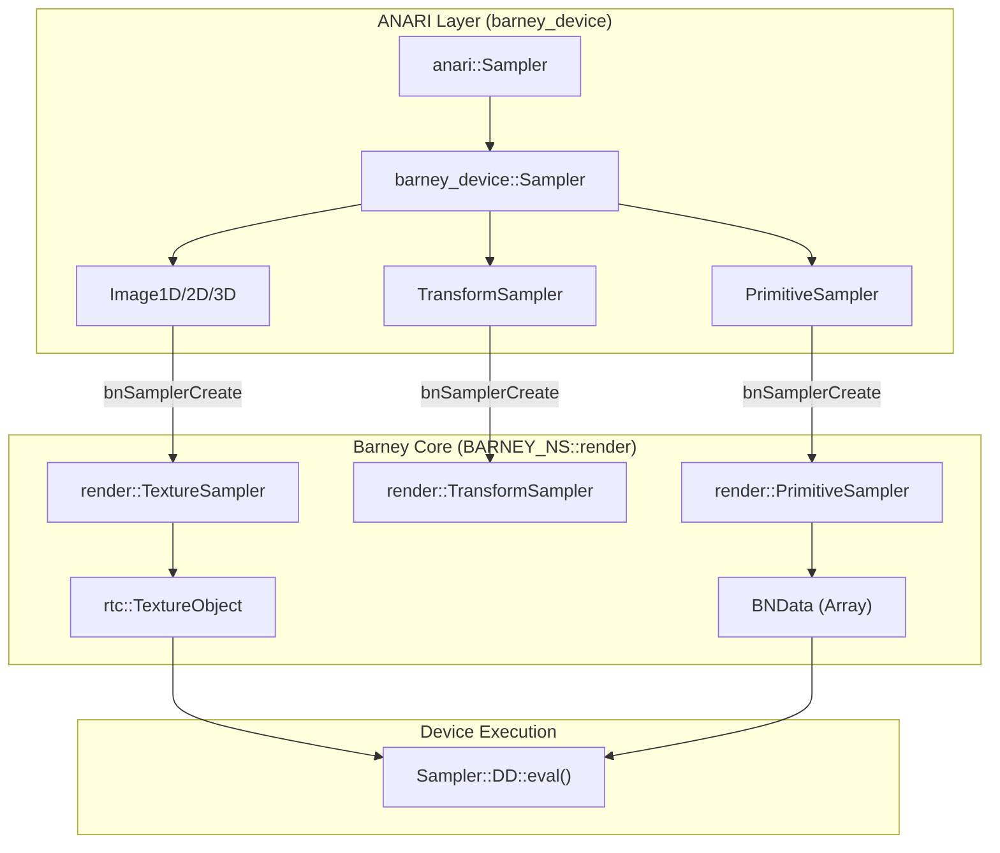
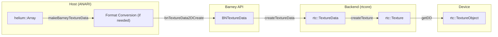

<!-- source: DeepWiki mcp.deepwiki.com · repo NVIDIA/barney · page 7.2 Texture Samplers · fetched 2026-10-26 -->

# Texture Samplers

<details>
<summary>Relevant source files</summary>

The following files were used as context for generating this wiki page:

- [anari/Sampler.cpp](anari/Sampler.cpp)
- [anari/Sampler.h](anari/Sampler.h)
- [anari/common.h](anari/common.h)
- [barney/common/Texture.cpp](barney/common/Texture.cpp)
- [barney/common/Texture.h](barney/common/Texture.h)
- [barney/fb/TiledFB.cu](barney/fb/TiledFB.cu)
- [barney/render/Sampler.cpp](barney/render/Sampler.cpp)
- [barney/render/Sampler.h](barney/render/Sampler.h)
- [rtcore/common/rtcore-common.h](rtcore/common/rtcore-common.h)

</details>


The Texture Sampler system in Barney provides a flexible mechanism for evaluating spatially-varying data during shading. It abstracts various data sources—such as 1D/2D/3D images, geometric attributes, or coordinate transformations—into a unified interface that can be sampled within device-side kernels.

## Sampler Hierarchy

Barney implements a sampler hierarchy that maps ANARI-level sampler objects to specialized internal classes. The base class `barney::render::Sampler` [barney/render/Sampler.h:34-116]() defines the interface for parameter commitment and device data generation.

### Image Samplers (1D, 2D, 3D)
`TextureSampler` [barney/render/Sampler.h:153-188]() handles samplers that operate on `rtc`-supported texture objects. It supports:
- **Image1D**: Typically used for transfer functions or lookup tables.
- **Image2D**: Standard surface texturing.
- **Image3D**: Volumetric or structured grid data.

These samplers wrap a `TextureData` object [barney/common/Texture.h:18-42](), which manages the actual texel storage across multiple GPUs.

### Transform Sampler
`TransformSampler` [barney/render/Sampler.h:118-125]() does not sample a texture but instead applies a coordinate transformation to an input attribute (e.g., transforming object-space positions to a different coordinate system before passing them to another sampler).

### Primitive Sampler
`PrimitiveSampler` [barney/render/Sampler.h:127-148]() allows sampling per-primitive data stored in an array. This is useful for mapping specific properties (like per-triangle IDs or colors) directly to shading inputs.

### Data Flow: ANARI to Barney
The following diagram illustrates how ANARI-layer sampler objects are translated into Barney's internal rendering entities.

**Diagram: Sampler Object Mapping**

Sources: [anari/Sampler.cpp:169-183](), [barney/render/Sampler.cpp:49-63](), [barney/render/Sampler.h:46-78]()

---

## Device-Side Evaluation (`Sampler::DD`)

The `Sampler::DD` (Device Data) struct [barney/render/Sampler.h:46-78]() is the bit-compatible representation of a sampler passed to the GPU. It contains all necessary information to evaluate the sampler without host intervention.

### The `eval` Function
The core logic resides in `Sampler::DD::eval` [barney/render/Sampler.h:202-230](). This function takes `HitAttributes` (the state at the ray-primitive intersection) and returns a `vec4f`.

1.  **Attribute Selection**: The sampler identifies which attribute to use as an input coordinate based on `inAttribute` (e.g., `ATTRIBUTE_0` for UVs, `WORLD_POSITION`, etc.) [barney/render/Sampler.h:76]().
2.  **Input Transform**: For texture samplers, an `inTransform` (4x4 matrix) is applied to the coordinate before sampling [barney/render/Sampler.h:65]().
3.  **Sampling**:
    - **Texture**: Uses `rtc::TextureObject` to perform filtered lookups [barney/render/Sampler.h:66]().
    - **Primitive**: Performs a direct array lookup using the primitive index [barney/render/Sampler.h:206-215]().
4.  **Output Transform**: Finally, an `outTransform` is applied to the sampled value before returning it to the shader [barney/render/Sampler.h:77]().

Sources: [barney/render/Sampler.h:46-78](), [barney/render/Sampler.h:202-230]()

---

## Attributes and Transformations

Barney uses a structured approach to mapping geometric data to sampler inputs.

### AttributeKind
Attributes are identified by the `AttributeKind` enum [barney/render/Sampler.cpp:14-33](). Supported types include:
- `ATTRIBUTE_0` through `ATTRIBUTE_3`: General purpose vertex attributes (e.g., UVs).
- `WORLD_POSITION` / `OBJECT_POSITION`: Spatial coordinates.
- `COLOR`: Per-vertex or per-primitive color.

### AttributeTransform
The `AttributeTransform` struct [barney/render/Sampler.h:24-32]() provides an optimized 4x4 matrix multiplication for `vec4f` values in device code. It is used for both coordinate remapping (`inTransform`) and value remapping (`outTransform`).

```cpp
// Logic for applying transform in device code
inline __rtc_device vec4f AttributeTransform::applyTo(const vec4f &in) const {
  vec4f out = offset;
  out = out + in.x * mat_x;
  out = out + in.y * mat_y;
  out = out + in.z * mat_z;
  out = out + in.w * mat_w;
  return out;
}
```
Sources: [barney/render/Sampler.h:191-200](), [barney/render/Sampler.cpp:14-33]()

---

## Sampler Registry

The `SamplerRegistry` manages the lifecycle and device-side memory for all samplers within a `SlotContext`.

- **Allocation**: When a `Sampler` is created, it allocates a unique `samplerID` from the registry [barney/render/Sampler.cpp:39]().
- **Update**: During `Sampler::commit()`, the sampler generates its `DD` struct and registers it with the device via `samplerRegistry->setDD(samplerID, dd, device)` [barney/render/Sampler.cpp:103]().
- **Deallocation**: When the sampler object is destroyed, it releases the ID back to the registry [barney/render/Sampler.cpp:46]().

Sources: [barney/render/Sampler.cpp:35-47](), [barney/render/Sampler.cpp:99-105]()

---

## ANARI Parameter Mapping

The ANARI device layer (`barney_device`) translates high-level ANARI parameters into Barney's internal `BNSampler` and `BNTextureData` objects.

| ANARI Parameter | Barney Equivalent | Description |
| :--- | :--- | :--- |
| `image` | `BNTextureData` | The raw pixel/texel data array [anari/Sampler.cpp:26-32](). |
| `inAttribute` | `inAttribute` | The geometry attribute used as coordinates [barney/render/Sampler.cpp:75-76](). |
| `wrapMode` | `BNTextureAddressMode` | Behavior at texture boundaries (Wrap, Clamp, Mirror, Border) [anari/common.h:43-54](). |
| `filter` | `BNTextureFilterMode` | Nearest vs. Linear interpolation [barney/common/Texture.cpp:35-40](). |
| `outTransform` | `outTransform` | Matrix applied to the sampled value [barney/render/Sampler.cpp:83-84](). |

### Texture Data Creation
Barney performs automatic format conversion if the input ANARI array type does not match a native GPU texture format. For example, `ANARI_FLOAT32_VEC3` data is converted to `BN_FLOAT32_VEC4` during `makeBarneyTextureData` to satisfy hardware alignment requirements [anari/Sampler.cpp:117-133]().

**Diagram: Texture Data Flow**

Sources: [anari/Sampler.cpp:26-151](), [barney/common/Texture.cpp:115-134](), [barney/common/Texture.h:18-42]()

---

