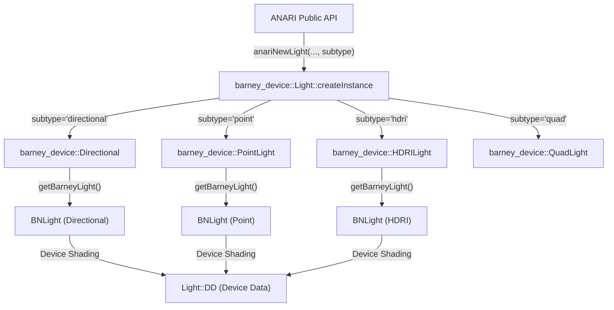
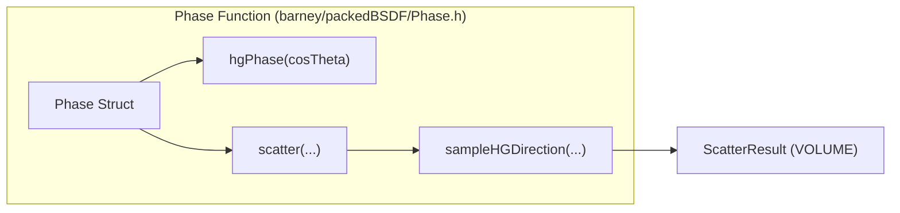

<!-- source: DeepWiki mcp.deepwiki.com · repo NVIDIA/barney · page 7.3 Lights · fetched 2026-10-26 -->

# Lights

Relevant source files

The following files were used as context for generating this wiki page:

- [anari/light/Light.cpp](anari/light/Light.cpp)
- [barney/light/EnvMap.h](barney/light/EnvMap.h)
- [barney/packedBSDF/Phase.h](barney/packedBSDF/Phase.h)
- [barney/render/DG.h](barney/render/DG.h)

The Barney light system provides a variety of light sources for physically-based rendering, ranging from basic analytical lights to complex image-based environment maps. Lights are managed through the ANARI device layer and translated into device-side data structures for use in the path tracing kernels.

## Light Hierarchy and Architecture

Barney implements lights using a host-side class hierarchy that maps to specialized device-side structures (`DD`). The `barney_device::Light` class serves as the base for all ANARI-compatible lights.

### Code Entity Mapping

The following diagram shows how ANARI light types are instantiated and mapped to Barney's internal representations.

**Light Instantiation and Mapping**

Sources: [anari/light/Light.cpp:23-33](), [anari/light/Light.h:10-40]()

## Supported Light Types

### 1. Directional Light
Directional lights represent infinitely distant sources (like the sun) where all rays are parallel.
*   **Parameters**: `color` (float3), `direction` (float3).
*   **ANARI Subtype**: `"directional"`.

### 2. Point Light
Point lights emit light omnidirectionally from a single point in space.
*   **Parameters**: `color` (float3), `position` (float3).
*   **ANARI Subtype**: `"point"`.

### 3. Quad Light
Area lights defined by a quadrilateral plane. These support physically based falloff and are sampled proportional to their area.
*   **ANARI Subtype**: `"quad"`.

### 4. HDRI / Environment Map
The `EnvMapLight` (or `HDRILight` in the ANARI layer) uses a high-dynamic-range image to illuminate the scene. It supports Importance Sampling based on the luminance of the pixels in the texture.

**Environment Map Components**
*   **Texture**: A 2D HDR image (lat-long format).
*   **CDFs**: Cumulative Distribution Functions calculated for importance sampling. `cdf_y` represents the marginal distribution for rows, and `allCDFs_x` contains conditional distributions for columns within each row [barney/light/EnvMap.h:45-46]().
*   **Orientation**: Defined by `direction` and `up` vectors to orient the environment map in world space [barney/light/EnvMap.h:82-83]().

Sources: [anari/light/Light.cpp:25-30](), [barney/light/EnvMap.h:22-47]()

## Device-Side Sampling and Evaluation

For path tracing, lights must implement sampling functions that return a direction, radiance, and the Probability Density Function (PDF) for that sample.

### The Light::DD Interface
The device-side data (`DD`) for lights provides methods to evaluate the light at a given hit point.

| Function | Purpose |
| :--- | :--- |
| `sample(Random &r)` | Samples a direction towards the light and returns radiance and PDF [barney/light/EnvMap.h:31](). |
| `pdf(vec3f dir)` | Returns the probability of having sampled the given direction [barney/light/EnvMap.h:30](). |
| `worldToPixel` | (EnvMap only) Maps a world-space direction to texture coordinates [barney/light/EnvMap.h:166-180](). |
| `pixelToWorld` | (EnvMap only) Maps a texture pixel to a world-space direction [barney/light/EnvMap.h:183-196](). |

### Environment Map Importance Sampling
To efficiently sample high-frequency HDRIs, Barney pre-computes CDFs on the device using compute kernels:
1.  **`computeWeights_xy`**: Calculates luminance weights for each pixel [barney/light/EnvMap.h:71]().
2.  **`computeCDFs_doLine`**: Generates 1D CDFs for rows [barney/light/EnvMap.h:72]().
3.  **`normalize_cdf_y`**: Finalizes the marginal distribution [barney/light/EnvMap.h:73]().

During rendering, `sampleCDF` is used to perform a binary search over these distributions to pick a light direction proportional to its intensity [barney/light/EnvMap.h:111-134]().

Sources: [barney/light/EnvMap.h:28-47](), [barney/light/EnvMap.h:111-134](), [barney/light/EnvMap.h:166-180]()

## Volume Scattering (Phase Functions)

When lights interact with volumes (participating media), the scattering behavior is defined by a **Phase Function**. Barney supports the Henyey-Greenstein phase function for anisotropic scattering.

**Phase Function Logic**

*   **Henyey-Greenstein**: Controlled by the anisotropy parameter `g`. If `|g| < 1e-3`, it defaults to isotropic scattering ($1/4\pi$) [barney/packedBSDF/Phase.h:52-53]().
*   **Sampling**: `sampleHGDirection` uses two random variables to generate a new direction based on the phase function's distribution [barney/packedBSDF/Phase.h:75-99]().

Sources: [barney/packedBSDF/Phase.h:16-39](), [barney/packedBSDF/Phase.h:49-57](), [barney/packedBSDF/Phase.h:75-99]()

## Data Flow: Host to Device

1.  **Commit**: The ANARI `commitParameters` method captures host-side values (e.g., `color`, `direction`) [anari/light/Light.cpp:41-44]().
2.  **Finalize**: The light is marked as finalized, triggering a structural scene change in the `BarneyGlobalState` [anari/light/Light.cpp:35-39]().
3.  **Barney Sync**: `getBarneyLight()` ensures a `BNLight` object exists in the core Barney context and updates its parameters via `bnLightSet` calls [anari/light/Light.cpp:51-60]().
4.  **SBT Entry**: During the build phase, light data is packed into the Shader Binding Table (SBT) or constant buffers for the CUDA/OptiX kernels to access during `shadeRays`.

Sources: [anari/light/Light.cpp:35-60](), [anari/light/Light.h:42-50]()

---

