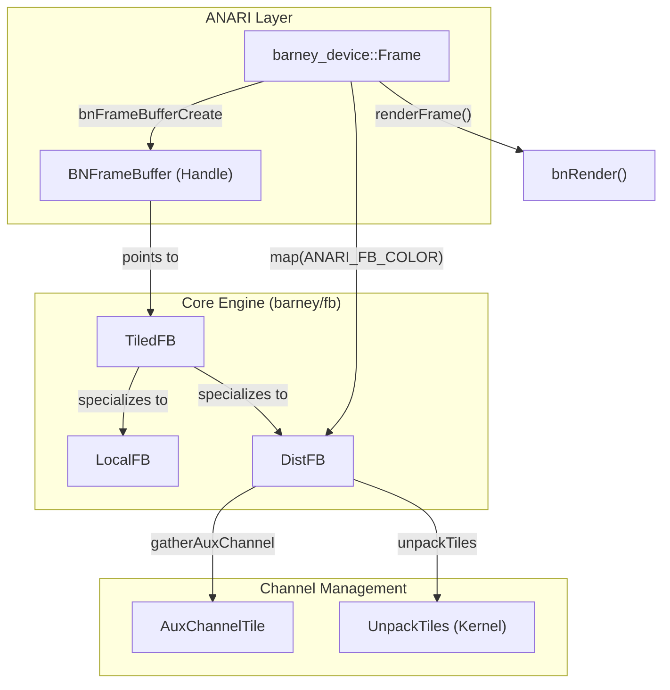
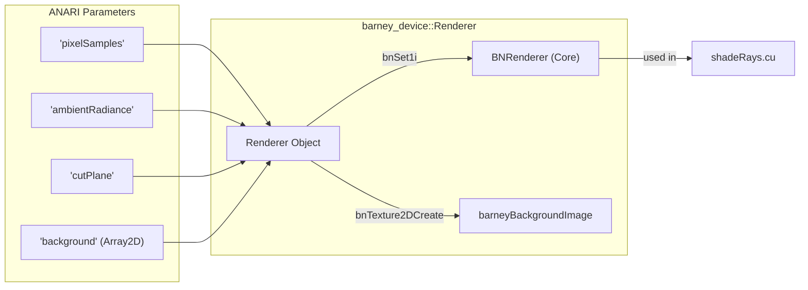

<!-- source: DeepWiki mcp.deepwiki.com · repo NVIDIA/barney · page 8 ANARI Frame and Renderer · fetched 2026-10-26 -->

# ANARI Frame and Renderer

Relevant source files

The following files were used as context for generating this wiki page:

- [anari/Frame.cpp](anari/Frame.cpp)
- [anari/Geometry.cpp](anari/Geometry.cpp)
- [anari/Renderer.cpp](anari/Renderer.cpp)
- [anari/Renderer.h](anari/Renderer.h)
- [anari/SpatialField.cpp](anari/SpatialField.cpp)
- [anari/barney_device.json](anari/barney_device.json)
- [barney/fb/DistFB.cu](barney/fb/DistFB.cu)

This section covers the management of the rendering lifecycle and the configuration of the rendering engine within the ANARI device layer. The **Frame** object manages the output buffers, denoising, and synchronization, while the **Renderer** object defines the visual properties and sampling strategies for the path tracer.

## 8.1 Frame Management
The `barney_device::Frame` class implements the `helium::BaseFrame` interface and serves as the primary controller for the rendering process. It manages the lifecycle of `BNFrameBuffer` objects, handles channel mapping (color, depth, IDs, normals), and coordinates the execution of render calls across multi-slot configurations.

Key responsibilities include:
*   **Parameter Mapping**: Translating ANARI parameters like `channel.color` and `size` into Barney-specific formats [anari/Frame.cpp:64-83]().
*   **Lifecycle Coordination**: The `renderFrame` method handles the flush of the global commit buffer, resets accumulation if the scene has changed, and invokes `bnRender` [anari/Frame.cpp:162-230]().
*   **Channel Access**: Managing host and CUDA-based access to framebuffer data through `map` and `unmap` operations [anari/Frame.cpp:232-264]().
*   **Post-Processing**: Configuring denoising and upscaling parameters on the underlying Barney framebuffer [anari/Frame.cpp:123-133]().

For details, see [Frame Management](#8.1).

### Frame and FrameBuffer Relationship
The following diagram illustrates how the ANARI `Frame` interacts with the core Barney `BNFrameBuffer` and the underlying distributed framebuffer architecture.

**Frame System Data Flow**

**Sources:** [anari/Frame.cpp:39-51](), [anari/Frame.cpp:162-230](), [barney/fb/DistFB.cu:117-160]().

---

## 8.2 Renderer Configuration
The `barney_device::Renderer` class defines how rays are traced and shaded. It acts as a bridge between ANARI renderer parameters and the `BNRenderer` core object. It supports features such as ambient radiance, background textures, and clipping planes.

Key configuration areas include:
*   **Sampling and Quality**: Parameters for `pixelSamples` (paths per pixel) and multi-scattering volume bounce limits [anari/Renderer.cpp:23-36]().
*   **Environmental Effects**: Handling of `ambientRadiance` and `background` colors or images [anari/Renderer.cpp:38-71]().
*   **Geometry Clipping**: Support for the `cutPlane` parameter, which allows for cross-sectional views of the scene [anari/Renderer.cpp:48-49]().
*   **Barney Capabilities**: The `barney_device.json` file defines the standard ANARI extensions supported, such as `khr_renderer_ambient_light` and `khr_renderer_background_image` [anari/barney_device.json:35-37]().

For details, see [Renderer Configuration](#8.2).

### Renderer Entity Mapping
This diagram bridges the ANARI parameter space to the internal Barney renderer state.

**Renderer Parameter Mapping**

**Sources:** [anari/Renderer.cpp:21-36](), [anari/Renderer.cpp:38-71](), [anari/Renderer.h:27-45]().

### Feature Summary Table

| Feature | ANARI Parameter | Code Entity | File Reference |
| :--- | :--- | :--- | :--- |
| **Denoising** | `denoise` | `m_denoise` | [anari/Renderer.cpp:26]() |
| **Upscaling** | `upscale` | `m_upscale` | [anari/Renderer.cpp:28]() |
| **Cut Plane** | `cutPlane` | `m_cutPlane` | [anari/Renderer.cpp:31]() |
| **Accumulation** | `khr_frame_accumulation` | `bnAccumReset` | [anari/Frame.cpp:173]() |
| **MPI Sync** | N/A | `Tether` | [anari/Frame.cpp:42]() |

**Sources:** [anari/Frame.cpp:170-175](), [anari/Renderer.cpp:21-36](), [anari/barney_device.json:30-35]().

---

