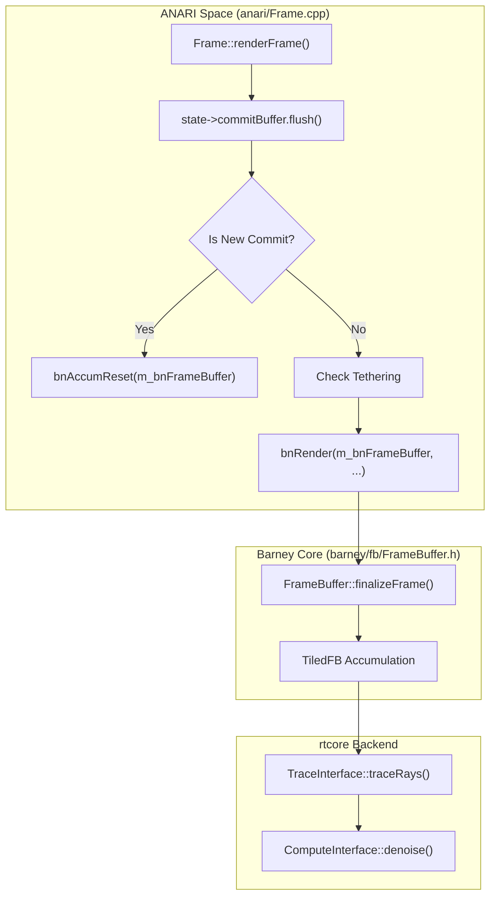
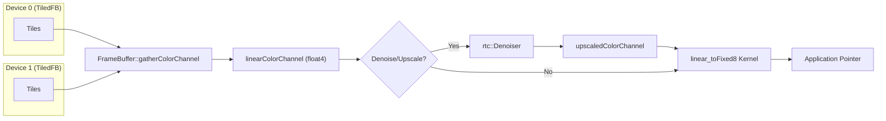

<!-- source: DeepWiki mcp.deepwiki.com · repo NVIDIA/barney · page 8.1 Frame Management · fetched 2026-10-26 -->

# Frame Management

Relevant source files

The following files were used as context for generating this wiki page:

- [anari/Frame.cpp](anari/Frame.cpp)
- [anari/Frame.h](anari/Frame.h)
- [anari/Renderer.cpp](anari/Renderer.cpp)
- [anari/Renderer.h](anari/Renderer.h)
- [anari/barney_device.json](anari/barney_device.json)
- [barney/common/Data.cpp](barney/common/Data.cpp)
- [barney/fb/FrameBuffer.h](barney/fb/FrameBuffer.h)

The **Frame** object in Barney (implemented as `barney_device::Frame`) acts as the primary orchestration point for the rendering lifecycle. It manages the relationship between the camera, the world (scene), and the renderer, while handling the allocation and resizing of the underlying `BNFrameBuffer`.

## 1. Frame Lifecycle and Configuration

The `Frame` object follows the standard ANARI create-set-commit-finalize pattern. During initialization, it creates a `BNFrameBuffer` handle associated with the context if the current slot is the master (slot 0) [anari/Frame.cpp:39-43]().

### commitParameters
In `commitParameters`, the frame retrieves its core dependencies and output requirements from the ANARI application:
- **Objects**: `renderer`, `camera`, and `world` [anari/Frame.cpp:66-68]().
- **Channels**: Requested output buffers (color, depth, primitiveId, instanceId, objectId, and normal) [anari/Frame.cpp:69-80]().
- **Dimensions**: The requested pixel `size` [anari/Frame.cpp:81]().

### finalize (Framebuffer Resizing)
The `finalize()` method translates ANARI parameters into Barney-core configurations.
1. **Validation**: Ensures all required objects (renderer, camera, world) are present [anari/Frame.cpp:89-105]().
2. **Channel Bitmask**: Constructs a bitmask of `requiredChannels` based on the requested ANARI types [anari/Frame.cpp:111-121]().
3. **Core Sync**: Passes renderer settings like `denoise`, `fadeOutDenoiser`, and `upscale` to the `BNFrameBuffer` [anari/Frame.cpp:124-127]().
4. **Resize**: Calls `bnFrameBufferResize` to allocate/reallocate device memory. The `m_displaySize` is updated to reflect the actual dimensions returned by the core [anari/Frame.cpp:129-137]().

| ANARI Channel | Barney Channel Flag | Data Type (Example) |
| :--- | :--- | :--- |
| `channel.color` | `BN_FB_COLOR` | `BN_UFIXED8_RGBA_SRGB` |
| `channel.depth` | `BN_FB_DEPTH` | `BN_FLOAT` |
| `channel.primitiveId` | `BN_FB_PRIMID` | `BN_UINT32` |
| `channel.normal` | `BN_FB_NORMAL` | `BN_FLOAT3` |

**Sources:** [anari/Frame.cpp:64-144](), [barney/fb/FrameBuffer.h:31-33]()

---

## 2. Rendering Execution

The `renderFrame()` function is the entry point for generating an image. It coordinates multi-GPU tethering, accumulation resets, and the actual ray tracing call.

### The Render Loop Flow
1. **Commit Flush**: Flushes the `BarneyGlobalState` commit buffer to ensure all scene changes are applied [anari/Frame.cpp:167]().
2. **Accumulation Reset**: If a new commit has been finalized since the last frame, `bnAccumReset` is called to clear progressive refinement [anari/Frame.cpp:170-175]().
3. **Tether Coordination**: In multi-GPU/distributed environments, `renderFrame` must be called by all "tethers" (local devices) before the master rank triggers the actual render [anari/Frame.cpp:218-223]().
4. **Core Render**: The master slot calls `bnRender`, passing the camera, model, and renderer handles [anari/Frame.cpp:224-228]().

### Data Flow: ANARI to rtcore
The following diagram illustrates how the ANARI `Frame` object bridges high-level user parameters to the low-level `rtcore` execution.

**Title: Frame Rendering Orchestration**

**Sources:** [anari/Frame.cpp:162-230](), [barney/fb/FrameBuffer.h:42-43]()

---

## 3. Buffer Mapping and Access

Barney provides access to rendered pixels through the `map()` and `unmap()` interface. This supports both host-side access and direct CUDA channel access for interoperability.

### Channel Mapping
When `map()` is called for a specific channel (e.g., `"color"`), the frame performs the following:
1. **Read/Gather**: Calls `bnFrameBufferRead`, which triggers the core to gather tiles from all GPUs/nodes into a linear staging buffer [anari/Frame.cpp:258-283]().
2. **Allocation**: If host-side buffers haven't been allocated for the channel, the `Frame` object allocates them to match the `m_displaySize` [anari/Frame.cpp:261-264]().
3. **Data Transfer**: The core `FrameBuffer::read` implementation handles reformatting (e.g., float4 to RGBA8) and copying to the provided pointer [barney/fb/FrameBuffer.h:66-68]().

### CUDA Interop
If the `nv_frame_buffers_cuda` extension is used, Barney can return CUDA device pointers directly, avoiding host-to-device transfers if the application is also running on the GPU [anari/barney_device.json:39]().

**Title: FrameBuffer Data Gathering**

**Sources:** [anari/Frame.cpp:241-300](), [barney/fb/FrameBuffer.h:48-68](), [barney/fb/FrameBuffer.h:141-151]()

---

## 4. Cleanup and Resource Management

The `Frame` object ensures that all internal staging buffers and core handles are released during destruction or reconfiguration.

- **`cleanup()`**: Frees the host-side channel buffers (`m_channelBuffers.color`, `depth`, etc.) allocated during `map()` [anari/Frame.cpp:333-345]().
- **Destructor**: Calls `wait()` to ensure the GPU is idle, performs `cleanup()`, and releases the `BNFrameBuffer` handle via `bnRelease` [anari/Frame.cpp:45-51]().
- **`freeResources()`**: Inside the core `FrameBuffer`, this method releases staging areas like `linearColorChannel`, `renderAuxChannel`, and `upscaledColorChannel` [barney/fb/FrameBuffer.h:37]().

**Sources:** [anari/Frame.cpp:45-51](), [anari/Frame.cpp:333-345](), [barney/fb/FrameBuffer.h:82-98]()

---

