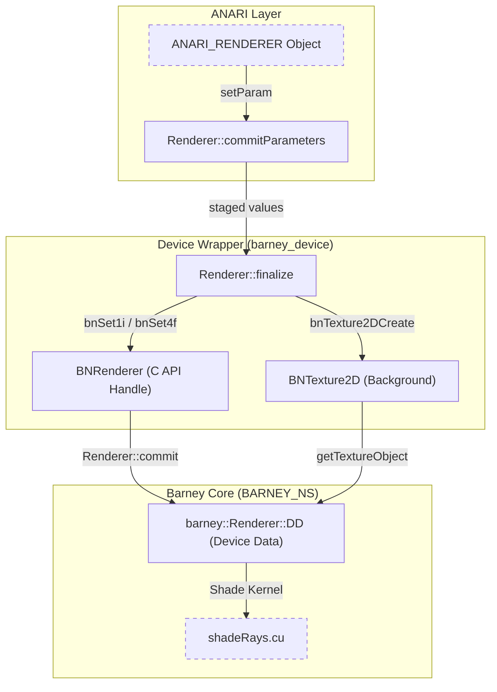

<!-- source: DeepWiki mcp.deepwiki.com · repo NVIDIA/barney · page 8.2 Renderer Configuration · fetched 2026-10-26 -->

# Renderer Configuration

<details>
<summary>Relevant source files</summary>

The following files were used as context for generating this wiki page:

- [anari/Frame.cpp](anari/Frame.cpp)
- [anari/Renderer.cpp](anari/Renderer.cpp)
- [anari/Renderer.h](anari/Renderer.h)
- [anari/barney_device.json](anari/barney_device.json)
- [barney/render/Renderer.cpp](barney/render/Renderer.cpp)
- [barney/render/Renderer.h](barney/render/Renderer.h)

</details>


The `Renderer` configuration system in Barney manages global rendering parameters, post-processing toggles, and environmental settings. It acts as the bridge between the ANARI API's `ANARI_RENDERER` object and the internal `barney::Renderer` engine state. This configuration governs behavior such as path tracing sample counts, denoising, upscaling, and global clipping planes.

## Renderer Lifecycle and Parameter Mapping

The `barney_device::Renderer` class handles the translation of ANARI parameters into Barney-specific API calls. This process occurs in two primary stages: `commitParameters` and `finalize`.

### Parameter Commit (`commitParameters`)
During `commitParameters`, the renderer fetches values from the ANARI state and stores them in local member variables.

| ANARI Parameter | Member Variable | Default | Description |
| :--- | :--- | :--- | :--- |
| `pixelSamples` | `m_pixelSamples` | 1 | Number of paths traced per pixel per frame. |
| `ambientRadiance` | `m_ambientRadiance` | 1.0f | Global ambient light intensity. |
| `denoise` | `m_denoise` | true | Enables/disables the denoiser. |
| `fadeOutDenoiser` | `m_fadeOutDenoiser` | true | Progressively reduces denoiser strength during accumulation. |
| `upscale` | `m_upscale` | false | Enables spatial upscaling. |
| `background` | `m_background` | (0,0,0,1) | Solid background color (float4). |
| `background` (Object) | `m_backgroundImage` | nullptr | 2D Array for background texture. |
| `cutPlane` | `m_cutPlane` | (0,0,0,0) | Plane equation $(nx, ny, nz, d)$ for clipping. |
| `maxVolumeBounces`| `m_maxVolumeBounces`| 8 | Maximum scattering events in volumes. |

Sources: [anari/Renderer.cpp:21-36](), [anari/Renderer.h:32-44]()

### Finalization (`finalize`)
In `finalize`, the local members are pushed to the underlying `BNRenderer` object using the Barney C API. If a background image is provided, a `BNTexture2D` is created and bound to the renderer.

- **Solid Color:** Set via `bnSetVec(barneyRenderer, "bgColor", ...)` [anari/Renderer.cpp:40]().
- **Texture:** If `m_backgroundImage` is set, a new `BNTexture2D` is created with `BN_TEXTURE_LINEAR` filtering and `BN_TEXTURE_CLAMP` addressing [anari/Renderer.cpp:51-62]().
- **Clipping Plane:** The `cutPlane` is passed as a 4-component float vector [anari/Renderer.cpp:48-49]().

## System Architecture: ANARI to Barney Core

The following diagram illustrates how configuration data flows from the ANARI property interface through the `barney_device` wrapper into the core rendering engine.

### Data Flow: Renderer Configuration

Sources: [anari/Renderer.cpp:38-71](), [barney/render/Renderer.h:17-30](), [barney/render/Renderer.cpp:26-37]()

## Device Data Structure (`Renderer::DD`)

The `Renderer::DD` (Device Data) struct is the GPU-resident representation of the renderer configuration. It is populated by `Renderer::getDD` and passed to ray tracing kernels.

```cpp
struct DD {
  vec4f              bgColor;
  rtc::TextureObject bgTexture;
  float              ambientRadiance;
  int                pathsPerPixel;
  vec4f              cutPlane;
#if BARNEY_USE_MULTI_SCATTERING
  int                maxVolumeBounces;
  int                volumeMultiScatter;
#endif
};
```
Sources: [barney/render/Renderer.h:20-30](), [barney/render/Renderer.cpp:102-117]()

## Framebuffer Synchronization

The renderer configuration directly influences the `BNFrameBuffer` behavior, specifically regarding post-processing. During `Frame::finalize`, the renderer's toggles are applied to the framebuffer object before resizing.

1. **Denoising:** If `m_renderer->denoise()` is true, the `BNFrameBuffer` is configured to allocate and execute denoising passes [anari/Frame.cpp:124]().
2. **Upscaling:** The `upscale` parameter triggers the allocation of high-resolution buffers and the execution of upscaling kernels [anari/Frame.cpp:126]().
3. **Accumulation Reset:** If a renderer parameter changes (detected via `state->commitBuffer`), `bnAccumReset` is called to clear previous samples [anari/Frame.cpp:170-174]().

Sources: [anari/Frame.cpp:123-133](), [anari/Frame.cpp:169-175]()

## Capability Definition (`barney_device.json`)

The capabilities and default values of the renderer are defined in the ANARI device query file. This allows ANARI clients to discover supported features like `khr_renderer_background_image` and `nv_frame_buffers_cuda`.

### Mapping ANARI Features to Barney
| Feature Tag | Barney Implementation |
| :--- | :--- |
| `khr_renderer_ambient_light` | `m_ambientRadiance` parameter |
| `khr_renderer_background_image` | `bnTexture2DCreate` in `Renderer::finalize` |
| `khr_frame_accumulation` | `bnAccumReset` logic in `Frame::renderFrame` |
| `nv_frame_buffers_cuda` | Support for CUDA-interop framebuffer mapping |

Sources: [anari/barney_device.json:35-39](), [anari/barney_device.json:44-100]()

## Code Entity Relationship

The following diagram bridges the ANARI object model to the specific C++ classes and Barney API handles.

### Entity Mapping: Renderer Subsystem
```mermaid
classDiagram
    class "ANARI_RENDERER" {
        <<Interface>>
    }
    class "barney_device::Renderer" {
        +BNRenderer barneyRenderer
        +BNTexture2D barneyBackgroundImage
        +commitParameters()
        +finalize()
    }
    class "barney::Renderer" {
        +struct staged
        +struct DD
        +commit()
        +getDD(Device*)
    }
    class "BNRenderer" {
        <<C API Handle>>
    }

    "ANARI_RENDERER" <|-- "barney_device::Renderer" : implements
    "barney_device::Renderer" o-- "BNRenderer" : wraps
    "BNRenderer" ..> "barney::Renderer" : internal implementation
    "barney::Renderer" +-- "barney::Renderer::DD" : provides GPU data
```
Sources: [anari/Renderer.h:13-28](), [barney/render/Renderer.h:17-30]()

---

