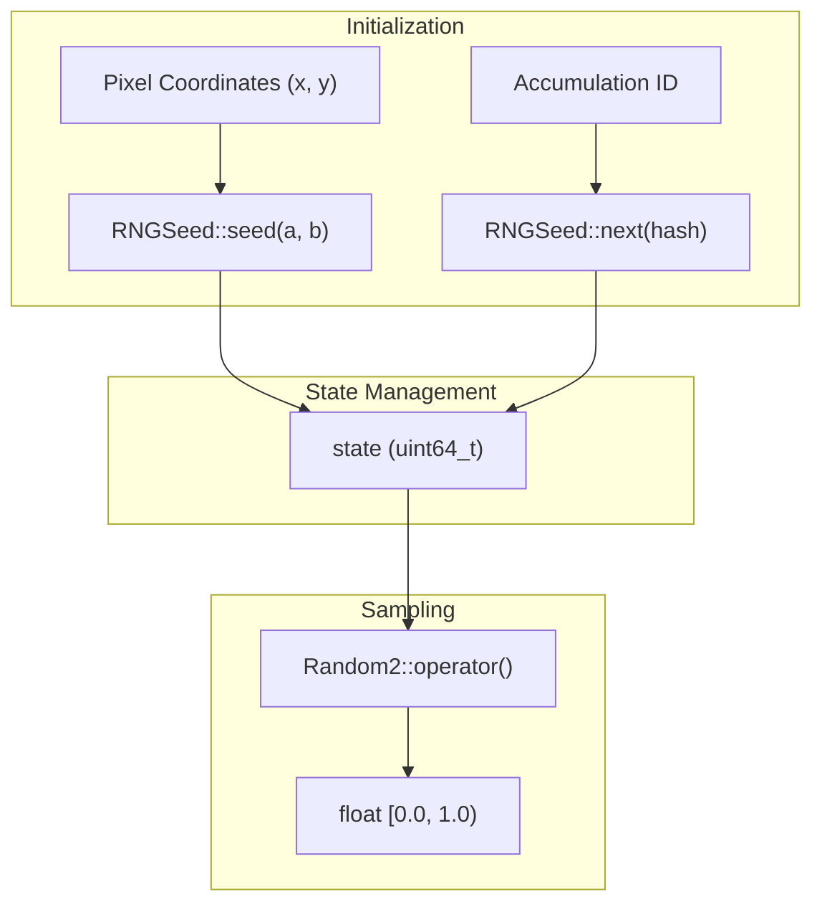
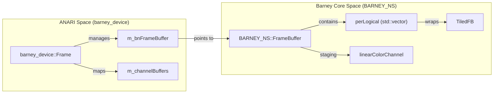

<!-- source: DeepWiki mcp.deepwiki.com · repo NVIDIA/barney · page 9 Common Utilities and Data Structures · fetched 2026-10-26 -->

# Common Utilities and Data Structures

Relevant source files

The following files were used as context for generating this wiki page:

- [anari/Frame.h](anari/Frame.h)
- [anari/Geometry.h](anari/Geometry.h)
- [barney/common/Data.cpp](barney/common/Data.cpp)
- [barney/common/barney-common.h](barney/common/barney-common.h)
- [barney/common/barneyConfig.h.in](barney/common/barneyConfig.h.in)
- [barney/common/half.h](barney/common/half.h)
- [barney/common/math.h](barney/common/math.h)
- [barney/fb/FrameBuffer.h](barney/fb/FrameBuffer.h)
- [barney/render/GeometryAttributes.cpp](barney/render/GeometryAttributes.cpp)

This section provides a technical reference for the shared utilities and data structures used across Barney. These components provide the foundation for math operations, random number generation, memory management, and hardware abstraction.

## Core Configuration and Hardware Abstraction

The Barney build configuration is primarily managed through `barneyConfig.h`, which is generated by CMake. It defines the availability of backends and specific features like NanoVDB or multi-scattering.

### System Configuration Flags
| Flag | Purpose |
| :--- | :--- |
| `BARNEY_HAVE_CUDA` | Enables CUDA-specific code paths [barney/common/barneyConfig.h.in:2](). |
| `BARNEY_OIDN_GPU/CPU` | Configures Intel Open Image Denoiser backend [barney/common/barneyConfig.h.in:3-4](). |
| `BARNEY_USE_MULTI_SCATTERING` | Enables advanced volume scattering kernels [barney/common/barneyConfig.h.in:8](). |
| `BARNEY_CUBQL_BVH_WIDTH` | Sets the branching factor for cuBQL-based BVHs [barney/common/barneyConfig.h.in:14](). |

The codebase uses a namespace alias `BARNEY_NS` which is dynamically assigned based on the selected rendering backend (OptiX, Embree, or CUDA) to avoid symbol collisions in multi-backend builds [barney/common/barney-common.h:33-53]().

**Sources:** [barney/common/barneyConfig.h.in:1-17](), [barney/common/barney-common.h:33-53]()

---

## Math Types and Utilities

Barney leverages `owl::common` for basic vector math but extends it with specialized ray tracing utilities and half-precision support.

### Math Constants and Functions
Standard constants like `ONE_PI` and `FOUR_PI` are defined alongside safe division and clamping functions [barney/common/math.h:13-27](). 
- **Saturate:** Clamps values to the `[0, 1]` range for colors and weights [barney/common/math.h:39-46]().
- **Color Conversion:** `linear_to_srgb` handles gamma correction for final display [barney/common/math.h:52-66]().
- **Quantization:** `make_rgba` packs `vec4f` colors into `uint32_t` for framebuffer storage [barney/common/math.h:101-116]().

### Half-Precision (FP16)
To reduce memory footprint, Barney provides `vec3h` and `vec2h` structures. These wrap hardware-specific types like `__half` (CUDA/HIP) or `float16_t` (CPU/Embree) [barney/common/half.h:11-18]().

**Sources:** [barney/common/math.h:1-137](), [barney/common/half.h:1-89]()

---

## Random Number Generation (RNG)

Barney implements a custom PCG-based (Permuted Congruential Generator) random number system designed for high-performance parallel execution.

### RNG Architecture
The system consists of two main entities:
1. `RNGSeed`: Manages a 64-bit state and provides the core hash/mixing functions [barney/common/barney-common.h:65-95]().
2. `Random2`: A wrapper that provides `[0, 1]` float distributions and initialization from 2D coordinates (e.g., pixel x/y) [barney/common/barney-common.h:97-111]().

### RNG Data Flow
The following diagram illustrates how seeds are initialized and consumed within the rendering kernels.

**Title: Random Number Generation Data Flow**

**Sources:** [barney/common/barney-common.h:65-111]()

---

## Data and PODData Objects

Barney uses a structured data management system to handle the transfer of arrays (vertices, indices, etc.) between the host and multiple GPUs.

### Data Object Hierarchy
- `BaseData`: The abstract base class tracking the `BNDataType` and the `DeviceGroup` it belongs to [barney/common/Data.cpp:205-212]().
- `PODData`: Manages "Plain Old Data" buffers. It maintains a `perLogical` vector of `rtc::Buffer` objects, ensuring data is replicated across all GPUs in the context [barney/common/Data.cpp:223-231]().

### Supported Data Types
The `toRTC` function maps Barney types to the underlying `rtcore` types:
| Barney Type | RTC Type |
| :--- | :--- |
| `BN_FLOAT32_VEC3` | `rtc::FLOAT3` |
| `BN_INT32` | `rtc::INT` |
| `BN_UFIXED8_RGBA` | `rtc::UCHAR4` |

**Sources:** [barney/common/Data.cpp:12-69](), [barney/common/Data.cpp:205-231]()

---

## FrameBuffer Utilities

The `FrameBuffer` class is the primary sink for rendering results. It manages both the color channel and auxiliary channels (depth, IDs, normals) required for denoising and picking.

### Channel Management
Framebuffers support multiple formats and resolutions:
- **Tiling:** Data is rendered into `TiledFB` structures on the device and later linearized [barney/fb/FrameBuffer.h:71-74]().
- **Gathering:** The `gatherColorChannel` and `gatherAuxChannel` virtual functions handle the complexity of aggregating data from multiple GPUs or MPI ranks [barney/fb/FrameBuffer.h:48-60]().
- **Upscaling:** Supports OptiX AI upscaling where tiles render at half-resolution and are expanded during the finalization phase [barney/fb/FrameBuffer.h:142-143]().

### System Entity Mapping: FrameBuffer
This diagram maps the high-level ANARI frame concepts to the internal Barney data structures.

**Title: ANARI to Barney Frame Mapping**

**Sources:** [barney/fb/FrameBuffer.h:12-156](), [anari/Frame.h:17-100]()

---

## Geometry Attributes

The `GeometryAttributes` utility handles the mapping of various attribute scopes (constant, per-vertex, per-primitive, or face-varying) to the device-side data structures used during shading.

### Attribute Scopes
The `getDD` (Device Data) function translates host-side attribute bindings into a format the GPU kernels can consume [barney/render/GeometryAttributes.cpp:10-53]():
- **FACE_VARYING:** Unique values per vertex per face (e.g., UVs with seams) [barney/render/GeometryAttributes.cpp:18]().
- **PER_VERTEX:** Values interpolated across the primitive [barney/render/GeometryAttributes.cpp:24]().
- **PER_PRIM:** Constant value across an entire triangle/sphere [barney/render/GeometryAttributes.cpp:30]().
- **CONSTANT:** A single value for the entire geometry [barney/render/GeometryAttributes.cpp:38]().

**Sources:** [barney/render/GeometryAttributes.cpp:10-56](), [anari/Geometry.h:13-33]()

---

