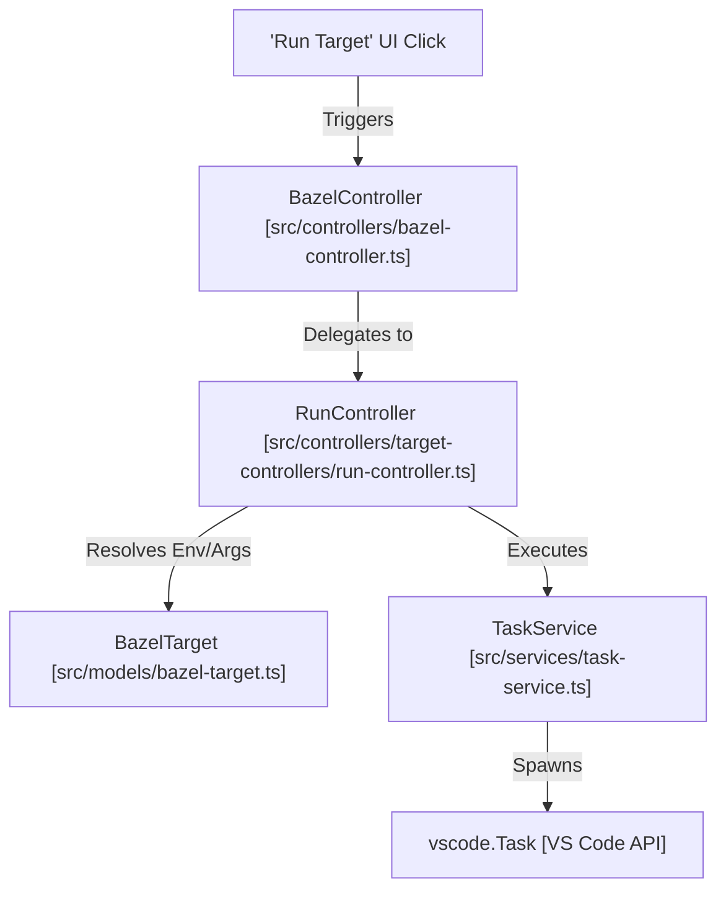
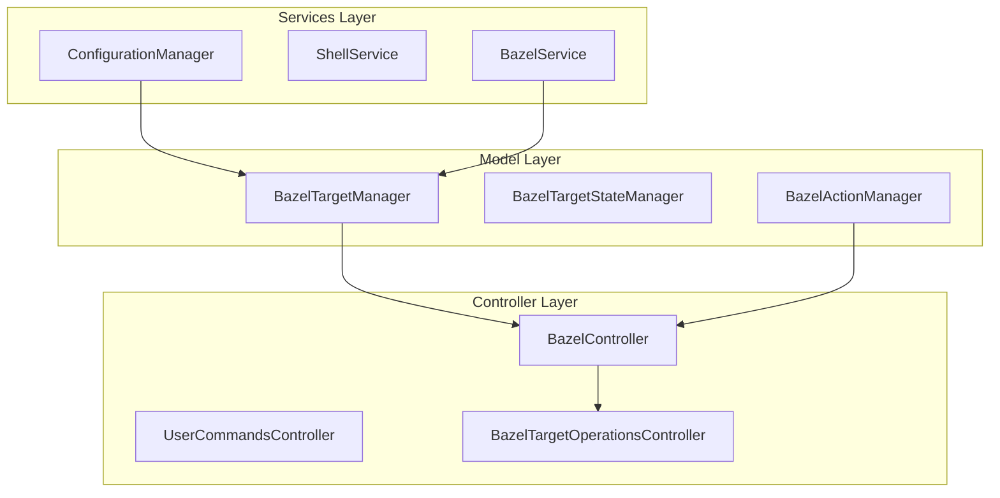

<!-- source: DeepWiki mcp.deepwiki.com · repo NVIDIA/bluebazel · page 1 Overview · fetched 2026-10-26 -->

# Overview

Relevant source files

The following files were used as context for generating this wiki page:

- [README.md](README.md)
- [ReleaseNotes.md](ReleaseNotes.md)
- [package.json](package.json)
- [src/extension.ts](src/extension.ts)

BlueBazel is a Visual Studio Code extension designed to provide a robust UI for building, running, debugging, and testing projects using the **Bazel** (or **Dazel**) build system. It simplifies complex Bazel workflows by offering a dedicated tree view for target management, interactive CodeLens actions for unit tests, and a highly customizable templating system for user-defined commands.

## Key Capabilities

*   **Target Management**: Organize Bazel targets into actions (Build, Run, Test, Debug) with persistent configurations for arguments and environment variables [package.json:102-113]().
*   **Integrated Debugging**: First-class support for debugging C++, Python, and Go targets directly from the VS Code interface [ReleaseNotes.md:31]().
*   **CodeLens Integration**: Run or debug specific test cases or `main()` functions via overlays directly in the source code [ReleaseNotes.md:37]().
*   **Extensible Commands**: A three-layer templating engine (`${keyword}`, `[Pick/Input]`, and `<shell>`) that allows users to create custom buttons and complex shell automation [README.md:71-110]().
*   **Discovery Strategies**: Hybrid target discovery using either high-speed BUILD file parsing or comprehensive `bazel query` pipelines [ReleaseNotes.md:54]().

## System Architecture

BlueBazel follows a layered architecture to separate concerns between the Bazel CLI, internal data models, and the VS Code UI.

### Logic Flow: Natural Language to Code Entities
The following diagram bridges the gap between high-level user actions and the specific classes that handle them.

**Target Execution Flow**

Sources: [src/extension.ts:72-103](), [src/extension.ts:144-147](), [package.json:104-107]()

### Subsystem Relationships
The extension initializes services first, followed by models that hold state, and finally controllers that bridge the UI to the logic.

**Initialization Hierarchy**

Sources: [src/extension.ts:112-198]()

## Major Components

| Component | Responsibility | Key Files |
| :--- | :--- | :--- |
| **Services** | Low-level wrappers for Shell, File System, and Bazel CLI. | `src/services/` |
| **Models** | State management for targets, environment variables, and persistence. | `src/models/` |
| **Controllers** | Command registration and business logic for Build/Run/Debug. | `src/controllers/` |
| **UI** | Tree view providers and CodeLens implementations. | `src/ui/` |
| **Language Plugins** | Language-specific debug configurations (C++, Go, Python). | `src/languages/` |

## Getting Started

To begin using or developing for BlueBazel, refer to the following child pages:

*   **[Getting Started & Configuration](#1.1)**: Covers installation, workspace requirements (like `WORKSPACE` or `MODULE.bazel` files), and an exhaustive guide to user settings [package.json:16-21]().
*   **[Extension Activation & Initialization](#1.2)**: A technical deep-dive into the `activate()` sequence, service instantiation order, and how the extension hooks into the VS Code lifecycle [src/extension.ts:112-230]().

For a deeper look at the internal mechanics, see the **Core Architecture** section.

---

