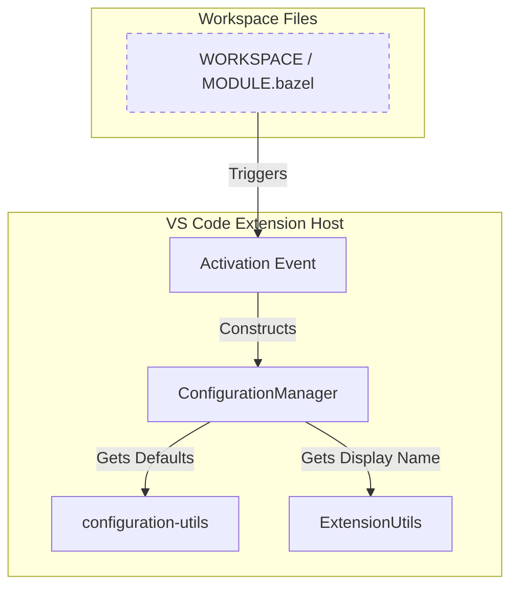
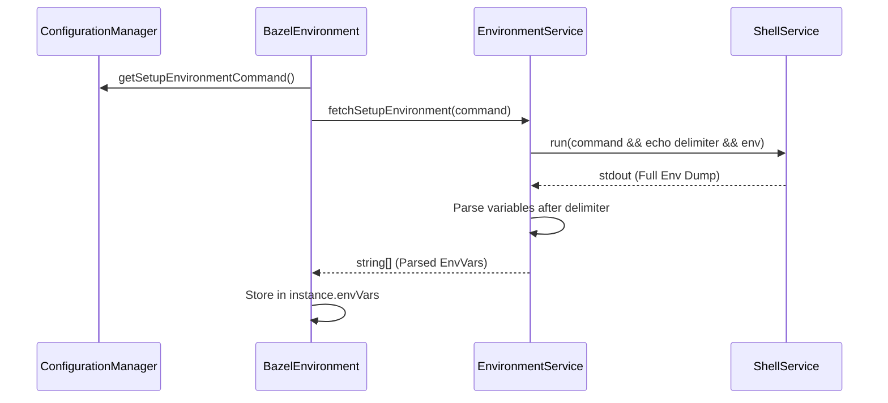
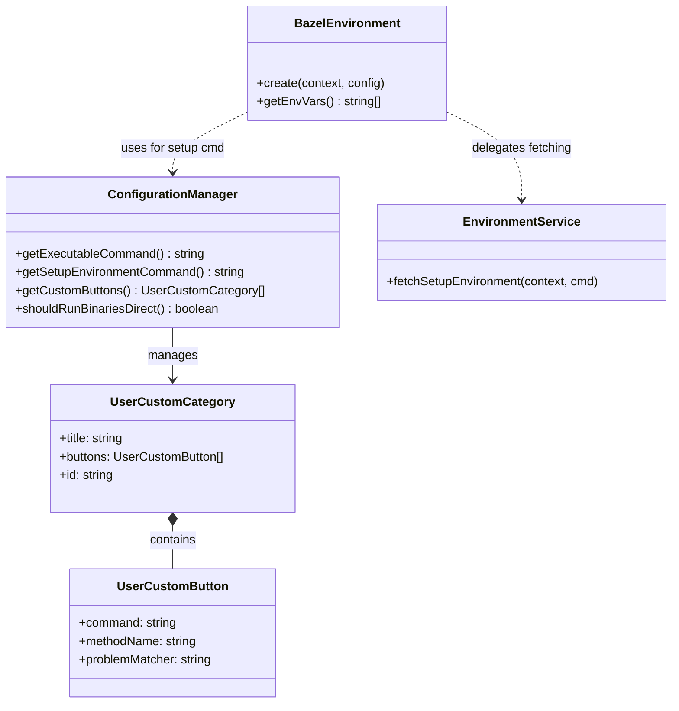

<!-- source: DeepWiki mcp.deepwiki.com · repo NVIDIA/bluebazel · page 1.1 Getting Started & Configuration · fetched 2026-10-26 -->

# Getting Started & Configuration

Relevant source files

The following files were used as context for generating this wiki page:

- [package-lock.json](package-lock.json)
- [package.json](package.json)
- [releases/bluebazel-1.0.5.vsix](releases/bluebazel-1.0.5.vsix)
- [src/models/bazel-environment.ts](src/models/bazel-environment.ts)
- [src/services/configuration-manager.ts](src/services/configuration-manager.ts)
- [src/services/environment-service.ts](src/services/environment-service.ts)

This page details the installation, activation requirements, and comprehensive configuration options for BlueBazel. It explains how the extension interacts with the Bazel workspace and how users can customize execution environments, commands, and UI elements via the `ConfigurationManager`.

## Installation & Activation

BlueBazel is packaged as a VS Code extension (`.vsix`) [releases/bluebazel-1.0.5.vsix:1-32](). It activates automatically when it detects a Bazel workspace root.

### Prerequisites
The extension looks for specific marker files in the root of the opened workspace folder to trigger activation [package.json:16-21]():
*   `WORKSPACE` or `WORKSPACE.bazel`
*   `MODULE` or `MODULE.bazel` (Bazel 6+ Bzlmod)

Once activated, the extension contributes a "Blue Bazel" view to the VS Code Explorer container [package.json:42-50]().

### Data Flow: Activation to UI
The following diagram illustrates the relationship between workspace files, the activation event, and the initialization of the configuration system.

**System Activation & Configuration Initialization**

**Sources:** [package.json:16-21](), [src/services/configuration-manager.ts:96-102](), [src/services/configuration-manager.ts:104-109]()

---

## Configuration Management

The `ConfigurationManager` class serves as the central authority for all user-facing settings. It merges default extension settings with user-provided overrides from `.vscode/settings.json` [src/services/configuration-manager.ts:96-102]().

### Core Execution Settings
These settings define how the extension interacts with the Bazel binary and the underlying shell.

| Setting | Default | Description |
| :--- | :--- | :--- |
| `executableCommand` | `"bazel"` | The path or alias for the Bazel executable [src/services/configuration-manager.ts:143-149](). |
| `setupEnvironmentCommand` | `""` | A shell command executed to initialize the environment (e.g., sourcing a script) [src/services/configuration-manager.ts:135-141](). |
| `showShellCommandOutput` | `false` | Whether to display output from internal shell commands in the console [src/services/configuration-manager.ts:160-169](). |
| `clearTerminalBeforeAction` | `false` | If true, clears the VS Code terminal before starting a new Bazel task [src/services/configuration-manager.ts:171-180](). |

### Environment Setup Logic
If `setupEnvironmentCommand` is provided, the `EnvironmentService` executes the command followed by an `env` dump to capture the resulting environment variables [src/services/environment-service.ts:34-50](). These variables are then parsed and stored in `BazelEnvironment` for use in all subsequent Bazel actions [src/models/bazel-environment.ts:28-51]().

**Environment Capture Pipeline**

**Sources:** [src/services/environment-service.ts:34-89](), [src/models/bazel-environment.ts:31-51](), [src/services/configuration-manager.ts:135-141]()

---

## Customization & Extensibility

### Custom Buttons
Users can define custom UI elements in the BlueBazel tree view. These are organized into categories and mapped to specific shell commands or internal methods [src/services/configuration-manager.ts:30-89]().

*   **UserCustomCategory**: A grouping of buttons in the tree view [src/services/configuration-manager.ts:66-70]().
*   **UserCustomButton**: Individual actionable items. Supports `problemMatcher` for VS Code task integration [src/services/configuration-manager.ts:30-38]().

### Run-Mode Flags
BlueBazel provides toggles for how binaries are executed:
*   **`runBinariesDirect`**: When `true` (default), the extension attempts to run the compiled binary directly from the `bazel-bin` directory rather than calling `bazel run`. This is often faster and bypasses Bazel's overhead [src/services/configuration-manager.ts:193-202]().
*   **`buildAtRun`**: Controls whether a build is automatically triggered before a run/debug action [src/services/configuration-manager.ts:182-191]().

### Refresh Strategies
The extension supports manual and automatic target discovery:
*   **Manual Refresh**: Triggered via the `bluebazel.refreshTargets` command [package.json:144-147]().
*   **Discovery Logic**: The extension uses a combination of `bazel query` and manual `BUILD` file parsing (fallback) to populate the target list.

---

## Implementation Details

### Configuration Persistence
The `ConfigurationManager` utilizes `MergedConfiguration`, which wraps the standard VS Code `WorkspaceConfiguration` [src/services/configuration-manager.ts:98-102](). 

### Code Entity Mapping
The following diagram maps the logical configuration concepts to their implementation classes and methods.

**Configuration Logic to Code Entities**

**Sources:** [src/services/configuration-manager.ts:30-149](), [src/models/bazel-environment.ts:28-42](), [src/services/environment-service.ts:32-38]()

---

