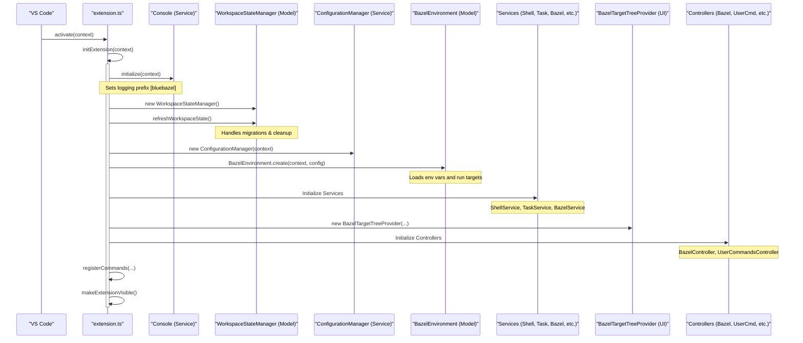
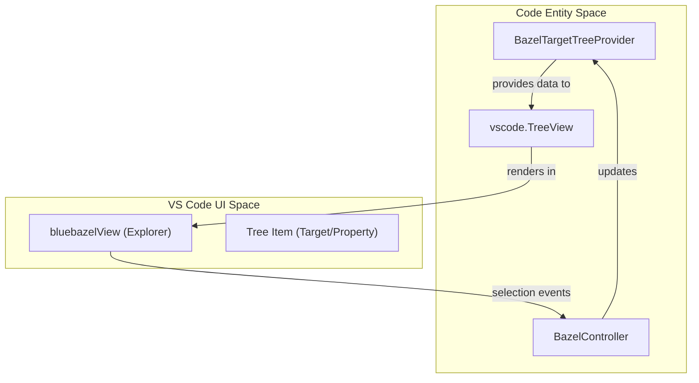

<!-- source: DeepWiki mcp.deepwiki.com · repo NVIDIA/bluebazel · page 1.2 Extension Activation & Initialization · fetched 2026-10-26 -->

# Extension Activation & Initialization

Relevant source files

The following files were used as context for generating this wiki page:

- [src/extension.ts](src/extension.ts)
- [src/services/console.ts](src/services/console.ts)
- [src/services/extension-utils.ts](src/services/extension-utils.ts)

This page provides a technical walkthrough of the BlueBazel extension's lifecycle, specifically focusing on the `activate()` and `initExtension()` sequence. The activation process follows a strict ordered initialization of services, models, UI components, and controllers to ensure that dependencies are correctly injected and the workspace state is synchronized before user interaction.

## Activation Overview

The entry point of the extension is the `activate` function in `src/extension.ts`. This function orchestrates the setup of the entire system. Because BlueBazel relies on a layered architecture, components are initialized in a specific order: Services → Models → UI → Controllers.

### Activation Flow Diagram
The following diagram illustrates the sequence of operations during extension startup, mapping natural language steps to the specific code entities involved.

**Title: Extension Initialization Sequence**

**Sources:** [src/extension.ts:112-212](), [src/services/console.ts:37-41]()

---

## Phase 1: Service & State Initialization

The first phase focuses on establishing the foundational services and restoring the persistent state of the workspace.

1.  **Console Logging**: The `Console` singleton is initialized with the extension context to allow prefixed logging throughout the lifecycle [src/services/console.ts:37-41]().
2.  **Workspace State**: The `WorkspaceStateManager` is instantiated to handle version migrations and clear stale data [src/extension.ts:119-120]().
3.  **Configuration**: The `ConfigurationManager` reads user settings from `settings.json` [src/extension.ts:123]().
4.  **Environment**: The `BazelEnvironment` model is created asynchronously, resolving environment variables and Bazel-specific paths [src/extension.ts:127]().

**Sources:** [src/extension.ts:112-127](), [src/services/console.ts:27-41]()

---

## Phase 2: Dependency Injection & Services

Once the environment is established, the extension initializes the core services. These services are often passed as dependencies to the model and controller layers.

| Service | Responsibility |
| :--- | :--- |
| `ShellService` | Executes shell commands with appropriate environment variables [src/extension.ts:138-140](). |
| `TaskService` | Integrates with the VS Code Task API for running Bazel builds/tests [src/extension.ts:144-147](). |
| `BazelService` | The primary interface for querying the Bazel CLI [src/extension.ts:152](). |
| `FileStorageService` | Handles persistence of large datasets (like target lists) to the global storage path [src/extension.ts:158](). |

**Sources:** [src/extension.ts:135-161]()

---

## Phase 3: UI Attachment & Tree View

The UI layer is centered around the `BazelTargetTreeProvider`. This component is not just a data provider but also manages the expansion state of the tree.

**Title: UI Component Mapping**

The `attachTreeDataProviderToView` function performs the following:
*   Creates the `TreeView` using the ID `bluebazelView` (dynamically resolved via `ExtensionUtils`) [src/extension.ts:94-99]().
*   Wires `onDidChangeSelection` to the `BazelController` to handle user clicks [src/extension.ts:101-103]().
*   Registers listeners for expand/collapse events to persist tree state [src/extension.ts:106]().

**Sources:** [src/extension.ts:90-110](), [src/services/extension-utils.ts:35-37]()

---

## Phase 4: Command Registration & Visibility

The final step of initialization is making the extension features accessible to the user.

### Command Registration
Commands are registered through a centralized `registerCommands` function, which delegates to specialized registrars (e.g., `registerBazelCommands`, `registerDebugCommands`) [src/extension.ts:205](). This ensures that every action available in the Command Palette or context menus has a corresponding handler in the controller layer.

### Activation "When" Clause
BlueBazel uses a custom context key to control the visibility of its UI components.

1.  **Context Key**: The extension calculates a "when" clause string, typically `bluebazel.active` [src/extension.ts:78-81]().
2.  **Set Context**: It executes the VS Code command `setContext` to set this key to `true` [src/extension.ts:87]().
3.  **Visibility**: This triggers VS Code to show the tree view and context menu items defined in `package.json` that depend on this context [src/extension.ts:83-88]().

**Sources:** [src/extension.ts:78-88](), [src/extension.ts:205-212]()

---

