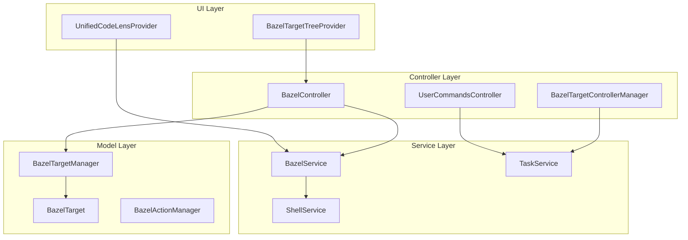
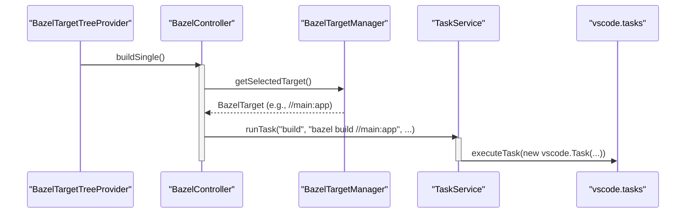

<!-- source: DeepWiki mcp.deepwiki.com · repo NVIDIA/bluebazel · page 2 Core Architecture · fetched 2026-10-26 -->

# Core Architecture

Relevant source files

The following files were used as context for generating this wiki page:

- [src/controllers/bazel-controller.ts](src/controllers/bazel-controller.ts)
- [src/extension.ts](src/extension.ts)
- [src/models/bazel-target.ts](src/models/bazel-target.ts)

BlueBazel utilizes a layered architecture designed to decouple VS Code UI components from the underlying Bazel build system logic. The system is organized into four primary layers: **Services**, **Models**, **Controllers**, and **UI**. It employs a dependency injection pattern where services and models are initialized at the extension's entry point and passed into the controllers and UI providers that require them.

### System Overview and Data Flow

Data flows from the Bazel workspace (via the CLI or filesystem parsing) through the **Services** layer, where it is transformed into **Models**. These models are managed by **Controllers**, which respond to user interactions from the **UI** (Tree Views, CodeLenses, and Commands) to trigger actions back through the service layer.

The initialization of these layers occurs in `src/extension.ts` during the `initExtension` sequence [src/extension.ts:112-212]().

#### High-Level Component Relationship
This diagram illustrates how core classes across different layers interact to bridge the gap between the Bazel workspace and the VS Code interface.

**Sources:** [src/extension.ts:52-77](), [src/extension.ts:132-212]()

---

### Layered Architecture

#### 1. Data Models
The Model layer represents the state of the Bazel workspace and the user's configuration. The central entity is the `BazelTarget` [src/models/bazel-target.ts:41](), which encapsulates a Bazel label, its rule type (e.g., `cc_binary`), and associated properties like environment variables and build arguments.

*   **BazelTargetManager**: Handles the collection of available targets discovered in the workspace and the set of "User Targets" pinned by the developer.
*   **BazelActionManager**: Manages the valid actions (build, run, test, debug) applicable to different target types.
*   **WorkspaceStateManager**: Manages persistence across VS Code sessions.

For details, see [Data Models](#2.1).

**Sources:** [src/models/bazel-target.ts:41-47](), [src/extension.ts:60-65]()

#### 2. Target Management & Persistence
BlueBazel implements a dual-persistence strategy to ensure performance with large workspaces. While small state items (like the currently selected target) are stored in VS Code's `workspaceState`, the large index of available targets is handled by the `FileStorageService` to avoid serializing massive JSON blobs into the standard state object.

The `BazelController` coordinates the `refreshAvailableTargets` logic, which uses the `BazelService` to crawl the workspace and then updates the `BazelTargetManager` [src/controllers/bazel-controller.ts:126-140]().

For details, see [Target Management & Persistence](#2.2).

**Sources:** [src/controllers/bazel-controller.ts:126-140](), [src/extension.ts:118-121]()

#### 3. Services Layer
Services are stateless (or near-stateless) utilities that interface with external systems. 

*   **BazelService**: The primary interface for target discovery and querying Bazel [src/extension.ts:149-152]().
*   **ShellService**: Executes raw shell commands with proper environment handling [src/extension.ts:136-140]().
*   **TaskService**: Wraps the VS Code Task API to run Bazel commands in integrated terminals [src/extension.ts:142-147]().
*   **FileWatcherService**: Monitors `BUILD` and `BUILD.bazel` files to trigger automatic target refreshes [src/controllers/bazel-controller.ts:48-55]().

For details, see [Services Layer](#2.3).

**Sources:** [src/extension.ts:132-164](), [src/controllers/bazel-controller.ts:48-55]()

---

### Execution Flow: From UI to Workspace

When a user interacts with a target in the UI, the `BazelController` or a specific action controller (like `BuildController`) translates that intent into a sequence of operations.

#### Command Execution Flow (e.g., Build Target)
This diagram maps the natural language action of "Building a Target" to the specific code entities involved in the execution pipeline.

**Sources:** [src/controllers/bazel-controller.ts:95-124](), [src/services/task-service.ts:1-50]() (implied by usage in extension.ts)

### Dependency Injection Pattern
The extension follows a manual dependency injection pattern in `src/extension.ts`. Objects are instantiated in an order that satisfies their constructor requirements. For example, the `BazelController` requires a `ConfigurationManager`, `FileWatcherService`, `TaskService`, `BazelService`, `BazelTargetManager`, and `BazelTargetTreeProvider` [src/controllers/bazel-controller.ts:40-47](). These are all instantiated during the `initExtension` call and passed in [src/extension.ts:193-199]().

**Sources:** [src/extension.ts:112-212](), [src/controllers/bazel-controller.ts:39-47]()

---

