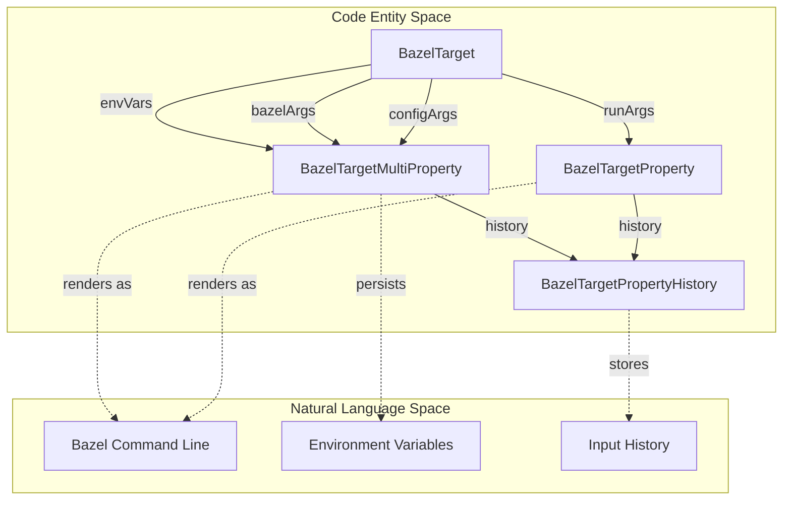

<!-- source: DeepWiki mcp.deepwiki.com · repo NVIDIA/bluebazel · page 2.1 Data Models · fetched 2026-10-26 -->

# Data Models

<details>
<summary>Relevant source files</summary>

The following files were used as context for generating this wiki page:

- [src/models/bazel-action-manager.ts](src/models/bazel-action-manager.ts)
- [src/models/bazel-target-multi-property.ts](src/models/bazel-target-multi-property.ts)
- [src/models/bazel-target-property-history.ts](src/models/bazel-target-property-history.ts)
- [src/models/bazel-target-property.ts](src/models/bazel-target-property.ts)
- [src/models/bazel-target-state-manager.ts](src/models/bazel-target-state-manager.ts)
- [src/models/bazel-target.ts](src/models/bazel-target.ts)
- [src/models/model-accessor.ts](src/models/model-accessor.ts)
- [src/models/model.ts](src/models/model.ts)

</details>


The Data Model layer in BlueBazel provides a structured representation of Bazel entities, their associated execution parameters, and their lifecycle states. These models abstract the underlying VS Code `workspaceState` persistence and provide a unified interface for the Controller layer to manipulate target-specific configurations.

## Core Target Model

### BazelTarget
The `BazelTarget` class is the central entity representing a specific Bazel rule (e.g., `cc_binary`, `py_test`) associated with a specific action (e.g., `build`, `run`, `test`). It aggregates multiple property models that define how the target should be executed.

*   **Identity**: Each target has a unique `id` generated using the pattern `${action}For${bazelPath}-${uuidv4()}` [src/models/bazel-target.ts:65-69]().
*   **Language Inference**: The model automatically infers the programming language from the `ruleType` via `BazelService.inferLanguageFromRuleType` [src/models/bazel-target.ts:70-70]().
*   **Property Aggregation**: A `BazelTarget` manages four primary property sets:
    *   `envVars`: Environment variables (`BazelTargetMultiProperty`) [src/models/bazel-target.ts:72-77]().
    *   `bazelArgs`: Arguments passed to the Bazel binary (`BazelTargetMultiProperty`) [src/models/bazel-target.ts:79-92]().
    *   `configArgs`: Configuration flags (e.g., `--config=x`) (`BazelTargetMultiProperty`) [src/models/bazel-target.ts:94-107]().
    *   `runArgs`: Arguments passed to the executable itself (`BazelTargetProperty`) [src/models/bazel-target.ts:109-114]().

#### Serialization
Targets are persisted using the `SerializedBazelTarget` interface [src/models/bazel-target.ts:31-38](). The class provides `toJSON()` for storage and a static `fromJSON()` for reconstruction [src/models/bazel-target.ts:155-169]().

### Target Relationship Diagram
This diagram shows how the `BazelTarget` links to various property models and how those map to the logical concepts of Bazel execution.

Title: BazelTarget Entity Mapping

Sources: [src/models/bazel-target.ts:41-115](), [src/models/bazel-target-multi-property.ts:62-77](), [src/models/bazel-target-property.ts:29-42]()

---

## Property Models

Properties represent the configurable attributes of a target. They are backed by VS Code's `workspaceState` for persistence across sessions.

### BazelTargetProperty
Used for single-value attributes (like `runArgs`).
*   **Persistence**: Uses a unique ID based on target action and property name: `${target.action}${name}For${target.id}` [src/models/bazel-target-property.ts:40-40]().
*   **Methods**: `update(value)` saves to `workspaceState` and adds to history; `get()` retrieves the value [src/models/bazel-target-property.ts:54-62]().

### BazelTargetMultiProperty & MultiPropertyItem
Used for collections of values (like environment variables or Bazel flags).
*   **MultiPropertyItem**: Represents a single entry in a list, identified by a UUID [src/models/bazel-target-multi-property.ts:30-41]().
*   **Dynamic Discovery**: Can use an `availableValuesFn` to fetch suggestions from the `BazelService` (e.g., fetching available `--config` values from `.bazelrc`) [src/models/bazel-target-multi-property.ts:138-140]().
*   **Serialization**: Items are stored as an array of JSON objects in `workspaceState` and re-instantiated upon retrieval [src/models/bazel-target-multi-property.ts:122-132]().

### BazelTargetPropertyHistory
Provides an LRU (Least Recently Used) cache for property values.
*   **Storage**: Maintains a `HistoryMap` in `workspaceState` [src/models/bazel-target-property-history.ts:32-48]().
*   **Behavior**: When a value is added, it is moved to the front of the list. If the list exceeds `size`, the oldest item is popped [src/models/bazel-target-property-history.ts:67-87]().

Sources: [src/models/bazel-target-property.ts:29-71](), [src/models/bazel-target-multi-property.ts:30-158](), [src/models/bazel-target-property-history.ts:30-88]()

---

## State and Action Management

### BazelTargetStateManager
Tracks the runtime status of targets (Idle, Executing, or Debugging) [src/models/bazel-target-state-manager.ts:28-32]().
*   **Reactivity**: Uses a `vscode.EventEmitter` named `_onDidChangeTargetState` to notify the UI (specifically the TreeView) when a target starts or stops executing [src/models/bazel-target-state-manager.ts:38-48]().

### BazelActionManager
A cache for valid Bazel commands (actions) available in the current environment.
*   **Initialization**: Fetches actions (e.g., `build`, `test`, `run`, `clean`) from `BazelService.fetchTargetActions()` during construction [src/models/bazel-action-manager.ts:37-43]().

### Runtime State Flow
This diagram maps the transition of a `BazelTarget` through different `BazelTargetState` enums as handled by the `BazelTargetStateManager`.

Title: Target State Lifecycle
```mermaid
stateDiagram-v2
    [*] --> "BazelTargetState.Idle" : "Initial State"
    "BazelTargetState.Idle" --> "BazelTargetState.Executing" : "setTargetState(target, Executing)"
    "BazelTargetState.Idle" --> "BazelTargetState.Debugging" : "setTargetState(target, Debugging)"
    "BazelTargetState.Executing" --> "BazelTargetState.Idle" : "Task Completion"
    "BazelTargetState.Debugging" --> "BazelTargetState.Idle" : "Debug Session End"

    state "BazelTargetStateManager" as Manager {
        "targetStateMap" --> "EventEmitter" : "fire(target)"
    }
```
Sources: [src/models/bazel-target-state-manager.ts:28-54]()

---

## Base Interfaces and Utilities

### Model and ModelAccessor
The system uses a lightweight abstraction for generic data access.

*   **Model Interface**: Defines a standard structure for objects with a `name`, `id`, and `get/update` methods [src/models/model.ts:25-30]().
*   **ModelAccessor**: A utility class providing type-safe wrappers for retrieving data from `Model` implementations:
    *   `getString(model)`: Returns a string or empty string [src/models/model-accessor.ts:27-34]().
    *   `getStringArray(model)`: Returns a string array or empty array [src/models/model-accessor.ts:44-50]().
    *   `getWithDefault(model, defaultValue)`: Handles undefined values [src/models/model-accessor.ts:36-42]().

Sources: [src/models/model.ts:25-30](), [src/models/model-accessor.ts:26-51]()

---

