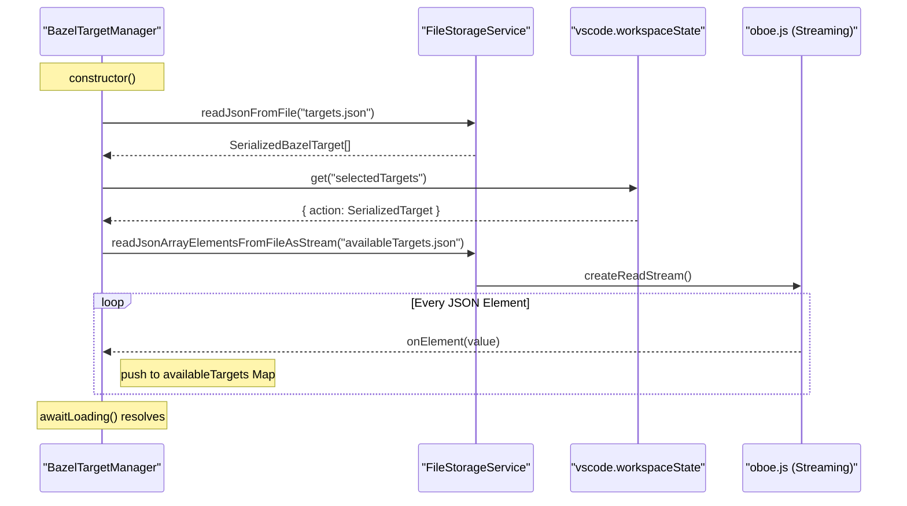
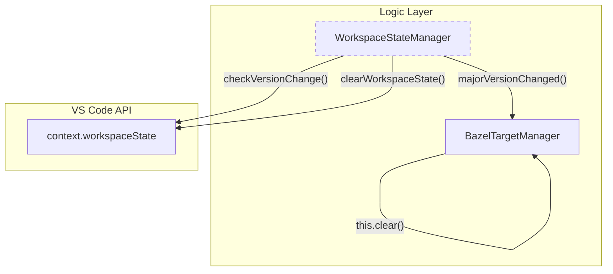

<!-- source: DeepWiki mcp.deepwiki.com · repo NVIDIA/bluebazel · page 2.2 Target Management & Persistence · fetched 2026-10-26 -->

# Target Management & Persistence

Relevant source files

The following files were used as context for generating this wiki page:

- [images/screenshot.png](images/screenshot.png)
- [src/models/bazel-target-manager.ts](src/models/bazel-target-manager.ts)
- [src/models/workspace-state-manager.ts](src/models/workspace-state-manager.ts)
- [src/services/file-storage-service.ts](src/services/file-storage-service.ts)
- [src/services/workspace-service.ts](src/services/workspace-service.ts)

The `BazelTargetManager` is the central authority for managing the lifecycle, storage, and retrieval of Bazel targets within BlueBazel. It distinguishes between targets discovered in the workspace, targets customized by the user, and the currently active selections for different Bazel actions.

### Dual-Persistence Strategy

BlueBazel employs a split-storage strategy to balance performance with persistence requirements. Large datasets are offloaded to the filesystem, while small, frequently accessed state is kept in the VS Code `workspaceState`.

| Storage Mechanism | Class | Data Type | Usage |
| :--- | :--- | :--- | :--- |
| **JSON Files** | `FileStorageService` | `availableTargets.json`, `targets.json` | Stores large arrays of `BazelTarget` objects discovered via queries or manual addition. |
| **Workspace State** | `vscode.Memento` | `selectedTargets` | Stores the single active `BazelTarget` for each `BazelAction` (Build, Run, Test, Debug). |

#### Target Categories
1.  **Available Targets**: Discovered targets from the Bazel workspace. These are cached in `availableTargets.json` to avoid expensive re-queries on every activation `[src/models/bazel-target-manager.ts:41]()`.
2.  **User Targets**: Targets manually added or modified by the user, stored in `targets.json` `[src/models/bazel-target-manager.ts:40]()`.
3.  **Selected Targets**: The specific targets currently "active" in the UI for execution, persisted via `workspaceState` `[src/models/bazel-target-manager.ts:117]()`.

**Sources:** `[src/models/bazel-target-manager.ts:32-48]()`, `[src/services/file-storage-service.ts:32-46]()`.

---

### BazelTargetManager Implementation

The `BazelTargetManager` initializes by triggering parallel loads of all three target categories. It uses `Promises` to track the loading state, allowing the UI to await critical data before rendering.

#### Data Flow: Target Loading & Initialization
The following diagram illustrates how the `BazelTargetManager` coordinates with `FileStorageService` and `workspaceState` during extension activation.

**Target Initialization Sequence**

**Sources:** `[src/models/bazel-target-manager.ts:44-75]()`, `[src/services/file-storage-service.ts:63-104]()`.

---

### Streaming Load with Cancellation

To handle workspaces with thousands of targets without blocking the extension host or consuming excessive memory, `FileStorageService` implements a streaming JSON reader using the `oboe` library `[src/services/file-storage-service.ts:84]()`.

*   **Streaming**: `readJsonArrayElementsFromFileAsStream` processes the `availableTargets.json` file element-by-element rather than loading the entire file into memory `[src/services/file-storage-service.ts:63-67]()`.
*   **Cancellation**: When a new target discovery process starts, the `BazelTargetManager` cancels the existing load operation via a `vscode.CancellationTokenSource` `[src/models/bazel-target-manager.ts:145-146]()`. This prevents race conditions where old cached data is appended to the `availableTargets` map after a refresh has begun.

**Sources:** `[src/services/file-storage-service.ts:84-103]()`, `[src/models/bazel-target-manager.ts:144-149]()`.

---

### WorkspaceStateManager & Migration

The `WorkspaceStateManager` manages extension-wide state and handles version-specific logic. Its primary role is ensuring that data persisted in older versions of the extension does not crash newer versions if the data schema changes.

#### Major Version Migration Logic
During instantiation, the manager compares the current extension version against the version stored in the workspace `[src/models/workspace-state-manager.ts:40-49]()`.

1.  **Detection**: It identifies if a "major" version change has occurred (e.g., 1.x.x to 2.x.x) `[src/models/workspace-state-manager.ts:43-47]()`.
2.  **Clearance**: If a major version change is detected, `BazelTargetManager` calls `clear()` to wipe cached targets, and `WorkspaceStateManager` purges all keys in `workspaceState` `[src/models/workspace-state-manager.ts:60-65]()`.
3.  **Persistence**: The new version string is then saved to prevent repeated clearing `[src/models/workspace-state-manager.ts:62]()`.

**Code Entity Mapping**

**Sources:** `[src/models/workspace-state-manager.ts:30-57]()`, `[src/models/bazel-target-manager.ts:50-53]()`.

---

### Key Functions & Storage Paths

| Function | File | Description |
| :--- | :--- | :--- |
| `writeJsonToFile` | `[src/services/file-storage-service.ts:53]()` | Serializes data to the extension's global storage path. |
| `readJsonArrayElementsFromFileAsStream` | `[src/services/file-storage-service.ts:63]()` | Uses `oboe` to stream JSON arrays from disk. |
| `loadSelectedTargets` | `[src/models/bazel-target-manager.ts:116]()` | Retrieves the user's last selected targets from `workspaceState`. |
| `updateAvailableTargets` | `[src/models/bazel-target-manager.ts:144]()` | Replaces the available target cache and triggers a file write. |
| `checkVersionChange` | `[src/models/workspace-state-manager.ts:40]()` | Logic for comparing semantic versions to trigger migrations. |

**Storage Location**: The `FileStorageService` uses `context.storageUri.fsPath` `[src/services/file-storage-service.ts:37]()`, which typically points to the VS Code internal global storage directory for the extension on the local machine.

**Sources:** `[src/services/file-storage-service.ts:32-61]()`, `[src/models/bazel-target-manager.ts:94-126]()`.

---

