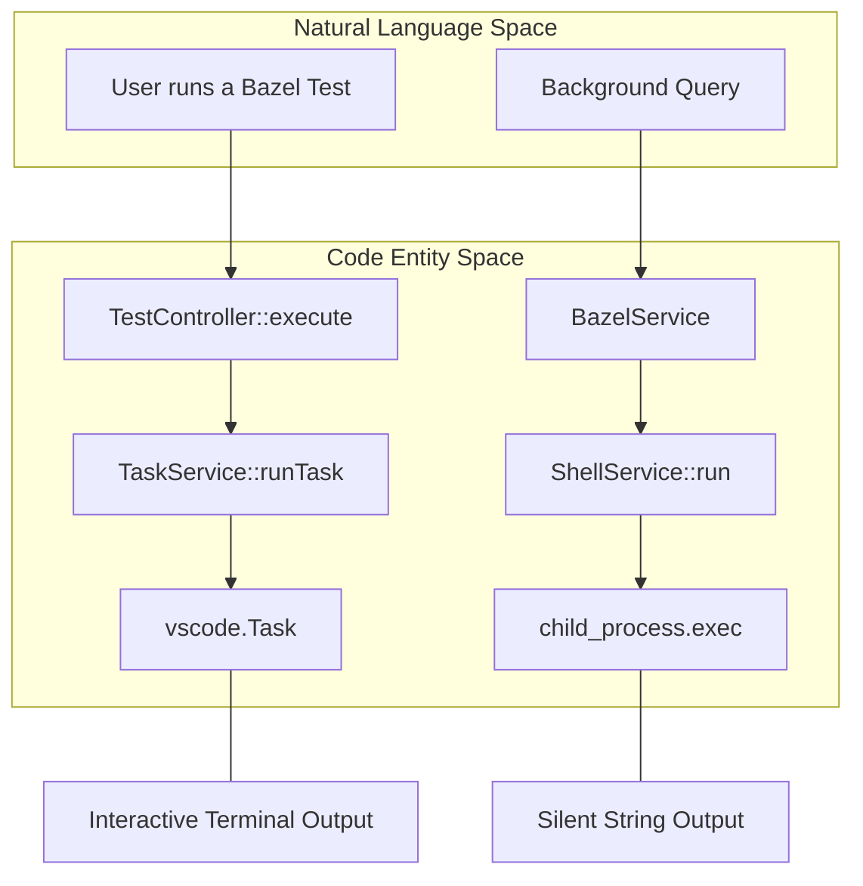
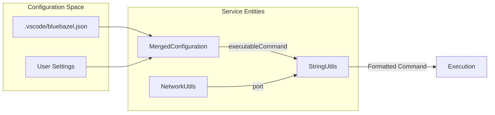

<!-- source: DeepWiki mcp.deepwiki.com · repo NVIDIA/bluebazel · page 2.3 Services Layer · fetched 2026-10-26 -->

# Services Layer

Relevant source files

The following files were used as context for generating this wiki page:

- [src/controllers/commands/user-commands.ts](src/controllers/commands/user-commands.ts)
- [src/controllers/target-controllers/bazel-target-controller-manager.ts](src/controllers/target-controllers/bazel-target-controller-manager.ts)
- [src/controllers/target-controllers/test-controller.ts](src/controllers/target-controllers/test-controller.ts)
- [src/services/configuration-utils.ts](src/services/configuration-utils.ts)
- [src/services/env-vars-utils.ts](src/services/env-vars-utils.ts)
- [src/services/file-watcher-service.ts](src/services/file-watcher-service.ts)
- [src/services/icon-service.ts](src/services/icon-service.ts)
- [src/services/network-utils.ts](src/services/network-utils.ts)
- [src/services/shell-service.ts](src/services/shell-service.ts)
- [src/services/string-utils.ts](src/services/string-utils.ts)
- [src/services/task-service.ts](src/services/task-service.ts)

The Services Layer provides the foundational infrastructure for the BlueBazel extension. It abstracts complex interactions with the operating system, the VS Code API, and the Bazel build system into reusable, stateless, or singleton services. This layer handles process execution, task management, filesystem watching, and environment configuration.

## Execution Services

These services handle the translation of Bazel commands into actual system processes or VS Code tasks.

### ShellService
The `ShellService` is responsible for low-level execution of shell commands using Node.js `child_process`. It provides a promise-based wrapper around `child.exec` with support for real-time output streaming to VS Code output channels and process cancellation.

*   **Process Management**: Uses `bash` as the default shell [src/services/shell-service.ts:52-52]().
*   **Buffer Handling**: Sets `maxBuffer` to `Number.MAX_SAFE_INTEGER` to prevent truncation of large Bazel query outputs [src/services/shell-service.ts:53-53]().
*   **Output Streaming**: Captures `stdout` and `stderr` line-by-line and redirects them to a `vscode.OutputChannel` if provided [src/services/shell-service.ts:63-83]().
*   **Cancellation**: Integrates with `vscode.CancellationToken` to kill the process tree if the user cancels the operation [src/services/shell-service.ts:98-103]().

### TaskService
The `TaskService` integrates with the VS Code Task API to execute Bazel targets in the integrated terminal. This allows users to see interactive output, use problem matchers, and manage execution through the standard VS Code Task UI.

*   **CustomTaskProvider**: Registers a `bluebazelTask` provider type [src/services/task-service.ts:31-46]().
*   **Terminal Management**: Can automatically clear the terminal before execution based on user configuration [src/services/task-service.ts:101-103]().
*   **Environment Injection**: Merges global setup environment variables with target-specific variables before execution [src/services/task-service.ts:69-69]().
*   **Execution Types**: Supports both `shell` (executing via `/bin/bash -c`) and `process` (direct binary execution) [src/services/task-service.ts:71-79]().

**Data Flow: From Controller to Terminal**

| Entity | Role | Source |
| :--- | :--- | :--- |
| `TestController` | Constructs the `bazel test` command string | [src/controllers/target-controllers/test-controller.ts:67-90]() |
| `TaskService.runTask` | Wraps the command in a `vscode.Task` object | [src/services/task-service.ts:88-95]() |
| `vscode.tasks.executeTask` | Hands off the task to the VS Code engine for terminal rendering | [src/services/task-service.ts:105-105]() |

**Diagram: Execution Service Abstraction**

Sources: [src/services/shell-service.ts:35-48](), [src/services/task-service.ts:48-66](), [src/controllers/target-controllers/test-controller.ts:36-65]()

---

## Filesystem and Environment Services

### FileWatcherService
The `FileWatcherService` monitors the workspace for changes to `BUILD` files or other patterns. It uses a debouncing mechanism to prevent redundant refreshes when multiple files change simultaneously (e.g., during a `git checkout`).

*   **Debouncing**: Uses a 500ms window to collect all affected file paths before triggering the callback [src/services/file-watcher-service.ts:53-58]().
*   **Global Set**: Maintains a `Set<string>` of `allAffectedFiles` to ensure no duplicates are processed [src/services/file-watcher-service.ts:29-29]().
*   **Lifecycle**: Registers watchers within `context.subscriptions` for automatic cleanup [src/services/file-watcher-service.ts:73-73]().

### EnvVarsUtils
A utility class for transforming environment variable formats between VS Code, Bazel, and Shell formats.

| Function | Output Format | Purpose |
| :--- | :--- | :--- |
| `toBuildEnvVars` | `--action_env=KEY=VAL` | Bazel build/query commands [src/services/env-vars-utils.ts:77-84]() |
| `toTestEnvVars` | `--test_env=KEY=VAL` | Bazel test commands [src/services/env-vars-utils.ts:108-115]() |
| `toRunEnvVars` | `export KEY=VAL && ...` | Direct binary execution in shell [src/services/env-vars-utils.ts:92-100]() |
| `listToObject` | `{ "KEY": "VAL" }` | Node.js `process.env` compatibility [src/services/env-vars-utils.ts:56-69]() |

Sources: [src/services/file-watcher-service.ts:27-51](), [src/services/env-vars-utils.ts:25-25]()

---

## UI Support Services

### IconService
The `IconService` dynamically resolves file and language icons by inspecting the user's active VS Code icon theme. This ensures the BlueBazel tree view matches the user's aesthetic settings.

*   **Theme Resolution**: Searches for the active theme in standard paths like `vscode.env.appRoot` and `~/.vscode/extensions` [src/services/icon-service.ts:66-71]().
*   **Mapping**: Maps `languageIds` from the theme's JSON definition to local file paths [src/services/icon-service.ts:100-124]().

### StringUtils
Provides specialized string manipulation for Bazel-related UI elements.

*   **toGerund**: Converts actions like `run` to `Running` or `aquery` to `Running aquery` for progress indicators [src/services/string-utils.ts:59-72]().
*   **cleanAndFormat**: Sanitizes command arguments by removing empty strings and trimming whitespace to ensure valid shell command construction [src/services/string-utils.ts:25-30]().

Sources: [src/services/icon-service.ts:48-54](), [src/services/string-utils.ts:24-24]()

---

## Configuration and Network Utilities

### ConfigurationUtils
Handles the merging of user-defined settings with default settings stored in `.vscode/bluebazel.json` files within the workspace.

*   **MergedConfiguration**: Implements `vscode.WorkspaceConfiguration` to provide a unified view where workspace-file defaults are overridden by standard VS Code settings [src/services/configuration-utils.ts:77-124]().

### NetworkUtils
Provides utilities for managing network ports, primarily used during debugging sessions.

*   **getAvailablePort**: Asks the OS for an ephemeral port (port 0) to use for debuggers [src/services/network-utils.ts:28-61]().
*   **waitForPort**: Polls a specific port (default 50ms interval) to detect when a Bazel-launched debug server has started listening [src/services/network-utils.ts:91-110]().

**Diagram: Configuration and Service Interaction**

Sources: [src/services/configuration-utils.ts:77-84](), [src/services/network-utils.ts:25-28](), [src/services/string-utils.ts:25-30]()

---

