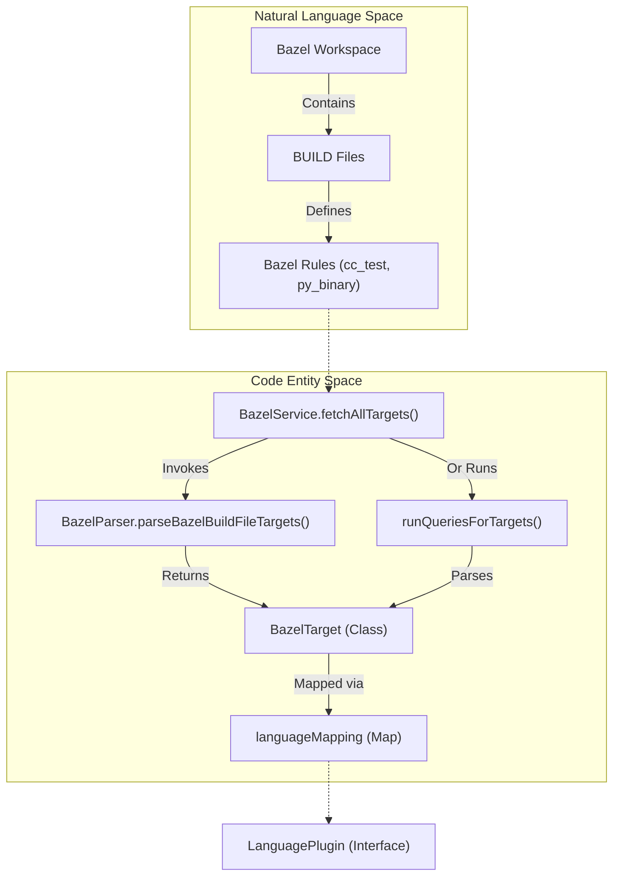
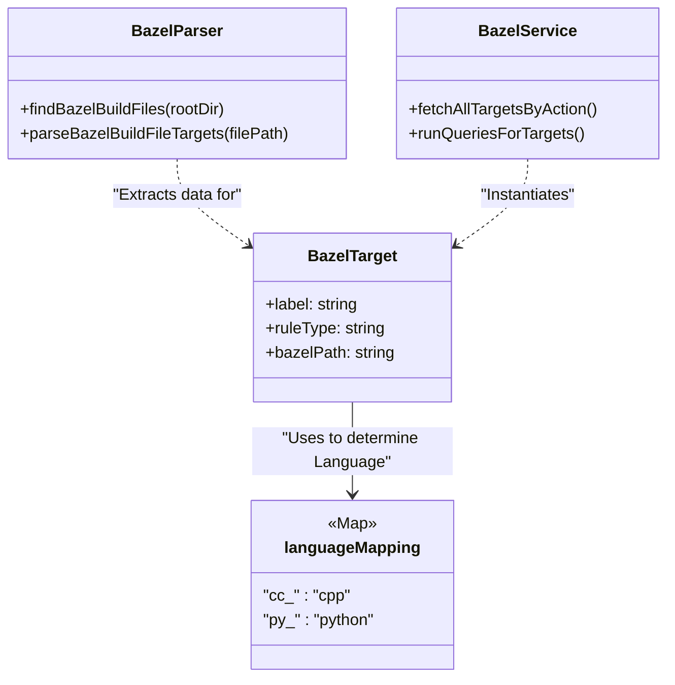

<!-- source: DeepWiki mcp.deepwiki.com · repo NVIDIA/bluebazel · page 3 Bazel Integration · fetched 2026-10-26 -->

# Bazel Integration

Relevant source files

The following files were used as context for generating this wiki page:

- [releases/bluebazel-1.0.4.vsix](releases/bluebazel-1.0.4.vsix)
- [src/services/bazel-parser.ts](src/services/bazel-parser.ts)
- [src/services/bazel-rule-language-mapping.ts](src/services/bazel-rule-language-mapping.ts)
- [src/services/bazel-service.ts](src/services/bazel-service.ts)

The **Bazel Integration** layer is the bridge between the BlueBazel VS Code extension and the Bazel build system. It is responsible for discovering targets within a workspace, parsing `BUILD` files to understand rule structures, and mapping those rules to specific programming languages for execution and debugging.

## Architecture Overview

BlueBazel interacts with Bazel through two primary mechanisms: direct CLI queries and manual file system parsing. This dual-strategy ensures that the extension remains performant in large monorepos while providing a fallback for environments where a full Bazel query might be slow or unavailable.

### Target Discovery Strategies
The `BazelService` [src/services/bazel-service.ts:37-37]() manages how targets are retrieved based on the user's configuration.

| Strategy | Implementation | Use Case |
| :--- | :--- | :--- |
| **Bazel Query** | Uses `bazel query` with `label_kind` output. | Default; highly accurate and handles complex macros/starlark. |
| **BUILD Parsing** | Regex-based line parsing of `BUILD` files. | High-performance fallback; works without a functional Bazel environment. |

The choice of strategy is governed by `configurationManager.shouldFetchTargetsUsingQuery()` [src/services/bazel-service.ts:150-155]().

### Rule-to-Language Mapping
To provide language-specific features (like debugging), BlueBazel maps Bazel rule types (e.g., `cc_binary`, `py_test`) to VS Code language identifiers. This is handled by a static mapping in `bazel-rule-language-mapping.ts` [src/services/bazel-rule-language-mapping.ts:24-156]().

## Target Discovery & Categorization

The `BazelService` categorizes discovered targets into four primary actions: `run`, `build`, `test`, and `coverage` [src/services/bazel-service.ts:77-82](). This categorization determines where a target appears in the UI and what operations are available to the user.

### Action Mapping Logic
Targets are sorted into action buckets based on their rule type and executable status:
- **Test Targets**: Rules containing `test` (e.g., `cc_test`) are added to `test`, `run`, and `build` categories [src/services/bazel-service.ts:100-105]().
- **Executable Targets**: Rules marked as executable (detected via `$is_executable` attribute in queries) are added to `run` and `build` [src/services/bazel-service.ts:106-109]().
- **Library/Other Targets**: All other rules are categorized under `build` [src/services/bazel-service.ts:110-111]().

### Data Flow: Discovery to Model
The following diagram illustrates how the system transitions from the "Natural Language Space" (Bazel concepts) to the "Code Entity Space" (TypeScript classes).

**Target Discovery Flow**

**Sources:** [src/services/bazel-service.ts:149-155](), [src/services/bazel-parser.ts:72-87](), [src/services/bazel-rule-language-mapping.ts:24-37]()

## Components

### BazelService
The primary service for interacting with the Bazel CLI. It handles:
- Executing `bazel query` commands [src/services/bazel-service.ts:123-144]().
- Resolving `bazel-bin` and runfiles locations [src/services/bazel-service.ts:67-72]().
- Reverse-looking up targets associated with a specific source file [src/services/bazel-service.ts:16120-16120]() (Note: Reference refers to the `extractBazelTargetsAssociatedWithSourceFile` logic).

For details, see [BazelService & Target Discovery](#3.1).

### BazelParser
A utility class for filesystem-level analysis. It performs:
- **Workspace Crawling**: Uses a Breadth-First Search (BFS) with 50-directory batching to find `WORKSPACE` and `BUILD` files [src/services/bazel-parser.ts:41-44]().
- **Target Extraction**: Parses `BUILD` files line-by-line using regex to extract `name` and `ruleType` without loading the full file into memory [src/services/bazel-parser.ts:109-143]().

For details, see [BazelParser & BUILD File Analysis](#3.2).

## Code Entity Relationships

The relationship between the parsing logic and the resulting data models is critical for the extension's responsiveness.

**Entity Mapping Diagram**

**Sources:** [src/services/bazel-parser.ts:31-31](), [src/services/bazel-service.ts:37-37](), [src/models/bazel-target.ts:30-30](), [src/services/bazel-rule-language-mapping.ts:24-24]()

## Key Files
- `src/services/bazel-service.ts`: Core logic for Bazel CLI communication and target categorization.
- `src/services/bazel-parser.ts`: Filesystem crawling and regex-based `BUILD` file parsing.
- `src/services/bazel-rule-language-mapping.ts`: Definitions for mapping rule prefixes to VS Code language IDs.

**Sources:**
- [src/services/bazel-service.ts:1-16120]()
- [src/services/bazel-parser.ts:1-174]()
- [src/services/bazel-rule-language-mapping.ts:1-300]()

---

