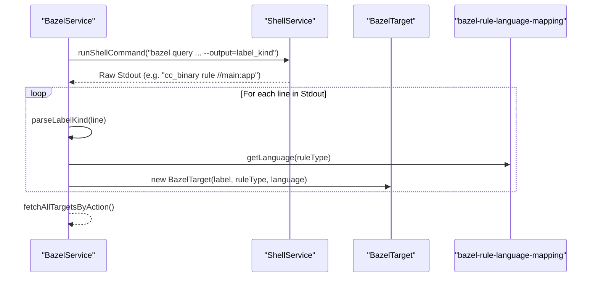
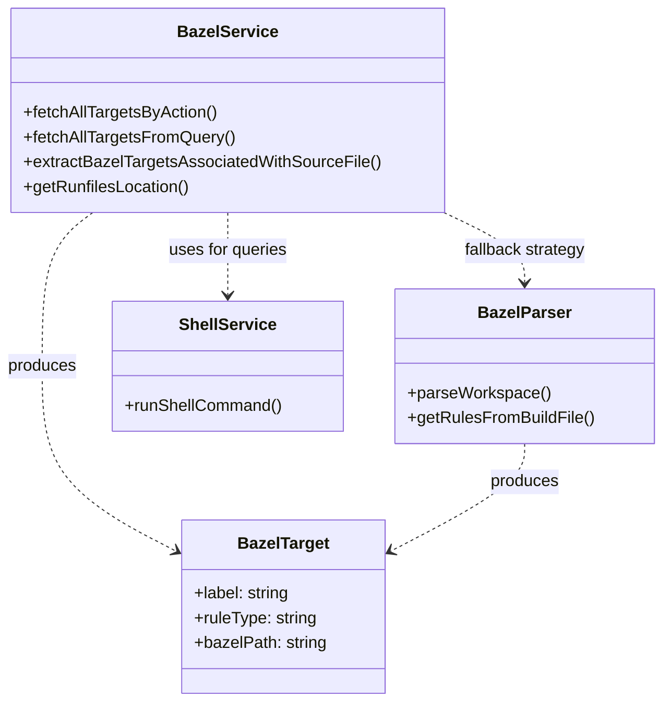

<!-- source: DeepWiki mcp.deepwiki.com · repo NVIDIA/bluebazel · page 3.1 BazelService & Target Discovery · fetched 2026-10-26 -->

# BazelService & Target Discovery

Relevant source files

The following files were used as context for generating this wiki page:

- [releases/bluebazel-1.0.4.vsix](releases/bluebazel-1.0.4.vsix)
- [src/services/bazel-rule-language-mapping.ts](src/services/bazel-rule-language-mapping.ts)
- [src/services/bazel-service.ts](src/services/bazel-service.ts)

The `BazelService` acts as the primary interface between the BlueBazel extension and the Bazel build system. It is responsible for discovering available targets, categorizing them by action (build, run, test), and resolving metadata such as runfile locations and source file associations.

## Target Discovery Strategies

`BazelService` employs two distinct strategies for discovering targets within a workspace, controlled by the `shouldFetchTargetsUsingQuery` configuration setting [src/services/bazel-service.ts:150-155]().

### 1. Bazel Query Pipeline (Primary)
When enabled, the service executes a series of optimized `bazel query` commands in parallel to retrieve the full target graph. This is the most accurate method as it relies on Bazel's own evaluation engine.

*   **Command Construction**: The service builds a combined shell command using three specific queries [src/services/bazel-service.ts:127-136]():
    *   **Run Targets**: `attr("$is_executable", 1, //...)`
    *   **Test Targets**: `filter(${filter}, tests(//...))`
    *   **Other Targets**: General targets excluding the above.
*   **Filtering**: A regex filter is applied to exclude noise from directories like `.aspect_rules_js`, `node_modules`, and internal `bazel-*` symlinks [src/services/bazel-service.ts:125-125]().
*   **Output Format**: Queries use `--output=label_kind` to retrieve both the target label and its rule type (e.g., `cc_binary`, `py_test`) [src/services/bazel-service.ts:129-135]().

### 2. BUILD File Parsing Fallback
If the query pipeline is disabled or fails, the service falls back to manual filesystem crawling via `BazelParser`. This strategy is faster for massive mono-repos where a full query might time out, though it lacks the semantic depth of the Bazel engine.

### Target Categorization Logic
The function `fetchAllTargetsByAction` processes discovered targets into a map keyed by `BazelAction` (`run`, `build`, `test`, `coverage`) [src/services/bazel-service.ts:74-82]().

| Target Type | Categorization Logic |
| :--- | :--- |
| **Test Rules** (`*_test`) | Added to `test`, `coverage`, `run`, and `build` [src/services/bazel-service.ts:100-105](). |
| **Executable Rules** (`$is_executable`) | Added to `run` and `build` [src/services/bazel-service.ts:106-108](). |
| **Library/Other Rules** | Added to `build` only [src/services/bazel-service.ts:109-111](). |

**Sources:** [src/services/bazel-service.ts:74-155]()

---

## Data Flow: From Query to Model
The following diagram illustrates how raw string output from the Bazel CLI is transformed into `BazelTarget` objects.

**Target Discovery and Parsing Flow**

**Sources:** [src/services/bazel-service.ts:123-144](), [src/services/bazel-service.ts:96-112](), [src/services/bazel-rule-language-mapping.ts:24-156]()

---

## Label and Kind Parsing

The `BazelService` parses the `--output=label_kind` format which typically looks like `cc_library rule //path/to:target`. 

*   **Rule Type Mapping**: The service maps Bazel rule prefixes to VS Code language identifiers using a comprehensive mapping table [src/services/bazel-rule-language-mapping.ts:24-156](). For example, `py_` maps to `python` and `cc_` maps to `cpp` [src/services/bazel-rule-language-mapping.ts:29-33]().
*   **Target Formatting**: Static utility `formatBazelTargetFromPath` converts filesystem paths (e.g., from `bazel-bin`) back into valid Bazel labels (e.g., `//path/to:target`) [src/services/bazel-service.ts:67-72]().

**Sources:** [src/services/bazel-service.ts:67-72](), [src/services/bazel-rule-language-mapping.ts:1-159]()

---

## Source File Reverse-Lookup

A key feature of the extension is the ability to find which Bazel targets are associated with a specific source file (e.g., for CodeLens or "Run Current File" features).

*   **`extractBazelTargetsAssociatedWithSourceFile`**: This function uses `bazel query` to find all rules that include the current file in their `srcs` attribute [src/services/bazel-service.ts:285-300]().
*   **Implementation**: It executes `bazel query 'attr(srcs, "filename", //...)'` [src/services/bazel-service.ts:293]().
*   **Efficiency**: The result is filtered and mapped to `BazelTarget` objects, allowing the UI to present only relevant actions for the file currently being edited.

**Sources:** [src/services/bazel-service.ts:285-310]()

---

## Runfiles and Completion

### Runfiles Location Resolution
The `getRunfilesLocation` method resolves the absolute path to a target's executable within the `bazel-bin` directory [src/services/bazel-service.ts:183-195](). This is critical for "Direct" execution modes (Run/Debug) where the extension bypasses `bazel run` to execute the binary directly.

### Bash Completion Integration
To provide a native-feeling CLI experience, `fetchBashCompletionArgs` and `fetchBashCompletionConfig` leverage Bazel's internal completion hooks [src/services/bazel-service.ts:233-283]().
*   It invokes the Bazel binary with specific environment variables (`COMP_LINE`, `COMP_POINT`) to simulate a tab-completion event [src/services/bazel-service.ts:246-253]().
*   This allows the extension to suggest valid build flags (e.g., `--config=release`) and arguments to the user.

**Sources:** [src/services/bazel-service.ts:183-195](), [src/services/bazel-service.ts:233-283]()

---

## Implementation Entity Map
This diagram maps the logical discovery concepts to the specific classes and methods in the codebase.

**Code Entity Relationship Diagram**

**Sources:** [src/services/bazel-service.ts:37-44](), [src/services/bazel-parser.ts:24-24](), [src/models/bazel-target.ts:30-30]()

---

