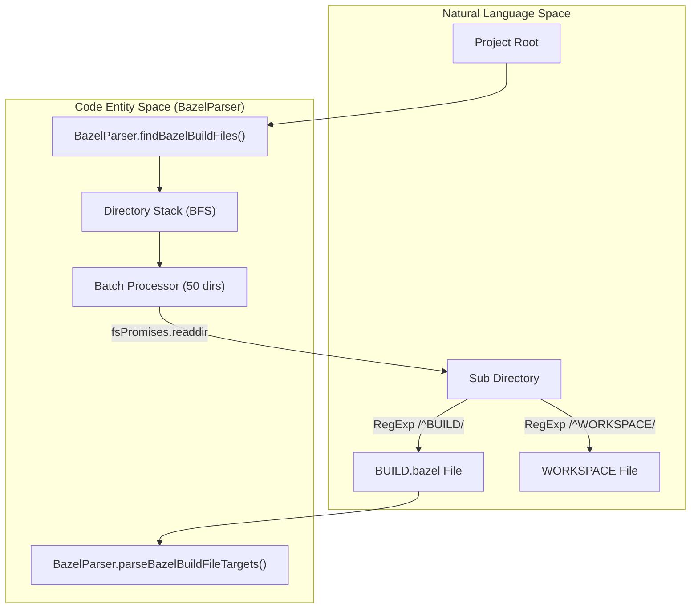
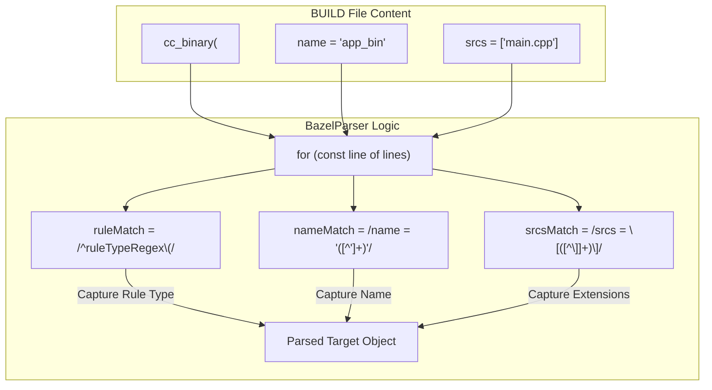

<!-- source: DeepWiki mcp.deepwiki.com · repo NVIDIA/bluebazel · page 3.2 BazelParser & BUILD File Analysis · fetched 2026-10-26 -->

# BazelParser & BUILD File Analysis

Relevant source files

The following files were used as context for generating this wiki page:

- [src/services/bazel-parser.ts](src/services/bazel-parser.ts)

The `BazelParser` is a utility service responsible for the filesystem-level discovery and structural analysis of Bazel projects. It serves as the primary fallback mechanism for target discovery when `bazel query` is unavailable or inefficient. It implements a high-performance workspace crawler and a regex-based parser to extract target metadata directly from `BUILD` files.

## Workspace Crawling & Root Discovery

The discovery process begins with `findBazelBuildFiles`, which performs a Breadth-First Search (BFS) starting from the workspace root [src/services/bazel-parser.ts:37-41](). To optimize I/O operations and avoid blocking the event loop, the crawler processes directories in batches of 50 [src/services/bazel-parser.ts:44]().

### File Identification Logic
The crawler identifies three categories of files:
1.  **Workspace Markers**: Files named `WORKSPACE`, `WORKSPACE.bazel`, `MODULE.bazel` [src/services/bazel-parser.ts:55-59]().
2.  **Build Files**: Files named `BUILD` or `BUILD.bazel` [src/services/bazel-parser.ts:53-54]().
3.  **Exclusions**: Hidden directories (starting with `.`) are ignored to prevent unnecessary recursion into `.git` or `.bazel` internal folders [src/services/bazel-parser.ts:51-52]().

### Root Resolution
Because a VS Code workspace may contain multiple nested Bazel workspaces, `BazelParser` uses `findClosestWorkspace` to associate each `BUILD` file with its nearest parent directory containing a workspace marker [src/services/bazel-parser.ts:159-173](). This ensures that target labels (e.g., `//path/to:target`) are calculated relative to the correct workspace root.

**Sources:** [src/services/bazel-parser.ts:31-70](), [src/services/bazel-parser.ts:159-173]()

## BUILD File Parsing

The `parseBazelBuildFileTargets` function performs a line-by-line scan of `BUILD` files [src/services/bazel-parser.ts:90](). This approach minimizes memory overhead compared to loading the entire file into an Abstract Syntax Tree (AST).

### Target Extraction
The parser uses regular expressions to identify three key components of a Bazel rule:
*   **Rule Type**: Matches the beginning of a rule (e.g., `cc_binary(`, `py_test(`) [src/services/bazel-parser.ts:110]().
*   **Target Name**: Extracts the value of the `name` attribute [src/services/bazel-parser.ts:111]().
*   **Source Files**: Parses the `srcs` list to identify file extensions, which are used for language-plugin mapping [src/services/bazel-parser.ts:112](), [src/services/bazel-parser.ts:137-142]().

### Target Metadata Construction
For every target found, the parser constructs a metadata object containing:
*   `bazelPath`: The full Bazel label (e.g., `//pkg:name`) [src/services/bazel-parser.ts:121]().
*   `buildPath`: The expected location in `bazel-bin` [src/services/bazel-parser.ts:122]().
*   `srcExtensions`: A list of file extensions found in the `srcs` attribute [src/services/bazel-parser.ts:120]().

**Sources:** [src/services/bazel-parser.ts:72-157]()

## Synthetic Target Generation

To provide a consistent user experience, `BazelParser` generates "synthetic" targets that do not explicitly exist in the `BUILD` file but represent logical package-level actions.

### package_build & package_test
During the parsing of a directory, if any rules are detected, the parser generates a `package_build` target representing the `//path/to/...` wildcard [src/services/bazel-parser.ts:211-217](). If at least one rule in the file is identified as a test (via the `hasTest` flag), a `package_test` target is also generated [src/services/bazel-parser.ts:219-225]().

| Synthetic Target | Bazel Label | Condition |
| :--- | :--- | :--- |
| `package_build` | `//path/to/...` | At least one rule exists in `BUILD` |
| `package_test` | `//path/to/...` | At least one rule contains "test" in its type |

**Sources:** [src/services/bazel-parser.ts:175-236]()

## Data Flow & Entity Mapping

The following diagrams illustrate how the `BazelParser` traverses the filesystem and maps physical files to the internal `BazelTarget` model.

### Workspace Discovery Flow
This diagram maps the BFS crawling logic to the filesystem entities.

**Sources:** [src/services/bazel-parser.ts:37-66](), [src/services/bazel-parser.ts:72-88]()

### BUILD Parsing Logic
This diagram shows how the line-by-line parser extracts target attributes.

**Sources:** [src/services/bazel-parser.ts:109-143]()

## Integration with Cancellation

The discovery process is integrated with VS Code's `CancellationToken` system. High-level callers (such as `BazelService`) pass a token to the parser. The parser checks the `token.isCancellationRequested` state during long-running operations to ensure that UI-initiated cancellations (e.g., clicking "Cancel" on a progress notification) immediately halt the filesystem crawl and parsing [src/services/bazel-parser.ts:182](), [src/services/bazel-parser.ts:200]().

**Sources:** [src/services/bazel-parser.ts:175-185]()

---

