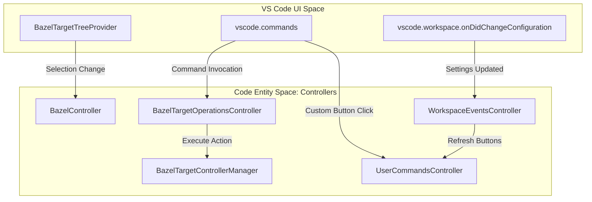
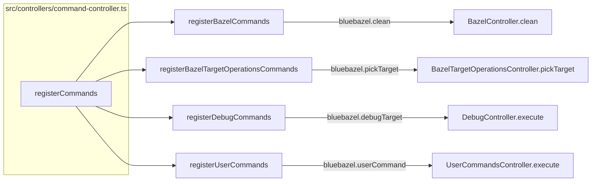

<!-- source: DeepWiki mcp.deepwiki.com · repo NVIDIA/bluebazel · page 4 Controllers · fetched 2026-10-26 -->

# Controllers

Relevant source files

The following files were used as context for generating this wiki page:

- [src/controllers/bazel-controller.ts](src/controllers/bazel-controller.ts)
- [src/controllers/bazel-target-operations-controller.ts](src/controllers/bazel-target-operations-controller.ts)
- [src/controllers/command-controller.ts](src/controllers/command-controller.ts)
- [src/controllers/workspace-events-controller.ts](src/controllers/workspace-events-controller.ts)

The controller layer in BlueBazel acts as the intermediary between the VS Code UI (commands and tree views) and the underlying data models and services. It orchestrates user actions—such as building targets, managing target lists, and handling workspace events—by delegating specific logic to specialized controller classes.

## Overview of Controller Responsibilities

The controller layer is partitioned into several key entities, each managing a specific domain of the extension's functionality.

| Controller | Primary Responsibility |
| :--- | :--- |
| `BazelController` | High-level workspace actions (clean, format) and target list refreshing. |
| `BazelTargetOperationsController` | Management of the target lifecycle (picking, adding, copying, removing targets). |
| `BazelTargetControllerManager` | Registry and dispatcher for action-specific execution (Build, Run, Test, Debug). |
| `UserCommandsController` | Resolution and execution of user-defined custom buttons and commands. |
| `WorkspaceEventsController` | Handling VS Code lifecycle events like configuration changes. |

### Controller Interaction Map

The following diagram illustrates how these controllers interact with VS Code and each other.

**Sources:** [src/controllers/bazel-controller.ts:39-47](), [src/controllers/bazel-target-operations-controller.ts:35-44](), [src/controllers/workspace-events-controller.ts:31-37]()

---

## Key Controllers

### BazelController
`BazelController` handles global workspace operations and synchronization. It is responsible for:
*   **Target Refreshing**: Initiating `refreshAvailableTargets` via `BazelService` when `BUILD` files change [src/controllers/bazel-controller.ts:48-55]() or when the workspace opens [src/controllers/bazel-controller.ts:57-62]().
*   **Workspace Utilities**: Executing `clean`, `format`, and `buildSingle` (compile one dependency) tasks [src/controllers/bazel-controller.ts:65-124]().
*   **Tree Selection**: Updating the `BazelTargetManager` when a user selects a different target in the sidebar [src/controllers/bazel-controller.ts:142-155]().

### BazelTargetOperationsController
This controller manages the "User Targets" list in the UI. It provides the logic for:
*   **Target Selection**: Displaying the `BazelTargetQuickPick` to allow users to add new targets [src/controllers/bazel-target-operations-controller.ts:48-63]().
*   **CRUD Operations**: Methods for `copyTarget`, `removeTarget`, and `addOrUpdateTarget` which modify the persistent target list [src/controllers/bazel-target-operations-controller.ts:110-138]().
*   **Execution Dispatch**: Delegating execution to the correct sub-controller (e.g., Build vs. Run) via the `BazelTargetControllerManager` [src/controllers/bazel-target-operations-controller.ts:147-153]().

### WorkspaceEventsController
A lightweight controller that listens for VS Code environment changes. Its primary role is to monitor `onDidChangeConfiguration` and trigger a refresh of custom buttons and the tree view if the extension's settings are modified [src/controllers/workspace-events-controller.ts:39-46]().

---

## Command Registration

All controllers are wired into VS Code via the `registerCommands` entry point. This function groups command registration into logical sub-registrars, mapping string IDs (e.g., `bluebazel.build`) to the methods defined in the controllers.

**Sources:** [src/controllers/command-controller.ts:42-58](), [src/controllers/bazel-target-operations-controller.ts:147-153]()

For details on how specific commands are mapped, see [Command Registration](#4.2).

---

## Specialized Child Controllers

The execution logic for specific Bazel actions and complex user-defined commands is offloaded to specialized child pages:

### Target Action Controllers
The `BazelTargetControllerManager` maintains a mapping of `BazelAction` (build, run, test, debug) to specific controller implementations. These controllers handle the complexities of terminal management, port polling for debuggers, and environment variable injection.
For details, see [Target Action Controllers (Build, Run, Test, Debug)](#4.1).

### User Commands & Custom Tasks
The `UserCommandsController` manages the execution of highly configurable user commands. It supports a three-layer templating system for variable substitution and integrates with the VS Code Task API.
For details, see [User Commands & Custom Task Execution](#4.3).

**Sources:** [src/controllers/target-controllers/bazel-target-controller-manager.ts](), [src/controllers/user-commands-controller.ts]()

---

