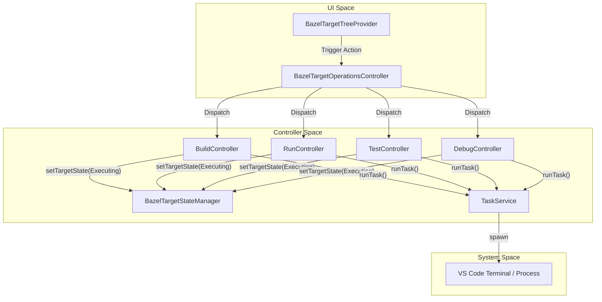
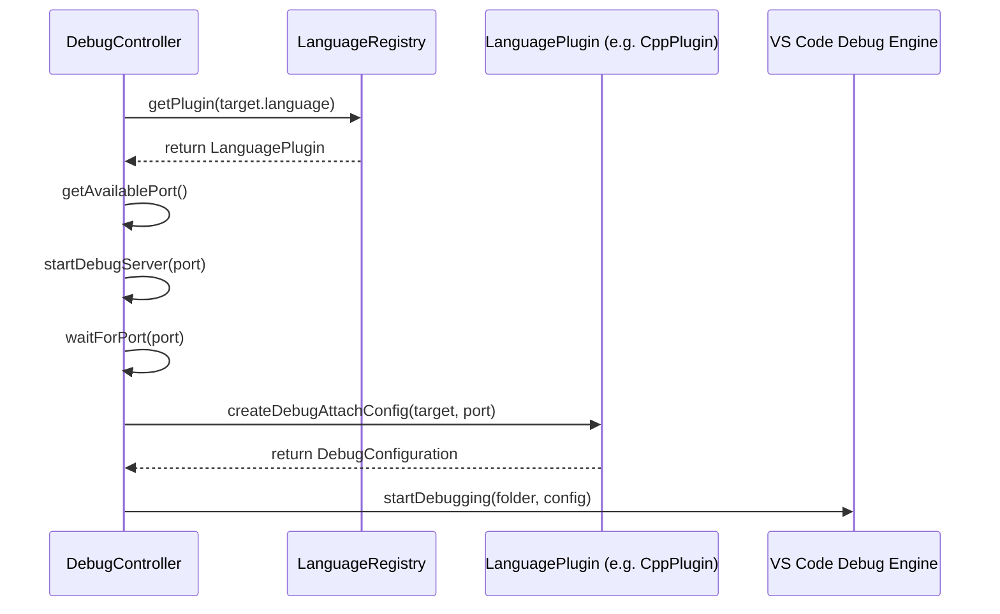

<!-- source: DeepWiki mcp.deepwiki.com · repo NVIDIA/bluebazel · page 4.1 Target Action Controllers (Build, Run, Test, Debug) · fetched 2026-10-26 -->

# Target Action Controllers (Build, Run, Test, Debug)

Relevant source files

The following files were used as context for generating this wiki page:

- [src/controllers/target-controllers/any-action-controller.ts](src/controllers/target-controllers/any-action-controller.ts)
- [src/controllers/target-controllers/bazel-target-controller.ts](src/controllers/target-controllers/bazel-target-controller.ts)
- [src/controllers/target-controllers/build-controller.ts](src/controllers/target-controllers/build-controller.ts)
- [src/controllers/target-controllers/debug-controller.ts](src/controllers/target-controllers/debug-controller.ts)
- [src/controllers/target-controllers/run-controller.ts](src/controllers/target-controllers/run-controller.ts)
- [src/controllers/target-controllers/test-controller.ts](src/controllers/target-controllers/test-controller.ts)
- [src/services/file-watcher-service.ts](src/services/file-watcher-service.ts)

The `BazelTargetController` implementations are the operational heart of BlueBazel. They translate abstract `BazelTarget` models into concrete shell commands and VS Code tasks. Each controller manages the lifecycle of a specific Bazel action, handling state transitions, environment variable formatting, and platform-specific execution logic.

## Overview of Controller Architecture

All action controllers implement the `BazelTargetController` interface `[src/controllers/target-controllers/bazel-target-controller.ts:27-30]()`, which defines two primary methods:
1. `execute(target: BazelTarget)`: Performs the action (e.g., building, running) and manages UI progress.
2. `getExecuteCommand(target: BazelTarget)`: Constructs the raw shell command string for the action.

### Action Execution Flow
The following diagram illustrates how a user interaction in the UI flows through the controllers to the system terminal.

**Action Execution Data Flow**

Sources: `[src/controllers/target-controllers/bazel-target-controller.ts:27-30]()`, `[src/controllers/target-controllers/build-controller.ts:50-81]()`, `[src/controllers/target-controllers/run-controller.ts:49-62]()`

---

## BuildController

The `BuildController` is responsible for executing `bazel build` commands. It features a unique resolution mechanism for the "Run Target" alias.

### Command Construction
The controller uses `cleanAndFormat` to assemble the command string from multiple target properties:
- **Executable**: Retrieved via `configurationManager.getExecutableCommand()` `[src/controllers/target-controllers/build-controller.ts:89-89]()`.
- **Arguments**: Combines Bazel arguments and configuration arguments `[src/controllers/target-controllers/build-controller.ts:90-91]()`.
- **Environment**: Formats environment variables using `EnvVarsUtils.toBuildEnvVars` `[src/controllers/target-controllers/build-controller.ts:92-92]()`.

### BUILD_RUN_TARGET_STR Resolution
A special constant `BUILD_RUN_TARGET_STR = '<Run Target>'` `[src/controllers/target-controllers/build-controller.ts:40-40]()` allows a build target to dynamically point to whatever target is currently selected in the "Run" category. 
- The method `getActualBuildTargetPath` checks if `target.buildPath` matches this constant `[src/controllers/target-controllers/build-controller.ts:108-108]()`.
- If it matches, it resolves the path relative to `BAZEL_BIN` using the currently selected run target from `BazelTargetManager` `[src/controllers/target-controllers/build-controller.ts:110-115]()`.

Sources: `[src/controllers/target-controllers/build-controller.ts:40-121]()`

---

## RunController

The `RunController` manages the execution of binaries. It supports two distinct modes controlled by user configuration.

| Mode | Configuration | Behavior |
| :--- | :--- | :--- |
| **Run in Bazel** | `shouldRunBinariesDirect() == false` | Executes `bazel run //target`. Environment variables are passed via the task environment `[src/controllers/target-controllers/run-controller.ts:64-87]()`. |
| **Run Direct** | `shouldRunBinariesDirect() == true` | Executes the binary directly from the `bazel-bin` directory. Optionally triggers a build first if `shouldBuildBeforeLaunch()` is enabled `[src/controllers/target-controllers/run-controller.ts:89-106]()`. |

### Logic Flow
1. **State Management**: Sets state to `Executing` `[src/controllers/target-controllers/run-controller.ts:51-51]()`.
2. **Path Resolution**: In `runDirect`, it calculates the absolute path to the executable by joining the workspace root with the target's `buildPath` `[src/controllers/target-controllers/run-controller.ts:97-97]()`.
3. **Argument Formatting**: In `runInBazel`, run arguments are prefixed with `--` to separate them from Bazel's own arguments `[src/controllers/target-controllers/run-controller.ts:128-130]()`.

Sources: `[src/controllers/target-controllers/run-controller.ts:49-156]()`

---

## TestController

The `TestController` handles `bazel test` execution. Its primary complexity lies in correctly formatting arguments and environment variables for the Bazel test runner.

### Implementation Details
- **Environment Variables**: Uses `EnvVarsUtils.toTestEnvVars` `[src/controllers/target-controllers/test-controller.ts:75-75]()`, which typically formats variables as `--test_env=KEY=VALUE`.
- **Task Labeling**: Generates a task label using `toGerund(target.action)` (e.g., "Testing //my/target") for the VS Code UI `[src/controllers/target-controllers/test-controller.ts:51-53]()`.
- **Command Assembly**: The `getExecuteCommand` method ensures that `testArgs` (run arguments) are appended after the target label `[src/controllers/target-controllers/test-controller.ts:79-87]()`.

Sources: `[src/controllers/target-controllers/test-controller.ts:36-91]()`

---

## DebugController

The `DebugController` is the most complex implementation, coordinating between Bazel, the system network, and language-specific debugger plugins.

### Debug Lifecycle (debugInBazel)
When debugging via Bazel, the controller follows a strict polling lifecycle:
1. **Port Selection**: Finds an available local port using `getAvailablePort()` `[src/controllers/target-controllers/debug-controller.ts:157-157]()`.
2. **Server Start**: Launches the Bazel command with a "run-under" script (e.g., `gdbserver` or `debugpy`) via `startDebugServer()` `[src/controllers/target-controllers/debug-controller.ts:175-175]()`.
3. **Port Polling**: Uses `waitForPort()` to wait for the debug server to start listening on the selected port `[src/controllers/target-controllers/debug-controller.ts:178-178]()`.
4. **Client Attach**: Delegates to the `LanguagePlugin` to create a `vscode.DebugConfiguration` and calls `vscode.debug.startDebugging()` `[src/controllers/target-controllers/debug-controller.ts:187-191]()`.

### Language Delegation
The controller does not know how to configure a debugger for a specific language. Instead, it uses the `LanguageRegistry` to find the appropriate plugin based on the `target.language` property `[src/controllers/target-controllers/debug-controller.ts:54-55]()`.

**Debug Controller and Language Plugin Interaction**

### Command Generation
- **getRunUnderArg**: Injects the debugger bridge into the Bazel command line `[src/controllers/target-controllers/debug-controller.ts:108-108]()`.
- **Debug Env Vars**: Adds language-specific debug environment variables to the execution context `[src/controllers/target-controllers/debug-controller.ts:100-101]()`.

Sources: `[src/controllers/target-controllers/debug-controller.ts:43-191]()`, `[src/languages/language-registry.ts:27-27]()`

---

