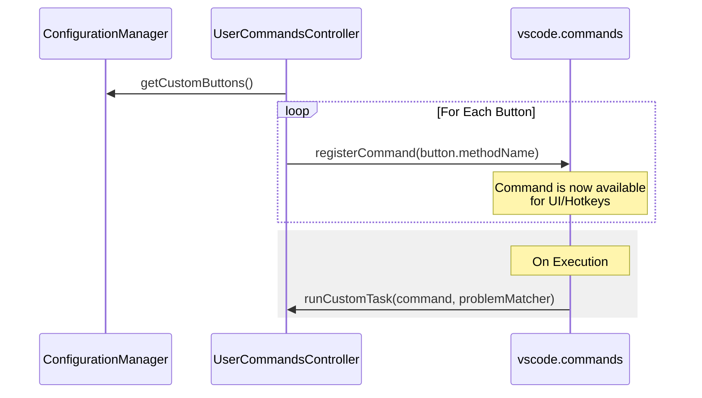

<!-- source: DeepWiki mcp.deepwiki.com · repo NVIDIA/bluebazel · page 4.2 Command Registration · fetched 2026-10-26 -->

# Command Registration

<details>
<summary>Relevant source files</summary>

The following files were used as context for generating this wiki page:

- [src/controllers/command-controller.ts](src/controllers/command-controller.ts)
- [src/controllers/commands/bazel-commands.ts](src/controllers/commands/bazel-commands.ts)
- [src/controllers/commands/bazel-target-operations-commands.ts](src/controllers/commands/bazel-target-operations-commands.ts)
- [src/controllers/commands/debug-commands.ts](src/controllers/commands/debug-commands.ts)
- [src/controllers/commands/multi-prop-tree-item-commands.ts](src/controllers/commands/multi-prop-tree-item-commands.ts)
- [src/controllers/commands/single-prop-tree-item-commands.ts](src/controllers/commands/single-prop-tree-item-commands.ts)
- [src/controllers/commands/tree-data-provider-commands.ts](src/controllers/commands/tree-data-provider-commands.ts)
- [src/controllers/commands/user-commands.ts](src/controllers/commands/user-commands.ts)
- [src/controllers/target-controllers/bazel-target-controller-manager.ts](src/controllers/target-controllers/bazel-target-controller-manager.ts)
- [src/services/string-utils.ts](src/services/string-utils.ts)

</details>


Command registration in BlueBazel is the mechanism that bridges the VS Code UI (menus, buttons, and hotkeys) to the extension's internal logic. This is orchestrated through a central `registerCommands` entry point that delegates to specialized sub-registrars, ensuring a clean separation of concerns between tree view interactions, Bazel operations, and user-defined tasks.

## Registration Architecture

The entry point for all command registration is the `registerCommands` function defined in `src/controllers/command-controller.ts`. This function is called during the extension's activation phase and receives all major controllers and services as dependencies.

### Command Flow Overview

The following diagram illustrates how VS Code commands are mapped to their respective controllers through the sub-registrar functions.

**Title: Command Dispatch Map**
```mermaid
graph TD
    subgraph "VS Code UI Space"
        "Command ID (e.g., bluebazel.refreshTargets)" --> "Sub-Registrar"
    end

    subgraph "Code Entity Space"
        "Sub-Registrar" --> "registerBazelCommands()"
        "Sub-Registrar" --> "registerBazelTargetOperationsCommands()"
        "Sub-Registrar" --> "registerUserCommands()"
        "Sub-Registrar" --> "registerTreeDataProviderCommands()"
        
        "registerBazelCommands()" --> "BazelController"
        "registerBazelTargetOperationsCommands()" --> "BazelTargetOperationsController"
        "registerUserCommands()" --> "UserCommandsController"
        "registerTreeDataProviderCommands()" --> "vscode.commands.executeCommand"
    end

    "BazelController" --- [src/controllers/bazel-controller.ts]
    "BazelTargetOperationsController" --- [src/controllers/bazel-target-operations-controller.ts]
    "UserCommandsController" --- [src/controllers/user-commands-controller.ts]
```
**Sources:** [src/controllers/command-controller.ts:42-58](), [src/controllers/commands/bazel-commands.ts:30-51]()

## Sub-Registrar Details

Each sub-registrar handles a specific domain of the extension's functionality.

### 1. General Bazel Commands
Handled by `registerBazelCommands`, these relate to global workspace operations.
*   `refreshTargets`: Triggers `bazelController.refreshAvailableTargets()` [src/controllers/commands/bazel-commands.ts:35-37]().
*   `format`: Executes `bazelController.format()` [src/controllers/commands/bazel-commands.ts:39-41]().
*   `clean`: Executes `bazelController.clean()` [src/controllers/commands/bazel-commands.ts:43-45]().
*   `buildCurrentFile`: Executes `bazelController.buildSingle()` [src/controllers/commands/bazel-commands.ts:47-49]().

### 2. Target Operations
Handled by `registerBazelTargetOperationsCommands`, these manage the lifecycle of targets in the side-bar.
*   `addTarget`: Uses `BazelTargetOperationsController.pickTarget(action)` [src/controllers/commands/bazel-target-operations-commands.ts:40-42]().
*   `removeTarget`: Removes a target via the controller [src/controllers/commands/bazel-target-operations-commands.ts:48-52]().
*   `copyCommand`: Copies the generated Bazel CLI command for a target to the clipboard [src/controllers/commands/bazel-target-operations-commands.ts:60-64]().
*   **Action Shortcuts**: This registrar also iterates through `build`, `run`, and `test` to create shortcut commands that execute the currently selected target for that action [src/controllers/commands/bazel-target-operations-commands.ts:77-84]().

### 3. Debug Commands
Handled by `registerDebugCommands`, these interface with the `DebugController`.
*   `debugTarget`: Explicitly debugs a specific `BazelTarget` [src/controllers/commands/debug-commands.ts:36-40]().
*   `debug`: Debugs the target currently selected in the 'run' category [src/controllers/commands/debug-commands.ts:42-49]().

### 4. Tree View Interaction
Three registrars manage how users interact with items in the Bazel Target Tree:
*   `registerTreeDataProviderCommands`: Handles view-level actions like `collapseAll` [src/controllers/commands/tree-data-provider-commands.ts:28-33]().
*   `registerSinglePropTreeItemCommands`: Manages single-value properties (e.g., editing a target's name or simple flag) [src/controllers/commands/single-prop-tree-item-commands.ts:31-45]().
*   `registerMultiPropTreeItemCommands`: Manages list-based properties (e.g., build flags or environment variables). It provides commands to `add`, `edit`, `remove`, and `copy` items within a property list [src/controllers/commands/multi-prop-tree-item-commands.ts:31-83]().

**Sources:** [src/controllers/commands/bazel-target-operations-commands.ts:31-85](), [src/controllers/commands/debug-commands.ts:31-51](), [src/controllers/commands/multi-prop-tree-item-commands.ts:31-83](), [src/controllers/commands/single-prop-tree-item-commands.ts:31-45]()

## User Command Registration

The `registerUserCommands` function handles dynamic command registration based on user configuration. Unlike static commands, these are generated at runtime from the `customButtons` setting in `settings.json`.

**Title: Dynamic Button Registration Logic**


### Implementation Details
1.  **Method Name Mapping**: Every custom button defines a `methodName` which becomes the actual VS Code command ID [src/controllers/commands/user-commands.ts:45]().
2.  **Backward Compatibility**: The handler supports both simple string commands and complex `UserCustomButton` objects [src/controllers/commands/user-commands.ts:47-51]().
3.  **Extension Context**: All registered commands are added to `context.subscriptions` to ensure they are disposed of correctly when the extension deactivates [src/controllers/commands/user-commands.ts:53]().

**Sources:** [src/controllers/commands/user-commands.ts:31-60](), [src/controllers/commands/user-commands.ts:62-74]()

## Controller Management

The `BazelTargetControllerManager` acts as a factory for action-specific controllers. During command registration, it provides the correct controller instance based on the action string (e.g., 'build', 'run', 'debug').

| Action | Controller Implementation | Role |
| :--- | :--- | :--- |
| `build` | `BuildController` | Logic for `bazel build` |
| `run` | `RunController` | Logic for `bazel run` or direct execution |
| `test` | `TestController` | Logic for `bazel test` and coverage |
| `debug` | `DebugController` | Orchestrates debuggers and port polling |
| `*` | `AnyActionController` | Fallback for generic actions |

**Sources:** [src/controllers/target-controllers/bazel-target-controller-manager.ts:42-100]()

---

