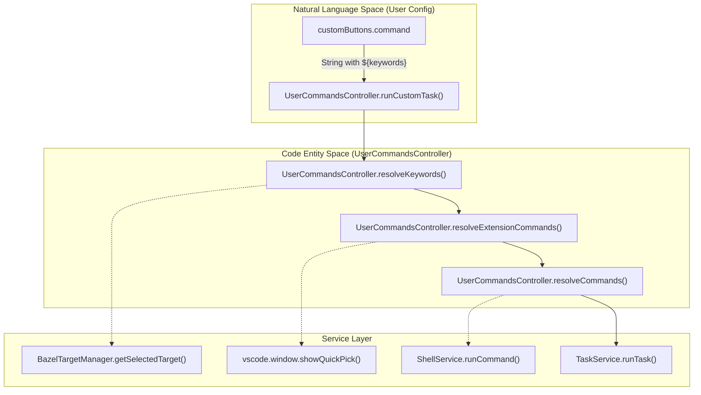
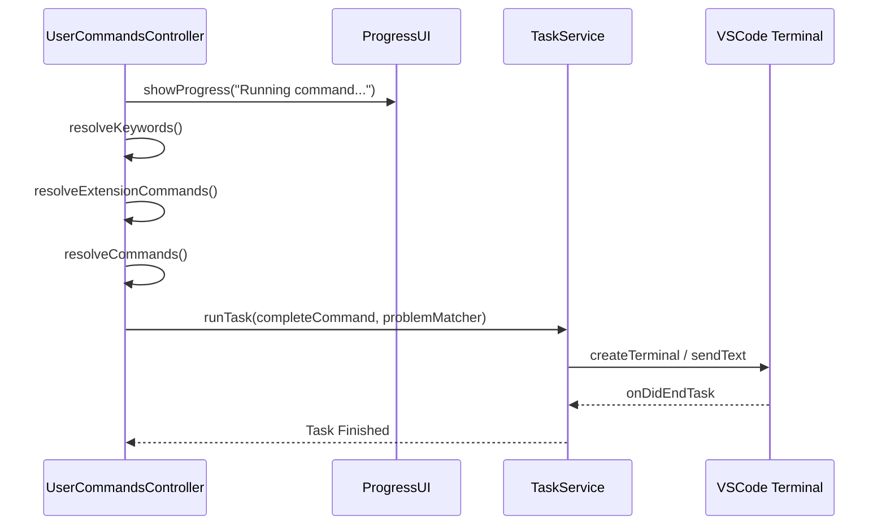

<!-- source: DeepWiki mcp.deepwiki.com · repo NVIDIA/bluebazel · page 4.3 User Commands & Custom Task Execution · fetched 2026-10-26 -->

# User Commands & Custom Task Execution

Relevant source files

The following files were used as context for generating this wiki page:

- [src/controllers/user-commands-controller.ts](src/controllers/user-commands-controller.ts)
- [src/services/configuration-manager.ts](src/services/configuration-manager.ts)

The `UserCommandsController` is responsible for resolving and executing custom tasks defined by the user. It implements a three-layer templating language that allows for dynamic command generation based on the current workspace state, interactive user input, and inline shell execution.

## Overview of Command Resolution

The execution of a custom task follows a strict resolution pipeline. When `runCustomTask` is called, it processes the input string through three distinct phases before passing the final command to the `TaskService`.

### Resolution Pipeline
1.  **Keyword Substitution**: Replaces `${keyword}` tokens with values from the current Bazel configuration or workspace settings.
2.  **Interactive Commands**: Processes `[Pick]` and `[Input]` tokens to prompt the user via VS Code UI.
3.  **Shell Execution**: Resolves `<shell>` tags by executing the enclosed command and capturing its stdout.

### Data Flow and System Integration
The following diagram illustrates how `UserCommandsController` bridges the gap between the configuration (Natural Language Space) and the internal service logic (Code Entity Space).

**Title: User Command Resolution Flow**

Sources: [src/controllers/user-commands-controller.ts:69-90](), [src/controllers/user-commands-controller.ts:105-124]()

---

## Three-Layer Templating Language

### 1. Keyword Substitution (`${keyword}`)
The controller maintains a mapping of internal configuration keys to dynamic values retrieved from the `BazelTargetManager` and `ConfigurationManager`.

| Keyword | Resolution Source | Description |
| :--- | :--- | :--- |
| `bluebazel.executable` | `ConfigurationManager.getExecutableCommand()` | Path to bazel binary [src/controllers/user-commands-controller.ts:122]() |
| `bluebazel.runTarget` | `BazelService.formatBazelTargetFromPath()` | The currently selected run target [src/controllers/user-commands-controller.ts:108-110]() |
| `bluebazel.testArgs` | `UserCommandsController.formatTestArgs()` | Formats args with `--test_arg` prefix [src/controllers/user-commands-controller.ts:92-97]() |
| `bluebazel.runEnvVars` | `BazelTarget.getEnvVars().toStringArray()` | Environment variables for the run target [src/controllers/user-commands-controller.ts:119]() |

**Special Logic: `formatTestArgs`**
For Bazel test commands, arguments must be prefixed with `--test_arg`. The `formatTestArgs` function uses a regex `(/(--\S+)/g)` to identify flags and prepend the required Bazel syntax.
Sources: [src/controllers/user-commands-controller.ts:38-55](), [src/controllers/user-commands-controller.ts:92-97](), [src/controllers/user-commands-controller.ts:105-124]()

### 2. Interactive Extension Commands
Interactive commands allow the command string to pause for user input.

*   **`[Pick](shell_command)`**: Executes the `shell_command`, splits the output by newlines, and presents a `vscode.window.showQuickPick` to the user. The selected item replaces the token [src/controllers/user-commands-controller.ts:131-149]().
*   **`[Input](Prompt Text)`**: Opens a `vscode.window.showInputBox` with the provided prompt. The user's text replaces the token [src/controllers/user-commands-controller.ts:151-155]().

### 3. Inline Shell Execution (`<shell>`)
The `<shell>command</shell>` syntax allows embedding the output of a shell command directly into the final task string. The `UserCommandsController.resolveCommands` method uses a recursive regex to find these tags and executes them via `ShellService.runCommand`.

**Caching**: To prevent redundant executions (especially during recursive resolution), the controller caches the results of shell commands within the scope of a single task resolution [src/controllers/user-commands-controller.ts:157-160]().

Sources: [src/controllers/user-commands-controller.ts:57-60](), [src/controllers/user-commands-controller.ts:131-160]()

---

## Integration with TaskService

Once the command string is fully resolved, it is handed off to the `TaskService` for execution in the VS Code terminal.

**Title: Execution Hand-off to TaskService**

The `runTask` call uses the following parameters:
*   **Execution Type**: `'shell'` [src/controllers/user-commands-controller.ts:82]().
*   **Terminal Clearing**: Determined by `configurationManager.isClearTerminalBeforeAction()` [src/controllers/user-commands-controller.ts:78]().
*   **Resolution**: The promise resolves on the `onDidEndTask` event [src/controllers/user-commands-controller.ts:83]().
*   **Problem Matchers**: Passed through from the `UserCustomButton` definition to enable VS Code error parsing [src/controllers/user-commands-controller.ts:84]().

Sources: [src/controllers/user-commands-controller.ts:69-90](), [src/services/configuration-manager.ts:171-180]()

---

## Configuration of Custom Tasks

Custom tasks are defined in the `bluebazel.customButtons` setting. This setting is managed by `ConfigurationManager`, which inflates the JSON into `UserCustomCategory` and `UserCustomButton` objects.

| Class | Responsibility |
| :--- | :--- |
| `UserCustomCategory` | Groups buttons under a single header in the Tree View [src/services/configuration-manager.ts:66-89](). |
| `UserCustomButton` | Holds the raw command string, icon, and problem matcher [src/services/configuration-manager.ts:30-64](). |

Sources: [src/services/configuration-manager.ts:30-89](), [src/services/configuration-manager.ts:115-124]()

---

