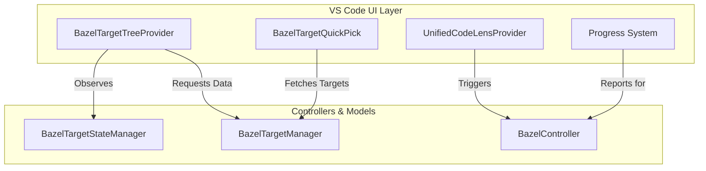

<!-- source: DeepWiki mcp.deepwiki.com · repo NVIDIA/bluebazel · page 5 User Interface · fetched 2026-10-26 -->

# User Interface

Relevant source files

The following files were used as context for generating this wiki page:

- [src/ui/bazel-target-quick-pick.ts](src/ui/bazel-target-quick-pick.ts)
- [src/ui/bazel-target-tree-provider.ts](src/ui/bazel-target-tree-provider.ts)
- [src/ui/progress.ts](src/ui/progress.ts)
- [src/ui/quick-pick.ts](src/ui/quick-pick.ts)
- [src/ui/terminal.ts](src/ui/terminal.ts)

The BlueBazel user interface provides a comprehensive set of tools within VS Code to manage, execute, and debug Bazel targets. The UI layer bridges the gap between the underlying [Core Architecture](#2) and the user, utilizing tree views, interactive dialogs, and contextual overlays to streamline the Bazel workflow.

### UI Architecture Overview

The UI components interact with the model layer to reflect the current state of the workspace and provide interactive controls for target operations.

**Sources:** [src/ui/bazel-target-tree-provider.ts:89-94](), [src/ui/bazel-target-quick-pick.ts:51-55](), [src/ui/progress.ts:124-129]()

---

## Bazel Target Tree View

The **Bazel Target Tree View** is the primary explorer for the extension. It organizes targets into logical categories based on their `BazelAction` (e.g., Build, Run, Test).

- **Hierarchy**: The tree uses a `BazelTreeElement` union type to represent different levels, including `BazelTargetCategory`, `BazelTarget`, and various property nodes `[src/ui/bazel-target-tree-provider.ts:36-43]()`.
- **Visual Indicators**: Targets are assigned icons based on their action type (e.g., a "beaker" for tests, "play" for run) `[src/ui/bazel-target-tree-provider.ts:52-74]()`.
- **State Persistence**: The provider tracks which nodes are expanded using an `expandedStateCache` stored in `vscode.ExtensionContext.workspaceState` `[src/ui/bazel-target-tree-provider.ts:85-87]()`.

For a deep dive into the tree resolution logic and context menu integration, see **[Bazel Target Tree View](#5.1)**.

---

## CodeLens Overlays

BlueBazel injects **CodeLens** actions directly into source code files to allow for one-click execution and debugging of tests or main functions.

- **Aggregation**: The `UnifiedCodeLensProvider` scans active documents using language-specific regex patterns.
- **Context Awareness**: It maps source file locations to Bazel targets by inspecting the workspace structure and `BUILD` files.
- **Dynamic Actions**: Injects `run` and `debug` links above recognized symbols, automatically handling test filter arguments for granular execution.

For details on language-specific patterns and target extraction, see **[CodeLens Providers](#5.2)**.

---

## QuickPick Dialogs

The extension utilizes `QuickPick` interfaces for interactive target selection and command configuration when the tree view is not the primary entry point.

| Component | Responsibility | Source |
| :--- | :--- | :--- |
| `BazelTargetQuickPick` | Provides a searchable list of available Bazel targets filtered by action. | `[src/ui/bazel-target-quick-pick.ts:32-34]()` |
| `showSimpleQuickPick` | A utility for selecting arguments or configuration values with a loading state. | `[src/ui/quick-pick.ts:35-40]()` |

The `BazelTargetQuickPick` supports a dual-mode input where users can first select an action and then filter through matching targets `[src/ui/bazel-target-quick-pick.ts:102-122]()`.

---

## Progress and Terminal Management

Long-running Bazel operations are communicated to the user through a unified progress system and terminal controls.

### Progress Indicators
The `showProgress` utility coordinates multiple UI updates simultaneously:
1. **Status Bar**: Displays a spinning icon and the current task title `[src/ui/progress.ts:90-93]()`.
2. **Notification Window**: Shows a progress dialog with a custom spinner and a "Cancel" button `[src/ui/progress.ts:52-58]()`.
3. **Cancellation**: Both UI elements propagate cancellation requests back to the underlying `vscode.CancellationTokenSource` `[src/ui/progress.ts:59-62]()`.

### Terminal Management
The extension interacts with the VS Code terminal for command output. It includes utilities like `clearTerminal` to ensure a clean state before new build or run operations are initiated `[src/ui/terminal.ts:26-28]()`.

**Sources:** [src/ui/progress.ts:124-153](), [src/ui/terminal.ts:26-28]()

---

