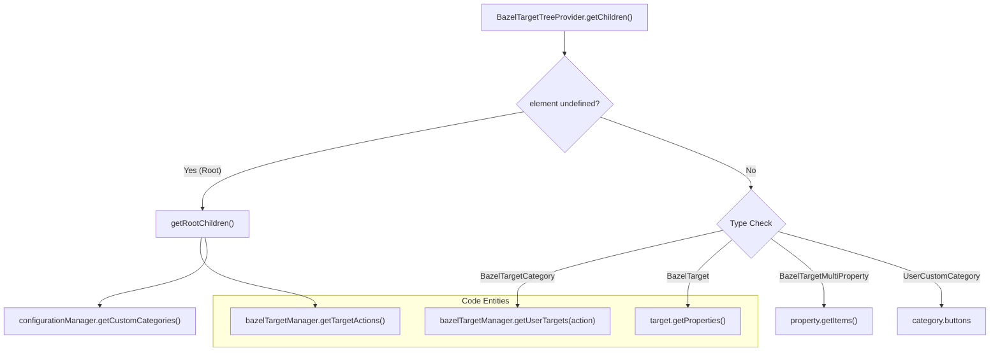
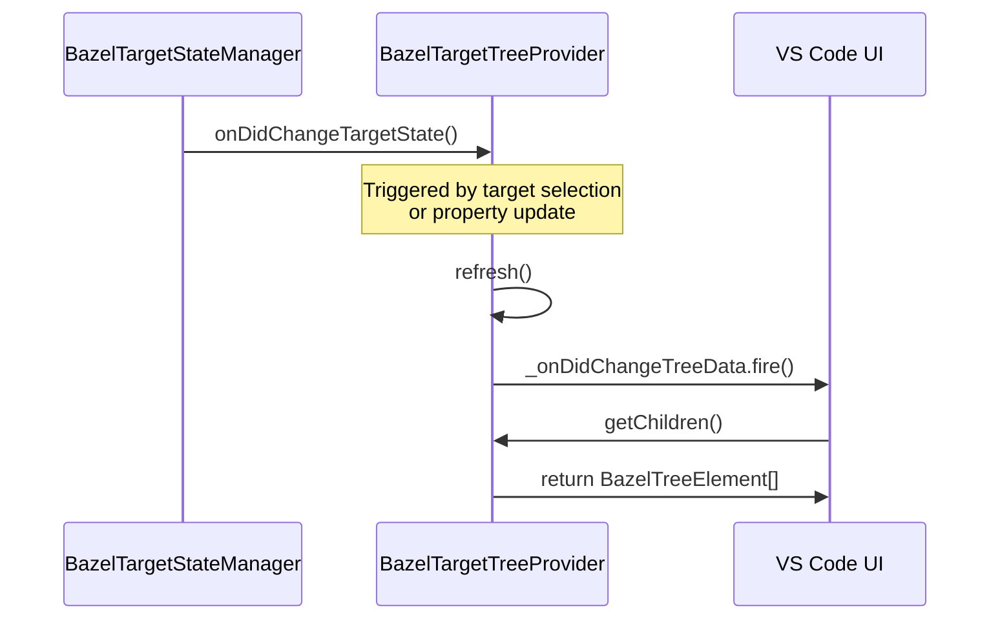

<!-- source: DeepWiki mcp.deepwiki.com · repo NVIDIA/bluebazel · page 5.1 Bazel Target Tree View · fetched 2026-10-26 -->

# Bazel Target Tree View

Relevant source files

The following files were used as context for generating this wiki page:

- [src/ui/bazel-target-quick-pick-item.ts](src/ui/bazel-target-quick-pick-item.ts)
- [src/ui/bazel-target-quick-pick.ts](src/ui/bazel-target-quick-pick.ts)
- [src/ui/bazel-target-tree-provider.ts](src/ui/bazel-target-tree-provider.ts)

The `BazelTargetTreeProvider` is the central class responsible for rendering the Bazel Explorer view in VS Code. It transforms the internal data models of targets and actions into a hierarchical tree structure, managing everything from icon assignment to the persistence of the user's expansion state.

## Tree Element Hierarchy

The tree view is composed of a union type `BazelTreeElement` [src/ui/bazel-target-tree-provider.ts:36-36](), which represents the various levels of the hierarchy.

| Element Type | Description |
| :--- | :--- |
| `BazelTargetCategory` | The top-level nodes representing Bazel actions (e.g., `build`, `run`, `test`). |
| `UserCustomCategory` | User-defined categories configured via settings. |
| `BazelTarget` | The actual Bazel targets (e.g., `//path/to:target`). |
| `BazelTargetProperty` | Key-value pairs belonging to a target (e.g., `args`, `env`). |
| `BazelTargetMultiProperty` | A property that contains a list of items (e.g., a list of `args`). |
| `BazelTargetMultiPropertyItem` | An individual entry within a `BazelTargetMultiProperty`. |
| `UserCustomButton` | Interactive buttons defined in the user configuration. |

### Data Flow and Element Resolution
The following diagram illustrates how the `BazelTargetTreeProvider` resolves the hierarchy from the root down to individual properties.

**Hierarchy Resolution Logic**

Sources: [src/ui/bazel-target-tree-provider.ts:116-150](), [src/ui/bazel-target-tree-provider.ts:181-220]()

## Implementation Details

### Context Values and Menus
To enable context-sensitive menus (defined in `package.json`), the provider assigns specific `contextValue` strings to `TreeItem` objects during the `getTreeItem` call.

*   **Targets:** Assigned `bazelTarget` [src/ui/bazel-target-tree-provider.ts:321-321]().
*   **Properties:** Assigned `bazelTargetProperty` [src/ui/bazel-target-tree-provider.ts:341-341]().
*   **Multi-Property Items:** Assigned `bazelTargetMultiPropertyItem` [src/ui/bazel-target-tree-provider.ts:360-360]().

### Selected-Target Highlighting
The provider highlights the "active" or most recently used target for a specific action by comparing the element against the `BazelTargetStateManager`. If a target's ID matches the `selectedTargetId` stored in the state manager, its label is modified to include a `★` symbol and its description is updated to `(selected)` [src/ui/bazel-target-tree-provider.ts:311-318]().

### Expansion State Persistence
To provide a seamless user experience, the tree provider persists which nodes are expanded in the VS Code `workspaceState`.
1.  **Cache:** An `expandedStateCache` object stores boolean values keyed by element IDs [src/ui/bazel-target-tree-provider.ts:49-49]().
2.  **Initialization:** On startup, the cache is populated from `workspaceState.get('expandedState')` [src/ui/bazel-target-tree-provider.ts:86-87]().
3.  **Persistence:** The `TreeItem.collapsibleState` is set based on this cache. When a user expands or collapses a node, the extension updates the cache and flushes it back to `workspaceState`.

### Icon Mapping
The provider maintains a static `iconMap` that associates `BazelAction` types with `vscode.ThemeIcon` identifiers to ensure visual consistency with standard VS Code metaphors.

| Action | Icon | Source |
| :--- | :--- | :--- |
| `build` | `tools` | [src/ui/bazel-target-tree-provider.ts:55-55]() |
| `run` | `play` | [src/ui/bazel-target-tree-provider.ts:69-69]() |
| `test` | `beaker` | [src/ui/bazel-target-tree-provider.ts:72-72]() |
| `query` | `graph` | [src/ui/bazel-target-tree-provider.ts:68-68]() |
| `clean` | `trash` | [src/ui/bazel-target-tree-provider.ts:57-57]() |

Sources: [src/ui/bazel-target-tree-provider.ts:52-74]()

## Component Interaction

The `BazelTargetTreeProvider` acts as a view layer that reacts to changes in the underlying models.

**Tree Update Lifecycle**

Sources: [src/ui/bazel-target-tree-provider.ts:90-94](), [src/ui/bazel-target-tree-provider.ts:116-120]()

## Key Functions

### `getChildren(element?: BazelTreeElement)`
The entry point for VS Code to request tree nodes. If `element` is undefined, it calls `getRootChildren()`. Otherwise, it performs a type-check on the element to determine which sub-level to fetch [src/ui/bazel-target-tree-provider.ts:181-220]().

### `getTreeItem(element: BazelTreeElement)`
Converts a `BazelTreeElement` into a `vscode.TreeItem`. This function handles:
*   Label formatting (including the "selected" star) [src/ui/bazel-target-tree-provider.ts:311-315]().
*   Icon assignment via `iconService` or internal `iconMap` [src/ui/bazel-target-tree-provider.ts:303-305]().
*   Setting `collapsibleState` based on whether the element has children and its previous expansion state [src/ui/bazel-target-tree-provider.ts:373-380]().

### `getRootChildren()`
Aggregates categories from two sources:
1.  **Dynamic Actions:** Fetched from `bazelTargetManager.getTargetActions()`, which returns actions like `build`, `run`, and `test` based on discovered targets [src/ui/bazel-target-tree-provider.ts:119-119]().
2.  **Custom Categories:** Fetched from `configurationManager.getCustomCategories()`, allowing users to define their own organizational folders in the tree [src/ui/bazel-target-tree-provider.ts:128-128]().

Sources: [src/ui/bazel-target-tree-provider.ts:116-150]()

---

