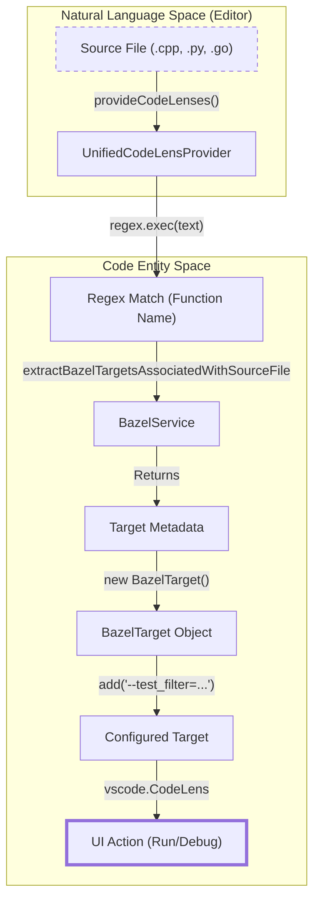
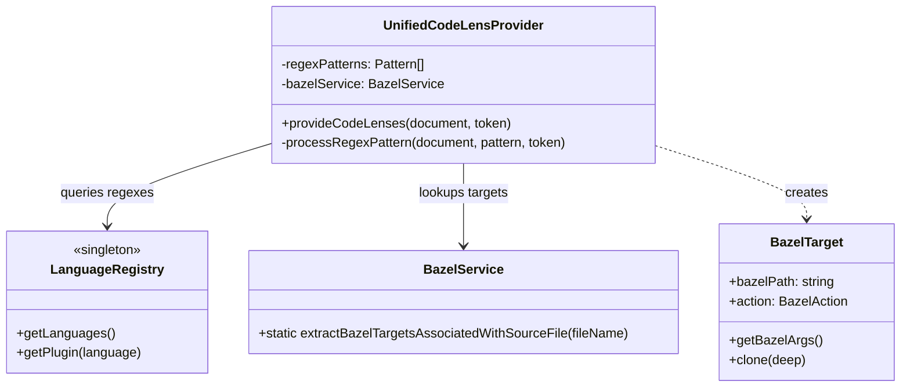

<!-- source: DeepWiki mcp.deepwiki.com · repo NVIDIA/bluebazel · page 5.2 CodeLens Providers · fetched 2026-10-26 -->

# CodeLens Providers

Relevant source files

The following files were used as context for generating this wiki page:

- [src/ui/code-lens-provider-utils.ts](src/ui/code-lens-provider-utils.ts)
- [src/ui/code-lens-providers/unified-code-lens-provider.ts](src/ui/code-lens-providers/unified-code-lens-provider.ts)

The CodeLens system in BlueBazel provides interactive "Run" and "Debug" overlays directly in the source code editor. These overlays appear above test functions and entry points (like `main()`), allowing developers to execute specific Bazel targets without leaving their code. This functionality is primarily driven by the `UnifiedCodeLensProvider`, which bridges the gap between static source code analysis and Bazel target execution.

## Overview of UnifiedCodeLensProvider

The `UnifiedCodeLensProvider` is a centralized provider that implements the `vscode.CodeLensProvider` interface [src/ui/code-lens-providers/unified-code-lens-provider.ts:41-41](). Instead of having separate providers for every language, BlueBazel uses this single provider to aggregate patterns from the `LanguageRegistry` and apply them based on the active document's language ID.

### Registration Process
CodeLens providers are registered during the extension initialization phase. The `registerCodeLensProviders` utility function instantiates the `UnifiedCodeLensProvider` and attaches it to supported language selectors: `go`, `cpp`, `c`, and `python` [src/ui/code-lens-provider-utils.ts:28-35]().

### Pattern Aggregation
Upon construction, the `UnifiedCodeLensProvider` queries the `LanguageRegistry` to retrieve regex patterns for "Run" and "Test" actions [src/ui/code-lens-providers/unified-code-lens-provider.ts:45-77]().

1.  **Language Plugins**: Each language plugin (e.g., `CppLanguagePlugin`) provides specific regexes via `getCodeLensTestRegex()` and `getCodeLensRunRegex()` [src/ui/code-lens-providers/unified-code-lens-provider.ts:56-68]().
2.  **Pattern Storage**: These are stored internally as `Pattern` objects containing the `PatternType` (Run/Test), the language ID, and the compiled `RegExp` [src/ui/code-lens-providers/unified-code-lens-provider.ts:31-39]().

**Sources:**
- [src/ui/code-lens-provider-utils.ts:28-35]()
- [src/ui/code-lens-providers/unified-code-lens-provider.ts:41-77]()

## Data Flow: From Source to Execution

The following diagram illustrates how the provider translates a regex match in a source file into a runnable `BazelTarget`.

### CodeLens Generation Flow
Title: Source Code to CodeLens Action

**Sources:**
- [src/ui/code-lens-providers/unified-code-lens-provider.ts:79-162]()
- [src/ui/code-lens-providers/unified-code-lens-provider.ts:124-124]()

## Implementation Details

### Target Extraction and Filtering
When a regex match is found, the provider must identify which Bazel target owns the current file. It calls `BazelService.extractBazelTargetsAssociatedWithSourceFile(document.fileName)` to find associated targets [src/ui/code-lens-providers/unified-code-lens-provider.ts:124-124]().

If targets are found, the provider performs the following:
1.  **Action Determination**: Maps the `PatternType` to a `BazelAction` (`'run'` or `'test'`) [src/ui/code-lens-providers/unified-code-lens-provider.ts:105-110]().
2.  **Function Name Resolution**: 
    *   For **C/C++**: It combines the fixture name and test name (e.g., `Fixture.TestName`) from the regex capture groups [src/ui/code-lens-providers/unified-code-lens-provider.ts:114-118]().
    *   For **Other Languages**: It uses the primary captured group as the function name [src/ui/code-lens-providers/unified-code-lens-provider.ts:121-121]().
3.  **Argument Injection**: If the pattern is a `Test` type, it automatically adds the `--test_filter` argument to the `BazelTarget` to ensure only the specific function is executed [src/ui/code-lens-providers/unified-code-lens-provider.ts:139-141]().

### Debug Support
For every "Run" or "Test" CodeLens generated, the provider also generates a corresponding "Debug" CodeLens [src/ui/code-lens-providers/unified-code-lens-provider.ts:151-161]().
- It clones the original target [src/ui/code-lens-providers/unified-code-lens-provider.ts:151-151]().
- It injects `--compilation_mode=dbg` into the Bazel arguments to ensure symbols are available [src/ui/code-lens-providers/unified-code-lens-provider.ts:152-152]().
- It binds the command to `${extensionName}.debugTarget` [src/ui/code-lens-providers/unified-code-lens-provider.ts:158-158]().

### Internal Architecture
Title: UnifiedCodeLensProvider Class Relationships

**Sources:**
- [src/ui/code-lens-providers/unified-code-lens-provider.ts:41-165]()
- [src/ui/code-lens-providers/unified-code-lens-provider.ts:124-124]()

## Summary of CodeLens Actions

| Action | Command | Arguments Injected |
| :--- | :--- | :--- |
| **Run/Test** | `bluebazel.executeTarget` | `--test_filter=<name>` (if test) |
| **Debug** | `bluebazel.debugTarget` | `--compilation_mode=dbg`, `--test_filter=<name>` (if test) |

The labels and command IDs used are dynamically resolved using `ExtensionUtils.getExtensionName(this.context)` to ensure consistency with the extension's configuration [src/ui/code-lens-providers/unified-code-lens-provider.ts:98-146]().

**Sources:**
- [src/ui/code-lens-providers/unified-code-lens-provider.ts:98-161]()

---

