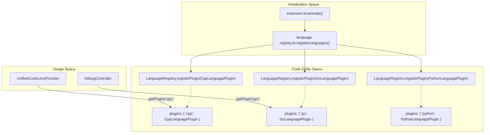
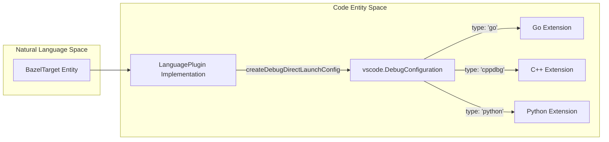

<!-- source: DeepWiki mcp.deepwiki.com · repo NVIDIA/bluebazel · page 6 Language Plugin System · fetched 2026-10-26 -->

# Language Plugin System

Relevant source files

The following files were used as context for generating this wiki page:

- [releases/bluebazel-1.0.2.vsix](releases/bluebazel-1.0.2.vsix)
- [releases/bluebazel-1.0.4.vsix](releases/bluebazel-1.0.4.vsix)
- [src/languages/language-plugin.ts](src/languages/language-plugin.ts)
- [src/languages/language-registry.ts](src/languages/language-registry.ts)
- [src/languages/plugins/go-language-plugin.ts](src/languages/plugins/go-language-plugin.ts)
- [src/services/bazel-rule-language-mapping.ts](src/services/bazel-rule-language-mapping.ts)

The Language Plugin System provides a modular framework for extending BlueBazel with language-specific capabilities. It allows the extension to support diverse ecosystems (C++, Python, Go) while maintaining a unified interface for core features like debugging and CodeLens injection.

## LanguagePlugin Interface

The `LanguagePlugin` interface defines the contract that every language-specific implementation must fulfill. It abstracts the complexities of different debuggers (GDB, debugpy, Delve) and source code patterns.

| Method | Purpose |
| :--- | :--- |
| `getDebugRunUnderCommand` | Returns the command string (e.g., `gdbserver`, `dlv`) used with Bazel's `--run_under` flag. |
| `getDebugEnvVars` | Provides language-specific environment variables required during a debug session. |
| `createDebugDirectLaunchConfig` | Generates a VS Code `DebugConfiguration` for launching a compiled binary directly. |
| `createDebugAttachConfig` | Generates a configuration for attaching the VS Code debugger to a running process/port. |
| `getCodeLensTestRegex` | Returns the RegExp used to identify test functions in source files. |
| `getCodeLensRunRegex` | Returns the RegExp used to identify entry points (e.g., `main()`) in source files. |

**Sources:** [src/languages/language-plugin.ts:28-43]()

## LanguageRegistry and Registration

The `LanguageRegistry` is a singleton that manages the lifecycle of language plugins. It maps VS Code language identifiers (e.g., `cpp`, `python`, `go`) to their respective plugin implementations.

### Plugin Lifecycle
1.  **Initialization**: During extension activation, the `registerLanguages` function instantiates the concrete plugins.
2.  **Registration**: Plugins are added to the registry via `LanguageRegistry.registerPlugin`.
3.  **Resolution**: Other services (like `DebugController` or `UnifiedCodeLensProvider`) query the registry using `getPlugin(language)` to retrieve the appropriate handler.

### Language Mapping Logic
BlueBazel uses two primary maps in `bazel-rule-language-mapping.ts` to determine which plugin to use:
*   **Rule Prefix Mapping**: Maps Bazel rule types (e.g., `cc_binary` -> `cpp`) to languages. [src/services/bazel-rule-language-mapping.ts:24-156]()
*   **Extension Mapping**: Maps file extensions (e.g., `.go` -> `go`) to languages for CodeLens support. [src/services/bazel-rule-language-mapping.ts:161-300]()

**Language Plugin Registration Flow**

**Sources:** [src/languages/language-registry.ts:33-64](), [src/services/bazel-rule-language-mapping.ts:24-300]()

## Debug Configuration Generation

A core responsibility of the language plugin is translating `BazelTarget` metadata into VS Code `DebugConfiguration` objects. This allows BlueBazel to leverage native VS Code debugger extensions (like `ms-vscode.cpptools` or `golang.go`).

### Debugging Patterns
*   **Run Under (Attach)**: The plugin provides a command for Bazel to wrap the executable (e.g., `dlv exec --headless --listen=:${port}`). BlueBazel then uses `createDebugAttachConfig` to connect VS Code to that port. [src/languages/plugins/go-language-plugin.ts:43-45]()
*   **Direct Launch**: The plugin uses `createDebugDirectLaunchConfig` to point the debugger directly at the Bazel-generated binary in the `bazel-bin` directory. [src/languages/plugins/go-language-plugin.ts:53-78]()

**Debug Configuration Translation**

**Sources:** [src/languages/language-plugin.ts:31-37](), [src/languages/plugins/go-language-plugin.ts:80-105]()

## CodeLens Contributions

Plugins contribute Regular Expressions that `UnifiedCodeLensProvider` uses to scan source files. This enables the "Run" and "Debug" buttons to appear directly above functions in the editor.

*   **Test Regex**: Identifies individual test cases (e.g., `func TestXxx` in Go). [src/languages/plugins/go-language-plugin.ts:113-115]()
*   **Run Regex**: Identifies entry points (e.g., `func main()` in Go). [src/languages/plugins/go-language-plugin.ts:122-124]()

For details on how these regexes are applied to the UI, see [CodeLens Providers](#5.2).

## Specific Implementations

Details for individual language support are covered in the following child pages:

*   **[C/C++ Language Plugin](#6.1)**: Detailed reference for `CppLanguagePlugin`, including `gdbserver` integration, `bazel_debug.sh` wrapper, and GTest support.
*   **[Python & Go Language Plugins](#6.2)**: Coverage of `PythonLanguagePlugin` (debugpy) and `GoLanguagePlugin` (Delve/dlv).

**Sources:** [src/languages/language-registry.ts:61-63]()

---

