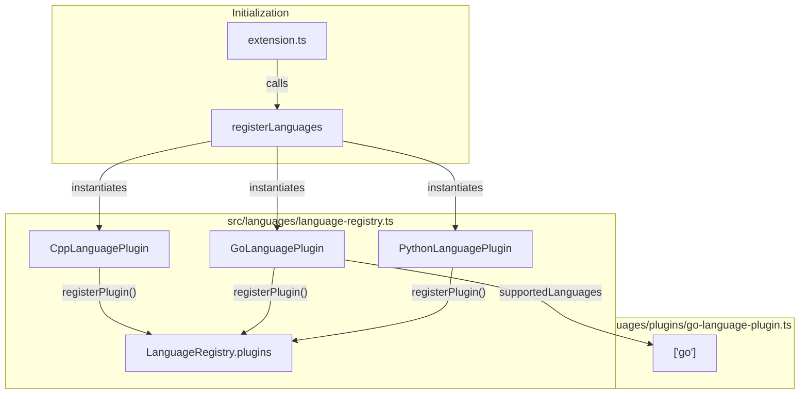
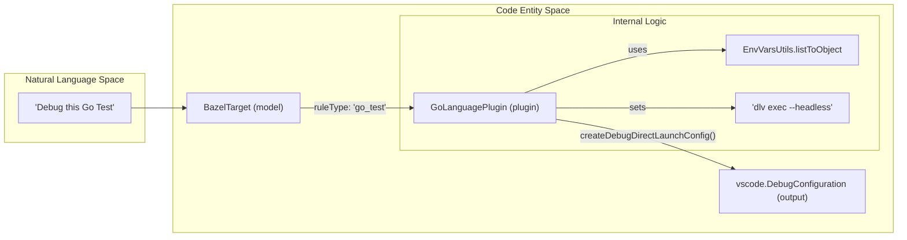

<!-- source: DeepWiki mcp.deepwiki.com · repo NVIDIA/bluebazel · page 6.2 Python & Go Language Plugins · fetched 2026-10-26 -->

# Python & Go Language Plugins

Relevant source files

The following files were used as context for generating this wiki page:

- [releases/bluebazel-1.0.2.vsix](releases/bluebazel-1.0.2.vsix)
- [src/languages/language-plugin.ts](src/languages/language-plugin.ts)
- [src/languages/language-registry.ts](src/languages/language-registry.ts)
- [src/languages/plugins/go-language-plugin.ts](src/languages/plugins/go-language-plugin.ts)
- [src/languages/plugins/python-language-plugin.ts](src/languages/plugins/python-language-plugin.ts)

The language plugin system in BlueBazel allows for specialized handling of different programming languages within the Bazel ecosystem. Both `PythonLanguagePlugin` and `GoLanguagePlugin` implement the `LanguagePlugin` interface to provide tailored debugging configurations and CodeLens regular expressions for test discovery.

## The LanguagePlugin Interface

All language-specific logic is encapsulated in classes implementing the `LanguagePlugin` interface. This interface defines the contract for generating debug configurations and providing regex patterns for CodeLens injection.

| Method | Description |
| :--- | :--- |
| `getDebugRunUnderCommand(port)` | Returns the command string used with Bazel's `--run_under` flag to wrap the executable in a debugger server. |
| `getDebugEnvVars(target)` | Returns an array of environment variables required specifically for debugging the given target. |
| `createDebugDirectLaunchConfig(...)` | Generates a VS Code `DebugConfiguration` for launching a pre-built binary directly without Bazel wrapping. |
| `createDebugAttachConfig(...)` | Generates a VS Code `DebugConfiguration` for attaching the IDE to a remote debugger port. |
| `getCodeLensTestRegex()` | Returns a regex used to identify test functions in source files. |
| `getCodeLensRunRegex()` | Returns a regex used to identify entry points (e.g., `main`) in source files. |

**Sources:** [src/languages/language-plugin.ts:28-43]()

---

## Python Language Plugin

The `PythonLanguagePlugin` handles `py_binary` and `py_test` targets. It primarily relies on the `debugpy` engine.

### Debugging Implementation & Limitations
Unlike C++ or Go, the Python plugin does not support the `bazel run --run_under` debugging strategy. This is because `py_binary` targets often use `os.execv` to transition from the Bazel stub to the actual Python interpreter, which frequently breaks the connection with a debugger wrapped via `--run_under` [src/languages/plugins/python-language-plugin.ts:45-47]().

Instead, the plugin emphasizes **Direct Debugging**:
1. **Runfiles Resolution**: It calls `BazelService.getRunfilesLocation` to find the Bazel-generated runfiles directory [src/languages/plugins/python-language-plugin.ts:59-59]().
2. **Main Discovery**: It recursively searches the runfiles for a `.py` file containing the `if __name__ == "__main__":` idiom using `findMainInRunfiles` [src/languages/plugins/python-language-plugin.ts:128-156]().
3. **Launch Config**: It creates a `python` type launch configuration pointing directly to that discovered file, using `pathMappings` to bridge the local `${workspaceFolder}` to the Bazel execution root [src/languages/plugins/python-language-plugin.ts:68-85]().

### CodeLens Regex
- **Tests**: Matches standard Python test definitions: `/(?:^|\s)def\s+(test_\w+)\(/gm` [src/languages/plugins/python-language-plugin.ts:114-116]().
- **Run**: Matches main function signatures: `/(?:^|\s)def\s+(main)\s*\(\s*\)/gm` [src/languages/plugins/python-language-plugin.ts:124-126]().

**Sources:** [src/languages/plugins/python-language-plugin.ts:35-159]()

---

## Go Language Plugin

The `GoLanguagePlugin` integrates with the `dlv` (Delve) debugger for Go targets.

### Debugging Lifecycle
The Go plugin supports both "Run Under" and "Direct" debugging modes.

- **Run Under**: It uses `dlv exec` in headless mode to listen on a specific port [src/languages/plugins/go-language-plugin.ts:43-45]().
- **Environment Handling**: For Go tests, it injects `GO_TEST_WRAP=0`. This is critical because Bazel's Go test runner normally wraps tests in a child process; disabling this ensures `dlv` attaches to the correct process [src/languages/plugins/go-language-plugin.ts:47-51]().
- **Remote Sessions**: If `isRemoteSession()` is true (e.g., VS Code over SSH), it automatically configures `substitutePath` to ensure breakpoints map correctly between the remote Bazel environment and the local editor [src/languages/plugins/go-language-plugin.ts:95-103]().

### CodeLens Regex
- **Tests**: Matches Go test signatures: `/^func\s+(Test\w+)\(\w+\s+\*testing\.T\)/gm` [src/languages/plugins/go-language-plugin.ts:113-115]().
- **Run**: Matches the main entry point: `/^func\s+(main)\s*\(\s*\)\s*\{/gm` [src/languages/plugins/go-language-plugin.ts:122-124]().

**Sources:** [src/languages/plugins/go-language-plugin.ts:33-126]()

---

## Architecture & Data Flow

The following diagrams illustrate how the plugins are registered and how they transform Bazel metadata into VS Code debugging configurations.

### Plugin Registration Flow
This diagram shows the initialization of the `LanguageRegistry` during extension activation.

**Sources:** [src/languages/language-registry.ts:57-64](), [src/languages/plugins/go-language-plugin.ts:40-40]()

### Debug Configuration Data Flow
This diagram bridges the natural language request to debug a target to the specific code entities involved in generating the `vscode.DebugConfiguration`.

**Sources:** [src/languages/plugins/go-language-plugin.ts:53-78](), [src/languages/plugins/go-language-plugin.ts:43-45]()

---

## Implementation Summary

| Feature | Python Plugin | Go Plugin |
| :--- | :--- | :--- |
| **Supported Languages** | `['python']` | `['go']` |
| **Debugger** | `debugpy` | `dlv` |
| **Debug Strategy** | Direct launch only (os.execv limitation) | `--run_under` and Direct launch |
| **Path Mapping** | `${workspaceFolder}` to `.` | `${workspaceFolder}` to `""` (remote) |
| **Special Env Vars** | None | `GO_TEST_WRAP=0` for tests |

**Sources:** [src/languages/plugins/python-language-plugin.ts:35-43](), [src/languages/plugins/go-language-plugin.ts:33-41](), [src/languages/plugins/go-language-plugin.ts:47-51]()

---

