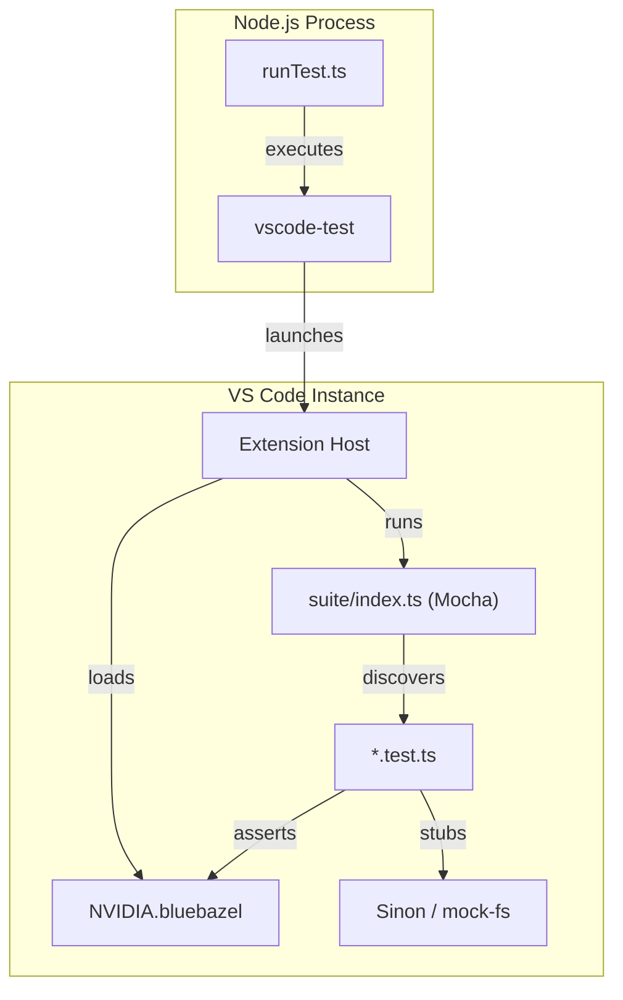
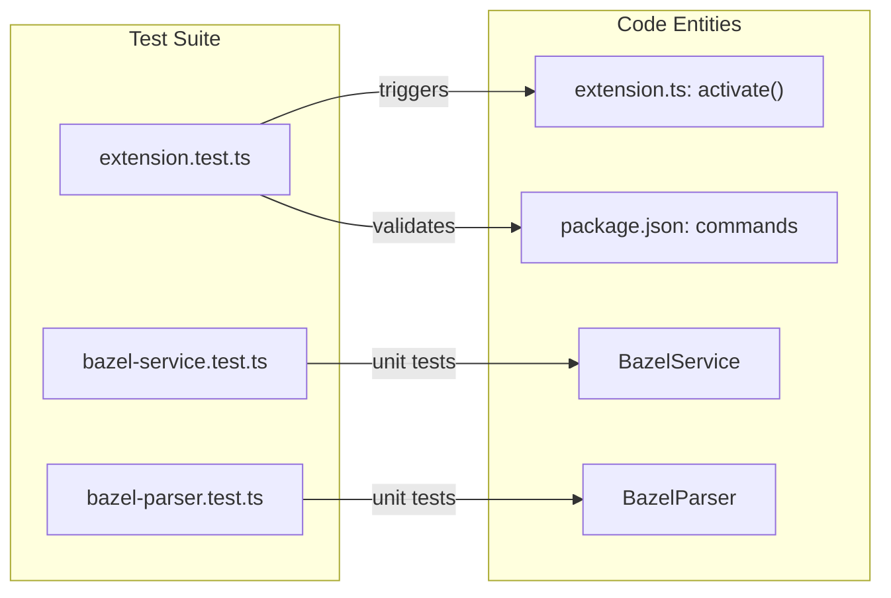

<!-- source: DeepWiki mcp.deepwiki.com · repo NVIDIA/bluebazel · page 7 Testing · fetched 2026-10-26 -->

# Testing

Relevant source files

The following files were used as context for generating this wiki page:

- [src/test/runTest.ts](src/test/runTest.ts)
- [src/test/suite/extension.test.ts](src/test/suite/extension.test.ts)
- [src/test/suite/index.ts](src/test/suite/index.ts)

The BlueBazel test infrastructure is designed to validate both individual service logic and the overall integration within the VS Code environment. The suite utilizes **Mocha** as the test runner, **Sinon** for mocking and stubbing dependencies, and **mock-fs** to simulate workspace environments without side effects on the host filesystem.

### Test Execution Harness

The testing lifecycle is managed by a dedicated runner that bootstraps a VS Code instance to execute tests in an environment that mimics production.

*   **`runTest.ts`**: This is the entry point for executing the test suite. It uses `vscode-test` to download, unzip, and launch a stable VS Code instance [src/test/runTest.ts:29-40](). It points the instance to the extension's root and the compiled test suite [src/test/runTest.ts:33-37]().
*   **`suite/index.ts`**: Acts as the Mocha configuration hub. It dynamically discovers all files matching the `**.test.js` pattern within the test directory and adds them to the Mocha runner [src/test/suite/index.ts:37-46](). It also supports environment-based filtering via `MOCHA_GREP` [src/test/suite/index.ts:34-34]().

**Sources:**
- [src/test/runTest.ts:29-47]()
- [src/test/suite/index.ts:25-63]()

### Infrastructure Overview

The following diagram illustrates how the test runner interacts with the extension and the testing libraries.

**Testing Infrastructure Flow**

**Sources:**
- [src/test/runTest.ts:33-40]()
- [src/test/suite/index.ts:31-46]()

### Test Categories

The test suite is divided into two primary categories:

#### 1. Extension Integration Tests
These tests focus on the "End-to-End" (E2E) behavior of the extension within the VS Code lifecycle. The primary goal is to ensure that once the extension is activated, all functionality declared in the `package.json` is correctly wired into the VS Code engine.

*   **Activation Check**: Ensures the `NVIDIA.bluebazel` extension can be retrieved and activated without errors [src/test/suite/extension.test.ts:28-32]().
*   **Command Registration**: Cross-references the `commands` array in `packageJSON` against the actual commands registered in the `vscode.commands` global namespace [src/test/suite/extension.test.ts:34-46]().

For details, see [Extension Integration Tests](#7.1).

#### 2. Service Unit Tests
These tests isolate the core logic of the `BazelService` and `BazelParser` from the VS Code UI and the actual `bazel` binary.

*   **Logic Validation**: Verifies BUILD file parsing, label formatting, and target discovery algorithms.
*   **Isolation**: Uses `mock-fs` to provide a virtual directory structure containing dummy `BUILD` and `WORKSPACE` files, and `Sinon` to stub `ShellService` calls to prevent actual Bazel execution.

For details, see [Service Unit Tests](#7.2).

**Sources:**
- [src/test/suite/extension.test.ts:27-49]()

### Test Suite Relationship

The relationship between the test runner and the code entities it validates is mapped below.

**Test Mapping to Code Entities**

**Sources:**
- [src/test/suite/extension.test.ts:29-45]()
- [src/test/suite/index.ts:40-46]()

---

