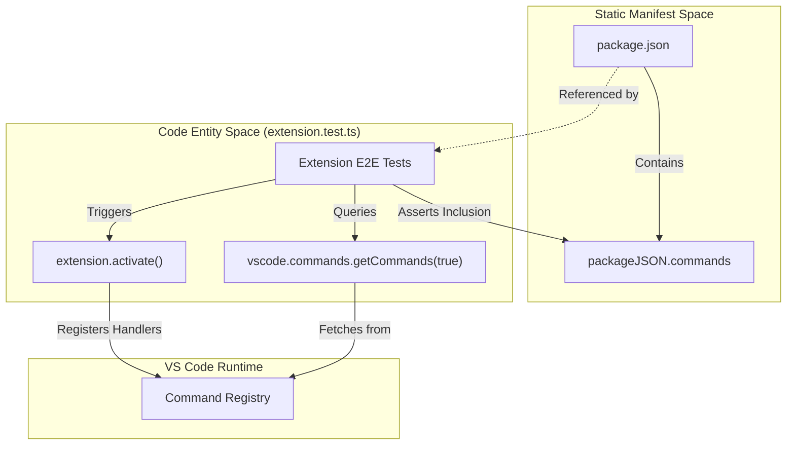
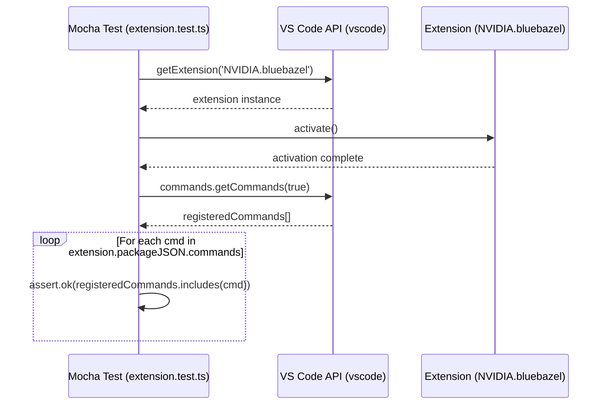

<!-- source: DeepWiki mcp.deepwiki.com · repo NVIDIA/bluebazel · page 7.1 Extension Integration Tests · fetched 2026-10-26 -->

# Extension Integration Tests

Relevant source files

The following files were used as context for generating this wiki page:

- [src/test/suite/extension.test.ts](src/test/suite/extension.test.ts)

The extension integration tests, located in `src/test/suite/extension.test.ts`, serve as a high-level validation of the extension's lifecycle and its contract with the VS Code editor. Unlike unit tests that isolate individual services, these tests run in a full VS Code instance to ensure that the extension's contribution points are correctly exposed to the host environment.

## Purpose and Scope

The primary goal of the integration suite is to verify that the BlueBazel extension activates successfully and that every command declared in the `package.json` manifest is actually registered within the VS Code command system [src/test/suite/extension.test.ts:34-47](). This prevents regressions where a command is defined in the UI (e.g., in a menu or as a keybinding) but lacks a corresponding handler in the runtime execution context.

### Key Validation Targets
*   **Extension Identity**: Validates the extension is recognized by the ID `NVIDIA.bluebazel` [src/test/suite/extension.test.ts:29-29]().
*   **Activation Lifecycle**: Ensures `extension.activate()` completes without throwing errors [src/test/suite/extension.test.ts:31-31]().
*   **Command Integrity**: Cross-checks the `packageJSON.commands` manifest against the live `vscode.commands` registry [src/test/suite/extension.test.ts:41-46]().

---

## Test Implementation

The integration test uses a Mocha suite structure. It leverages the `vscode` API to interact with the extension host.

### Setup Phase
Before any tests run, the `suiteSetup` block retrieves the extension instance and explicitly triggers activation. This mimics the real-world scenario where VS Code activates the extension upon detecting a workspace or a specific command invocation.

### Command Registration Check
The core test logic iterates through the commands listed in the extension's `package.json`. It compares this list against the array of commands returned by `vscode.commands.getCommands(true)`, where `true` indicates that internal/filtered commands should also be included.

#### Integration Flow: Manifest to Runtime
The following diagram illustrates how the test bridges the static configuration in `package.json` with the runtime state of the VS Code command registry.

**Command Registration Validation Flow**

**Sources:** [src/test/suite/extension.test.ts:27-47]()

---

## Data Flow and Cross-Check Logic

The test logic ensures that there is no mismatch between what the extension claims to support and what it actually provides.

| Entity | Source | Role |
| :--- | :--- | :--- |
| `NVIDIA.bluebazel` | `vscode.extensions.getExtension` | The unique identifier used to locate the extension in the host [src/test/suite/extension.test.ts:29-29](). |
| `packageJSON.commands` | Extension Manifest | The "Source of Truth" for what commands the extension promises to the user [src/test/suite/extension.test.ts:42-42](). |
| `registeredCommands` | `vscode.commands.getCommands` | The actual list of handlers available in the current session [src/test/suite/extension.test.ts:41-41](). |

### Execution Logic
The test performs a loop-based assertion. If a command defined in the manifest is missing from the registry, the test fails with a descriptive error message.

**Command Verification Sequence**

**Sources:** [src/test/suite/extension.test.ts:28-47]()

## Technical Details

### Extension ID
The test specifically targets `NVIDIA.bluebazel`. This ID must match the `publisher.name` combination defined in the root `package.json`. If the ID changes, the integration tests will fail to find the extension [src/test/suite/extension.test.ts:29-29]().

### Assertion Failures
If a command registration fails, the test provides the specific command ID that is missing: `Command '${cmd}' is not registered.` [src/test/suite/extension.test.ts:44-44](). This usually indicates that a developer added a command to `package.json` but forgot to call `context.subscriptions.push(vscode.commands.registerCommand(...))` in the controller initialization logic.

**Sources:**
* [src/test/suite/extension.test.ts:27-49]()

---

