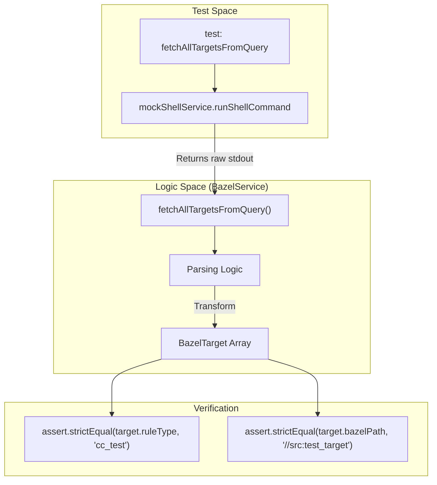
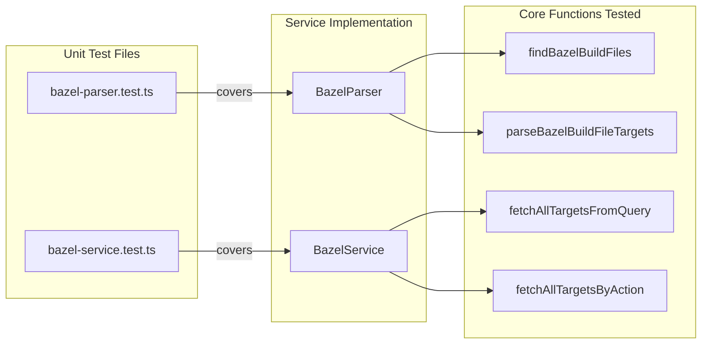

<!-- source: DeepWiki mcp.deepwiki.com · repo NVIDIA/bluebazel · page 7.2 Service Unit Tests · fetched 2026-10-26 -->

# Service Unit Tests

Relevant source files

The following files were used as context for generating this wiki page:

- [src/test/suite/services/bazel-parser.test.ts](src/test/suite/services/bazel-parser.test.ts)
- [src/test/suite/services/bazel-service.test.ts](src/test/suite/services/bazel-service.test.ts)

Service unit tests in BlueBazel ensure the reliability of the core logic responsible for interacting with the Bazel build system and the local filesystem. These tests primarily target `BazelParser` and `BazelService`, utilizing isolation techniques like temporary filesystems and `sinon` stubs to ensure tests are fast, deterministic, and decoupled from the host machine's environment.

## BazelParser Unit Tests

The `BazelParser` tests focus on the filesystem crawling logic and the regex-based parsing of `BUILD` files. Because `BazelParser` is designed to work as a fallback when `bazel query` is unavailable or disabled, these tests validate its ability to accurately reconstruct the target graph manually.

### Testing Strategy
*   **Temporary Filesystem**: The suite uses a `createTempDir` helper [src/test/suite/services/bazel-parser.test.ts:32-35]() to generate unique scratch spaces for each test.
*   **File Mocking**: The `createBazelFiles` function [src/test/suite/services/bazel-parser.test.ts:37-60]() populates these directories with mock `WORKSPACE` and `BUILD` files to simulate complex workspace structures.
*   **Cleanup**: A `teardown` hook [src/test/suite/services/bazel-parser.test.ts:81-83]() ensures that all temporary directories are deleted after each test.

### Key Scenarios Tested
| Scenario | Description |
| :--- | :--- |
| **Workspace Discovery** | Validates that `findBazelBuildFiles` correctly identifies directories containing `WORKSPACE` markers and `BUILD` files [src/test/suite/services/bazel-parser.test.ts:85-99](). |
| **Rule Parsing** | Verifies that the parser extracts `ruleType`, `name`, and file extensions from `cc_library` and `py_binary` blocks [src/test/suite/services/bazel-parser.test.ts:101-135](). |
| **Recursive Parsing** | Tests the ability to handle multiple `WORKSPACE` files in subdirectories and correctly calculate the `bazelPath` relative to the nearest root [src/test/suite/services/bazel-parser.test.ts:137-156](). |
| **Cancellation Support** | Ensures that passing a `vscode.CancellationToken` to `parseAllBazelBuildFilesTargets` correctly halts execution and rejects the promise [src/test/suite/services/bazel-parser.test.ts:164-171](). |

**Sources:** [src/test/suite/services/bazel-parser.test.ts:24-189]()

---

## BazelService Unit Tests

The `BazelService` tests validate the high-level orchestration of target discovery, including the decision logic between using `bazel query` versus the `BazelParser` fallback.

### Mocking and Isolation
The suite uses `sinon` to create stubbed instances of dependencies, preventing the tests from executing real shell commands or accessing the VS Code configuration store.

| Entity | Mocking Technique | Purpose |
| :--- | :--- | :--- |
| `ConfigurationManager` | `sinon.createStubInstance` | Controls whether the service thinks "Fetch Targets Using Query" is enabled [src/test/suite/services/bazel-service.test.ts:62](). |
| `ShellService` | `sinon.createStubInstance` | Simulates the output of `bazel query` commands without spawning processes [src/test/suite/services/bazel-service.test.ts:63](). |
| `fs` | `sinon.stub` | Intercepts `existsSync` calls to simulate `WORKSPACE` file presence [src/test/suite/services/bazel-service.test.ts:148-149](). |

### Data Flow: Query Parsing Test
The following diagram illustrates how the test validates the transformation of raw Bazel output into `BazelTarget` models.

**Bazel Query Parsing Test Flow**

**Sources:** [src/test/suite/services/bazel-service.test.ts:129-144]()

### Tested Capabilities
*   **Action Categorization**: Tests `fetchAllTargetsByAction` to ensure targets are mapped to multiple categories (e.g., a `cc_test` appearing in `test`, `build`, and `run` lists) [src/test/suite/services/bazel-service.test.ts:110-127]().
*   **Label Formatting**: Validates the static utility `formatBazelTargetFromPath` which converts filesystem paths (e.g., `bazel-bin/src/target`) into Bazel labels (e.g., `//src:target`) [src/test/suite/services/bazel-service.test.ts:90-94]().
*   **Discovery Strategy**: Confirms that `fetchAllTargets` respects the user's configuration by calling either the Query-based or Parser-based discovery methods [src/test/suite/services/bazel-service.test.ts:96-108]().

**Sources:** [src/test/suite/services/bazel-service.test.ts:75-155]()

---

## Code Entity Association

This diagram bridges the test file structures to the actual service implementations they cover.

**Test Coverage Map**

**Sources:** [src/test/suite/services/bazel-parser.test.ts:24-24](), [src/test/suite/services/bazel-service.test.ts:25-25]()

---

