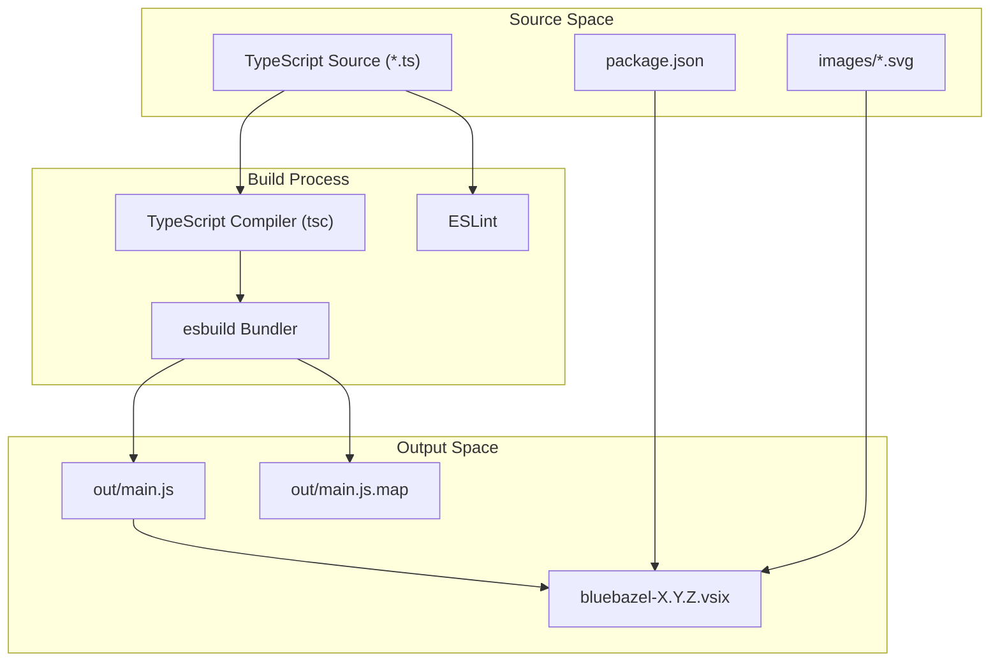
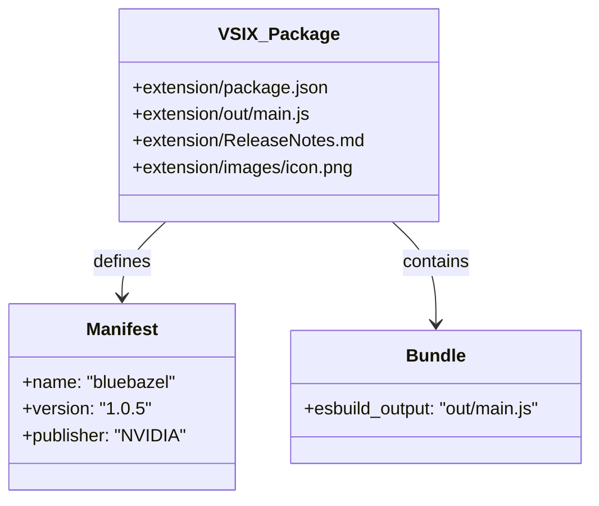

<!-- source: DeepWiki mcp.deepwiki.com · repo NVIDIA/bluebazel · page 8 Build, Packaging & Release · fetched 2026-10-26 -->

# Build, Packaging & Release

Relevant source files

The following files were used as context for generating this wiki page:

- [.eslintrc.json](.eslintrc.json)
- [.vscode/launch.json](.vscode/launch.json)
- [.vscode/tasks.json](.vscode/tasks.json)
- [.vscodeignore](.vscodeignore)
- [images/demo_debug.gif](images/demo_debug.gif)
- [images/icon_black.svg](images/icon_black.svg)
- [package-lock.json](package-lock.json)
- [releases/bluebazel-1.0.5.vsix](releases/bluebazel-1.0.5.vsix)
- [releases/bluebazel-1.0.6.vsix](releases/bluebazel-1.0.6.vsix)
- [releases/bluebazel-1.0.7.vsix](releases/bluebazel-1.0.7.vsix)
- [test-problem-matcher-config.json](test-problem-matcher-config.json)
- [tsconfig.json](tsconfig.json)

This page details the infrastructure used to compile, bundle, and distribute the BlueBazel extension. The extension leverages `esbuild` for high-performance bundling, TypeScript for type safety, and ESLint for code quality.

## Build Pipeline & Bundling

The extension is bundled into a single executable JavaScript file, `out/main.js`, to optimize load times and minimize the package size. This process is managed by `esbuild`.

### Compilation Flow
The build process transforms TypeScript source code into a production-ready bundle.

1.  **TypeScript Compilation**: The `tsconfig.json` defines the compiler settings, targeting `ES2019` and using `commonjs` modules [tsconfig.json:3-4](). The output is directed to the `out` directory [tsconfig.json:5-5]().
2.  **Bundling**: `esbuild` is used to bundle the extension [package-lock.json:31-31](). It resolves all dependencies and produces the final `out/main.js` artifact.
3.  **Source Maps**: Source maps are enabled to allow debugging of the original TypeScript code within the VS Code Extension Host [tsconfig.json:9-9](), [.vscode/launch.json:19-19]().

### Build Configuration Diagram
The following diagram illustrates the data flow from source files to the final release artifact.

**Extension Build Data Flow**

Sources: [tsconfig.json:1-16](), [package-lock.json:7-46](), [.vscodeignore:1-21]()

## Packaging & Exclusion Rules

To keep the `.vsix` package lightweight, the `.vscodeignore` file explicitly excludes source code, development configurations, and heavy dependencies that are already bundled into `out/main.js`.

### .vscodeignore Strategy
*   **Excluded**: All `.ts` files, `src/` directory, `node_modules/` (since dependencies are bundled), and testing infrastructure [ .vscodeignore:5-9, 14-15]().
*   **Included**: Only the bundled `out/main.js` is explicitly allowed from the output directory [ .vscodeignore:19-19]().
*   **Release History**: The `releases/` directory is ignored during packaging to prevent recursive inclusion of old versions [ .vscodeignore:16-16]().

Sources: [.vscodeignore:1-21]()

## Code Quality & Linting

BlueBazel uses ESLint with TypeScript-specific plugins to enforce coding standards.

### ESLint Configuration
The configuration in `.eslintrc.json` uses the following rules:
*   **Parser**: `@typescript-eslint/parser` [ .eslintrc.json:12-12]().
*   **Plugins**: `@typescript-eslint` [ .eslintrc.json:18-20]().
*   **Stylistic Rules**:
    *   4-space indentation [ .eslintrc.json:22-25]().
    *   Single quotes for strings [ .eslintrc.json:30-33]().
    *   Mandatory semicolons [ .eslintrc.json:34-37]().
    *   Unix-style linebreaks [ .eslintrc.json:26-29]().

Sources: [.eslintrc.json:1-39]()

## Release Artifact History

The repository maintains a history of compiled extension packages in the `releases/` directory. Each `.vsix` file is a standalone installer for the extension.

| Version | Artifact |
| :--- | :--- |
| 1.0.5 | `releases/bluebazel-1.0.5.vsix` |
| 1.0.6 | `releases/bluebazel-1.0.6.vsix` |
| 1.0.7 | `releases/bluebazel-1.0.7.vsix` |

### Artifact Structure
Each `.vsix` is a ZIP-compressed archive containing:
*   `extension/package.json`: Manifest and command definitions.
*   `extension/out/main.js`: The bundled logic.
*   `extension/ReleaseNotes.md`: Version-specific changes.
*   `extension/images/`: Icons and assets used in the UI.

**VSIX Content Mapping**

Sources: [releases/bluebazel-1.0.5.vsix:1-13](), [releases/bluebazel-1.0.6.vsix:1-25](), [releases/bluebazel-1.0.7.vsix:1-23]()

## Development Workflow

The extension provides VS Code tasks to automate the build-test cycle.

*   **Watch Task**: Runs `npm: watch` (defined in `package.json`) as a `preLaunchTask` to continuously compile changes during development [.vscode/launch.json:18-18](), [.vscode/tasks.json:5-19]().
*   **Launch Configurations**:
    *   **Run Extension**: Launches a new VS Code window with the local extension build [.vscode/launch.json:7-20]().
    *   **Run Extension Tests**: Executes the mocha test suite using `vscode-test` [.vscode/launch.json:22-32]().

Sources: [.vscode/launch.json:1-34](), [.vscode/tasks.json:1-20]()

---

