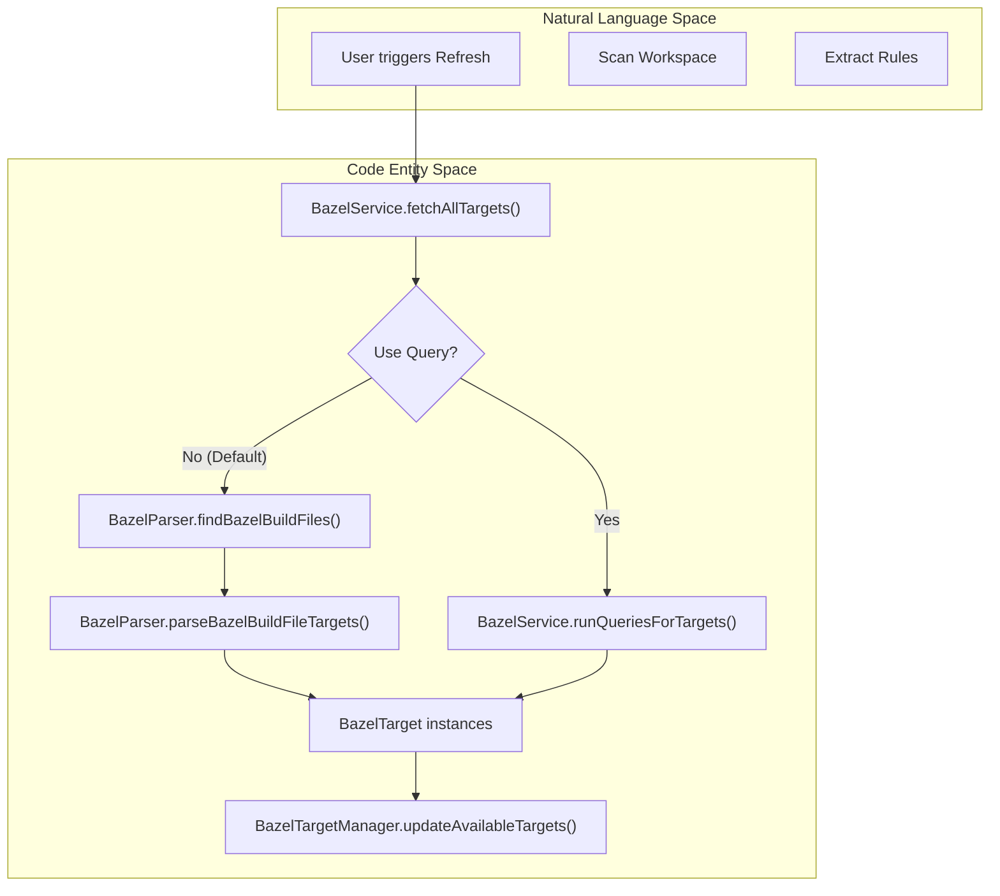
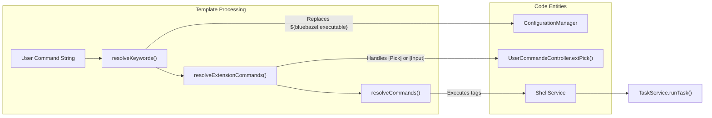

<!-- source: DeepWiki mcp.deepwiki.com · repo NVIDIA/bluebazel · page 9 Glossary · fetched 2026-10-26 -->

# Glossary

Relevant source files

The following files were used as context for generating this wiki page:

- [ReleaseNotes.md](ReleaseNotes.md)
- [images/screenshot.png](images/screenshot.png)
- [package.json](package.json)
- [src/controllers/target-controllers/debug-controller.ts](src/controllers/target-controllers/debug-controller.ts)
- [src/controllers/user-commands-controller.ts](src/controllers/user-commands-controller.ts)
- [src/languages/plugins/cpp-language-plugin.ts](src/languages/plugins/cpp-language-plugin.ts)
- [src/models/bazel-target-manager.ts](src/models/bazel-target-manager.ts)
- [src/models/bazel-target.ts](src/models/bazel-target.ts)
- [src/models/workspace-state-manager.ts](src/models/workspace-state-manager.ts)
- [src/services/bazel-parser.ts](src/services/bazel-parser.ts)
- [src/services/bazel-service.ts](src/services/bazel-service.ts)
- [src/ui/bazel-target-tree-provider.ts](src/ui/bazel-target-tree-provider.ts)

This page provides definitions for codebase-specific terms, abbreviations, and domain concepts used within BlueBazel. It serves as a technical reference for engineers to understand the implementation details and data flow between VS Code and the Bazel build system.

## Core Concepts & Terms

### BazelAction
A string representing a valid Bazel command that operates on a target (e.g., `build`, `run`, `test`, `query`). The extension categorizes targets based on these actions to populate the UI tree view.
*   **Implementation:** Defined as a type alias for `string` in [src/models/bazel-target.ts:40-40]().
*   **Discovery:** The `BazelService` maintains a list of actions requiring targets in `fetchTargetActions` [src/services/bazel-service.ts:49-62]().

### BazelTarget
The primary data model representing a specific Bazel rule (e.g., `cc_binary`, `py_test`). It encapsulates the target's label, its path in the `bazel-bin` directory, and its associated properties like environment variables and arguments.
*   **Implementation:** `BazelTarget` class in [src/models/bazel-target.ts:41-180]().
*   **Key Fields:** `bazelPath` (the label), `buildPath` (path relative to `bazel-bin`), and `ruleType`.
*   **Persistence:** Serialized via `SerializedBazelTarget` interface [src/models/bazel-target.ts:31-38]().

### BazelTargetProperty & MultiProperty
Classes that manage the configuration state for a target. `BazelTargetProperty` handles single values (like Run Args), while `BazelTargetMultiProperty` handles arrays of values (like Environment Variables or Bazel Flags).
*   **Implementation:** [src/models/bazel-target.ts:72-114]().
*   **Data Flow:** These properties are persisted in `workspaceState` and resolved into command-line strings during execution.

### Bazel-bin
The output directory where Bazel places compiled binaries. The extension uses this path to resolve the location of executables for "Direct Run" and debugging modes.
*   **Reference:** Defined as a constant `BAZEL_BIN` in [src/services/bazel-parser.ts:30-30]().

---

## System Components & Data Flow

The following diagram illustrates how natural language concepts (like "Finding Targets") map to specific code entities and how data flows through the system.

### Target Discovery and Parsing
Title: Target Discovery Data Flow

**Sources:** [src/services/bazel-service.ts:149-155](), [src/services/bazel-parser.ts:37-70](), [src/services/bazel-parser.ts:72-157](), [src/models/bazel-target-manager.ts:144-149]()

### Custom Command Resolution
BlueBazel allows users to define custom buttons in `settings.json`. These commands undergo a multi-stage resolution process.

Title: Command Resolution Pipeline

**Sources:** [src/controllers/user-commands-controller.ts:38-55](), [src/controllers/user-commands-controller.ts:69-90](), [src/controllers/user-commands-controller.ts:131-144]()

---

## Technical Abbreviations

| Abbreviation | Full Term | Description | Code Pointer |
| :--- | :--- | :--- | :--- |
| **BFS** | Breadth-First Search | The algorithm used to crawl the workspace for BUILD files. | [src/services/bazel-parser.ts:41-66]() |
| **DI** | Dependency Injection | Pattern used in controllers and services to receive required utilities. | [src/controllers/target-controllers/debug-controller.ts:45-51]() |
| **GDB** | GNU Debugger | The primary debugger used for C/C++ targets. | [src/languages/plugins/cpp-language-plugin.ts:81-81]() |
| **JSON** | JavaScript Object Notation | Format used for persisting target configurations in `targets.json`. | [src/models/bazel-target-manager.ts:40-41]() |

---

## Domain Concepts

### Direct Run vs. Bazel Run
*   **Bazel Run:** Executes the target via `bazel run //path:target`. This ensures all runfiles are symlinked correctly but adds overhead.
*   **Direct Run:** Executes the binary directly from the `bazel-bin` directory. This is faster and often necessary for debuggers that cannot follow `os.execv` calls (like `debugpy` in Python).
*   **Implementation:** Controlled by `configurationManager.shouldRunBinariesDirect()` in [src/controllers/target-controllers/debug-controller.ts:62-67]().

### Language Plugin System
A mechanism to provide language-specific debugging configurations and CodeLens patterns.
*   **Interface:** `LanguagePlugin` [src/languages/plugins/cpp-language-plugin.ts:32-32]().
*   **Example (C++):** `CppLanguagePlugin` generates `cppdbg` configurations for VS Code's debugger [src/languages/plugins/cpp-language-plugin.ts:76-96]().

### Workspace State Migration
To prevent stale data across extension updates, the extension clears its internal cache during major version changes.
*   **Implementation:** `WorkspaceStateManager.majorVersionChanged()` [src/models/workspace-state-manager.ts:55-57]().
*   **Logic:** Triggered in the `BazelTargetManager` constructor [src/models/bazel-target-manager.ts:50-59]().

**Sources:**
*   [src/models/bazel-target.ts:1-180]()
*   [src/services/bazel-service.ts:1-160]()
*   [src/services/bazel-parser.ts:1-160]()
*   [src/controllers/user-commands-controller.ts:1-144]()
*   [src/models/bazel-target-manager.ts:1-160]()
*   [src/models/workspace-state-manager.ts:1-81]()
*   [src/languages/plugins/cpp-language-plugin.ts:1-160]()