# Page: Overview

# Overview

<details>
<summary>Relevant source files</summary>

The following files were used as context for generating this wiki page:

- [README.md](README.md)
- [ReleaseNotes.md](ReleaseNotes.md)
- [package.json](package.json)
- [src/extension.ts](src/extension.ts)

</details>


BlueBazel is a Visual Studio Code extension designed to provide a robust UI for building, running, debugging, and testing projects using the **Bazel** (or **Dazel**) build system. It simplifies complex Bazel workflows by offering a dedicated tree view for target management, interactive CodeLens actions for unit tests, and a highly customizable templating system for user-defined commands.

## Key Capabilities

*   **Target Management**: Organize Bazel targets into actions (Build, Run, Test, Debug) with persistent configurations for arguments and environment variables [package.json:102-113]().
*   **Integrated Debugging**: First-class support for debugging C++, Python, and Go targets directly from the VS Code interface [ReleaseNotes.md:31]().
*   **CodeLens Integration**: Run or debug specific test cases or `main()` functions via overlays directly in the source code [ReleaseNotes.md:37]().
*   **Extensible Commands**: A three-layer templating engine (`${keyword}`, `[Pick/Input]`, and `<shell>`) that allows users to create custom buttons and complex shell automation [README.md:71-110]().
*   **Discovery Strategies**: Hybrid target discovery using either high-speed BUILD file parsing or comprehensive `bazel query` pipelines [ReleaseNotes.md:54]().

## System Architecture

BlueBazel follows a layered architecture to separate concerns between the Bazel CLI, internal data models, and the VS Code UI.

### Logic Flow: Natural Language to Code Entities
The following diagram bridges the gap between high-level user actions and the specific classes that handle them.

**Target Execution Flow**
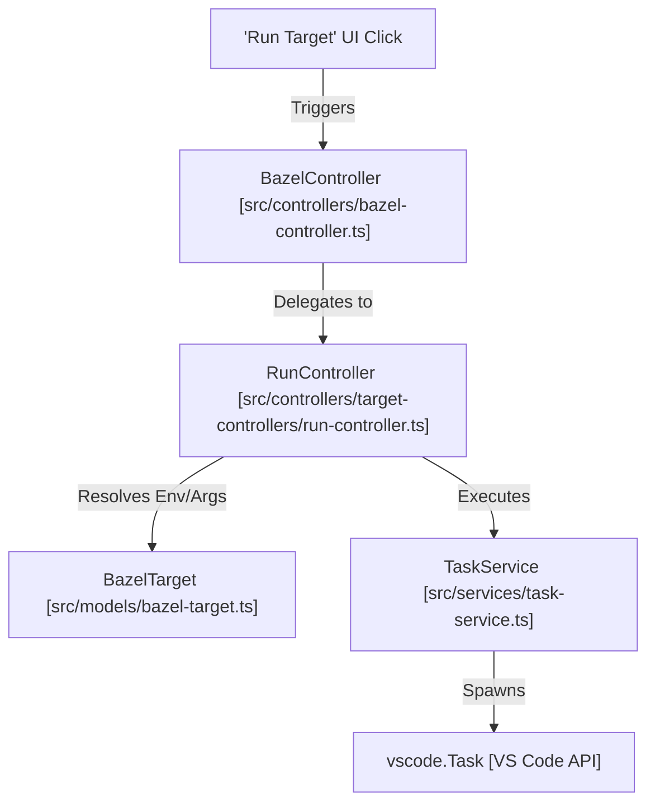
Sources: [src/extension.ts:72-103](), [src/extension.ts:144-147](), [package.json:104-107]()

### Subsystem Relationships
The extension initializes services first, followed by models that hold state, and finally controllers that bridge the UI to the logic.

**Initialization Hierarchy**
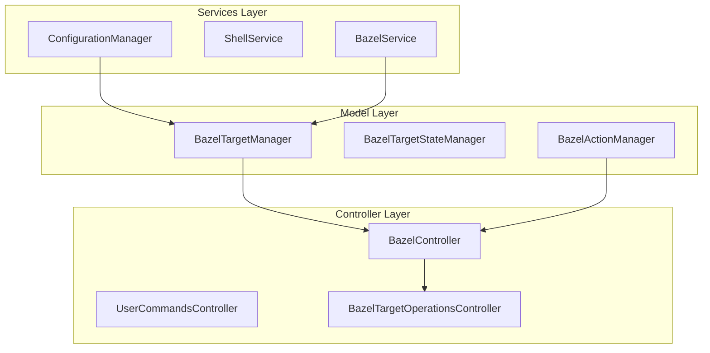
Sources: [src/extension.ts:112-198]()

## Major Components

| Component | Responsibility | Key Files |
| :--- | :--- | :--- |
| **Services** | Low-level wrappers for Shell, File System, and Bazel CLI. | `src/services/` |
| **Models** | State management for targets, environment variables, and persistence. | `src/models/` |
| **Controllers** | Command registration and business logic for Build/Run/Debug. | `src/controllers/` |
| **UI** | Tree view providers and CodeLens implementations. | `src/ui/` |
| **Language Plugins** | Language-specific debug configurations (C++, Go, Python). | `src/languages/` |

## Getting Started

To begin using or developing for BlueBazel, refer to the following child pages:

*   **[Getting Started & Configuration](#1.1)**: Covers installation, workspace requirements (like `WORKSPACE` or `MODULE.bazel` files), and an exhaustive guide to user settings [package.json:16-21]().
*   **[Extension Activation & Initialization](#1.2)**: A technical deep-dive into the `activate()` sequence, service instantiation order, and how the extension hooks into the VS Code lifecycle [src/extension.ts:112-230]().

For a deeper look at the internal mechanics, see the **Core Architecture** section.

---

# Page: Getting Started & Configuration

# Getting Started & Configuration

<details>
<summary>Relevant source files</summary>

The following files were used as context for generating this wiki page:

- [package-lock.json](package-lock.json)
- [package.json](package.json)
- [releases/bluebazel-1.0.5.vsix](releases/bluebazel-1.0.5.vsix)
- [src/models/bazel-environment.ts](src/models/bazel-environment.ts)
- [src/services/configuration-manager.ts](src/services/configuration-manager.ts)
- [src/services/environment-service.ts](src/services/environment-service.ts)

</details>


This page details the installation, activation requirements, and comprehensive configuration options for BlueBazel. It explains how the extension interacts with the Bazel workspace and how users can customize execution environments, commands, and UI elements via the `ConfigurationManager`.

## Installation & Activation

BlueBazel is packaged as a VS Code extension (`.vsix`) [releases/bluebazel-1.0.5.vsix:1-32](). It activates automatically when it detects a Bazel workspace root.

### Prerequisites
The extension looks for specific marker files in the root of the opened workspace folder to trigger activation [package.json:16-21]():
*   `WORKSPACE` or `WORKSPACE.bazel`
*   `MODULE` or `MODULE.bazel` (Bazel 6+ Bzlmod)

Once activated, the extension contributes a "Blue Bazel" view to the VS Code Explorer container [package.json:42-50]().

### Data Flow: Activation to UI
The following diagram illustrates the relationship between workspace files, the activation event, and the initialization of the configuration system.

**System Activation & Configuration Initialization**
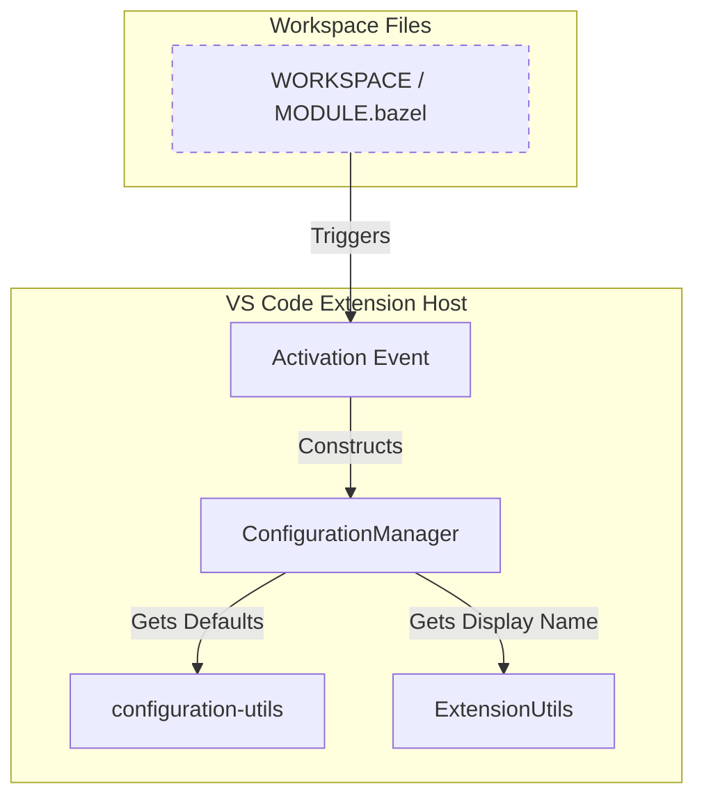
**Sources:** [package.json:16-21](), [src/services/configuration-manager.ts:96-102](), [src/services/configuration-manager.ts:104-109]()

---

## Configuration Management

The `ConfigurationManager` class serves as the central authority for all user-facing settings. It merges default extension settings with user-provided overrides from `.vscode/settings.json` [src/services/configuration-manager.ts:96-102]().

### Core Execution Settings
These settings define how the extension interacts with the Bazel binary and the underlying shell.

| Setting | Default | Description |
| :--- | :--- | :--- |
| `executableCommand` | `"bazel"` | The path or alias for the Bazel executable [src/services/configuration-manager.ts:143-149](). |
| `setupEnvironmentCommand` | `""` | A shell command executed to initialize the environment (e.g., sourcing a script) [src/services/configuration-manager.ts:135-141](). |
| `showShellCommandOutput` | `false` | Whether to display output from internal shell commands in the console [src/services/configuration-manager.ts:160-169](). |
| `clearTerminalBeforeAction` | `false` | If true, clears the VS Code terminal before starting a new Bazel task [src/services/configuration-manager.ts:171-180](). |

### Environment Setup Logic
If `setupEnvironmentCommand` is provided, the `EnvironmentService` executes the command followed by an `env` dump to capture the resulting environment variables [src/services/environment-service.ts:34-50](). These variables are then parsed and stored in `BazelEnvironment` for use in all subsequent Bazel actions [src/models/bazel-environment.ts:28-51]().

**Environment Capture Pipeline**
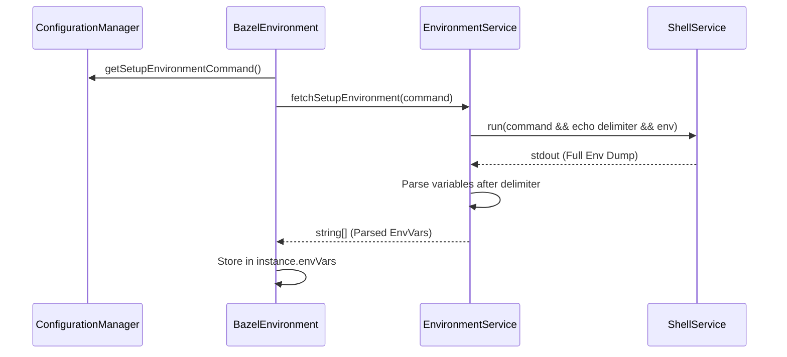
**Sources:** [src/services/environment-service.ts:34-89](), [src/models/bazel-environment.ts:31-51](), [src/services/configuration-manager.ts:135-141]()

---

## Customization & Extensibility

### Custom Buttons
Users can define custom UI elements in the BlueBazel tree view. These are organized into categories and mapped to specific shell commands or internal methods [src/services/configuration-manager.ts:30-89]().

*   **UserCustomCategory**: A grouping of buttons in the tree view [src/services/configuration-manager.ts:66-70]().
*   **UserCustomButton**: Individual actionable items. Supports `problemMatcher` for VS Code task integration [src/services/configuration-manager.ts:30-38]().

### Run-Mode Flags
BlueBazel provides toggles for how binaries are executed:
*   **`runBinariesDirect`**: When `true` (default), the extension attempts to run the compiled binary directly from the `bazel-bin` directory rather than calling `bazel run`. This is often faster and bypasses Bazel's overhead [src/services/configuration-manager.ts:193-202]().
*   **`buildAtRun`**: Controls whether a build is automatically triggered before a run/debug action [src/services/configuration-manager.ts:182-191]().

### Refresh Strategies
The extension supports manual and automatic target discovery:
*   **Manual Refresh**: Triggered via the `bluebazel.refreshTargets` command [package.json:144-147]().
*   **Discovery Logic**: The extension uses a combination of `bazel query` and manual `BUILD` file parsing (fallback) to populate the target list.

---

## Implementation Details

### Configuration Persistence
The `ConfigurationManager` utilizes `MergedConfiguration`, which wraps the standard VS Code `WorkspaceConfiguration` [src/services/configuration-manager.ts:98-102](). 

### Code Entity Mapping
The following diagram maps the logical configuration concepts to their implementation classes and methods.

**Configuration Logic to Code Entities**
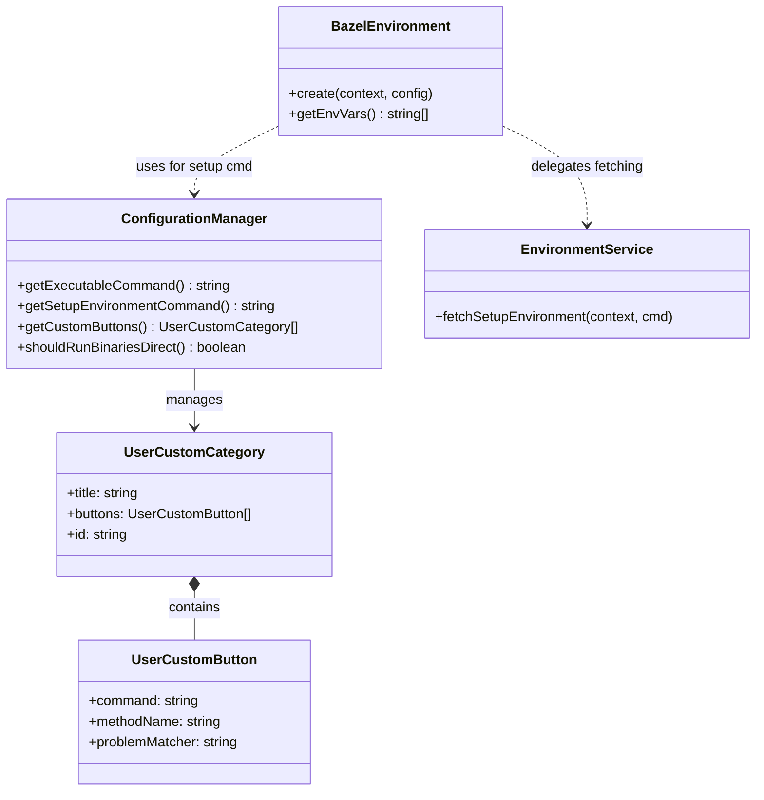
**Sources:** [src/services/configuration-manager.ts:30-149](), [src/models/bazel-environment.ts:28-42](), [src/services/environment-service.ts:32-38]()

---

# Page: Extension Activation & Initialization

# Extension Activation & Initialization

<details>
<summary>Relevant source files</summary>

The following files were used as context for generating this wiki page:

- [src/extension.ts](src/extension.ts)
- [src/services/console.ts](src/services/console.ts)
- [src/services/extension-utils.ts](src/services/extension-utils.ts)

</details>


This page provides a technical walkthrough of the BlueBazel extension's lifecycle, specifically focusing on the `activate()` and `initExtension()` sequence. The activation process follows a strict ordered initialization of services, models, UI components, and controllers to ensure that dependencies are correctly injected and the workspace state is synchronized before user interaction.

## Activation Overview

The entry point of the extension is the `activate` function in `src/extension.ts`. This function orchestrates the setup of the entire system. Because BlueBazel relies on a layered architecture, components are initialized in a specific order: Services → Models → UI → Controllers.

### Activation Flow Diagram
The following diagram illustrates the sequence of operations during extension startup, mapping natural language steps to the specific code entities involved.

**Title: Extension Initialization Sequence**
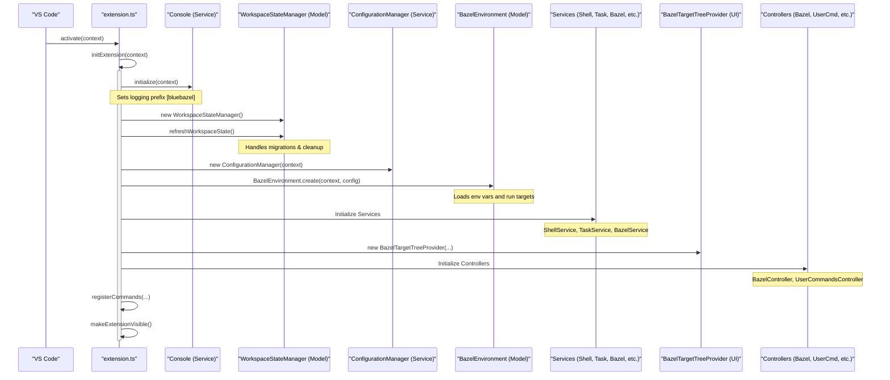
**Sources:** [src/extension.ts:112-212](), [src/services/console.ts:37-41]()

---

## Phase 1: Service & State Initialization

The first phase focuses on establishing the foundational services and restoring the persistent state of the workspace.

1.  **Console Logging**: The `Console` singleton is initialized with the extension context to allow prefixed logging throughout the lifecycle [src/services/console.ts:37-41]().
2.  **Workspace State**: The `WorkspaceStateManager` is instantiated to handle version migrations and clear stale data [src/extension.ts:119-120]().
3.  **Configuration**: The `ConfigurationManager` reads user settings from `settings.json` [src/extension.ts:123]().
4.  **Environment**: The `BazelEnvironment` model is created asynchronously, resolving environment variables and Bazel-specific paths [src/extension.ts:127]().

**Sources:** [src/extension.ts:112-127](), [src/services/console.ts:27-41]()

---

## Phase 2: Dependency Injection & Services

Once the environment is established, the extension initializes the core services. These services are often passed as dependencies to the model and controller layers.

| Service | Responsibility |
| :--- | :--- |
| `ShellService` | Executes shell commands with appropriate environment variables [src/extension.ts:138-140](). |
| `TaskService` | Integrates with the VS Code Task API for running Bazel builds/tests [src/extension.ts:144-147](). |
| `BazelService` | The primary interface for querying the Bazel CLI [src/extension.ts:152](). |
| `FileStorageService` | Handles persistence of large datasets (like target lists) to the global storage path [src/extension.ts:158](). |

**Sources:** [src/extension.ts:135-161]()

---

## Phase 3: UI Attachment & Tree View

The UI layer is centered around the `BazelTargetTreeProvider`. This component is not just a data provider but also manages the expansion state of the tree.

**Title: UI Component Mapping**
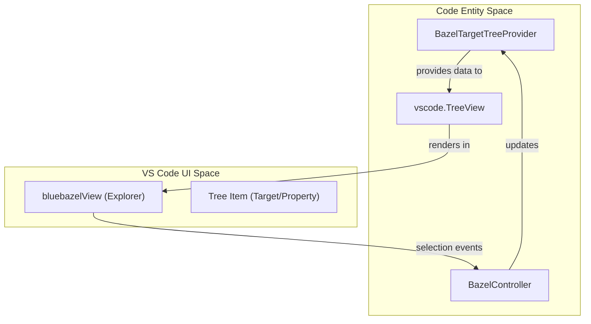

The `attachTreeDataProviderToView` function performs the following:
*   Creates the `TreeView` using the ID `bluebazelView` (dynamically resolved via `ExtensionUtils`) [src/extension.ts:94-99]().
*   Wires `onDidChangeSelection` to the `BazelController` to handle user clicks [src/extension.ts:101-103]().
*   Registers listeners for expand/collapse events to persist tree state [src/extension.ts:106]().

**Sources:** [src/extension.ts:90-110](), [src/services/extension-utils.ts:35-37]()

---

## Phase 4: Command Registration & Visibility

The final step of initialization is making the extension features accessible to the user.

### Command Registration
Commands are registered through a centralized `registerCommands` function, which delegates to specialized registrars (e.g., `registerBazelCommands`, `registerDebugCommands`) [src/extension.ts:205](). This ensures that every action available in the Command Palette or context menus has a corresponding handler in the controller layer.

### Activation "When" Clause
BlueBazel uses a custom context key to control the visibility of its UI components.

1.  **Context Key**: The extension calculates a "when" clause string, typically `bluebazel.active` [src/extension.ts:78-81]().
2.  **Set Context**: It executes the VS Code command `setContext` to set this key to `true` [src/extension.ts:87]().
3.  **Visibility**: This triggers VS Code to show the tree view and context menu items defined in `package.json` that depend on this context [src/extension.ts:83-88]().

**Sources:** [src/extension.ts:78-88](), [src/extension.ts:205-212]()

---

# Page: Core Architecture

# Core Architecture

<details>
<summary>Relevant source files</summary>

The following files were used as context for generating this wiki page:

- [src/controllers/bazel-controller.ts](src/controllers/bazel-controller.ts)
- [src/extension.ts](src/extension.ts)
- [src/models/bazel-target.ts](src/models/bazel-target.ts)

</details>


BlueBazel utilizes a layered architecture designed to decouple VS Code UI components from the underlying Bazel build system logic. The system is organized into four primary layers: **Services**, **Models**, **Controllers**, and **UI**. It employs a dependency injection pattern where services and models are initialized at the extension's entry point and passed into the controllers and UI providers that require them.

### System Overview and Data Flow

Data flows from the Bazel workspace (via the CLI or filesystem parsing) through the **Services** layer, where it is transformed into **Models**. These models are managed by **Controllers**, which respond to user interactions from the **UI** (Tree Views, CodeLenses, and Commands) to trigger actions back through the service layer.

The initialization of these layers occurs in `src/extension.ts` during the `initExtension` sequence [src/extension.ts:112-212]().

#### High-Level Component Relationship
This diagram illustrates how core classes across different layers interact to bridge the gap between the Bazel workspace and the VS Code interface.

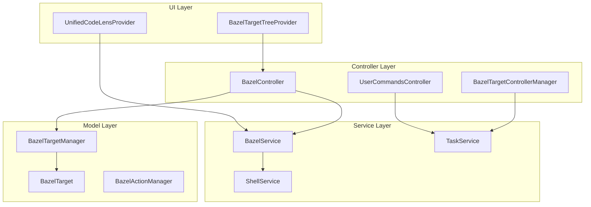
**Sources:** [src/extension.ts:52-77](), [src/extension.ts:132-212]()

---

### Layered Architecture

#### 1. Data Models
The Model layer represents the state of the Bazel workspace and the user's configuration. The central entity is the `BazelTarget` [src/models/bazel-target.ts:41](), which encapsulates a Bazel label, its rule type (e.g., `cc_binary`), and associated properties like environment variables and build arguments.

*   **BazelTargetManager**: Handles the collection of available targets discovered in the workspace and the set of "User Targets" pinned by the developer.
*   **BazelActionManager**: Manages the valid actions (build, run, test, debug) applicable to different target types.
*   **WorkspaceStateManager**: Manages persistence across VS Code sessions.

For details, see [Data Models](#2.1).

**Sources:** [src/models/bazel-target.ts:41-47](), [src/extension.ts:60-65]()

#### 2. Target Management & Persistence
BlueBazel implements a dual-persistence strategy to ensure performance with large workspaces. While small state items (like the currently selected target) are stored in VS Code's `workspaceState`, the large index of available targets is handled by the `FileStorageService` to avoid serializing massive JSON blobs into the standard state object.

The `BazelController` coordinates the `refreshAvailableTargets` logic, which uses the `BazelService` to crawl the workspace and then updates the `BazelTargetManager` [src/controllers/bazel-controller.ts:126-140]().

For details, see [Target Management & Persistence](#2.2).

**Sources:** [src/controllers/bazel-controller.ts:126-140](), [src/extension.ts:118-121]()

#### 3. Services Layer
Services are stateless (or near-stateless) utilities that interface with external systems. 

*   **BazelService**: The primary interface for target discovery and querying Bazel [src/extension.ts:149-152]().
*   **ShellService**: Executes raw shell commands with proper environment handling [src/extension.ts:136-140]().
*   **TaskService**: Wraps the VS Code Task API to run Bazel commands in integrated terminals [src/extension.ts:142-147]().
*   **FileWatcherService**: Monitors `BUILD` and `BUILD.bazel` files to trigger automatic target refreshes [src/controllers/bazel-controller.ts:48-55]().

For details, see [Services Layer](#2.3).

**Sources:** [src/extension.ts:132-164](), [src/controllers/bazel-controller.ts:48-55]()

---

### Execution Flow: From UI to Workspace

When a user interacts with a target in the UI, the `BazelController` or a specific action controller (like `BuildController`) translates that intent into a sequence of operations.

#### Command Execution Flow (e.g., Build Target)
This diagram maps the natural language action of "Building a Target" to the specific code entities involved in the execution pipeline.

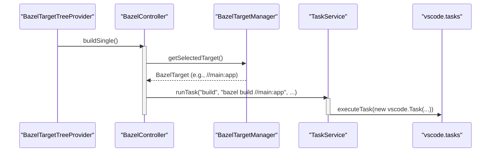
**Sources:** [src/controllers/bazel-controller.ts:95-124](), [src/services/task-service.ts:1-50]() (implied by usage in extension.ts)

### Dependency Injection Pattern
The extension follows a manual dependency injection pattern in `src/extension.ts`. Objects are instantiated in an order that satisfies their constructor requirements. For example, the `BazelController` requires a `ConfigurationManager`, `FileWatcherService`, `TaskService`, `BazelService`, `BazelTargetManager`, and `BazelTargetTreeProvider` [src/controllers/bazel-controller.ts:40-47](). These are all instantiated during the `initExtension` call and passed in [src/extension.ts:193-199]().

**Sources:** [src/extension.ts:112-212](), [src/controllers/bazel-controller.ts:39-47]()

---

# Page: Data Models

# Data Models

<details>
<summary>Relevant source files</summary>

The following files were used as context for generating this wiki page:

- [src/models/bazel-action-manager.ts](src/models/bazel-action-manager.ts)
- [src/models/bazel-target-multi-property.ts](src/models/bazel-target-multi-property.ts)
- [src/models/bazel-target-property-history.ts](src/models/bazel-target-property-history.ts)
- [src/models/bazel-target-property.ts](src/models/bazel-target-property.ts)
- [src/models/bazel-target-state-manager.ts](src/models/bazel-target-state-manager.ts)
- [src/models/bazel-target.ts](src/models/bazel-target.ts)
- [src/models/model-accessor.ts](src/models/model-accessor.ts)
- [src/models/model.ts](src/models/model.ts)

</details>


The Data Model layer in BlueBazel provides a structured representation of Bazel entities, their associated execution parameters, and their lifecycle states. These models abstract the underlying VS Code `workspaceState` persistence and provide a unified interface for the Controller layer to manipulate target-specific configurations.

## Core Target Model

### BazelTarget
The `BazelTarget` class is the central entity representing a specific Bazel rule (e.g., `cc_binary`, `py_test`) associated with a specific action (e.g., `build`, `run`, `test`). It aggregates multiple property models that define how the target should be executed.

*   **Identity**: Each target has a unique `id` generated using the pattern `${action}For${bazelPath}-${uuidv4()}` [src/models/bazel-target.ts:65-69]().
*   **Language Inference**: The model automatically infers the programming language from the `ruleType` via `BazelService.inferLanguageFromRuleType` [src/models/bazel-target.ts:70-70]().
*   **Property Aggregation**: A `BazelTarget` manages four primary property sets:
    *   `envVars`: Environment variables (`BazelTargetMultiProperty`) [src/models/bazel-target.ts:72-77]().
    *   `bazelArgs`: Arguments passed to the Bazel binary (`BazelTargetMultiProperty`) [src/models/bazel-target.ts:79-92]().
    *   `configArgs`: Configuration flags (e.g., `--config=x`) (`BazelTargetMultiProperty`) [src/models/bazel-target.ts:94-107]().
    *   `runArgs`: Arguments passed to the executable itself (`BazelTargetProperty`) [src/models/bazel-target.ts:109-114]().

#### Serialization
Targets are persisted using the `SerializedBazelTarget` interface [src/models/bazel-target.ts:31-38](). The class provides `toJSON()` for storage and a static `fromJSON()` for reconstruction [src/models/bazel-target.ts:155-169]().

### Target Relationship Diagram
This diagram shows how the `BazelTarget` links to various property models and how those map to the logical concepts of Bazel execution.

Title: BazelTarget Entity Mapping
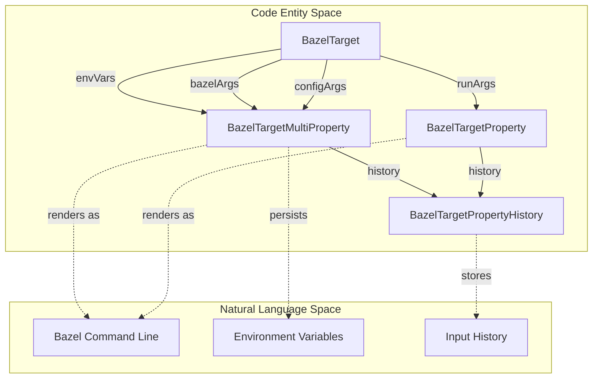
Sources: [src/models/bazel-target.ts:41-115](), [src/models/bazel-target-multi-property.ts:62-77](), [src/models/bazel-target-property.ts:29-42]()

---

## Property Models

Properties represent the configurable attributes of a target. They are backed by VS Code's `workspaceState` for persistence across sessions.

### BazelTargetProperty
Used for single-value attributes (like `runArgs`).
*   **Persistence**: Uses a unique ID based on target action and property name: `${target.action}${name}For${target.id}` [src/models/bazel-target-property.ts:40-40]().
*   **Methods**: `update(value)` saves to `workspaceState` and adds to history; `get()` retrieves the value [src/models/bazel-target-property.ts:54-62]().

### BazelTargetMultiProperty & MultiPropertyItem
Used for collections of values (like environment variables or Bazel flags).
*   **MultiPropertyItem**: Represents a single entry in a list, identified by a UUID [src/models/bazel-target-multi-property.ts:30-41]().
*   **Dynamic Discovery**: Can use an `availableValuesFn` to fetch suggestions from the `BazelService` (e.g., fetching available `--config` values from `.bazelrc`) [src/models/bazel-target-multi-property.ts:138-140]().
*   **Serialization**: Items are stored as an array of JSON objects in `workspaceState` and re-instantiated upon retrieval [src/models/bazel-target-multi-property.ts:122-132]().

### BazelTargetPropertyHistory
Provides an LRU (Least Recently Used) cache for property values.
*   **Storage**: Maintains a `HistoryMap` in `workspaceState` [src/models/bazel-target-property-history.ts:32-48]().
*   **Behavior**: When a value is added, it is moved to the front of the list. If the list exceeds `size`, the oldest item is popped [src/models/bazel-target-property-history.ts:67-87]().

Sources: [src/models/bazel-target-property.ts:29-71](), [src/models/bazel-target-multi-property.ts:30-158](), [src/models/bazel-target-property-history.ts:30-88]()

---

## State and Action Management

### BazelTargetStateManager
Tracks the runtime status of targets (Idle, Executing, or Debugging) [src/models/bazel-target-state-manager.ts:28-32]().
*   **Reactivity**: Uses a `vscode.EventEmitter` named `_onDidChangeTargetState` to notify the UI (specifically the TreeView) when a target starts or stops executing [src/models/bazel-target-state-manager.ts:38-48]().

### BazelActionManager
A cache for valid Bazel commands (actions) available in the current environment.
*   **Initialization**: Fetches actions (e.g., `build`, `test`, `run`, `clean`) from `BazelService.fetchTargetActions()` during construction [src/models/bazel-action-manager.ts:37-43]().

### Runtime State Flow
This diagram maps the transition of a `BazelTarget` through different `BazelTargetState` enums as handled by the `BazelTargetStateManager`.

Title: Target State Lifecycle
```mermaid
stateDiagram-v2
    [*] --> "BazelTargetState.Idle" : "Initial State"
    "BazelTargetState.Idle" --> "BazelTargetState.Executing" : "setTargetState(target, Executing)"
    "BazelTargetState.Idle" --> "BazelTargetState.Debugging" : "setTargetState(target, Debugging)"
    "BazelTargetState.Executing" --> "BazelTargetState.Idle" : "Task Completion"
    "BazelTargetState.Debugging" --> "BazelTargetState.Idle" : "Debug Session End"

    state "BazelTargetStateManager" as Manager {
        "targetStateMap" --> "EventEmitter" : "fire(target)"
    }
```
Sources: [src/models/bazel-target-state-manager.ts:28-54]()

---

## Base Interfaces and Utilities

### Model and ModelAccessor
The system uses a lightweight abstraction for generic data access.

*   **Model Interface**: Defines a standard structure for objects with a `name`, `id`, and `get/update` methods [src/models/model.ts:25-30]().
*   **ModelAccessor**: A utility class providing type-safe wrappers for retrieving data from `Model` implementations:
    *   `getString(model)`: Returns a string or empty string [src/models/model-accessor.ts:27-34]().
    *   `getStringArray(model)`: Returns a string array or empty array [src/models/model-accessor.ts:44-50]().
    *   `getWithDefault(model, defaultValue)`: Handles undefined values [src/models/model-accessor.ts:36-42]().

Sources: [src/models/model.ts:25-30](), [src/models/model-accessor.ts:26-51]()

---

# Page: Target Management & Persistence

# Target Management & Persistence

<details>
<summary>Relevant source files</summary>

The following files were used as context for generating this wiki page:

- [images/screenshot.png](images/screenshot.png)
- [src/models/bazel-target-manager.ts](src/models/bazel-target-manager.ts)
- [src/models/workspace-state-manager.ts](src/models/workspace-state-manager.ts)
- [src/services/file-storage-service.ts](src/services/file-storage-service.ts)
- [src/services/workspace-service.ts](src/services/workspace-service.ts)

</details>


The `BazelTargetManager` is the central authority for managing the lifecycle, storage, and retrieval of Bazel targets within BlueBazel. It distinguishes between targets discovered in the workspace, targets customized by the user, and the currently active selections for different Bazel actions.

### Dual-Persistence Strategy

BlueBazel employs a split-storage strategy to balance performance with persistence requirements. Large datasets are offloaded to the filesystem, while small, frequently accessed state is kept in the VS Code `workspaceState`.

| Storage Mechanism | Class | Data Type | Usage |
| :--- | :--- | :--- | :--- |
| **JSON Files** | `FileStorageService` | `availableTargets.json`, `targets.json` | Stores large arrays of `BazelTarget` objects discovered via queries or manual addition. |
| **Workspace State** | `vscode.Memento` | `selectedTargets` | Stores the single active `BazelTarget` for each `BazelAction` (Build, Run, Test, Debug). |

#### Target Categories
1.  **Available Targets**: Discovered targets from the Bazel workspace. These are cached in `availableTargets.json` to avoid expensive re-queries on every activation `[src/models/bazel-target-manager.ts:41]()`.
2.  **User Targets**: Targets manually added or modified by the user, stored in `targets.json` `[src/models/bazel-target-manager.ts:40]()`.
3.  **Selected Targets**: The specific targets currently "active" in the UI for execution, persisted via `workspaceState` `[src/models/bazel-target-manager.ts:117]()`.

**Sources:** `[src/models/bazel-target-manager.ts:32-48]()`, `[src/services/file-storage-service.ts:32-46]()`.

---

### BazelTargetManager Implementation

The `BazelTargetManager` initializes by triggering parallel loads of all three target categories. It uses `Promises` to track the loading state, allowing the UI to await critical data before rendering.

#### Data Flow: Target Loading & Initialization
The following diagram illustrates how the `BazelTargetManager` coordinates with `FileStorageService` and `workspaceState` during extension activation.

**Target Initialization Sequence**
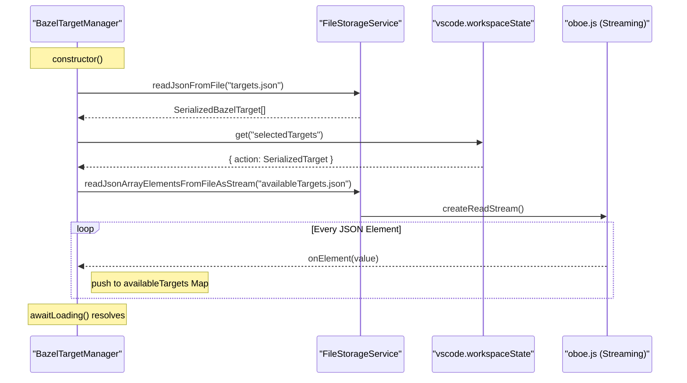
**Sources:** `[src/models/bazel-target-manager.ts:44-75]()`, `[src/services/file-storage-service.ts:63-104]()`.

---

### Streaming Load with Cancellation

To handle workspaces with thousands of targets without blocking the extension host or consuming excessive memory, `FileStorageService` implements a streaming JSON reader using the `oboe` library `[src/services/file-storage-service.ts:84]()`.

*   **Streaming**: `readJsonArrayElementsFromFileAsStream` processes the `availableTargets.json` file element-by-element rather than loading the entire file into memory `[src/services/file-storage-service.ts:63-67]()`.
*   **Cancellation**: When a new target discovery process starts, the `BazelTargetManager` cancels the existing load operation via a `vscode.CancellationTokenSource` `[src/models/bazel-target-manager.ts:145-146]()`. This prevents race conditions where old cached data is appended to the `availableTargets` map after a refresh has begun.

**Sources:** `[src/services/file-storage-service.ts:84-103]()`, `[src/models/bazel-target-manager.ts:144-149]()`.

---

### WorkspaceStateManager & Migration

The `WorkspaceStateManager` manages extension-wide state and handles version-specific logic. Its primary role is ensuring that data persisted in older versions of the extension does not crash newer versions if the data schema changes.

#### Major Version Migration Logic
During instantiation, the manager compares the current extension version against the version stored in the workspace `[src/models/workspace-state-manager.ts:40-49]()`.

1.  **Detection**: It identifies if a "major" version change has occurred (e.g., 1.x.x to 2.x.x) `[src/models/workspace-state-manager.ts:43-47]()`.
2.  **Clearance**: If a major version change is detected, `BazelTargetManager` calls `clear()` to wipe cached targets, and `WorkspaceStateManager` purges all keys in `workspaceState` `[src/models/workspace-state-manager.ts:60-65]()`.
3.  **Persistence**: The new version string is then saved to prevent repeated clearing `[src/models/workspace-state-manager.ts:62]()`.

**Code Entity Mapping**
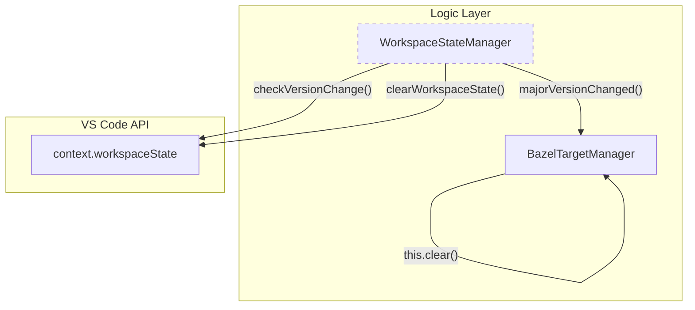

**Sources:** `[src/models/workspace-state-manager.ts:30-57]()`, `[src/models/bazel-target-manager.ts:50-53]()`.

---

### Key Functions & Storage Paths

| Function | File | Description |
| :--- | :--- | :--- |
| `writeJsonToFile` | `[src/services/file-storage-service.ts:53]()` | Serializes data to the extension's global storage path. |
| `readJsonArrayElementsFromFileAsStream` | `[src/services/file-storage-service.ts:63]()` | Uses `oboe` to stream JSON arrays from disk. |
| `loadSelectedTargets` | `[src/models/bazel-target-manager.ts:116]()` | Retrieves the user's last selected targets from `workspaceState`. |
| `updateAvailableTargets` | `[src/models/bazel-target-manager.ts:144]()` | Replaces the available target cache and triggers a file write. |
| `checkVersionChange` | `[src/models/workspace-state-manager.ts:40]()` | Logic for comparing semantic versions to trigger migrations. |

**Storage Location**: The `FileStorageService` uses `context.storageUri.fsPath` `[src/services/file-storage-service.ts:37]()`, which typically points to the VS Code internal global storage directory for the extension on the local machine.

**Sources:** `[src/services/file-storage-service.ts:32-61]()`, `[src/models/bazel-target-manager.ts:94-126]()`.

---

# Page: Services Layer

# Services Layer

<details>
<summary>Relevant source files</summary>

The following files were used as context for generating this wiki page:

- [src/controllers/commands/user-commands.ts](src/controllers/commands/user-commands.ts)
- [src/controllers/target-controllers/bazel-target-controller-manager.ts](src/controllers/target-controllers/bazel-target-controller-manager.ts)
- [src/controllers/target-controllers/test-controller.ts](src/controllers/target-controllers/test-controller.ts)
- [src/services/configuration-utils.ts](src/services/configuration-utils.ts)
- [src/services/env-vars-utils.ts](src/services/env-vars-utils.ts)
- [src/services/file-watcher-service.ts](src/services/file-watcher-service.ts)
- [src/services/icon-service.ts](src/services/icon-service.ts)
- [src/services/network-utils.ts](src/services/network-utils.ts)
- [src/services/shell-service.ts](src/services/shell-service.ts)
- [src/services/string-utils.ts](src/services/string-utils.ts)
- [src/services/task-service.ts](src/services/task-service.ts)

</details>


The Services Layer provides the foundational infrastructure for the BlueBazel extension. It abstracts complex interactions with the operating system, the VS Code API, and the Bazel build system into reusable, stateless, or singleton services. This layer handles process execution, task management, filesystem watching, and environment configuration.

## Execution Services

These services handle the translation of Bazel commands into actual system processes or VS Code tasks.

### ShellService
The `ShellService` is responsible for low-level execution of shell commands using Node.js `child_process`. It provides a promise-based wrapper around `child.exec` with support for real-time output streaming to VS Code output channels and process cancellation.

*   **Process Management**: Uses `bash` as the default shell [src/services/shell-service.ts:52-52]().
*   **Buffer Handling**: Sets `maxBuffer` to `Number.MAX_SAFE_INTEGER` to prevent truncation of large Bazel query outputs [src/services/shell-service.ts:53-53]().
*   **Output Streaming**: Captures `stdout` and `stderr` line-by-line and redirects them to a `vscode.OutputChannel` if provided [src/services/shell-service.ts:63-83]().
*   **Cancellation**: Integrates with `vscode.CancellationToken` to kill the process tree if the user cancels the operation [src/services/shell-service.ts:98-103]().

### TaskService
The `TaskService` integrates with the VS Code Task API to execute Bazel targets in the integrated terminal. This allows users to see interactive output, use problem matchers, and manage execution through the standard VS Code Task UI.

*   **CustomTaskProvider**: Registers a `bluebazelTask` provider type [src/services/task-service.ts:31-46]().
*   **Terminal Management**: Can automatically clear the terminal before execution based on user configuration [src/services/task-service.ts:101-103]().
*   **Environment Injection**: Merges global setup environment variables with target-specific variables before execution [src/services/task-service.ts:69-69]().
*   **Execution Types**: Supports both `shell` (executing via `/bin/bash -c`) and `process` (direct binary execution) [src/services/task-service.ts:71-79]().

**Data Flow: From Controller to Terminal**

| Entity | Role | Source |
| :--- | :--- | :--- |
| `TestController` | Constructs the `bazel test` command string | [src/controllers/target-controllers/test-controller.ts:67-90]() |
| `TaskService.runTask` | Wraps the command in a `vscode.Task` object | [src/services/task-service.ts:88-95]() |
| `vscode.tasks.executeTask` | Hands off the task to the VS Code engine for terminal rendering | [src/services/task-service.ts:105-105]() |

**Diagram: Execution Service Abstraction**

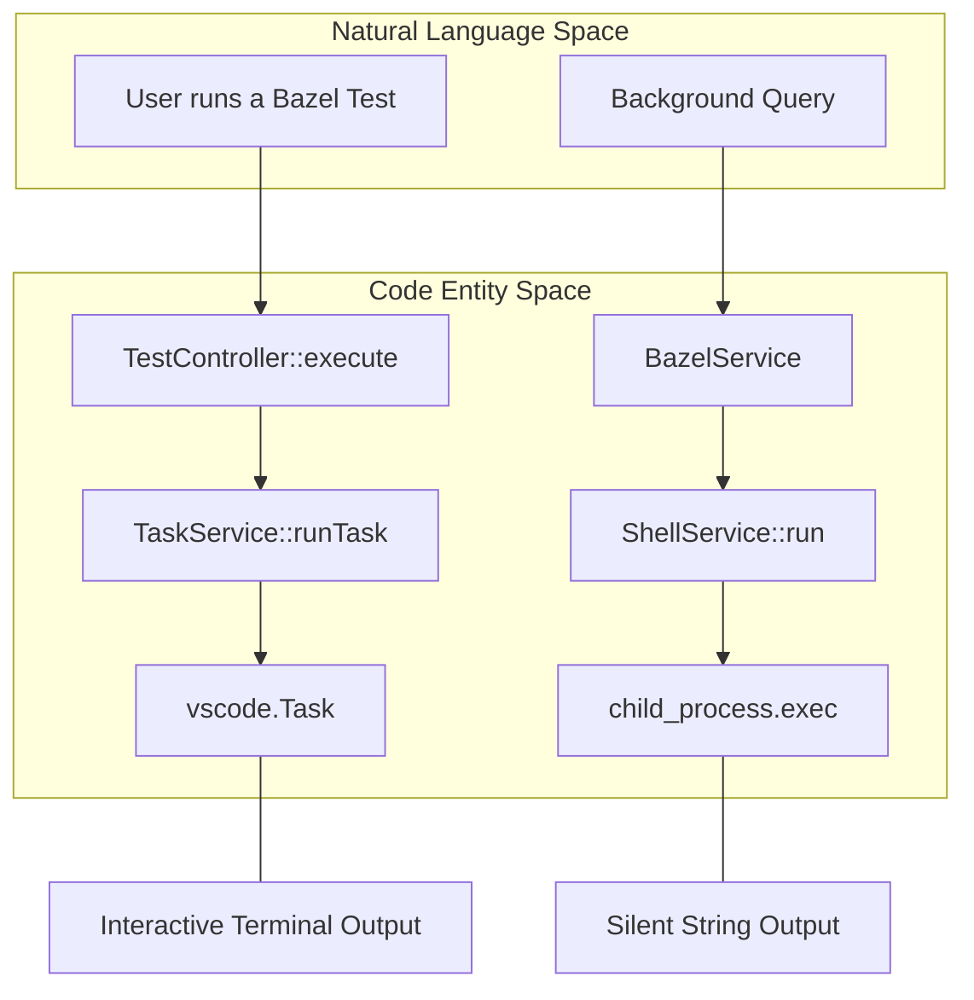
Sources: [src/services/shell-service.ts:35-48](), [src/services/task-service.ts:48-66](), [src/controllers/target-controllers/test-controller.ts:36-65]()

---

## Filesystem and Environment Services

### FileWatcherService
The `FileWatcherService` monitors the workspace for changes to `BUILD` files or other patterns. It uses a debouncing mechanism to prevent redundant refreshes when multiple files change simultaneously (e.g., during a `git checkout`).

*   **Debouncing**: Uses a 500ms window to collect all affected file paths before triggering the callback [src/services/file-watcher-service.ts:53-58]().
*   **Global Set**: Maintains a `Set<string>` of `allAffectedFiles` to ensure no duplicates are processed [src/services/file-watcher-service.ts:29-29]().
*   **Lifecycle**: Registers watchers within `context.subscriptions` for automatic cleanup [src/services/file-watcher-service.ts:73-73]().

### EnvVarsUtils
A utility class for transforming environment variable formats between VS Code, Bazel, and Shell formats.

| Function | Output Format | Purpose |
| :--- | :--- | :--- |
| `toBuildEnvVars` | `--action_env=KEY=VAL` | Bazel build/query commands [src/services/env-vars-utils.ts:77-84]() |
| `toTestEnvVars` | `--test_env=KEY=VAL` | Bazel test commands [src/services/env-vars-utils.ts:108-115]() |
| `toRunEnvVars` | `export KEY=VAL && ...` | Direct binary execution in shell [src/services/env-vars-utils.ts:92-100]() |
| `listToObject` | `{ "KEY": "VAL" }` | Node.js `process.env` compatibility [src/services/env-vars-utils.ts:56-69]() |

Sources: [src/services/file-watcher-service.ts:27-51](), [src/services/env-vars-utils.ts:25-25]()

---

## UI Support Services

### IconService
The `IconService` dynamically resolves file and language icons by inspecting the user's active VS Code icon theme. This ensures the BlueBazel tree view matches the user's aesthetic settings.

*   **Theme Resolution**: Searches for the active theme in standard paths like `vscode.env.appRoot` and `~/.vscode/extensions` [src/services/icon-service.ts:66-71]().
*   **Mapping**: Maps `languageIds` from the theme's JSON definition to local file paths [src/services/icon-service.ts:100-124]().

### StringUtils
Provides specialized string manipulation for Bazel-related UI elements.

*   **toGerund**: Converts actions like `run` to `Running` or `aquery` to `Running aquery` for progress indicators [src/services/string-utils.ts:59-72]().
*   **cleanAndFormat**: Sanitizes command arguments by removing empty strings and trimming whitespace to ensure valid shell command construction [src/services/string-utils.ts:25-30]().

Sources: [src/services/icon-service.ts:48-54](), [src/services/string-utils.ts:24-24]()

---

## Configuration and Network Utilities

### ConfigurationUtils
Handles the merging of user-defined settings with default settings stored in `.vscode/bluebazel.json` files within the workspace.

*   **MergedConfiguration**: Implements `vscode.WorkspaceConfiguration` to provide a unified view where workspace-file defaults are overridden by standard VS Code settings [src/services/configuration-utils.ts:77-124]().

### NetworkUtils
Provides utilities for managing network ports, primarily used during debugging sessions.

*   **getAvailablePort**: Asks the OS for an ephemeral port (port 0) to use for debuggers [src/services/network-utils.ts:28-61]().
*   **waitForPort**: Polls a specific port (default 50ms interval) to detect when a Bazel-launched debug server has started listening [src/services/network-utils.ts:91-110]().

**Diagram: Configuration and Service Interaction**

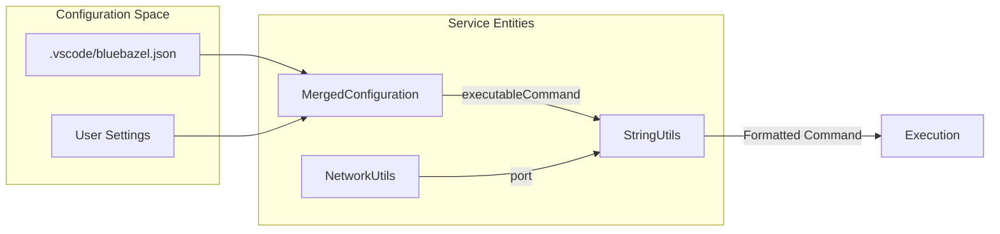
Sources: [src/services/configuration-utils.ts:77-84](), [src/services/network-utils.ts:25-28](), [src/services/string-utils.ts:25-30]()

---

# Page: Bazel Integration

# Bazel Integration

<details>
<summary>Relevant source files</summary>

The following files were used as context for generating this wiki page:

- [releases/bluebazel-1.0.4.vsix](releases/bluebazel-1.0.4.vsix)
- [src/services/bazel-parser.ts](src/services/bazel-parser.ts)
- [src/services/bazel-rule-language-mapping.ts](src/services/bazel-rule-language-mapping.ts)
- [src/services/bazel-service.ts](src/services/bazel-service.ts)

</details>


The **Bazel Integration** layer is the bridge between the BlueBazel VS Code extension and the Bazel build system. It is responsible for discovering targets within a workspace, parsing `BUILD` files to understand rule structures, and mapping those rules to specific programming languages for execution and debugging.

## Architecture Overview

BlueBazel interacts with Bazel through two primary mechanisms: direct CLI queries and manual file system parsing. This dual-strategy ensures that the extension remains performant in large monorepos while providing a fallback for environments where a full Bazel query might be slow or unavailable.

### Target Discovery Strategies
The `BazelService` [src/services/bazel-service.ts:37-37]() manages how targets are retrieved based on the user's configuration.

| Strategy | Implementation | Use Case |
| :--- | :--- | :--- |
| **Bazel Query** | Uses `bazel query` with `label_kind` output. | Default; highly accurate and handles complex macros/starlark. |
| **BUILD Parsing** | Regex-based line parsing of `BUILD` files. | High-performance fallback; works without a functional Bazel environment. |

The choice of strategy is governed by `configurationManager.shouldFetchTargetsUsingQuery()` [src/services/bazel-service.ts:150-155]().

### Rule-to-Language Mapping
To provide language-specific features (like debugging), BlueBazel maps Bazel rule types (e.g., `cc_binary`, `py_test`) to VS Code language identifiers. This is handled by a static mapping in `bazel-rule-language-mapping.ts` [src/services/bazel-rule-language-mapping.ts:24-156]().

## Target Discovery & Categorization

The `BazelService` categorizes discovered targets into four primary actions: `run`, `build`, `test`, and `coverage` [src/services/bazel-service.ts:77-82](). This categorization determines where a target appears in the UI and what operations are available to the user.

### Action Mapping Logic
Targets are sorted into action buckets based on their rule type and executable status:
- **Test Targets**: Rules containing `test` (e.g., `cc_test`) are added to `test`, `run`, and `build` categories [src/services/bazel-service.ts:100-105]().
- **Executable Targets**: Rules marked as executable (detected via `$is_executable` attribute in queries) are added to `run` and `build` [src/services/bazel-service.ts:106-109]().
- **Library/Other Targets**: All other rules are categorized under `build` [src/services/bazel-service.ts:110-111]().

### Data Flow: Discovery to Model
The following diagram illustrates how the system transitions from the "Natural Language Space" (Bazel concepts) to the "Code Entity Space" (TypeScript classes).

**Target Discovery Flow**
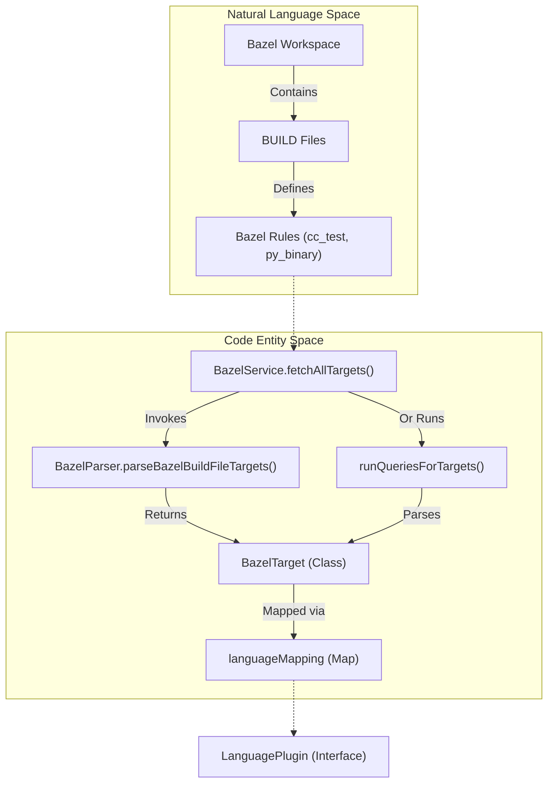
**Sources:** [src/services/bazel-service.ts:149-155](), [src/services/bazel-parser.ts:72-87](), [src/services/bazel-rule-language-mapping.ts:24-37]()

## Components

### BazelService
The primary service for interacting with the Bazel CLI. It handles:
- Executing `bazel query` commands [src/services/bazel-service.ts:123-144]().
- Resolving `bazel-bin` and runfiles locations [src/services/bazel-service.ts:67-72]().
- Reverse-looking up targets associated with a specific source file [src/services/bazel-service.ts:16120-16120]() (Note: Reference refers to the `extractBazelTargetsAssociatedWithSourceFile` logic).

For details, see [BazelService & Target Discovery](#3.1).

### BazelParser
A utility class for filesystem-level analysis. It performs:
- **Workspace Crawling**: Uses a Breadth-First Search (BFS) with 50-directory batching to find `WORKSPACE` and `BUILD` files [src/services/bazel-parser.ts:41-44]().
- **Target Extraction**: Parses `BUILD` files line-by-line using regex to extract `name` and `ruleType` without loading the full file into memory [src/services/bazel-parser.ts:109-143]().

For details, see [BazelParser & BUILD File Analysis](#3.2).

## Code Entity Relationships

The relationship between the parsing logic and the resulting data models is critical for the extension's responsiveness.

**Entity Mapping Diagram**
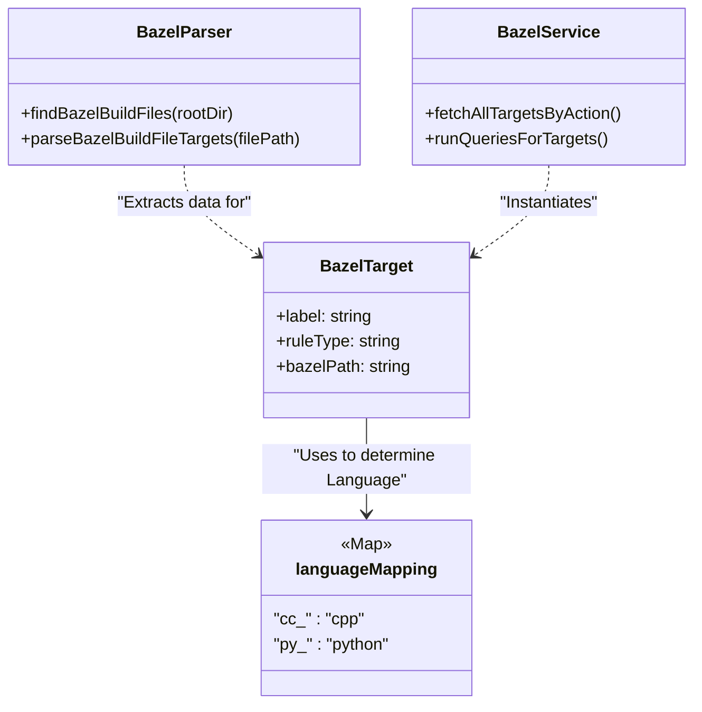
**Sources:** [src/services/bazel-parser.ts:31-31](), [src/services/bazel-service.ts:37-37](), [src/models/bazel-target.ts:30-30](), [src/services/bazel-rule-language-mapping.ts:24-24]()

## Key Files
- `src/services/bazel-service.ts`: Core logic for Bazel CLI communication and target categorization.
- `src/services/bazel-parser.ts`: Filesystem crawling and regex-based `BUILD` file parsing.
- `src/services/bazel-rule-language-mapping.ts`: Definitions for mapping rule prefixes to VS Code language IDs.

**Sources:**
- [src/services/bazel-service.ts:1-16120]()
- [src/services/bazel-parser.ts:1-174]()
- [src/services/bazel-rule-language-mapping.ts:1-300]()

---

# Page: BazelService & Target Discovery

# BazelService & Target Discovery

<details>
<summary>Relevant source files</summary>

The following files were used as context for generating this wiki page:

- [releases/bluebazel-1.0.4.vsix](releases/bluebazel-1.0.4.vsix)
- [src/services/bazel-rule-language-mapping.ts](src/services/bazel-rule-language-mapping.ts)
- [src/services/bazel-service.ts](src/services/bazel-service.ts)

</details>


The `BazelService` acts as the primary interface between the BlueBazel extension and the Bazel build system. It is responsible for discovering available targets, categorizing them by action (build, run, test), and resolving metadata such as runfile locations and source file associations.

## Target Discovery Strategies

`BazelService` employs two distinct strategies for discovering targets within a workspace, controlled by the `shouldFetchTargetsUsingQuery` configuration setting [src/services/bazel-service.ts:150-155]().

### 1. Bazel Query Pipeline (Primary)
When enabled, the service executes a series of optimized `bazel query` commands in parallel to retrieve the full target graph. This is the most accurate method as it relies on Bazel's own evaluation engine.

*   **Command Construction**: The service builds a combined shell command using three specific queries [src/services/bazel-service.ts:127-136]():
    *   **Run Targets**: `attr("$is_executable", 1, //...)`
    *   **Test Targets**: `filter(${filter}, tests(//...))`
    *   **Other Targets**: General targets excluding the above.
*   **Filtering**: A regex filter is applied to exclude noise from directories like `.aspect_rules_js`, `node_modules`, and internal `bazel-*` symlinks [src/services/bazel-service.ts:125-125]().
*   **Output Format**: Queries use `--output=label_kind` to retrieve both the target label and its rule type (e.g., `cc_binary`, `py_test`) [src/services/bazel-service.ts:129-135]().

### 2. BUILD File Parsing Fallback
If the query pipeline is disabled or fails, the service falls back to manual filesystem crawling via `BazelParser`. This strategy is faster for massive mono-repos where a full query might time out, though it lacks the semantic depth of the Bazel engine.

### Target Categorization Logic
The function `fetchAllTargetsByAction` processes discovered targets into a map keyed by `BazelAction` (`run`, `build`, `test`, `coverage`) [src/services/bazel-service.ts:74-82]().

| Target Type | Categorization Logic |
| :--- | :--- |
| **Test Rules** (`*_test`) | Added to `test`, `coverage`, `run`, and `build` [src/services/bazel-service.ts:100-105](). |
| **Executable Rules** (`$is_executable`) | Added to `run` and `build` [src/services/bazel-service.ts:106-108](). |
| **Library/Other Rules** | Added to `build` only [src/services/bazel-service.ts:109-111](). |

**Sources:** [src/services/bazel-service.ts:74-155]()

---

## Data Flow: From Query to Model
The following diagram illustrates how raw string output from the Bazel CLI is transformed into `BazelTarget` objects.

**Target Discovery and Parsing Flow**
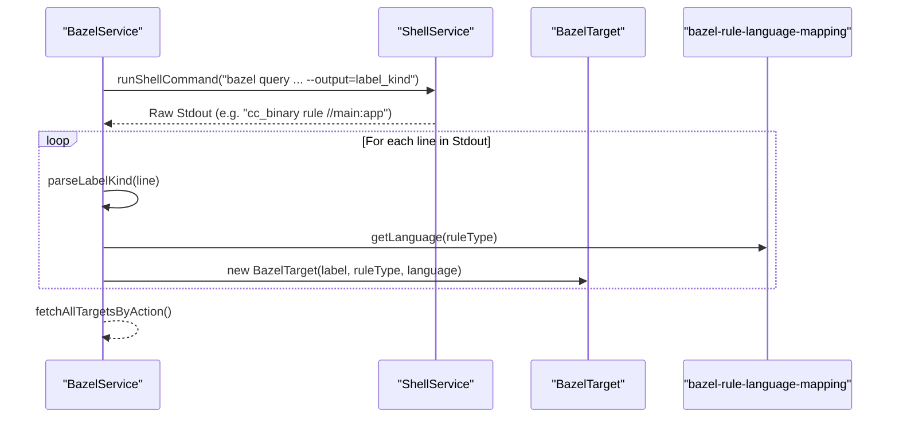
**Sources:** [src/services/bazel-service.ts:123-144](), [src/services/bazel-service.ts:96-112](), [src/services/bazel-rule-language-mapping.ts:24-156]()

---

## Label and Kind Parsing

The `BazelService` parses the `--output=label_kind` format which typically looks like `cc_library rule //path/to:target`. 

*   **Rule Type Mapping**: The service maps Bazel rule prefixes to VS Code language identifiers using a comprehensive mapping table [src/services/bazel-rule-language-mapping.ts:24-156](). For example, `py_` maps to `python` and `cc_` maps to `cpp` [src/services/bazel-rule-language-mapping.ts:29-33]().
*   **Target Formatting**: Static utility `formatBazelTargetFromPath` converts filesystem paths (e.g., from `bazel-bin`) back into valid Bazel labels (e.g., `//path/to:target`) [src/services/bazel-service.ts:67-72]().

**Sources:** [src/services/bazel-service.ts:67-72](), [src/services/bazel-rule-language-mapping.ts:1-159]()

---

## Source File Reverse-Lookup

A key feature of the extension is the ability to find which Bazel targets are associated with a specific source file (e.g., for CodeLens or "Run Current File" features).

*   **`extractBazelTargetsAssociatedWithSourceFile`**: This function uses `bazel query` to find all rules that include the current file in their `srcs` attribute [src/services/bazel-service.ts:285-300]().
*   **Implementation**: It executes `bazel query 'attr(srcs, "filename", //...)'` [src/services/bazel-service.ts:293]().
*   **Efficiency**: The result is filtered and mapped to `BazelTarget` objects, allowing the UI to present only relevant actions for the file currently being edited.

**Sources:** [src/services/bazel-service.ts:285-310]()

---

## Runfiles and Completion

### Runfiles Location Resolution
The `getRunfilesLocation` method resolves the absolute path to a target's executable within the `bazel-bin` directory [src/services/bazel-service.ts:183-195](). This is critical for "Direct" execution modes (Run/Debug) where the extension bypasses `bazel run` to execute the binary directly.

### Bash Completion Integration
To provide a native-feeling CLI experience, `fetchBashCompletionArgs` and `fetchBashCompletionConfig` leverage Bazel's internal completion hooks [src/services/bazel-service.ts:233-283]().
*   It invokes the Bazel binary with specific environment variables (`COMP_LINE`, `COMP_POINT`) to simulate a tab-completion event [src/services/bazel-service.ts:246-253]().
*   This allows the extension to suggest valid build flags (e.g., `--config=release`) and arguments to the user.

**Sources:** [src/services/bazel-service.ts:183-195](), [src/services/bazel-service.ts:233-283]()

---

## Implementation Entity Map
This diagram maps the logical discovery concepts to the specific classes and methods in the codebase.

**Code Entity Relationship Diagram**
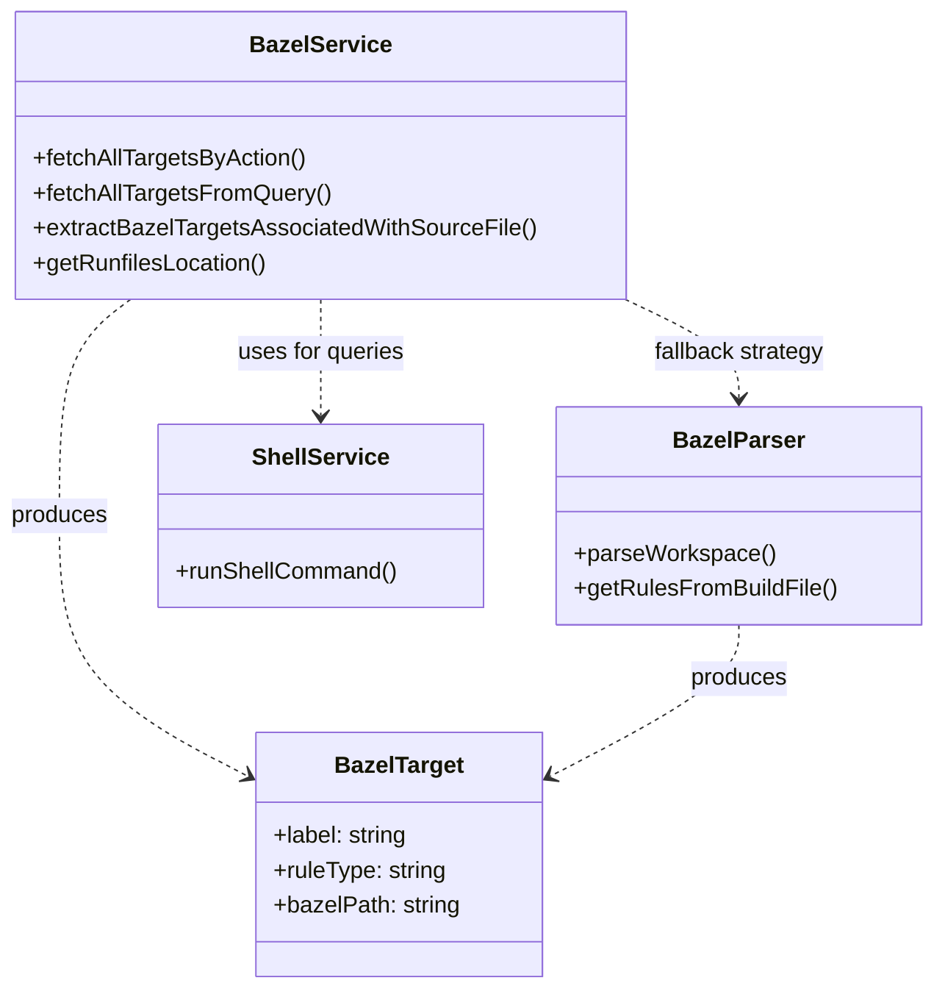
**Sources:** [src/services/bazel-service.ts:37-44](), [src/services/bazel-parser.ts:24-24](), [src/models/bazel-target.ts:30-30]()

---

# Page: BazelParser & BUILD File Analysis

# BazelParser & BUILD File Analysis

<details>
<summary>Relevant source files</summary>

The following files were used as context for generating this wiki page:

- [src/services/bazel-parser.ts](src/services/bazel-parser.ts)

</details>


The `BazelParser` is a utility service responsible for the filesystem-level discovery and structural analysis of Bazel projects. It serves as the primary fallback mechanism for target discovery when `bazel query` is unavailable or inefficient. It implements a high-performance workspace crawler and a regex-based parser to extract target metadata directly from `BUILD` files.

## Workspace Crawling & Root Discovery

The discovery process begins with `findBazelBuildFiles`, which performs a Breadth-First Search (BFS) starting from the workspace root [src/services/bazel-parser.ts:37-41](). To optimize I/O operations and avoid blocking the event loop, the crawler processes directories in batches of 50 [src/services/bazel-parser.ts:44]().

### File Identification Logic
The crawler identifies three categories of files:
1.  **Workspace Markers**: Files named `WORKSPACE`, `WORKSPACE.bazel`, `MODULE.bazel` [src/services/bazel-parser.ts:55-59]().
2.  **Build Files**: Files named `BUILD` or `BUILD.bazel` [src/services/bazel-parser.ts:53-54]().
3.  **Exclusions**: Hidden directories (starting with `.`) are ignored to prevent unnecessary recursion into `.git` or `.bazel` internal folders [src/services/bazel-parser.ts:51-52]().

### Root Resolution
Because a VS Code workspace may contain multiple nested Bazel workspaces, `BazelParser` uses `findClosestWorkspace` to associate each `BUILD` file with its nearest parent directory containing a workspace marker [src/services/bazel-parser.ts:159-173](). This ensures that target labels (e.g., `//path/to:target`) are calculated relative to the correct workspace root.

**Sources:** [src/services/bazel-parser.ts:31-70](), [src/services/bazel-parser.ts:159-173]()

## BUILD File Parsing

The `parseBazelBuildFileTargets` function performs a line-by-line scan of `BUILD` files [src/services/bazel-parser.ts:90](). This approach minimizes memory overhead compared to loading the entire file into an Abstract Syntax Tree (AST).

### Target Extraction
The parser uses regular expressions to identify three key components of a Bazel rule:
*   **Rule Type**: Matches the beginning of a rule (e.g., `cc_binary(`, `py_test(`) [src/services/bazel-parser.ts:110]().
*   **Target Name**: Extracts the value of the `name` attribute [src/services/bazel-parser.ts:111]().
*   **Source Files**: Parses the `srcs` list to identify file extensions, which are used for language-plugin mapping [src/services/bazel-parser.ts:112](), [src/services/bazel-parser.ts:137-142]().

### Target Metadata Construction
For every target found, the parser constructs a metadata object containing:
*   `bazelPath`: The full Bazel label (e.g., `//pkg:name`) [src/services/bazel-parser.ts:121]().
*   `buildPath`: The expected location in `bazel-bin` [src/services/bazel-parser.ts:122]().
*   `srcExtensions`: A list of file extensions found in the `srcs` attribute [src/services/bazel-parser.ts:120]().

**Sources:** [src/services/bazel-parser.ts:72-157]()

## Synthetic Target Generation

To provide a consistent user experience, `BazelParser` generates "synthetic" targets that do not explicitly exist in the `BUILD` file but represent logical package-level actions.

### package_build & package_test
During the parsing of a directory, if any rules are detected, the parser generates a `package_build` target representing the `//path/to/...` wildcard [src/services/bazel-parser.ts:211-217](). If at least one rule in the file is identified as a test (via the `hasTest` flag), a `package_test` target is also generated [src/services/bazel-parser.ts:219-225]().

| Synthetic Target | Bazel Label | Condition |
| :--- | :--- | :--- |
| `package_build` | `//path/to/...` | At least one rule exists in `BUILD` |
| `package_test` | `//path/to/...` | At least one rule contains "test" in its type |

**Sources:** [src/services/bazel-parser.ts:175-236]()

## Data Flow & Entity Mapping

The following diagrams illustrate how the `BazelParser` traverses the filesystem and maps physical files to the internal `BazelTarget` model.

### Workspace Discovery Flow
This diagram maps the BFS crawling logic to the filesystem entities.

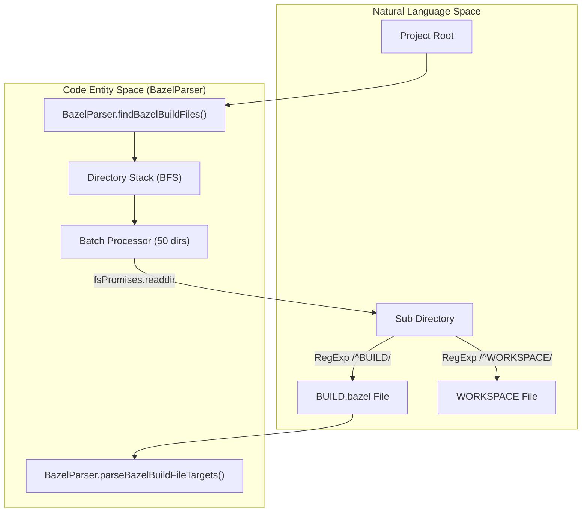
**Sources:** [src/services/bazel-parser.ts:37-66](), [src/services/bazel-parser.ts:72-88]()

### BUILD Parsing Logic
This diagram shows how the line-by-line parser extracts target attributes.

```mermaid
graph TD
    subgraph "BUILD File Content"
        RuleLine["cc_binary("]
        NameLine["name = 'app_bin'"]
        SrcsLine["srcs = ['main.cpp']"]
    end

    subgraph "BazelParser Logic"
        LineLoop["for (const line of lines)"]
        RuleRegex["ruleMatch = /^ruleTypeRegex\(/"]
        NameRegex["nameMatch = /name = '([^']+)'/"]
        SrcsRegex["srcsMatch = /srcs = \[([^\]]+)\]/"]
        TargetObj["Parsed Target Object"]
    end

    RuleLine --> LineLoop
    NameLine --> LineLoop
    SrcsLine --> LineLoop
    
    LineLoop --> RuleRegex
    LineLoop --> NameRegex
    LineLoop --> SrcsRegex

    RuleRegex -- "Capture Rule Type" --> TargetObj
    NameRegex -- "Capture Name" --> TargetObj
    SrcsRegex -- "Capture Extensions" --> TargetObj
```
**Sources:** [src/services/bazel-parser.ts:109-143]()

## Integration with Cancellation

The discovery process is integrated with VS Code's `CancellationToken` system. High-level callers (such as `BazelService`) pass a token to the parser. The parser checks the `token.isCancellationRequested` state during long-running operations to ensure that UI-initiated cancellations (e.g., clicking "Cancel" on a progress notification) immediately halt the filesystem crawl and parsing [src/services/bazel-parser.ts:182](), [src/services/bazel-parser.ts:200]().

**Sources:** [src/services/bazel-parser.ts:175-185]()

---

# Page: Controllers

# Controllers

<details>
<summary>Relevant source files</summary>

The following files were used as context for generating this wiki page:

- [src/controllers/bazel-controller.ts](src/controllers/bazel-controller.ts)
- [src/controllers/bazel-target-operations-controller.ts](src/controllers/bazel-target-operations-controller.ts)
- [src/controllers/command-controller.ts](src/controllers/command-controller.ts)
- [src/controllers/workspace-events-controller.ts](src/controllers/workspace-events-controller.ts)

</details>


The controller layer in BlueBazel acts as the intermediary between the VS Code UI (commands and tree views) and the underlying data models and services. It orchestrates user actions—such as building targets, managing target lists, and handling workspace events—by delegating specific logic to specialized controller classes.

## Overview of Controller Responsibilities

The controller layer is partitioned into several key entities, each managing a specific domain of the extension's functionality.

| Controller | Primary Responsibility |
| :--- | :--- |
| `BazelController` | High-level workspace actions (clean, format) and target list refreshing. |
| `BazelTargetOperationsController` | Management of the target lifecycle (picking, adding, copying, removing targets). |
| `BazelTargetControllerManager` | Registry and dispatcher for action-specific execution (Build, Run, Test, Debug). |
| `UserCommandsController` | Resolution and execution of user-defined custom buttons and commands. |
| `WorkspaceEventsController` | Handling VS Code lifecycle events like configuration changes. |

### Controller Interaction Map

The following diagram illustrates how these controllers interact with VS Code and each other.

```mermaid
graph TD
    subgraph VSCode_Space ["VS Code UI Space"]
        UI_Tree["BazelTargetTreeProvider"]
        UI_Cmd["vscode.commands"]
        UI_Cfg["vscode.workspace.onDidChangeConfiguration"]
    end

    subgraph Controller_Space ["Code Entity Space: Controllers"]
        BC["BazelController"]
        BTOC["BazelTargetOperationsController"]
        BTCM["BazelTargetControllerManager"]
        UCC["UserCommandsController"]
        WEC["WorkspaceEventsController"]
    end

    UI_Tree -->|Selection Change| BC
    UI_Cmd -->|Command Invocation| BTOC
    UI_Cmd -->|Custom Button Click| UCC
    UI_Cfg -->|Settings Updated| WEC
    BTOC -->|Execute Action| BTCM
    WEC -->|Refresh Buttons| UCC
```
**Sources:** [src/controllers/bazel-controller.ts:39-47](), [src/controllers/bazel-target-operations-controller.ts:35-44](), [src/controllers/workspace-events-controller.ts:31-37]()

---

## Key Controllers

### BazelController
`BazelController` handles global workspace operations and synchronization. It is responsible for:
*   **Target Refreshing**: Initiating `refreshAvailableTargets` via `BazelService` when `BUILD` files change [src/controllers/bazel-controller.ts:48-55]() or when the workspace opens [src/controllers/bazel-controller.ts:57-62]().
*   **Workspace Utilities**: Executing `clean`, `format`, and `buildSingle` (compile one dependency) tasks [src/controllers/bazel-controller.ts:65-124]().
*   **Tree Selection**: Updating the `BazelTargetManager` when a user selects a different target in the sidebar [src/controllers/bazel-controller.ts:142-155]().

### BazelTargetOperationsController
This controller manages the "User Targets" list in the UI. It provides the logic for:
*   **Target Selection**: Displaying the `BazelTargetQuickPick` to allow users to add new targets [src/controllers/bazel-target-operations-controller.ts:48-63]().
*   **CRUD Operations**: Methods for `copyTarget`, `removeTarget`, and `addOrUpdateTarget` which modify the persistent target list [src/controllers/bazel-target-operations-controller.ts:110-138]().
*   **Execution Dispatch**: Delegating execution to the correct sub-controller (e.g., Build vs. Run) via the `BazelTargetControllerManager` [src/controllers/bazel-target-operations-controller.ts:147-153]().

### WorkspaceEventsController
A lightweight controller that listens for VS Code environment changes. Its primary role is to monitor `onDidChangeConfiguration` and trigger a refresh of custom buttons and the tree view if the extension's settings are modified [src/controllers/workspace-events-controller.ts:39-46]().

---

## Command Registration

All controllers are wired into VS Code via the `registerCommands` entry point. This function groups command registration into logical sub-registrars, mapping string IDs (e.g., `bluebazel.build`) to the methods defined in the controllers.

```mermaid
graph LR
    subgraph Registry ["src/controllers/command-controller.ts"]
        RC["registerCommands"]
    end

    RC --> RBC["registerBazelCommands"]
    RC --> RBTOC["registerBazelTargetOperationsCommands"]
    RC --> RDC["registerDebugCommands"]
    RC --> RUC["registerUserCommands"]

    RBC -->|"bluebazel.clean"| BC["BazelController.clean"]
    RBTOC -->|"bluebazel.pickTarget"| BTOC["BazelTargetOperationsController.pickTarget"]
    RDC -->|"bluebazel.debugTarget"| DC["DebugController.execute"]
    RUC -->|"bluebazel.userCommand"| UCC["UserCommandsController.execute"]
```
**Sources:** [src/controllers/command-controller.ts:42-58](), [src/controllers/bazel-target-operations-controller.ts:147-153]()

For details on how specific commands are mapped, see [Command Registration](#4.2).

---

## Specialized Child Controllers

The execution logic for specific Bazel actions and complex user-defined commands is offloaded to specialized child pages:

### Target Action Controllers
The `BazelTargetControllerManager` maintains a mapping of `BazelAction` (build, run, test, debug) to specific controller implementations. These controllers handle the complexities of terminal management, port polling for debuggers, and environment variable injection.
For details, see [Target Action Controllers (Build, Run, Test, Debug)](#4.1).

### User Commands & Custom Tasks
The `UserCommandsController` manages the execution of highly configurable user commands. It supports a three-layer templating system for variable substitution and integrates with the VS Code Task API.
For details, see [User Commands & Custom Task Execution](#4.3).

**Sources:** [src/controllers/target-controllers/bazel-target-controller-manager.ts](), [src/controllers/user-commands-controller.ts]()

---

# Page: Target Action Controllers (Build, Run, Test, Debug)

# Target Action Controllers (Build, Run, Test, Debug)

<details>
<summary>Relevant source files</summary>

The following files were used as context for generating this wiki page:

- [src/controllers/target-controllers/any-action-controller.ts](src/controllers/target-controllers/any-action-controller.ts)
- [src/controllers/target-controllers/bazel-target-controller.ts](src/controllers/target-controllers/bazel-target-controller.ts)
- [src/controllers/target-controllers/build-controller.ts](src/controllers/target-controllers/build-controller.ts)
- [src/controllers/target-controllers/debug-controller.ts](src/controllers/target-controllers/debug-controller.ts)
- [src/controllers/target-controllers/run-controller.ts](src/controllers/target-controllers/run-controller.ts)
- [src/controllers/target-controllers/test-controller.ts](src/controllers/target-controllers/test-controller.ts)
- [src/services/file-watcher-service.ts](src/services/file-watcher-service.ts)

</details>


The `BazelTargetController` implementations are the operational heart of BlueBazel. They translate abstract `BazelTarget` models into concrete shell commands and VS Code tasks. Each controller manages the lifecycle of a specific Bazel action, handling state transitions, environment variable formatting, and platform-specific execution logic.

## Overview of Controller Architecture

All action controllers implement the `BazelTargetController` interface `[src/controllers/target-controllers/bazel-target-controller.ts:27-30]()`, which defines two primary methods:
1. `execute(target: BazelTarget)`: Performs the action (e.g., building, running) and manages UI progress.
2. `getExecuteCommand(target: BazelTarget)`: Constructs the raw shell command string for the action.

### Action Execution Flow
The following diagram illustrates how a user interaction in the UI flows through the controllers to the system terminal.

**Action Execution Data Flow**
```mermaid
graph TD
    subgraph "UI Space"
        A["BazelTargetTreeProvider"] -- "Trigger Action" --> B["BazelTargetOperationsController"]
    end

    subgraph "Controller Space"
        B -- "Dispatch" --> C["BuildController"]
        B -- "Dispatch" --> D["RunController"]
        B -- "Dispatch" --> E["TestController"]
        B -- "Dispatch" --> F["DebugController"]
        
        C & D & E & F -- "setTargetState(Executing)" --> G["BazelTargetStateManager"]
        C & D & E & F -- "runTask()" --> H["TaskService"]
    end

    subgraph "System Space"
        H -- "spawn" --> I["VS Code Terminal / Process"]
    end
```
Sources: `[src/controllers/target-controllers/bazel-target-controller.ts:27-30]()`, `[src/controllers/target-controllers/build-controller.ts:50-81]()`, `[src/controllers/target-controllers/run-controller.ts:49-62]()`

---

## BuildController

The `BuildController` is responsible for executing `bazel build` commands. It features a unique resolution mechanism for the "Run Target" alias.

### Command Construction
The controller uses `cleanAndFormat` to assemble the command string from multiple target properties:
- **Executable**: Retrieved via `configurationManager.getExecutableCommand()` `[src/controllers/target-controllers/build-controller.ts:89-89]()`.
- **Arguments**: Combines Bazel arguments and configuration arguments `[src/controllers/target-controllers/build-controller.ts:90-91]()`.
- **Environment**: Formats environment variables using `EnvVarsUtils.toBuildEnvVars` `[src/controllers/target-controllers/build-controller.ts:92-92]()`.

### BUILD_RUN_TARGET_STR Resolution
A special constant `BUILD_RUN_TARGET_STR = '<Run Target>'` `[src/controllers/target-controllers/build-controller.ts:40-40]()` allows a build target to dynamically point to whatever target is currently selected in the "Run" category. 
- The method `getActualBuildTargetPath` checks if `target.buildPath` matches this constant `[src/controllers/target-controllers/build-controller.ts:108-108]()`.
- If it matches, it resolves the path relative to `BAZEL_BIN` using the currently selected run target from `BazelTargetManager` `[src/controllers/target-controllers/build-controller.ts:110-115]()`.

Sources: `[src/controllers/target-controllers/build-controller.ts:40-121]()`

---

## RunController

The `RunController` manages the execution of binaries. It supports two distinct modes controlled by user configuration.

| Mode | Configuration | Behavior |
| :--- | :--- | :--- |
| **Run in Bazel** | `shouldRunBinariesDirect() == false` | Executes `bazel run //target`. Environment variables are passed via the task environment `[src/controllers/target-controllers/run-controller.ts:64-87]()`. |
| **Run Direct** | `shouldRunBinariesDirect() == true` | Executes the binary directly from the `bazel-bin` directory. Optionally triggers a build first if `shouldBuildBeforeLaunch()` is enabled `[src/controllers/target-controllers/run-controller.ts:89-106]()`. |

### Logic Flow
1. **State Management**: Sets state to `Executing` `[src/controllers/target-controllers/run-controller.ts:51-51]()`.
2. **Path Resolution**: In `runDirect`, it calculates the absolute path to the executable by joining the workspace root with the target's `buildPath` `[src/controllers/target-controllers/run-controller.ts:97-97]()`.
3. **Argument Formatting**: In `runInBazel`, run arguments are prefixed with `--` to separate them from Bazel's own arguments `[src/controllers/target-controllers/run-controller.ts:128-130]()`.

Sources: `[src/controllers/target-controllers/run-controller.ts:49-156]()`

---

## TestController

The `TestController` handles `bazel test` execution. Its primary complexity lies in correctly formatting arguments and environment variables for the Bazel test runner.

### Implementation Details
- **Environment Variables**: Uses `EnvVarsUtils.toTestEnvVars` `[src/controllers/target-controllers/test-controller.ts:75-75]()`, which typically formats variables as `--test_env=KEY=VALUE`.
- **Task Labeling**: Generates a task label using `toGerund(target.action)` (e.g., "Testing //my/target") for the VS Code UI `[src/controllers/target-controllers/test-controller.ts:51-53]()`.
- **Command Assembly**: The `getExecuteCommand` method ensures that `testArgs` (run arguments) are appended after the target label `[src/controllers/target-controllers/test-controller.ts:79-87]()`.

Sources: `[src/controllers/target-controllers/test-controller.ts:36-91]()`

---

## DebugController

The `DebugController` is the most complex implementation, coordinating between Bazel, the system network, and language-specific debugger plugins.

### Debug Lifecycle (debugInBazel)
When debugging via Bazel, the controller follows a strict polling lifecycle:
1. **Port Selection**: Finds an available local port using `getAvailablePort()` `[src/controllers/target-controllers/debug-controller.ts:157-157]()`.
2. **Server Start**: Launches the Bazel command with a "run-under" script (e.g., `gdbserver` or `debugpy`) via `startDebugServer()` `[src/controllers/target-controllers/debug-controller.ts:175-175]()`.
3. **Port Polling**: Uses `waitForPort()` to wait for the debug server to start listening on the selected port `[src/controllers/target-controllers/debug-controller.ts:178-178]()`.
4. **Client Attach**: Delegates to the `LanguagePlugin` to create a `vscode.DebugConfiguration` and calls `vscode.debug.startDebugging()` `[src/controllers/target-controllers/debug-controller.ts:187-191]()`.

### Language Delegation
The controller does not know how to configure a debugger for a specific language. Instead, it uses the `LanguageRegistry` to find the appropriate plugin based on the `target.language` property `[src/controllers/target-controllers/debug-controller.ts:54-55]()`.

**Debug Controller and Language Plugin Interaction**
```mermaid
sequenceDiagram
    participant DC as DebugController
    participant LR as LanguageRegistry
    participant LP as LanguagePlugin (e.g. CppPlugin)
    participant VS as VS Code Debug Engine

    DC->>LR: getPlugin(target.language)
    LR-->>DC: return LanguagePlugin
    DC->>DC: getAvailablePort()
    DC->>DC: startDebugServer(port)
    DC->>DC: waitForPort(port)
    DC->>LP: createDebugAttachConfig(target, port)
    LP-->>DC: return DebugConfiguration
    DC->>VS: startDebugging(folder, config)
```

### Command Generation
- **getRunUnderArg**: Injects the debugger bridge into the Bazel command line `[src/controllers/target-controllers/debug-controller.ts:108-108]()`.
- **Debug Env Vars**: Adds language-specific debug environment variables to the execution context `[src/controllers/target-controllers/debug-controller.ts:100-101]()`.

Sources: `[src/controllers/target-controllers/debug-controller.ts:43-191]()`, `[src/languages/language-registry.ts:27-27]()`

---

# Page: Command Registration

# Command Registration

<details>
<summary>Relevant source files</summary>

The following files were used as context for generating this wiki page:

- [src/controllers/command-controller.ts](src/controllers/command-controller.ts)
- [src/controllers/commands/bazel-commands.ts](src/controllers/commands/bazel-commands.ts)
- [src/controllers/commands/bazel-target-operations-commands.ts](src/controllers/commands/bazel-target-operations-commands.ts)
- [src/controllers/commands/debug-commands.ts](src/controllers/commands/debug-commands.ts)
- [src/controllers/commands/multi-prop-tree-item-commands.ts](src/controllers/commands/multi-prop-tree-item-commands.ts)
- [src/controllers/commands/single-prop-tree-item-commands.ts](src/controllers/commands/single-prop-tree-item-commands.ts)
- [src/controllers/commands/tree-data-provider-commands.ts](src/controllers/commands/tree-data-provider-commands.ts)
- [src/controllers/commands/user-commands.ts](src/controllers/commands/user-commands.ts)
- [src/controllers/target-controllers/bazel-target-controller-manager.ts](src/controllers/target-controllers/bazel-target-controller-manager.ts)
- [src/services/string-utils.ts](src/services/string-utils.ts)

</details>


Command registration in BlueBazel is the mechanism that bridges the VS Code UI (menus, buttons, and hotkeys) to the extension's internal logic. This is orchestrated through a central `registerCommands` entry point that delegates to specialized sub-registrars, ensuring a clean separation of concerns between tree view interactions, Bazel operations, and user-defined tasks.

## Registration Architecture

The entry point for all command registration is the `registerCommands` function defined in `src/controllers/command-controller.ts`. This function is called during the extension's activation phase and receives all major controllers and services as dependencies.

### Command Flow Overview

The following diagram illustrates how VS Code commands are mapped to their respective controllers through the sub-registrar functions.

**Title: Command Dispatch Map**
```mermaid
graph TD
    subgraph "VS Code UI Space"
        "Command ID (e.g., bluebazel.refreshTargets)" --> "Sub-Registrar"
    end

    subgraph "Code Entity Space"
        "Sub-Registrar" --> "registerBazelCommands()"
        "Sub-Registrar" --> "registerBazelTargetOperationsCommands()"
        "Sub-Registrar" --> "registerUserCommands()"
        "Sub-Registrar" --> "registerTreeDataProviderCommands()"
        
        "registerBazelCommands()" --> "BazelController"
        "registerBazelTargetOperationsCommands()" --> "BazelTargetOperationsController"
        "registerUserCommands()" --> "UserCommandsController"
        "registerTreeDataProviderCommands()" --> "vscode.commands.executeCommand"
    end

    "BazelController" --- [src/controllers/bazel-controller.ts]
    "BazelTargetOperationsController" --- [src/controllers/bazel-target-operations-controller.ts]
    "UserCommandsController" --- [src/controllers/user-commands-controller.ts]
```
**Sources:** [src/controllers/command-controller.ts:42-58](), [src/controllers/commands/bazel-commands.ts:30-51]()

## Sub-Registrar Details

Each sub-registrar handles a specific domain of the extension's functionality.

### 1. General Bazel Commands
Handled by `registerBazelCommands`, these relate to global workspace operations.
*   `refreshTargets`: Triggers `bazelController.refreshAvailableTargets()` [src/controllers/commands/bazel-commands.ts:35-37]().
*   `format`: Executes `bazelController.format()` [src/controllers/commands/bazel-commands.ts:39-41]().
*   `clean`: Executes `bazelController.clean()` [src/controllers/commands/bazel-commands.ts:43-45]().
*   `buildCurrentFile`: Executes `bazelController.buildSingle()` [src/controllers/commands/bazel-commands.ts:47-49]().

### 2. Target Operations
Handled by `registerBazelTargetOperationsCommands`, these manage the lifecycle of targets in the side-bar.
*   `addTarget`: Uses `BazelTargetOperationsController.pickTarget(action)` [src/controllers/commands/bazel-target-operations-commands.ts:40-42]().
*   `removeTarget`: Removes a target via the controller [src/controllers/commands/bazel-target-operations-commands.ts:48-52]().
*   `copyCommand`: Copies the generated Bazel CLI command for a target to the clipboard [src/controllers/commands/bazel-target-operations-commands.ts:60-64]().
*   **Action Shortcuts**: This registrar also iterates through `build`, `run`, and `test` to create shortcut commands that execute the currently selected target for that action [src/controllers/commands/bazel-target-operations-commands.ts:77-84]().

### 3. Debug Commands
Handled by `registerDebugCommands`, these interface with the `DebugController`.
*   `debugTarget`: Explicitly debugs a specific `BazelTarget` [src/controllers/commands/debug-commands.ts:36-40]().
*   `debug`: Debugs the target currently selected in the 'run' category [src/controllers/commands/debug-commands.ts:42-49]().

### 4. Tree View Interaction
Three registrars manage how users interact with items in the Bazel Target Tree:
*   `registerTreeDataProviderCommands`: Handles view-level actions like `collapseAll` [src/controllers/commands/tree-data-provider-commands.ts:28-33]().
*   `registerSinglePropTreeItemCommands`: Manages single-value properties (e.g., editing a target's name or simple flag) [src/controllers/commands/single-prop-tree-item-commands.ts:31-45]().
*   `registerMultiPropTreeItemCommands`: Manages list-based properties (e.g., build flags or environment variables). It provides commands to `add`, `edit`, `remove`, and `copy` items within a property list [src/controllers/commands/multi-prop-tree-item-commands.ts:31-83]().

**Sources:** [src/controllers/commands/bazel-target-operations-commands.ts:31-85](), [src/controllers/commands/debug-commands.ts:31-51](), [src/controllers/commands/multi-prop-tree-item-commands.ts:31-83](), [src/controllers/commands/single-prop-tree-item-commands.ts:31-45]()

## User Command Registration

The `registerUserCommands` function handles dynamic command registration based on user configuration. Unlike static commands, these are generated at runtime from the `customButtons` setting in `settings.json`.

**Title: Dynamic Button Registration Logic**
```mermaid
sequenceDiagram
    participant CM as ConfigurationManager
    participant UC as UserCommandsController
    participant VS as vscode.commands

    UC->>CM: getCustomButtons()
    loop For Each Button
        UC->>VS: registerCommand(button.methodName)
        Note over VS: Command is now available<br/>for UI/Hotkeys
    end
    
    rect rgb(240, 240, 240)
    Note over VS: On Execution
    VS->>UC: runCustomTask(command, problemMatcher)
    end
```

### Implementation Details
1.  **Method Name Mapping**: Every custom button defines a `methodName` which becomes the actual VS Code command ID [src/controllers/commands/user-commands.ts:45]().
2.  **Backward Compatibility**: The handler supports both simple string commands and complex `UserCustomButton` objects [src/controllers/commands/user-commands.ts:47-51]().
3.  **Extension Context**: All registered commands are added to `context.subscriptions` to ensure they are disposed of correctly when the extension deactivates [src/controllers/commands/user-commands.ts:53]().

**Sources:** [src/controllers/commands/user-commands.ts:31-60](), [src/controllers/commands/user-commands.ts:62-74]()

## Controller Management

The `BazelTargetControllerManager` acts as a factory for action-specific controllers. During command registration, it provides the correct controller instance based on the action string (e.g., 'build', 'run', 'debug').

| Action | Controller Implementation | Role |
| :--- | :--- | :--- |
| `build` | `BuildController` | Logic for `bazel build` |
| `run` | `RunController` | Logic for `bazel run` or direct execution |
| `test` | `TestController` | Logic for `bazel test` and coverage |
| `debug` | `DebugController` | Orchestrates debuggers and port polling |
| `*` | `AnyActionController` | Fallback for generic actions |

**Sources:** [src/controllers/target-controllers/bazel-target-controller-manager.ts:42-100]()

---

# Page: User Commands & Custom Task Execution

# User Commands & Custom Task Execution

<details>
<summary>Relevant source files</summary>

The following files were used as context for generating this wiki page:

- [src/controllers/user-commands-controller.ts](src/controllers/user-commands-controller.ts)
- [src/services/configuration-manager.ts](src/services/configuration-manager.ts)

</details>


The `UserCommandsController` is responsible for resolving and executing custom tasks defined by the user. It implements a three-layer templating language that allows for dynamic command generation based on the current workspace state, interactive user input, and inline shell execution.

## Overview of Command Resolution

The execution of a custom task follows a strict resolution pipeline. When `runCustomTask` is called, it processes the input string through three distinct phases before passing the final command to the `TaskService`.

### Resolution Pipeline
1.  **Keyword Substitution**: Replaces `${keyword}` tokens with values from the current Bazel configuration or workspace settings.
2.  **Interactive Commands**: Processes `[Pick]` and `[Input]` tokens to prompt the user via VS Code UI.
3.  **Shell Execution**: Resolves `<shell>` tags by executing the enclosed command and capturing its stdout.

### Data Flow and System Integration
The following diagram illustrates how `UserCommandsController` bridges the gap between the configuration (Natural Language Space) and the internal service logic (Code Entity Space).

**Title: User Command Resolution Flow**
```mermaid
graph TD
    subgraph "Natural Language Space (User Config)"
        A["customButtons.command"] -- "String with ${keywords}" --> B
    end

    subgraph "Code Entity Space (UserCommandsController)"
        B["UserCommandsController.runCustomTask()"]
        C["UserCommandsController.resolveKeywords()"]
        D["UserCommandsController.resolveExtensionCommands()"]
        E["UserCommandsController.resolveCommands()"]
        
        B --> C
        C --> D
        D --> E
    end

    subgraph "Service Layer"
        F["BazelTargetManager.getSelectedTarget()"]
        G["vscode.window.showQuickPick()"]
        H["ShellService.runCommand()"]
        I["TaskService.runTask()"]
    end

    C -.-> F
    D -.-> G
    E -.-> H
    E --> I
```
Sources: [src/controllers/user-commands-controller.ts:69-90](), [src/controllers/user-commands-controller.ts:105-124]()

---

## Three-Layer Templating Language

### 1. Keyword Substitution (`${keyword}`)
The controller maintains a mapping of internal configuration keys to dynamic values retrieved from the `BazelTargetManager` and `ConfigurationManager`.

| Keyword | Resolution Source | Description |
| :--- | :--- | :--- |
| `bluebazel.executable` | `ConfigurationManager.getExecutableCommand()` | Path to bazel binary [src/controllers/user-commands-controller.ts:122]() |
| `bluebazel.runTarget` | `BazelService.formatBazelTargetFromPath()` | The currently selected run target [src/controllers/user-commands-controller.ts:108-110]() |
| `bluebazel.testArgs` | `UserCommandsController.formatTestArgs()` | Formats args with `--test_arg` prefix [src/controllers/user-commands-controller.ts:92-97]() |
| `bluebazel.runEnvVars` | `BazelTarget.getEnvVars().toStringArray()` | Environment variables for the run target [src/controllers/user-commands-controller.ts:119]() |

**Special Logic: `formatTestArgs`**
For Bazel test commands, arguments must be prefixed with `--test_arg`. The `formatTestArgs` function uses a regex `(/(--\S+)/g)` to identify flags and prepend the required Bazel syntax.
Sources: [src/controllers/user-commands-controller.ts:38-55](), [src/controllers/user-commands-controller.ts:92-97](), [src/controllers/user-commands-controller.ts:105-124]()

### 2. Interactive Extension Commands
Interactive commands allow the command string to pause for user input.

*   **`[Pick](shell_command)`**: Executes the `shell_command`, splits the output by newlines, and presents a `vscode.window.showQuickPick` to the user. The selected item replaces the token [src/controllers/user-commands-controller.ts:131-149]().
*   **`[Input](Prompt Text)`**: Opens a `vscode.window.showInputBox` with the provided prompt. The user's text replaces the token [src/controllers/user-commands-controller.ts:151-155]().

### 3. Inline Shell Execution (`<shell>`)
The `<shell>command</shell>` syntax allows embedding the output of a shell command directly into the final task string. The `UserCommandsController.resolveCommands` method uses a recursive regex to find these tags and executes them via `ShellService.runCommand`.

**Caching**: To prevent redundant executions (especially during recursive resolution), the controller caches the results of shell commands within the scope of a single task resolution [src/controllers/user-commands-controller.ts:157-160]().

Sources: [src/controllers/user-commands-controller.ts:57-60](), [src/controllers/user-commands-controller.ts:131-160]()

---

## Integration with TaskService

Once the command string is fully resolved, it is handed off to the `TaskService` for execution in the VS Code terminal.

**Title: Execution Hand-off to TaskService**
```mermaid
sequenceDiagram
    participant U as UserCommandsController
    participant P as ProgressUI
    participant T as TaskService
    participant V as VSCode Terminal

    U->>P: showProgress("Running command...")
    U->>U: resolveKeywords()
    U->>U: resolveExtensionCommands()
    U->>U: resolveCommands()
    U->>T: runTask(completeCommand, problemMatcher)
    T->>V: createTerminal / sendText
    V-->>T: onDidEndTask
    T-->>U: Task Finished
```

The `runTask` call uses the following parameters:
*   **Execution Type**: `'shell'` [src/controllers/user-commands-controller.ts:82]().
*   **Terminal Clearing**: Determined by `configurationManager.isClearTerminalBeforeAction()` [src/controllers/user-commands-controller.ts:78]().
*   **Resolution**: The promise resolves on the `onDidEndTask` event [src/controllers/user-commands-controller.ts:83]().
*   **Problem Matchers**: Passed through from the `UserCustomButton` definition to enable VS Code error parsing [src/controllers/user-commands-controller.ts:84]().

Sources: [src/controllers/user-commands-controller.ts:69-90](), [src/services/configuration-manager.ts:171-180]()

---

## Configuration of Custom Tasks

Custom tasks are defined in the `bluebazel.customButtons` setting. This setting is managed by `ConfigurationManager`, which inflates the JSON into `UserCustomCategory` and `UserCustomButton` objects.

| Class | Responsibility |
| :--- | :--- |
| `UserCustomCategory` | Groups buttons under a single header in the Tree View [src/services/configuration-manager.ts:66-89](). |
| `UserCustomButton` | Holds the raw command string, icon, and problem matcher [src/services/configuration-manager.ts:30-64](). |

Sources: [src/services/configuration-manager.ts:30-89](), [src/services/configuration-manager.ts:115-124]()

---

# Page: User Interface

# User Interface

<details>
<summary>Relevant source files</summary>

The following files were used as context for generating this wiki page:

- [src/ui/bazel-target-quick-pick.ts](src/ui/bazel-target-quick-pick.ts)
- [src/ui/bazel-target-tree-provider.ts](src/ui/bazel-target-tree-provider.ts)
- [src/ui/progress.ts](src/ui/progress.ts)
- [src/ui/quick-pick.ts](src/ui/quick-pick.ts)
- [src/ui/terminal.ts](src/ui/terminal.ts)

</details>


The BlueBazel user interface provides a comprehensive set of tools within VS Code to manage, execute, and debug Bazel targets. The UI layer bridges the gap between the underlying [Core Architecture](#2) and the user, utilizing tree views, interactive dialogs, and contextual overlays to streamline the Bazel workflow.

### UI Architecture Overview

The UI components interact with the model layer to reflect the current state of the workspace and provide interactive controls for target operations.

```mermaid
graph TD
    subgraph "VS Code UI Layer"
        TV["BazelTargetTreeProvider"]
        QP["BazelTargetQuickPick"]
        CL["UnifiedCodeLensProvider"]
        PR["Progress System"]
    end

    subgraph "Controllers & Models"
        TC["BazelController"]
        TM["BazelTargetManager"]
        SM["BazelTargetStateManager"]
    end

    TV -->|Observes| SM
    TV -->|Requests Data| TM
    QP -->|Fetches Targets| TM
    CL -->|Triggers| TC
    PR -->|Reports for| TC
```
**Sources:** [src/ui/bazel-target-tree-provider.ts:89-94](), [src/ui/bazel-target-quick-pick.ts:51-55](), [src/ui/progress.ts:124-129]()

---

## Bazel Target Tree View

The **Bazel Target Tree View** is the primary explorer for the extension. It organizes targets into logical categories based on their `BazelAction` (e.g., Build, Run, Test).

- **Hierarchy**: The tree uses a `BazelTreeElement` union type to represent different levels, including `BazelTargetCategory`, `BazelTarget`, and various property nodes `[src/ui/bazel-target-tree-provider.ts:36-43]()`.
- **Visual Indicators**: Targets are assigned icons based on their action type (e.g., a "beaker" for tests, "play" for run) `[src/ui/bazel-target-tree-provider.ts:52-74]()`.
- **State Persistence**: The provider tracks which nodes are expanded using an `expandedStateCache` stored in `vscode.ExtensionContext.workspaceState` `[src/ui/bazel-target-tree-provider.ts:85-87]()`.

For a deep dive into the tree resolution logic and context menu integration, see **[Bazel Target Tree View](#5.1)**.

---

## CodeLens Overlays

BlueBazel injects **CodeLens** actions directly into source code files to allow for one-click execution and debugging of tests or main functions.

- **Aggregation**: The `UnifiedCodeLensProvider` scans active documents using language-specific regex patterns.
- **Context Awareness**: It maps source file locations to Bazel targets by inspecting the workspace structure and `BUILD` files.
- **Dynamic Actions**: Injects `run` and `debug` links above recognized symbols, automatically handling test filter arguments for granular execution.

For details on language-specific patterns and target extraction, see **[CodeLens Providers](#5.2)**.

---

## QuickPick Dialogs

The extension utilizes `QuickPick` interfaces for interactive target selection and command configuration when the tree view is not the primary entry point.

| Component | Responsibility | Source |
| :--- | :--- | :--- |
| `BazelTargetQuickPick` | Provides a searchable list of available Bazel targets filtered by action. | `[src/ui/bazel-target-quick-pick.ts:32-34]()` |
| `showSimpleQuickPick` | A utility for selecting arguments or configuration values with a loading state. | `[src/ui/quick-pick.ts:35-40]()` |

The `BazelTargetQuickPick` supports a dual-mode input where users can first select an action and then filter through matching targets `[src/ui/bazel-target-quick-pick.ts:102-122]()`.

---

## Progress and Terminal Management

Long-running Bazel operations are communicated to the user through a unified progress system and terminal controls.

### Progress Indicators
The `showProgress` utility coordinates multiple UI updates simultaneously:
1. **Status Bar**: Displays a spinning icon and the current task title `[src/ui/progress.ts:90-93]()`.
2. **Notification Window**: Shows a progress dialog with a custom spinner and a "Cancel" button `[src/ui/progress.ts:52-58]()`.
3. **Cancellation**: Both UI elements propagate cancellation requests back to the underlying `vscode.CancellationTokenSource` `[src/ui/progress.ts:59-62]()`.

### Terminal Management
The extension interacts with the VS Code terminal for command output. It includes utilities like `clearTerminal` to ensure a clean state before new build or run operations are initiated `[src/ui/terminal.ts:26-28]()`.

**Sources:** [src/ui/progress.ts:124-153](), [src/ui/terminal.ts:26-28]()

---

# Page: Bazel Target Tree View

# Bazel Target Tree View

<details>
<summary>Relevant source files</summary>

The following files were used as context for generating this wiki page:

- [src/ui/bazel-target-quick-pick-item.ts](src/ui/bazel-target-quick-pick-item.ts)
- [src/ui/bazel-target-quick-pick.ts](src/ui/bazel-target-quick-pick.ts)
- [src/ui/bazel-target-tree-provider.ts](src/ui/bazel-target-tree-provider.ts)

</details>


The `BazelTargetTreeProvider` is the central class responsible for rendering the Bazel Explorer view in VS Code. It transforms the internal data models of targets and actions into a hierarchical tree structure, managing everything from icon assignment to the persistence of the user's expansion state.

## Tree Element Hierarchy

The tree view is composed of a union type `BazelTreeElement` [src/ui/bazel-target-tree-provider.ts:36-36](), which represents the various levels of the hierarchy.

| Element Type | Description |
| :--- | :--- |
| `BazelTargetCategory` | The top-level nodes representing Bazel actions (e.g., `build`, `run`, `test`). |
| `UserCustomCategory` | User-defined categories configured via settings. |
| `BazelTarget` | The actual Bazel targets (e.g., `//path/to:target`). |
| `BazelTargetProperty` | Key-value pairs belonging to a target (e.g., `args`, `env`). |
| `BazelTargetMultiProperty` | A property that contains a list of items (e.g., a list of `args`). |
| `BazelTargetMultiPropertyItem` | An individual entry within a `BazelTargetMultiProperty`. |
| `UserCustomButton` | Interactive buttons defined in the user configuration. |

### Data Flow and Element Resolution
The following diagram illustrates how the `BazelTargetTreeProvider` resolves the hierarchy from the root down to individual properties.

**Hierarchy Resolution Logic**
```mermaid
graph TD
    A["BazelTargetTreeProvider.getChildren()"] --> B{"element undefined?"}
    B -- "Yes (Root)" --> C["getRootChildren()"]
    B -- "No" --> D{"Type Check"}
    
    C --> C1["bazelTargetManager.getTargetActions()"]
    C --> C2["configurationManager.getCustomCategories()"]
    
    D -- "BazelTargetCategory" --> E["bazelTargetManager.getUserTargets(action)"]
    D -- "BazelTarget" --> F["target.getProperties()"]
    D -- "BazelTargetMultiProperty" --> G["property.getItems()"]
    D -- "UserCustomCategory" --> H["category.buttons"]
    
    subgraph "Code Entities"
    C1
    E
    F
    end
```
Sources: [src/ui/bazel-target-tree-provider.ts:116-150](), [src/ui/bazel-target-tree-provider.ts:181-220]()

## Implementation Details

### Context Values and Menus
To enable context-sensitive menus (defined in `package.json`), the provider assigns specific `contextValue` strings to `TreeItem` objects during the `getTreeItem` call.

*   **Targets:** Assigned `bazelTarget` [src/ui/bazel-target-tree-provider.ts:321-321]().
*   **Properties:** Assigned `bazelTargetProperty` [src/ui/bazel-target-tree-provider.ts:341-341]().
*   **Multi-Property Items:** Assigned `bazelTargetMultiPropertyItem` [src/ui/bazel-target-tree-provider.ts:360-360]().

### Selected-Target Highlighting
The provider highlights the "active" or most recently used target for a specific action by comparing the element against the `BazelTargetStateManager`. If a target's ID matches the `selectedTargetId` stored in the state manager, its label is modified to include a `★` symbol and its description is updated to `(selected)` [src/ui/bazel-target-tree-provider.ts:311-318]().

### Expansion State Persistence
To provide a seamless user experience, the tree provider persists which nodes are expanded in the VS Code `workspaceState`.
1.  **Cache:** An `expandedStateCache` object stores boolean values keyed by element IDs [src/ui/bazel-target-tree-provider.ts:49-49]().
2.  **Initialization:** On startup, the cache is populated from `workspaceState.get('expandedState')` [src/ui/bazel-target-tree-provider.ts:86-87]().
3.  **Persistence:** The `TreeItem.collapsibleState` is set based on this cache. When a user expands or collapses a node, the extension updates the cache and flushes it back to `workspaceState`.

### Icon Mapping
The provider maintains a static `iconMap` that associates `BazelAction` types with `vscode.ThemeIcon` identifiers to ensure visual consistency with standard VS Code metaphors.

| Action | Icon | Source |
| :--- | :--- | :--- |
| `build` | `tools` | [src/ui/bazel-target-tree-provider.ts:55-55]() |
| `run` | `play` | [src/ui/bazel-target-tree-provider.ts:69-69]() |
| `test` | `beaker` | [src/ui/bazel-target-tree-provider.ts:72-72]() |
| `query` | `graph` | [src/ui/bazel-target-tree-provider.ts:68-68]() |
| `clean` | `trash` | [src/ui/bazel-target-tree-provider.ts:57-57]() |

Sources: [src/ui/bazel-target-tree-provider.ts:52-74]()

## Component Interaction

The `BazelTargetTreeProvider` acts as a view layer that reacts to changes in the underlying models.

**Tree Update Lifecycle**
```mermaid
sequenceDiagram
    participant SM as BazelTargetStateManager
    participant TP as BazelTargetTreeProvider
    participant VS as VS Code UI

    SM->>TP: onDidChangeTargetState()
    Note over TP: Triggered by target selection<br/>or property update
    TP->>TP: refresh()
    TP->>VS: _onDidChangeTreeData.fire()
    VS->>TP: getChildren()
    TP->>VS: return BazelTreeElement[]
```
Sources: [src/ui/bazel-target-tree-provider.ts:90-94](), [src/ui/bazel-target-tree-provider.ts:116-120]()

## Key Functions

### `getChildren(element?: BazelTreeElement)`
The entry point for VS Code to request tree nodes. If `element` is undefined, it calls `getRootChildren()`. Otherwise, it performs a type-check on the element to determine which sub-level to fetch [src/ui/bazel-target-tree-provider.ts:181-220]().

### `getTreeItem(element: BazelTreeElement)`
Converts a `BazelTreeElement` into a `vscode.TreeItem`. This function handles:
*   Label formatting (including the "selected" star) [src/ui/bazel-target-tree-provider.ts:311-315]().
*   Icon assignment via `iconService` or internal `iconMap` [src/ui/bazel-target-tree-provider.ts:303-305]().
*   Setting `collapsibleState` based on whether the element has children and its previous expansion state [src/ui/bazel-target-tree-provider.ts:373-380]().

### `getRootChildren()`
Aggregates categories from two sources:
1.  **Dynamic Actions:** Fetched from `bazelTargetManager.getTargetActions()`, which returns actions like `build`, `run`, and `test` based on discovered targets [src/ui/bazel-target-tree-provider.ts:119-119]().
2.  **Custom Categories:** Fetched from `configurationManager.getCustomCategories()`, allowing users to define their own organizational folders in the tree [src/ui/bazel-target-tree-provider.ts:128-128]().

Sources: [src/ui/bazel-target-tree-provider.ts:116-150]()

---

# Page: CodeLens Providers

# CodeLens Providers

<details>
<summary>Relevant source files</summary>

The following files were used as context for generating this wiki page:

- [src/ui/code-lens-provider-utils.ts](src/ui/code-lens-provider-utils.ts)
- [src/ui/code-lens-providers/unified-code-lens-provider.ts](src/ui/code-lens-providers/unified-code-lens-provider.ts)

</details>


The CodeLens system in BlueBazel provides interactive "Run" and "Debug" overlays directly in the source code editor. These overlays appear above test functions and entry points (like `main()`), allowing developers to execute specific Bazel targets without leaving their code. This functionality is primarily driven by the `UnifiedCodeLensProvider`, which bridges the gap between static source code analysis and Bazel target execution.

## Overview of UnifiedCodeLensProvider

The `UnifiedCodeLensProvider` is a centralized provider that implements the `vscode.CodeLensProvider` interface [src/ui/code-lens-providers/unified-code-lens-provider.ts:41-41](). Instead of having separate providers for every language, BlueBazel uses this single provider to aggregate patterns from the `LanguageRegistry` and apply them based on the active document's language ID.

### Registration Process
CodeLens providers are registered during the extension initialization phase. The `registerCodeLensProviders` utility function instantiates the `UnifiedCodeLensProvider` and attaches it to supported language selectors: `go`, `cpp`, `c`, and `python` [src/ui/code-lens-provider-utils.ts:28-35]().

### Pattern Aggregation
Upon construction, the `UnifiedCodeLensProvider` queries the `LanguageRegistry` to retrieve regex patterns for "Run" and "Test" actions [src/ui/code-lens-providers/unified-code-lens-provider.ts:45-77]().

1.  **Language Plugins**: Each language plugin (e.g., `CppLanguagePlugin`) provides specific regexes via `getCodeLensTestRegex()` and `getCodeLensRunRegex()` [src/ui/code-lens-providers/unified-code-lens-provider.ts:56-68]().
2.  **Pattern Storage**: These are stored internally as `Pattern` objects containing the `PatternType` (Run/Test), the language ID, and the compiled `RegExp` [src/ui/code-lens-providers/unified-code-lens-provider.ts:31-39]().

**Sources:**
- [src/ui/code-lens-provider-utils.ts:28-35]()
- [src/ui/code-lens-providers/unified-code-lens-provider.ts:41-77]()

## Data Flow: From Source to Execution

The following diagram illustrates how the provider translates a regex match in a source file into a runnable `BazelTarget`.

### CodeLens Generation Flow
Title: Source Code to CodeLens Action
```mermaid
graph TD
    subgraph "Natural Language Space (Editor)"
        A["Source File (.cpp, .py, .go)"] -- "provideCodeLenses()" --> B["UnifiedCodeLensProvider"]
    end

    subgraph "Code Entity Space"
        B -- "regex.exec(text)" --> C["Regex Match (Function Name)"]
        C -- "extractBazelTargetsAssociatedWithSourceFile" --> D["BazelService"]
        D -- "Returns" --> E["Target Metadata"]
        E -- "new BazelTarget()" --> F["BazelTarget Object"]
        F -- "add('--test_filter=...')" --> G["Configured Target"]
        G -- "vscode.CodeLens" --> H["UI Action (Run/Debug)"]
    end
    
    style A stroke-dasharray: 5 5
    style H stroke-width:4px
```
**Sources:**
- [src/ui/code-lens-providers/unified-code-lens-provider.ts:79-162]()
- [src/ui/code-lens-providers/unified-code-lens-provider.ts:124-124]()

## Implementation Details

### Target Extraction and Filtering
When a regex match is found, the provider must identify which Bazel target owns the current file. It calls `BazelService.extractBazelTargetsAssociatedWithSourceFile(document.fileName)` to find associated targets [src/ui/code-lens-providers/unified-code-lens-provider.ts:124-124]().

If targets are found, the provider performs the following:
1.  **Action Determination**: Maps the `PatternType` to a `BazelAction` (`'run'` or `'test'`) [src/ui/code-lens-providers/unified-code-lens-provider.ts:105-110]().
2.  **Function Name Resolution**: 
    *   For **C/C++**: It combines the fixture name and test name (e.g., `Fixture.TestName`) from the regex capture groups [src/ui/code-lens-providers/unified-code-lens-provider.ts:114-118]().
    *   For **Other Languages**: It uses the primary captured group as the function name [src/ui/code-lens-providers/unified-code-lens-provider.ts:121-121]().
3.  **Argument Injection**: If the pattern is a `Test` type, it automatically adds the `--test_filter` argument to the `BazelTarget` to ensure only the specific function is executed [src/ui/code-lens-providers/unified-code-lens-provider.ts:139-141]().

### Debug Support
For every "Run" or "Test" CodeLens generated, the provider also generates a corresponding "Debug" CodeLens [src/ui/code-lens-providers/unified-code-lens-provider.ts:151-161]().
- It clones the original target [src/ui/code-lens-providers/unified-code-lens-provider.ts:151-151]().
- It injects `--compilation_mode=dbg` into the Bazel arguments to ensure symbols are available [src/ui/code-lens-providers/unified-code-lens-provider.ts:152-152]().
- It binds the command to `${extensionName}.debugTarget` [src/ui/code-lens-providers/unified-code-lens-provider.ts:158-158]().

### Internal Architecture
Title: UnifiedCodeLensProvider Class Relationships
```mermaid
classDiagram
    class UnifiedCodeLensProvider {
        -regexPatterns: Pattern[]
        -bazelService: BazelService
        +provideCodeLenses(document, token)
        -processRegexPattern(document, pattern, token)
    }
    class LanguageRegistry {
        <<singleton>>
        +getLanguages()
        +getPlugin(language)
    }
    class BazelTarget {
        +bazelPath: string
        +action: BazelAction
        +getBazelArgs()
        +clone(deep)
    }
    class BazelService {
        +static extractBazelTargetsAssociatedWithSourceFile(fileName)
    }

    UnifiedCodeLensProvider --> LanguageRegistry : queries regexes
    UnifiedCodeLensProvider --> BazelService : lookups targets
    UnifiedCodeLensProvider ..> BazelTarget : creates
```
**Sources:**
- [src/ui/code-lens-providers/unified-code-lens-provider.ts:41-165]()
- [src/ui/code-lens-providers/unified-code-lens-provider.ts:124-124]()

## Summary of CodeLens Actions

| Action | Command | Arguments Injected |
| :--- | :--- | :--- |
| **Run/Test** | `bluebazel.executeTarget` | `--test_filter=<name>` (if test) |
| **Debug** | `bluebazel.debugTarget` | `--compilation_mode=dbg`, `--test_filter=<name>` (if test) |

The labels and command IDs used are dynamically resolved using `ExtensionUtils.getExtensionName(this.context)` to ensure consistency with the extension's configuration [src/ui/code-lens-providers/unified-code-lens-provider.ts:98-146]().

**Sources:**
- [src/ui/code-lens-providers/unified-code-lens-provider.ts:98-161]()

---

# Page: Language Plugin System

# Language Plugin System

<details>
<summary>Relevant source files</summary>

The following files were used as context for generating this wiki page:

- [releases/bluebazel-1.0.2.vsix](releases/bluebazel-1.0.2.vsix)
- [releases/bluebazel-1.0.4.vsix](releases/bluebazel-1.0.4.vsix)
- [src/languages/language-plugin.ts](src/languages/language-plugin.ts)
- [src/languages/language-registry.ts](src/languages/language-registry.ts)
- [src/languages/plugins/go-language-plugin.ts](src/languages/plugins/go-language-plugin.ts)
- [src/services/bazel-rule-language-mapping.ts](src/services/bazel-rule-language-mapping.ts)

</details>


The Language Plugin System provides a modular framework for extending BlueBazel with language-specific capabilities. It allows the extension to support diverse ecosystems (C++, Python, Go) while maintaining a unified interface for core features like debugging and CodeLens injection.

## LanguagePlugin Interface

The `LanguagePlugin` interface defines the contract that every language-specific implementation must fulfill. It abstracts the complexities of different debuggers (GDB, debugpy, Delve) and source code patterns.

| Method | Purpose |
| :--- | :--- |
| `getDebugRunUnderCommand` | Returns the command string (e.g., `gdbserver`, `dlv`) used with Bazel's `--run_under` flag. |
| `getDebugEnvVars` | Provides language-specific environment variables required during a debug session. |
| `createDebugDirectLaunchConfig` | Generates a VS Code `DebugConfiguration` for launching a compiled binary directly. |
| `createDebugAttachConfig` | Generates a configuration for attaching the VS Code debugger to a running process/port. |
| `getCodeLensTestRegex` | Returns the RegExp used to identify test functions in source files. |
| `getCodeLensRunRegex` | Returns the RegExp used to identify entry points (e.g., `main()`) in source files. |

**Sources:** [src/languages/language-plugin.ts:28-43]()

## LanguageRegistry and Registration

The `LanguageRegistry` is a singleton that manages the lifecycle of language plugins. It maps VS Code language identifiers (e.g., `cpp`, `python`, `go`) to their respective plugin implementations.

### Plugin Lifecycle
1.  **Initialization**: During extension activation, the `registerLanguages` function instantiates the concrete plugins.
2.  **Registration**: Plugins are added to the registry via `LanguageRegistry.registerPlugin`.
3.  **Resolution**: Other services (like `DebugController` or `UnifiedCodeLensProvider`) query the registry using `getPlugin(language)` to retrieve the appropriate handler.

### Language Mapping Logic
BlueBazel uses two primary maps in `bazel-rule-language-mapping.ts` to determine which plugin to use:
*   **Rule Prefix Mapping**: Maps Bazel rule types (e.g., `cc_binary` -> `cpp`) to languages. [src/services/bazel-rule-language-mapping.ts:24-156]()
*   **Extension Mapping**: Maps file extensions (e.g., `.go` -> `go`) to languages for CodeLens support. [src/services/bazel-rule-language-mapping.ts:161-300]()

**Language Plugin Registration Flow**
```mermaid
graph TD
    subgraph "Initialization Space"
        A["extension.ts:activate()"] --> B["language-registry.ts:registerLanguages()"]
    end

    subgraph "Code Entity Space"
        B --> C["LanguageRegistry.registerPlugin(CppLanguagePlugin)"]
        B --> D["LanguageRegistry.registerPlugin(GoLanguagePlugin)"]
        B --> E["LanguageRegistry.registerPlugin(PythonLanguagePlugin)"]
        
        C -.-> F["plugins: { 'cpp': CppLanguagePlugin }"]
        D -.-> G["plugins: { 'go': GoLanguagePlugin }"]
        E -.-> H["plugins: { 'python': PythonLanguagePlugin }"]
    end

    subgraph "Usage Space"
        I["DebugController"] -- "getPlugin('go')" --> G
        J["UnifiedCodeLensProvider"] -- "getPlugin('cpp')" --> F
    end
```
**Sources:** [src/languages/language-registry.ts:33-64](), [src/services/bazel-rule-language-mapping.ts:24-300]()

## Debug Configuration Generation

A core responsibility of the language plugin is translating `BazelTarget` metadata into VS Code `DebugConfiguration` objects. This allows BlueBazel to leverage native VS Code debugger extensions (like `ms-vscode.cpptools` or `golang.go`).

### Debugging Patterns
*   **Run Under (Attach)**: The plugin provides a command for Bazel to wrap the executable (e.g., `dlv exec --headless --listen=:${port}`). BlueBazel then uses `createDebugAttachConfig` to connect VS Code to that port. [src/languages/plugins/go-language-plugin.ts:43-45]()
*   **Direct Launch**: The plugin uses `createDebugDirectLaunchConfig` to point the debugger directly at the Bazel-generated binary in the `bazel-bin` directory. [src/languages/plugins/go-language-plugin.ts:53-78]()

**Debug Configuration Translation**
```mermaid
graph LR
    subgraph "Natural Language Space"
        T["BazelTarget Entity"]
    end

    subgraph "Code Entity Space"
        T --> P["LanguagePlugin Implementation"]
        P -- "createDebugDirectLaunchConfig" --> DC["vscode.DebugConfiguration"]
        
        DC -- "type: 'go'" --> VCG["Go Extension"]
        DC -- "type: 'cppdbg'" --> VCC["C++ Extension"]
        DC -- "type: 'python'" --> VCP["Python Extension"]
    end
```
**Sources:** [src/languages/language-plugin.ts:31-37](), [src/languages/plugins/go-language-plugin.ts:80-105]()

## CodeLens Contributions

Plugins contribute Regular Expressions that `UnifiedCodeLensProvider` uses to scan source files. This enables the "Run" and "Debug" buttons to appear directly above functions in the editor.

*   **Test Regex**: Identifies individual test cases (e.g., `func TestXxx` in Go). [src/languages/plugins/go-language-plugin.ts:113-115]()
*   **Run Regex**: Identifies entry points (e.g., `func main()` in Go). [src/languages/plugins/go-language-plugin.ts:122-124]()

For details on how these regexes are applied to the UI, see [CodeLens Providers](#5.2).

## Specific Implementations

Details for individual language support are covered in the following child pages:

*   **[C/C++ Language Plugin](#6.1)**: Detailed reference for `CppLanguagePlugin`, including `gdbserver` integration, `bazel_debug.sh` wrapper, and GTest support.
*   **[Python & Go Language Plugins](#6.2)**: Coverage of `PythonLanguagePlugin` (debugpy) and `GoLanguagePlugin` (Delve/dlv).

**Sources:** [src/languages/language-registry.ts:61-63]()

---

# Page: C/C++ Language Plugin

# C/C++ Language Plugin

<details>
<summary>Relevant source files</summary>

The following files were used as context for generating this wiki page:

- [src/languages/plugins/cpp-language-plugin.ts](src/languages/plugins/cpp-language-plugin.ts)

</details>


The `CppLanguagePlugin` provides the specialized logic required to build, run, and debug C and C++ Bazel targets within VS Code. It implements the `LanguagePlugin` interface to provide debug configuration generation, environment variable transformation for the `cppdbg` debugger type, and regex-based CodeLens detection for GTest and `main()` functions.

## Overview and Implementation

The `CppLanguagePlugin` is registered within the `LanguageRegistry` to handle files with `.c` and `.cpp` extensions [src/languages/plugins/cpp-language-plugin.ts:39-40](). It primarily serves as a bridge between Bazel's execution model and the VS Code C++ extension (`ms-vscode.cpptools`).

### Key Responsibilities
*   **Debug Configuration Generation**: Creates three distinct types of `cppdbg` configurations (Run Under, Direct, and Attach).
*   **Environment Transformation**: Converts standard environment variable strings into the specific array-of-objects format required by the VS Code C++ debugger [src/languages/plugins/cpp-language-plugin.ts:59-73]().
*   **Symbol Loading**: Injects GDB commands to ensure symbols are correctly mapped between the Bazel output tree and the workspace source files [src/languages/plugins/cpp-language-plugin.ts:88-91]().
*   **CodeLens Detection**: Defines regex patterns to identify C++ entry points for inline "Run" and "Debug" actions.

## Debug Configuration Generators

The plugin implements three strategies for debugging C++ targets, each tailored to different Bazel execution flows.

### 1. Run Under Launch (bazel_debug.sh)
This configuration uses a helper script, `bazel_debug.sh`, to invoke `bazel run` with a `--run_under=gdb` flag.

*   **Mechanism**: It launches `/bin/bash` as the primary program and passes the Bazel command as an argument [src/languages/plugins/cpp-language-plugin.ts:80-81]().
*   **Symbol Mapping**: Because the entry point is bash, the plugin uses `customLaunchSetupCommands` to force GDB to load the actual target binary's symbols using `-file-exec-and-symbols` [src/languages/plugins/cpp-language-plugin.ts:88-90]().
*   **Source Mapping**: Maps `/proc/self/cwd` to the `${workspaceFolder}` to ensure breakpoints resolve correctly during execution [src/languages/plugins/cpp-language-plugin.ts:84-84]().

### 2. Direct Launch
Used when the user wishes to bypass Bazel's runtime environment and execute the compiled binary directly from the `bazel-out` directory.

*   **Mechanism**: Sets the `program` field directly to the path of the binary resolved by the `BazelTarget` [src/languages/plugins/cpp-language-plugin.ts:124-124]().
*   **Requirement**: The target must have been built previously so the binary exists at the `target.buildPath`.

### 3. Attach Config (gdbserver)
This configuration is used for remote debugging or when the process is started by a separate controller using `gdbserver`.

*   **Mechanism**: Connects to a `gdbserver` instance via a network port [src/languages/plugins/cpp-language-plugin.ts:154-154]().
*   **Multi-process Handling**: Injects GDB setup commands to handle forks (`set follow-fork-mode child` and `set detach-on-fork off`) to ensure the debugger follows the process correctly [src/languages/plugins/cpp-language-plugin.ts:162-164]().

### Debug Configuration Data Flow

The following diagram illustrates how the `CppLanguagePlugin` transforms `BazelTarget` data into a VS Code `DebugConfiguration`.

**Title: C++ Debug Configuration Transformation**
```mermaid
graph TD
    subgraph "Natural Language Space"
        "User Target Selection" --> "Target Properties"
        "Target Properties" --> "Debug Config Generation"
    end

    subgraph "Code Entity Space"
        BTarget["BazelTarget [src/models/bazel-target.ts]"]
        CppPlugin["CppLanguagePlugin [src/languages/plugins/cpp-language-plugin.ts]"]
        EnvUtils["EnvVarsUtils [src/services/env-vars-utils.ts]"]
        
        BTarget -- "getEnvVars()" --> CppPlugin
        CppPlugin -- "listToArrayOfObjects()" --> EnvUtils
        EnvUtils -- "returns {name, value}[]" --> CppPlugin
        
        CppPlugin -- "createDebugRunUnderLaunchConfig()" --> LaunchConfig["vscode.DebugConfiguration"]
        CppPlugin -- "createDebugDirectLaunchConfig()" --> LaunchConfig
        CppPlugin -- "createDebugAttachConfig()" --> LaunchConfig
    end
```
**Sources:** [src/languages/plugins/cpp-language-plugin.ts:50-165](), [src/services/env-vars-utils.ts:39-49]()

## Environment Variable Transformation

Standard VS Code launch configurations often accept environment variables as a simple key-value map. However, the `cppdbg` type requires an array of objects. The `CppLanguagePlugin` utilizes `EnvVarsUtils.listToArrayOfObjects` to perform this conversion.

| Input Format (Standard) | Output Format (cppdbg) |
| :--- | :--- |
| `MY_VAR=value` | `{"name": "MY_VAR", "value": "value"}` |

This transformation is applied to both global setup environment variables and target-specific variables [src/languages/plugins/cpp-language-plugin.ts:85-85]().

**Sources:** [src/languages/plugins/cpp-language-plugin.ts:59-73](), [src/services/env-vars-utils.ts:39-49]()

## CodeLens and Regex Patterns

The plugin provides regex patterns to the `UnifiedCodeLensProvider` to detect test cases and entry points.

### Supported Patterns
*   **GTest (Google Test)**: Detects `TEST()`, `TEST_F()`, and `TEST_P()` macros [src/languages/plugins/cpp-language-plugin.ts:178-180]().
*   **Main Function**: Detects standard C++ `main` signatures [src/languages/plugins/cpp-language-plugin.ts:181-181]().

| Feature | Regex Pattern |
| :--- | :--- |
| **GTest** | `(TEST|TEST_F|TEST_P)\s*\(\s*([^,]+)\s*,\s*([^)]+)\s*\)` |
| **Main** | `int\s+main\s*\(.*\)` |

When a match is found, the plugin extracts the test suite and test name to populate the `--gtest_filter` argument for Bazel [src/languages/plugins/cpp-language-plugin.ts:185-195]().

### CodeLens Data Flow

**Title: C++ CodeLens Detection and Command Mapping**
```mermaid
graph LR
    subgraph "Natural Language Space"
        "Source File" -- "Regex Match" --> "CodeLens Action"
        "CodeLens Action" -- "Click" --> "Bazel Execution"
    end

    subgraph "Code Entity Space"
        UCLP["UnifiedCodeLensProvider [src/ui/codelens-provider.ts]"]
        CppPlugin["CppLanguagePlugin [src/languages/plugins/cpp-language-plugin.ts]"]
        BParser["BazelParser [src/services/bazel-parser.ts]"]
        
        UCLP -- "getCodeLensRegexes()" --> CppPlugin
        CppPlugin -- "returns GTest/Main Patterns" --> UCLP
        UCLP -- "extractBazelTargetsAssociatedWithSourceFile()" --> BParser
        UCLP -- "getTestFilterArgs()" --> CppPlugin
    end
```
**Sources:** [src/languages/plugins/cpp-language-plugin.ts:176-200](), [src/ui/codelens-provider.ts:45-80]()

## Implementation Details

### GDB Command Injection
The plugin injects specific GDB commands to ensure the debugger behaves correctly in the Bazel sandbox environment:
1.  **Pretty Printing**: `-enable-pretty-printing` is enabled by default for all configurations [src/languages/plugins/cpp-language-plugin.ts:91-91]().
2.  **Symbol Loading**: In "Run Under" mode, `-file-exec-and-symbols` is used because the initial process is the bash shell, not the C++ binary [src/languages/plugins/cpp-language-plugin.ts:89-89]().
3.  **Fork Following**: For attach configurations, `set follow-fork-mode child` ensures that if the Bazel target forks, the debugger tracks the child process [src/languages/plugins/cpp-language-plugin.ts:162-163]().

**Sources:** [src/languages/plugins/cpp-language-plugin.ts:88-91](), [src/languages/plugins/cpp-language-plugin.ts:161-165]()

---

# Page: Python & Go Language Plugins

# Python & Go Language Plugins

<details>
<summary>Relevant source files</summary>

The following files were used as context for generating this wiki page:

- [releases/bluebazel-1.0.2.vsix](releases/bluebazel-1.0.2.vsix)
- [src/languages/language-plugin.ts](src/languages/language-plugin.ts)
- [src/languages/language-registry.ts](src/languages/language-registry.ts)
- [src/languages/plugins/go-language-plugin.ts](src/languages/plugins/go-language-plugin.ts)
- [src/languages/plugins/python-language-plugin.ts](src/languages/plugins/python-language-plugin.ts)

</details>


The language plugin system in BlueBazel allows for specialized handling of different programming languages within the Bazel ecosystem. Both `PythonLanguagePlugin` and `GoLanguagePlugin` implement the `LanguagePlugin` interface to provide tailored debugging configurations and CodeLens regular expressions for test discovery.

## The LanguagePlugin Interface

All language-specific logic is encapsulated in classes implementing the `LanguagePlugin` interface. This interface defines the contract for generating debug configurations and providing regex patterns for CodeLens injection.

| Method | Description |
| :--- | :--- |
| `getDebugRunUnderCommand(port)` | Returns the command string used with Bazel's `--run_under` flag to wrap the executable in a debugger server. |
| `getDebugEnvVars(target)` | Returns an array of environment variables required specifically for debugging the given target. |
| `createDebugDirectLaunchConfig(...)` | Generates a VS Code `DebugConfiguration` for launching a pre-built binary directly without Bazel wrapping. |
| `createDebugAttachConfig(...)` | Generates a VS Code `DebugConfiguration` for attaching the IDE to a remote debugger port. |
| `getCodeLensTestRegex()` | Returns a regex used to identify test functions in source files. |
| `getCodeLensRunRegex()` | Returns a regex used to identify entry points (e.g., `main`) in source files. |

**Sources:** [src/languages/language-plugin.ts:28-43]()

---

## Python Language Plugin

The `PythonLanguagePlugin` handles `py_binary` and `py_test` targets. It primarily relies on the `debugpy` engine.

### Debugging Implementation & Limitations
Unlike C++ or Go, the Python plugin does not support the `bazel run --run_under` debugging strategy. This is because `py_binary` targets often use `os.execv` to transition from the Bazel stub to the actual Python interpreter, which frequently breaks the connection with a debugger wrapped via `--run_under` [src/languages/plugins/python-language-plugin.ts:45-47]().

Instead, the plugin emphasizes **Direct Debugging**:
1. **Runfiles Resolution**: It calls `BazelService.getRunfilesLocation` to find the Bazel-generated runfiles directory [src/languages/plugins/python-language-plugin.ts:59-59]().
2. **Main Discovery**: It recursively searches the runfiles for a `.py` file containing the `if __name__ == "__main__":` idiom using `findMainInRunfiles` [src/languages/plugins/python-language-plugin.ts:128-156]().
3. **Launch Config**: It creates a `python` type launch configuration pointing directly to that discovered file, using `pathMappings` to bridge the local `${workspaceFolder}` to the Bazel execution root [src/languages/plugins/python-language-plugin.ts:68-85]().

### CodeLens Regex
- **Tests**: Matches standard Python test definitions: `/(?:^|\s)def\s+(test_\w+)\(/gm` [src/languages/plugins/python-language-plugin.ts:114-116]().
- **Run**: Matches main function signatures: `/(?:^|\s)def\s+(main)\s*\(\s*\)/gm` [src/languages/plugins/python-language-plugin.ts:124-126]().

**Sources:** [src/languages/plugins/python-language-plugin.ts:35-159]()

---

## Go Language Plugin

The `GoLanguagePlugin` integrates with the `dlv` (Delve) debugger for Go targets.

### Debugging Lifecycle
The Go plugin supports both "Run Under" and "Direct" debugging modes.

- **Run Under**: It uses `dlv exec` in headless mode to listen on a specific port [src/languages/plugins/go-language-plugin.ts:43-45]().
- **Environment Handling**: For Go tests, it injects `GO_TEST_WRAP=0`. This is critical because Bazel's Go test runner normally wraps tests in a child process; disabling this ensures `dlv` attaches to the correct process [src/languages/plugins/go-language-plugin.ts:47-51]().
- **Remote Sessions**: If `isRemoteSession()` is true (e.g., VS Code over SSH), it automatically configures `substitutePath` to ensure breakpoints map correctly between the remote Bazel environment and the local editor [src/languages/plugins/go-language-plugin.ts:95-103]().

### CodeLens Regex
- **Tests**: Matches Go test signatures: `/^func\s+(Test\w+)\(\w+\s+\*testing\.T\)/gm` [src/languages/plugins/go-language-plugin.ts:113-115]().
- **Run**: Matches the main entry point: `/^func\s+(main)\s*\(\s*\)\s*\{/gm` [src/languages/plugins/go-language-plugin.ts:122-124]().

**Sources:** [src/languages/plugins/go-language-plugin.ts:33-126]()

---

## Architecture & Data Flow

The following diagrams illustrate how the plugins are registered and how they transform Bazel metadata into VS Code debugging configurations.

### Plugin Registration Flow
This diagram shows the initialization of the `LanguageRegistry` during extension activation.

```mermaid
graph TD
    subgraph "Initialization"
        A["extension.ts"] -- "calls" --> B["registerLanguages"]
    end

    subgraph "src/languages/language-registry.ts"
        B -- "instantiates" --> C["CppLanguagePlugin"]
        B -- "instantiates" --> D["GoLanguagePlugin"]
        B -- "instantiates" --> E["PythonLanguagePlugin"]
        C & D & E -- "registerPlugin()" --> F["LanguageRegistry.plugins"]
    end

    subgraph "src/languages/plugins/go-language-plugin.ts"
        D -- "supportedLanguages" --> G["['go']"]
    end
```
**Sources:** [src/languages/language-registry.ts:57-64](), [src/languages/plugins/go-language-plugin.ts:40-40]()

### Debug Configuration Data Flow
This diagram bridges the natural language request to debug a target to the specific code entities involved in generating the `vscode.DebugConfiguration`.

```mermaid
graph LR
    subgraph "Natural Language Space"
        UserRequest["'Debug this Go Test'"]
    end

    subgraph "Code Entity Space"
        Target["BazelTarget (model)"]
        Plugin["GoLanguagePlugin (plugin)"]
        Config["vscode.DebugConfiguration (output)"]
        
        Target -- "ruleType: 'go_test'" --> Plugin
        Plugin -- "createDebugDirectLaunchConfig()" --> Config
        
        subgraph "Internal Logic"
            Plugin -- "uses" --> EnvUtils["EnvVarsUtils.listToObject"]
            Plugin -- "sets" --> Dlv["'dlv exec --headless'"]
        end
    end

    UserRequest --> Target
```
**Sources:** [src/languages/plugins/go-language-plugin.ts:53-78](), [src/languages/plugins/go-language-plugin.ts:43-45]()

---

## Implementation Summary

| Feature | Python Plugin | Go Plugin |
| :--- | :--- | :--- |
| **Supported Languages** | `['python']` | `['go']` |
| **Debugger** | `debugpy` | `dlv` |
| **Debug Strategy** | Direct launch only (os.execv limitation) | `--run_under` and Direct launch |
| **Path Mapping** | `${workspaceFolder}` to `.` | `${workspaceFolder}` to `""` (remote) |
| **Special Env Vars** | None | `GO_TEST_WRAP=0` for tests |

**Sources:** [src/languages/plugins/python-language-plugin.ts:35-43](), [src/languages/plugins/go-language-plugin.ts:33-41](), [src/languages/plugins/go-language-plugin.ts:47-51]()

---

# Page: Testing

# Testing

<details>
<summary>Relevant source files</summary>

The following files were used as context for generating this wiki page:

- [src/test/runTest.ts](src/test/runTest.ts)
- [src/test/suite/extension.test.ts](src/test/suite/extension.test.ts)
- [src/test/suite/index.ts](src/test/suite/index.ts)

</details>


The BlueBazel test infrastructure is designed to validate both individual service logic and the overall integration within the VS Code environment. The suite utilizes **Mocha** as the test runner, **Sinon** for mocking and stubbing dependencies, and **mock-fs** to simulate workspace environments without side effects on the host filesystem.

### Test Execution Harness

The testing lifecycle is managed by a dedicated runner that bootstraps a VS Code instance to execute tests in an environment that mimics production.

*   **`runTest.ts`**: This is the entry point for executing the test suite. It uses `vscode-test` to download, unzip, and launch a stable VS Code instance [src/test/runTest.ts:29-40](). It points the instance to the extension's root and the compiled test suite [src/test/runTest.ts:33-37]().
*   **`suite/index.ts`**: Acts as the Mocha configuration hub. It dynamically discovers all files matching the `**.test.js` pattern within the test directory and adds them to the Mocha runner [src/test/suite/index.ts:37-46](). It also supports environment-based filtering via `MOCHA_GREP` [src/test/suite/index.ts:34-34]().

**Sources:**
- [src/test/runTest.ts:29-47]()
- [src/test/suite/index.ts:25-63]()

### Infrastructure Overview

The following diagram illustrates how the test runner interacts with the extension and the testing libraries.

**Testing Infrastructure Flow**
```mermaid
graph TD
    subgraph "Node.js Process"
        A["runTest.ts"] -- "executes" --> B["vscode-test"]
    end

    subgraph "VS Code Instance"
        B -- "launches" --> C["Extension Host"]
        C -- "loads" --> D["NVIDIA.bluebazel"]
        C -- "runs" --> E["suite/index.ts (Mocha)"]
        
        E -- "discovers" --> F["*.test.ts"]
        F -- "stubs" --> G["Sinon / mock-fs"]
        F -- "asserts" --> D
    end
```
**Sources:**
- [src/test/runTest.ts:33-40]()
- [src/test/suite/index.ts:31-46]()

### Test Categories

The test suite is divided into two primary categories:

#### 1. Extension Integration Tests
These tests focus on the "End-to-End" (E2E) behavior of the extension within the VS Code lifecycle. The primary goal is to ensure that once the extension is activated, all functionality declared in the `package.json` is correctly wired into the VS Code engine.

*   **Activation Check**: Ensures the `NVIDIA.bluebazel` extension can be retrieved and activated without errors [src/test/suite/extension.test.ts:28-32]().
*   **Command Registration**: Cross-references the `commands` array in `packageJSON` against the actual commands registered in the `vscode.commands` global namespace [src/test/suite/extension.test.ts:34-46]().

For details, see [Extension Integration Tests](#7.1).

#### 2. Service Unit Tests
These tests isolate the core logic of the `BazelService` and `BazelParser` from the VS Code UI and the actual `bazel` binary.

*   **Logic Validation**: Verifies BUILD file parsing, label formatting, and target discovery algorithms.
*   **Isolation**: Uses `mock-fs` to provide a virtual directory structure containing dummy `BUILD` and `WORKSPACE` files, and `Sinon` to stub `ShellService` calls to prevent actual Bazel execution.

For details, see [Service Unit Tests](#7.2).

**Sources:**
- [src/test/suite/extension.test.ts:27-49]()

### Test Suite Relationship

The relationship between the test runner and the code entities it validates is mapped below.

**Test Mapping to Code Entities**
```mermaid
graph LR
    subgraph "Test Suite"
        ET["extension.test.ts"]
        BT["bazel-service.test.ts"]
        PT["bazel-parser.test.ts"]
    end

    subgraph "Code Entities"
        ACT["extension.ts: activate()"]
        BS["BazelService"]
        BP["BazelParser"]
        PJSON["package.json: commands"]
    end

    ET -- "triggers" --> ACT
    ET -- "validates" --> PJSON
    BT -- "unit tests" --> BS
    PT -- "unit tests" --> BP
```
**Sources:**
- [src/test/suite/extension.test.ts:29-45]()
- [src/test/suite/index.ts:40-46]()

---

# Page: Extension Integration Tests

# Extension Integration Tests

<details>
<summary>Relevant source files</summary>

The following files were used as context for generating this wiki page:

- [src/test/suite/extension.test.ts](src/test/suite/extension.test.ts)

</details>


The extension integration tests, located in `src/test/suite/extension.test.ts`, serve as a high-level validation of the extension's lifecycle and its contract with the VS Code editor. Unlike unit tests that isolate individual services, these tests run in a full VS Code instance to ensure that the extension's contribution points are correctly exposed to the host environment.

## Purpose and Scope

The primary goal of the integration suite is to verify that the BlueBazel extension activates successfully and that every command declared in the `package.json` manifest is actually registered within the VS Code command system [src/test/suite/extension.test.ts:34-47](). This prevents regressions where a command is defined in the UI (e.g., in a menu or as a keybinding) but lacks a corresponding handler in the runtime execution context.

### Key Validation Targets
*   **Extension Identity**: Validates the extension is recognized by the ID `NVIDIA.bluebazel` [src/test/suite/extension.test.ts:29-29]().
*   **Activation Lifecycle**: Ensures `extension.activate()` completes without throwing errors [src/test/suite/extension.test.ts:31-31]().
*   **Command Integrity**: Cross-checks the `packageJSON.commands` manifest against the live `vscode.commands` registry [src/test/suite/extension.test.ts:41-46]().

---

## Test Implementation

The integration test uses a Mocha suite structure. It leverages the `vscode` API to interact with the extension host.

### Setup Phase
Before any tests run, the `suiteSetup` block retrieves the extension instance and explicitly triggers activation. This mimics the real-world scenario where VS Code activates the extension upon detecting a workspace or a specific command invocation.

### Command Registration Check
The core test logic iterates through the commands listed in the extension's `package.json`. It compares this list against the array of commands returned by `vscode.commands.getCommands(true)`, where `true` indicates that internal/filtered commands should also be included.

#### Integration Flow: Manifest to Runtime
The following diagram illustrates how the test bridges the static configuration in `package.json` with the runtime state of the VS Code command registry.

**Command Registration Validation Flow**
```mermaid
graph TD
    subgraph "Static Manifest Space"
        PK["package.json"] -->|Contains| CMD_LIST["packageJSON.commands"]
    end

    subgraph "Code Entity Space (extension.test.ts)"
        TEST["Extension E2E Tests"]
        ACT["extension.activate()"]
        GET_CMD["vscode.commands.getCommands(true)"]
    end

    subgraph "VS Code Runtime"
        REG["Command Registry"]
    end

    PK -.->|Referenced by| TEST
    TEST -->|Triggers| ACT
    ACT -->|Registers Handlers| REG
    TEST -->|Queries| GET_CMD
    GET_CMD -->|Fetches from| REG
    TEST -->|Asserts Inclusion| CMD_LIST
```
**Sources:** [src/test/suite/extension.test.ts:27-47]()

---

## Data Flow and Cross-Check Logic

The test logic ensures that there is no mismatch between what the extension claims to support and what it actually provides.

| Entity | Source | Role |
| :--- | :--- | :--- |
| `NVIDIA.bluebazel` | `vscode.extensions.getExtension` | The unique identifier used to locate the extension in the host [src/test/suite/extension.test.ts:29-29](). |
| `packageJSON.commands` | Extension Manifest | The "Source of Truth" for what commands the extension promises to the user [src/test/suite/extension.test.ts:42-42](). |
| `registeredCommands` | `vscode.commands.getCommands` | The actual list of handlers available in the current session [src/test/suite/extension.test.ts:41-41](). |

### Execution Logic
The test performs a loop-based assertion. If a command defined in the manifest is missing from the registry, the test fails with a descriptive error message.

**Command Verification Sequence**
```mermaid
sequenceDiagram
    participant T as Mocha Test (extension.test.ts)
    participant V as VS Code API (vscode)
    participant E as Extension (NVIDIA.bluebazel)

    T->>V: getExtension('NVIDIA.bluebazel')
    V-->>T: extension instance
    T->>E: activate()
    E-->>T: activation complete
    T->>V: commands.getCommands(true)
    V-->>T: registeredCommands[]
    loop For each cmd in extension.packageJSON.commands
        T->>T: assert.ok(registeredCommands.includes(cmd))
    end
```
**Sources:** [src/test/suite/extension.test.ts:28-47]()

## Technical Details

### Extension ID
The test specifically targets `NVIDIA.bluebazel`. This ID must match the `publisher.name` combination defined in the root `package.json`. If the ID changes, the integration tests will fail to find the extension [src/test/suite/extension.test.ts:29-29]().

### Assertion Failures
If a command registration fails, the test provides the specific command ID that is missing: `Command '${cmd}' is not registered.` [src/test/suite/extension.test.ts:44-44](). This usually indicates that a developer added a command to `package.json` but forgot to call `context.subscriptions.push(vscode.commands.registerCommand(...))` in the controller initialization logic.

**Sources:**
* [src/test/suite/extension.test.ts:27-49]()

---

# Page: Service Unit Tests

# Service Unit Tests

<details>
<summary>Relevant source files</summary>

The following files were used as context for generating this wiki page:

- [src/test/suite/services/bazel-parser.test.ts](src/test/suite/services/bazel-parser.test.ts)
- [src/test/suite/services/bazel-service.test.ts](src/test/suite/services/bazel-service.test.ts)

</details>


Service unit tests in BlueBazel ensure the reliability of the core logic responsible for interacting with the Bazel build system and the local filesystem. These tests primarily target `BazelParser` and `BazelService`, utilizing isolation techniques like temporary filesystems and `sinon` stubs to ensure tests are fast, deterministic, and decoupled from the host machine's environment.

## BazelParser Unit Tests

The `BazelParser` tests focus on the filesystem crawling logic and the regex-based parsing of `BUILD` files. Because `BazelParser` is designed to work as a fallback when `bazel query` is unavailable or disabled, these tests validate its ability to accurately reconstruct the target graph manually.

### Testing Strategy
*   **Temporary Filesystem**: The suite uses a `createTempDir` helper [src/test/suite/services/bazel-parser.test.ts:32-35]() to generate unique scratch spaces for each test.
*   **File Mocking**: The `createBazelFiles` function [src/test/suite/services/bazel-parser.test.ts:37-60]() populates these directories with mock `WORKSPACE` and `BUILD` files to simulate complex workspace structures.
*   **Cleanup**: A `teardown` hook [src/test/suite/services/bazel-parser.test.ts:81-83]() ensures that all temporary directories are deleted after each test.

### Key Scenarios Tested
| Scenario | Description |
| :--- | :--- |
| **Workspace Discovery** | Validates that `findBazelBuildFiles` correctly identifies directories containing `WORKSPACE` markers and `BUILD` files [src/test/suite/services/bazel-parser.test.ts:85-99](). |
| **Rule Parsing** | Verifies that the parser extracts `ruleType`, `name`, and file extensions from `cc_library` and `py_binary` blocks [src/test/suite/services/bazel-parser.test.ts:101-135](). |
| **Recursive Parsing** | Tests the ability to handle multiple `WORKSPACE` files in subdirectories and correctly calculate the `bazelPath` relative to the nearest root [src/test/suite/services/bazel-parser.test.ts:137-156](). |
| **Cancellation Support** | Ensures that passing a `vscode.CancellationToken` to `parseAllBazelBuildFilesTargets` correctly halts execution and rejects the promise [src/test/suite/services/bazel-parser.test.ts:164-171](). |

**Sources:** [src/test/suite/services/bazel-parser.test.ts:24-189]()

---

## BazelService Unit Tests

The `BazelService` tests validate the high-level orchestration of target discovery, including the decision logic between using `bazel query` versus the `BazelParser` fallback.

### Mocking and Isolation
The suite uses `sinon` to create stubbed instances of dependencies, preventing the tests from executing real shell commands or accessing the VS Code configuration store.

| Entity | Mocking Technique | Purpose |
| :--- | :--- | :--- |
| `ConfigurationManager` | `sinon.createStubInstance` | Controls whether the service thinks "Fetch Targets Using Query" is enabled [src/test/suite/services/bazel-service.test.ts:62](). |
| `ShellService` | `sinon.createStubInstance` | Simulates the output of `bazel query` commands without spawning processes [src/test/suite/services/bazel-service.test.ts:63](). |
| `fs` | `sinon.stub` | Intercepts `existsSync` calls to simulate `WORKSPACE` file presence [src/test/suite/services/bazel-service.test.ts:148-149](). |

### Data Flow: Query Parsing Test
The following diagram illustrates how the test validates the transformation of raw Bazel output into `BazelTarget` models.

**Bazel Query Parsing Test Flow**
```mermaid
graph TD
    subgraph "Test Space"
        A["test: fetchAllTargetsFromQuery"] --> B["mockShellService.runShellCommand"]
    end

    subgraph "Logic Space (BazelService)"
        B -- "Returns raw stdout" --> C["fetchAllTargetsFromQuery()"]
        C --> D["Parsing Logic"]
        D -- "Transform" --> E["BazelTarget Array"]
    end

    subgraph "Verification"
        E --> F["assert.strictEqual(target.ruleType, 'cc_test')"]
        E --> G["assert.strictEqual(target.bazelPath, '//src:test_target')"]
    end
```
**Sources:** [src/test/suite/services/bazel-service.test.ts:129-144]()

### Tested Capabilities
*   **Action Categorization**: Tests `fetchAllTargetsByAction` to ensure targets are mapped to multiple categories (e.g., a `cc_test` appearing in `test`, `build`, and `run` lists) [src/test/suite/services/bazel-service.test.ts:110-127]().
*   **Label Formatting**: Validates the static utility `formatBazelTargetFromPath` which converts filesystem paths (e.g., `bazel-bin/src/target`) into Bazel labels (e.g., `//src:target`) [src/test/suite/services/bazel-service.test.ts:90-94]().
*   **Discovery Strategy**: Confirms that `fetchAllTargets` respects the user's configuration by calling either the Query-based or Parser-based discovery methods [src/test/suite/services/bazel-service.test.ts:96-108]().

**Sources:** [src/test/suite/services/bazel-service.test.ts:75-155]()

---

## Code Entity Association

This diagram bridges the test file structures to the actual service implementations they cover.

**Test Coverage Map**
```mermaid
graph LR
    subgraph "Unit Test Files"
        T1["bazel-parser.test.ts"]
        T2["bazel-service.test.ts"]
    end

    subgraph "Service Implementation"
        S1["BazelParser"]
        S2["BazelService"]
    end

    subgraph "Core Functions Tested"
        F1["findBazelBuildFiles"]
        F2["parseBazelBuildFileTargets"]
        F3["fetchAllTargetsFromQuery"]
        F4["fetchAllTargetsByAction"]
    end

    T1 -- "covers" --> S1
    T2 -- "covers" --> S2
    
    S1 --> F1
    S1 --> F2
    S2 --> F3
    S2 --> F4
```

**Sources:** [src/test/suite/services/bazel-parser.test.ts:24-24](), [src/test/suite/services/bazel-service.test.ts:25-25]()

---

# Page: Build, Packaging & Release

# Build, Packaging & Release

<details>
<summary>Relevant source files</summary>

The following files were used as context for generating this wiki page:

- [.eslintrc.json](.eslintrc.json)
- [.vscode/launch.json](.vscode/launch.json)
- [.vscode/tasks.json](.vscode/tasks.json)
- [.vscodeignore](.vscodeignore)
- [images/demo_debug.gif](images/demo_debug.gif)
- [images/icon_black.svg](images/icon_black.svg)
- [package-lock.json](package-lock.json)
- [releases/bluebazel-1.0.5.vsix](releases/bluebazel-1.0.5.vsix)
- [releases/bluebazel-1.0.6.vsix](releases/bluebazel-1.0.6.vsix)
- [releases/bluebazel-1.0.7.vsix](releases/bluebazel-1.0.7.vsix)
- [test-problem-matcher-config.json](test-problem-matcher-config.json)
- [tsconfig.json](tsconfig.json)

</details>


This page details the infrastructure used to compile, bundle, and distribute the BlueBazel extension. The extension leverages `esbuild` for high-performance bundling, TypeScript for type safety, and ESLint for code quality.

## Build Pipeline & Bundling

The extension is bundled into a single executable JavaScript file, `out/main.js`, to optimize load times and minimize the package size. This process is managed by `esbuild`.

### Compilation Flow
The build process transforms TypeScript source code into a production-ready bundle.

1.  **TypeScript Compilation**: The `tsconfig.json` defines the compiler settings, targeting `ES2019` and using `commonjs` modules [tsconfig.json:3-4](). The output is directed to the `out` directory [tsconfig.json:5-5]().
2.  **Bundling**: `esbuild` is used to bundle the extension [package-lock.json:31-31](). It resolves all dependencies and produces the final `out/main.js` artifact.
3.  **Source Maps**: Source maps are enabled to allow debugging of the original TypeScript code within the VS Code Extension Host [tsconfig.json:9-9](), [.vscode/launch.json:19-19]().

### Build Configuration Diagram
The following diagram illustrates the data flow from source files to the final release artifact.

**Extension Build Data Flow**
```mermaid
graph TD
    subgraph "Source Space"
        TS["TypeScript Source (*.ts)"]
        PKG["package.json"]
        ICON["images/*.svg"]
    end

    subgraph "Build Process"
        TSC["TypeScript Compiler (tsc)"]
        ESB["esbuild Bundler"]
        LINT["ESLint"]
    end

    subgraph "Output Space"
        MAIN["out/main.js"]
        MAP["out/main.js.map"]
        VSIX["bluebazel-X.Y.Z.vsix"]
    end

    TS --> LINT
    TS --> TSC
    TSC --> ESB
    ESB --> MAIN
    ESB --> MAP
    MAIN --> VSIX
    PKG --> VSIX
    ICON --> VSIX
```
Sources: [tsconfig.json:1-16](), [package-lock.json:7-46](), [.vscodeignore:1-21]()

## Packaging & Exclusion Rules

To keep the `.vsix` package lightweight, the `.vscodeignore` file explicitly excludes source code, development configurations, and heavy dependencies that are already bundled into `out/main.js`.

### .vscodeignore Strategy
*   **Excluded**: All `.ts` files, `src/` directory, `node_modules/` (since dependencies are bundled), and testing infrastructure [ .vscodeignore:5-9, 14-15]().
*   **Included**: Only the bundled `out/main.js` is explicitly allowed from the output directory [ .vscodeignore:19-19]().
*   **Release History**: The `releases/` directory is ignored during packaging to prevent recursive inclusion of old versions [ .vscodeignore:16-16]().

Sources: [.vscodeignore:1-21]()

## Code Quality & Linting

BlueBazel uses ESLint with TypeScript-specific plugins to enforce coding standards.

### ESLint Configuration
The configuration in `.eslintrc.json` uses the following rules:
*   **Parser**: `@typescript-eslint/parser` [ .eslintrc.json:12-12]().
*   **Plugins**: `@typescript-eslint` [ .eslintrc.json:18-20]().
*   **Stylistic Rules**:
    *   4-space indentation [ .eslintrc.json:22-25]().
    *   Single quotes for strings [ .eslintrc.json:30-33]().
    *   Mandatory semicolons [ .eslintrc.json:34-37]().
    *   Unix-style linebreaks [ .eslintrc.json:26-29]().

Sources: [.eslintrc.json:1-39]()

## Release Artifact History

The repository maintains a history of compiled extension packages in the `releases/` directory. Each `.vsix` file is a standalone installer for the extension.

| Version | Artifact |
| :--- | :--- |
| 1.0.5 | `releases/bluebazel-1.0.5.vsix` |
| 1.0.6 | `releases/bluebazel-1.0.6.vsix` |
| 1.0.7 | `releases/bluebazel-1.0.7.vsix` |

### Artifact Structure
Each `.vsix` is a ZIP-compressed archive containing:
*   `extension/package.json`: Manifest and command definitions.
*   `extension/out/main.js`: The bundled logic.
*   `extension/ReleaseNotes.md`: Version-specific changes.
*   `extension/images/`: Icons and assets used in the UI.

**VSIX Content Mapping**
```mermaid
classDiagram
    class VSIX_Package {
        +extension/package.json
        +extension/out/main.js
        +extension/ReleaseNotes.md
        +extension/images/icon.png
    }
    class Manifest {
        +name: "bluebazel"
        +version: "1.0.5"
        +publisher: "NVIDIA"
    }
    class Bundle {
        +esbuild_output: "out/main.js"
    }
    VSIX_Package --> Manifest : defines
    VSIX_Package --> Bundle : contains
```
Sources: [releases/bluebazel-1.0.5.vsix:1-13](), [releases/bluebazel-1.0.6.vsix:1-25](), [releases/bluebazel-1.0.7.vsix:1-23]()

## Development Workflow

The extension provides VS Code tasks to automate the build-test cycle.

*   **Watch Task**: Runs `npm: watch` (defined in `package.json`) as a `preLaunchTask` to continuously compile changes during development [.vscode/launch.json:18-18](), [.vscode/tasks.json:5-19]().
*   **Launch Configurations**:
    *   **Run Extension**: Launches a new VS Code window with the local extension build [.vscode/launch.json:7-20]().
    *   **Run Extension Tests**: Executes the mocha test suite using `vscode-test` [.vscode/launch.json:22-32]().

Sources: [.vscode/launch.json:1-34](), [.vscode/tasks.json:1-20]()

---

# Page: Glossary

# Glossary

<details>
<summary>Relevant source files</summary>

The following files were used as context for generating this wiki page:

- [ReleaseNotes.md](ReleaseNotes.md)
- [images/screenshot.png](images/screenshot.png)
- [package.json](package.json)
- [src/controllers/target-controllers/debug-controller.ts](src/controllers/target-controllers/debug-controller.ts)
- [src/controllers/user-commands-controller.ts](src/controllers/user-commands-controller.ts)
- [src/languages/plugins/cpp-language-plugin.ts](src/languages/plugins/cpp-language-plugin.ts)
- [src/models/bazel-target-manager.ts](src/models/bazel-target-manager.ts)
- [src/models/bazel-target.ts](src/models/bazel-target.ts)
- [src/models/workspace-state-manager.ts](src/models/workspace-state-manager.ts)
- [src/services/bazel-parser.ts](src/services/bazel-parser.ts)
- [src/services/bazel-service.ts](src/services/bazel-service.ts)
- [src/ui/bazel-target-tree-provider.ts](src/ui/bazel-target-tree-provider.ts)

</details>


This page provides definitions for codebase-specific terms, abbreviations, and domain concepts used within BlueBazel. It serves as a technical reference for engineers to understand the implementation details and data flow between VS Code and the Bazel build system.

## Core Concepts & Terms

### BazelAction
A string representing a valid Bazel command that operates on a target (e.g., `build`, `run`, `test`, `query`). The extension categorizes targets based on these actions to populate the UI tree view.
*   **Implementation:** Defined as a type alias for `string` in [src/models/bazel-target.ts:40-40]().
*   **Discovery:** The `BazelService` maintains a list of actions requiring targets in `fetchTargetActions` [src/services/bazel-service.ts:49-62]().

### BazelTarget
The primary data model representing a specific Bazel rule (e.g., `cc_binary`, `py_test`). It encapsulates the target's label, its path in the `bazel-bin` directory, and its associated properties like environment variables and arguments.
*   **Implementation:** `BazelTarget` class in [src/models/bazel-target.ts:41-180]().
*   **Key Fields:** `bazelPath` (the label), `buildPath` (path relative to `bazel-bin`), and `ruleType`.
*   **Persistence:** Serialized via `SerializedBazelTarget` interface [src/models/bazel-target.ts:31-38]().

### BazelTargetProperty & MultiProperty
Classes that manage the configuration state for a target. `BazelTargetProperty` handles single values (like Run Args), while `BazelTargetMultiProperty` handles arrays of values (like Environment Variables or Bazel Flags).
*   **Implementation:** [src/models/bazel-target.ts:72-114]().
*   **Data Flow:** These properties are persisted in `workspaceState` and resolved into command-line strings during execution.

### Bazel-bin
The output directory where Bazel places compiled binaries. The extension uses this path to resolve the location of executables for "Direct Run" and debugging modes.
*   **Reference:** Defined as a constant `BAZEL_BIN` in [src/services/bazel-parser.ts:30-30]().

---

## System Components & Data Flow

The following diagram illustrates how natural language concepts (like "Finding Targets") map to specific code entities and how data flows through the system.

### Target Discovery and Parsing
Title: Target Discovery Data Flow
```mermaid
graph TD
    subgraph "Natural Language Space"
        A["User triggers Refresh"]
        B["Scan Workspace"]
        C["Extract Rules"]
    end

    subgraph "Code Entity Space"
        A --> D["BazelService.fetchAllTargets()"]
        D --> E{"Use Query?"}
        E -- "No (Default)" --> F["BazelParser.findBazelBuildFiles()"]
        E -- "Yes" --> G["BazelService.runQueriesForTargets()"]
        F --> H["BazelParser.parseBazelBuildFileTargets()"]
        H --> I["BazelTarget instances"]
        G --> I
        I --> J["BazelTargetManager.updateAvailableTargets()"]
    end
```
**Sources:** [src/services/bazel-service.ts:149-155](), [src/services/bazel-parser.ts:37-70](), [src/services/bazel-parser.ts:72-157](), [src/models/bazel-target-manager.ts:144-149]()

### Custom Command Resolution
BlueBazel allows users to define custom buttons in `settings.json`. These commands undergo a multi-stage resolution process.

Title: Command Resolution Pipeline
```mermaid
graph LR
    subgraph "Template Processing"
        K["User Command String"] --> L["resolveKeywords()"]
        L --> M["resolveExtensionCommands()"]
        M --> N["resolveCommands()"]
    end

    subgraph "Code Entities"
        L -- "Replaces ${bluebazel.executable}" --> O["ConfigurationManager"]
        M -- "Handles [Pick] or [Input]" --> P["UserCommandsController.extPick()"]
        N -- "Executes <shell> tags" --> Q["ShellService"]
    end

    Q --> R["TaskService.runTask()"]
```
**Sources:** [src/controllers/user-commands-controller.ts:38-55](), [src/controllers/user-commands-controller.ts:69-90](), [src/controllers/user-commands-controller.ts:131-144]()

---

## Technical Abbreviations

| Abbreviation | Full Term | Description | Code Pointer |
| :--- | :--- | :--- | :--- |
| **BFS** | Breadth-First Search | The algorithm used to crawl the workspace for BUILD files. | [src/services/bazel-parser.ts:41-66]() |
| **DI** | Dependency Injection | Pattern used in controllers and services to receive required utilities. | [src/controllers/target-controllers/debug-controller.ts:45-51]() |
| **GDB** | GNU Debugger | The primary debugger used for C/C++ targets. | [src/languages/plugins/cpp-language-plugin.ts:81-81]() |
| **JSON** | JavaScript Object Notation | Format used for persisting target configurations in `targets.json`. | [src/models/bazel-target-manager.ts:40-41]() |

---

## Domain Concepts

### Direct Run vs. Bazel Run
*   **Bazel Run:** Executes the target via `bazel run //path:target`. This ensures all runfiles are symlinked correctly but adds overhead.
*   **Direct Run:** Executes the binary directly from the `bazel-bin` directory. This is faster and often necessary for debuggers that cannot follow `os.execv` calls (like `debugpy` in Python).
*   **Implementation:** Controlled by `configurationManager.shouldRunBinariesDirect()` in [src/controllers/target-controllers/debug-controller.ts:62-67]().

### Language Plugin System
A mechanism to provide language-specific debugging configurations and CodeLens patterns.
*   **Interface:** `LanguagePlugin` [src/languages/plugins/cpp-language-plugin.ts:32-32]().
*   **Example (C++):** `CppLanguagePlugin` generates `cppdbg` configurations for VS Code's debugger [src/languages/plugins/cpp-language-plugin.ts:76-96]().

### Workspace State Migration
To prevent stale data across extension updates, the extension clears its internal cache during major version changes.
*   **Implementation:** `WorkspaceStateManager.majorVersionChanged()` [src/models/workspace-state-manager.ts:55-57]().
*   **Logic:** Triggered in the `BazelTargetManager` constructor [src/models/bazel-target-manager.ts:50-59]().

**Sources:**
*   [src/models/bazel-target.ts:1-180]()
*   [src/services/bazel-service.ts:1-160]()
*   [src/services/bazel-parser.ts:1-160]()
*   [src/controllers/user-commands-controller.ts:1-144]()
*   [src/models/bazel-target-manager.ts:1-160]()
*   [src/models/workspace-state-manager.ts:1-81]()
*   [src/languages/plugins/cpp-language-plugin.ts:1-160]()