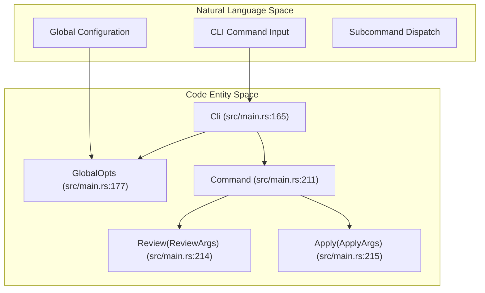
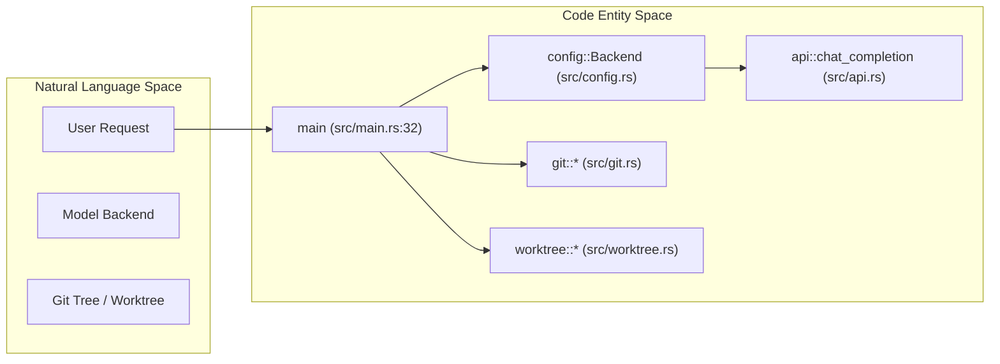

<!-- source: DeepWiki mcp.deepwiki.com · repo NVIDIA/boro · page 1 Overview · fetched 2026-10-26 -->

# Overview

Relevant source files

The following files were used as context for generating this wiki page:

- [README.md](README.md)
- [src/main.rs](src/main.rs)

Boro is an AI-assisted command-line interface designed for Linux kernel, QEMU, libvirt, and virt-manager patch review, backporting, building, and testing [README.md:1-10, src/main.rs:77-100, src/main.rs:168](). Operating directly inside the developer's local git tree, Boro targets the pre-submission workflow, handling local patch-stack iteration, downstream maintenance, and security-fix integration [README.md:5-10](). 

The system architecture coordinates multiple specialist stages, model backends, process execution utilities, and optional virtme-ng execution environments [README.md:61-158, src/main.rs:4-30]().

### High-Level Architecture

The following diagram illustrates the primary component structure of the Boro codebase, mapping user-facing CLI inputs to internal data structures defined in `src/main.rs`.

Sources: `src/main.rs:165-216`

### Execution Workflow

The execution pipeline routes requests through configuration layers, model inference handlers, and repository tools.

Sources: `src/main.rs:32-35`, `src/config.rs:1-10`, `src/api.rs:1-10`, `src/git.rs:1-10`

---

## 1.1. Getting Started and Configuration

Boro builds with Cargo and relies on a local Rust toolchain [README.md:20-24](). External dependencies such as `b4`, `vng` (virtme-ng), and `lei` (public-inbox) must be available on the system `PATH` depending on the targeted workflow [README.md:150-158](). 

Runtime behavior, model endpoints, and validation thresholds are configured via environment variables prefixed with `BORO_`:
- `BORO_URL`: Endpoint URL for OpenAI-compatible chat and completion APIs [README.md:29]()
- `BORO_KEY`: API authentication key [README.md:30]()
- `BORO_MODEL`: Default model identifier used for broad and specialist discovery passes [README.md:31, README.md:70-75]()
- `BORO_VALIDATION_MODEL`: Optional override model used for protected baseline analysis, validation stages, and final reporting [README.md:72-78]()

For installation steps, Cargo build instructions, full environment variable definitions, and external tool prerequisites, see [Getting Started and Configuration](#1.1).

Sources: `README.md:20-158`

---

## 1.2. CLI Commands Reference

The Boro CLI entry point is defined in `src/main.rs` using `clap` [src/main.rs:38, src/main.rs:165-174](). Global options control source directories, worker concurrency limits, transport backends, verbose logging, and JSON output formatting [src/main.rs:177-210]().

Subcommands include:
- `review`: Executes a multi-stage agentic review across a given commit range [src/main.rs:213-214]()
- `apply`: Automatically applies commits or message IDs, resolving diff3 conflicts using model assistance [src/main.rs:215]()
- `build`: Checks out commits in isolated worktrees, builds kernels using `vng -b`, and triages build output [README.md:95-96]()
- `test`: Builds and boots kernels under virtme-ng, executing AI-selected test plans and analyzing runtime outputs [README.md:97-101]()

For detailed descriptions of all subcommands, global options, and argument structures, see [CLI Commands Reference](#1.2).

Sources: `src/main.rs:165-216`, `README.md:90-111`

---

