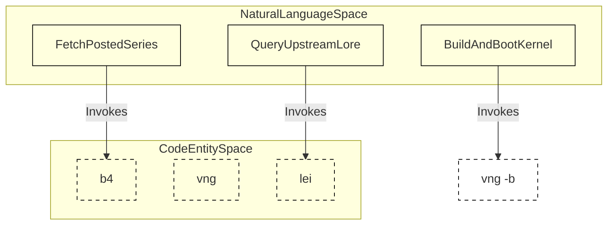
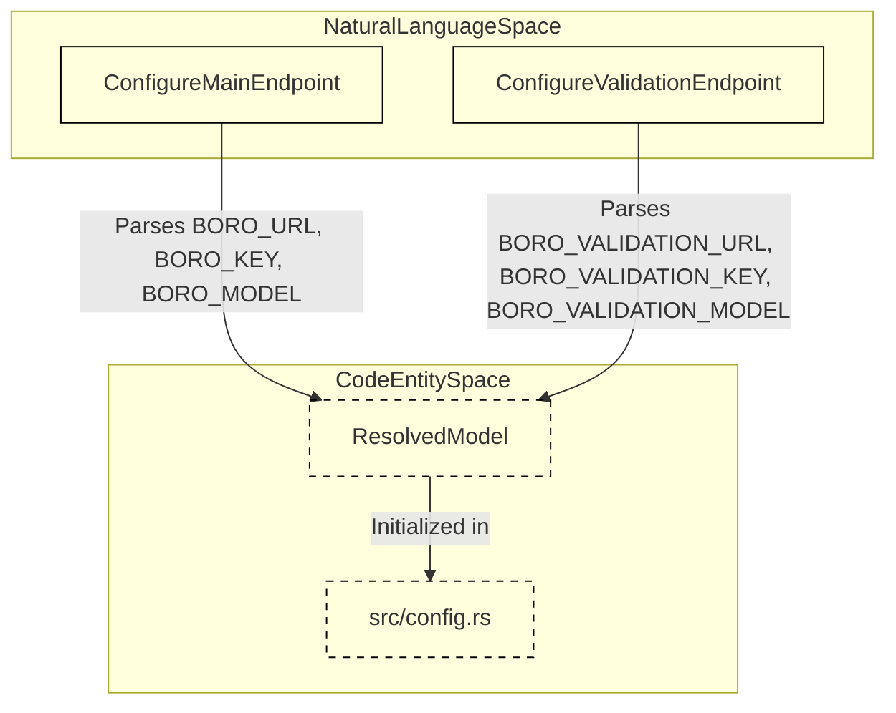

<!-- source: DeepWiki mcp.deepwiki.com · repo NVIDIA/boro · page 1.1 Getting Started and Configuration · fetched 2026-10-26 -->

# Getting Started and Configuration

<details>
<summary>Relevant source files</summary>

The following files were used as context for generating this wiki page:

- [Cargo.lock](Cargo.lock)
- [Cargo.toml](Cargo.toml)
- [README.md](README.md)
- [src/config.rs](src/config.rs)
- [src/prompts.rs](src/prompts.rs)
- [src/target/libvirt.rs](src/target/libvirt.rs)
- [src/target/virt_manager.rs](src/target/virt_manager.rs)

</details>


## Purpose and Scope

This page details the prerequisites, compilation process, external CLI dependencies, and environment variable configuration required to run and configure `boro`. Boro is designed as an AI-assisted CLI for local kernel, QEMU, libvirt, and virt-manager development workflows, operating directly inside a local git repository.

Sources: `README.md:1-16`, `src/config.rs:36-62`

---

## Installation and Cargo Build

Boro is built in Rust (edition 2021) and managed via Cargo. The package defines its dependencies—including `clap` with derive/env features, `tokio`, `reqwest`, `rust-embed` with `debug-embed`, and `tree-sitter`—in `[Cargo.toml:1-34]`.

To compile and install `boro` locally from a source checkout, run:

```bash
cargo install --force --path .
```

For development builds, standard `cargo build` or `cargo build --release` compiles the binary. The `rust-embed` dependency is configured with the `debug-embed` feature flag to ensure that prompt corpora are baked directly into debug binaries as well as release builds (`[Cargo.toml:26-30]()`), avoiding runtime path resolution failures if the source tree is relocated.

Sources: `README.md:18-24`, `Cargo.toml:1-34`

---

## External Dependencies

While Boro executes its core review pipelines entirely within its process, certain subcommands rely on external host tools. These utilities must be installed and available on the system `$PATH`:

*   **`b4`**: Required for fetching patch series posted to mailing lists (`--message-id`). Boro invokes `b4` to import posted series into temporary worktrees before applying and reviewing them (`[README.md:43-56]`, `[README.md:150-153]`).
*   **`virtme-ng` (`vng`)**: Required for the `build` and `test` subcommands. Boro leverages `vng -b` to compile individual commits in isolation and boots kernels under `virtme-ng` to execute AI-selected test plans (`[README.md:84-115]`, `[README.md:154-156]`).
*   **`lei` (from `public-inbox`)**: Optional dependency used for querying upstream lore archives during follow-up analysis and commit message historical context lookups (`[README.md:157-158]`).


*Figure 1: Mapping external user intents to external binary dependencies.*

Sources: `README.md:43-58`, `README.md:150-158`

---

## Environment Configuration (`BORO_*`)

Boro communicates with OpenAI-compatible HTTP endpoints or subprocess CLI tools. Configuration is driven primarily through environment variables parsed into the `ResolvedModel` struct (`[src/config.rs:85-119]()`).

### Model and Validation Backend Separation
Boro separates the bulk-of-work model (`BORO_MODEL`) from the strong-validator model (`BORO_VALIDATION_MODEL`). 

*   **Main Model (`BORO_*`)**: Drives broad discovery, specialist passes, and routine inference.
*   **Validation Model (`BORO_VALIDATION_*`)**: Drives the initial complete-context fast review, validates new candidate findings, adjudicates patch conflicts, and renders final summaries.

### Supported Environment Variables

| Variable | Scope | Description |
| :--- | :--- | :--- |
| `BORO_URL` | Main | Base URL for the OpenAI-compatible chat/completions endpoint (automatically normalized to append `/v1` via `[src/config.rs:136-142]()`). |
| `BORO_KEY` | Main | API authentication key for the main model endpoint. |
| `BORO_MODEL` | Main | Model identifier string (e.g., local or hosted LLM name). |
| `BORO_VALIDATION_URL` | Validation | Optional override for the validation endpoint URL (falls back to `BORO_URL`). |
| `BORO_VALIDATION_KEY` | Validation | Optional override for the validation API key (falls back to `BORO_KEY`). |
| `BORO_VALIDATION_MODEL` | Validation | Optional override for the validation model identifier (falls back to `BORO_MODEL`). |
| `BORO_TEMPERATURE` | Main | Optional `f32` sampling temperature (`[src/config.rs:101-105]()`). |
| `BORO_VALIDATION_TEMPERATURE` | Validation | Optional `f32` sampling temperature for the validation model (`[src/config.rs:101-105]()`). |
| `BORO_NUM_CTX` | Main | Ollama context window override forwarded as top-level `options.num_ctx` (`[src/config.rs:106-114]()`). |
| `BORO_VALIDATION_NUM_CTX` | Validation | Context window override for the validation model (`[src/config.rs:106-114]()`). |
| `BORO_MAX_INPUT_TOKENS` | Main | Preflight budget truncation limit (`[src/config.rs:115-119]()`). Defaults to `32768` (`[src/config.rs:6]()`). |
| `BORO_VALIDATION_MAX_INPUT_TOKENS` | Validation | Preflight budget truncation limit for the validation model (`[src/config.rs:115-119]()`). |


*Figure 2: Configuration data flow from environment variables to `ResolvedModel`.*

Sources: `README.md:26-32`, `src/config.rs:1-154`

---

