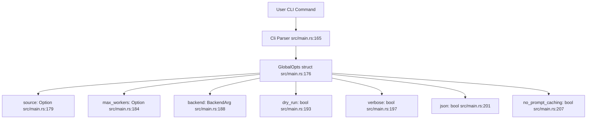
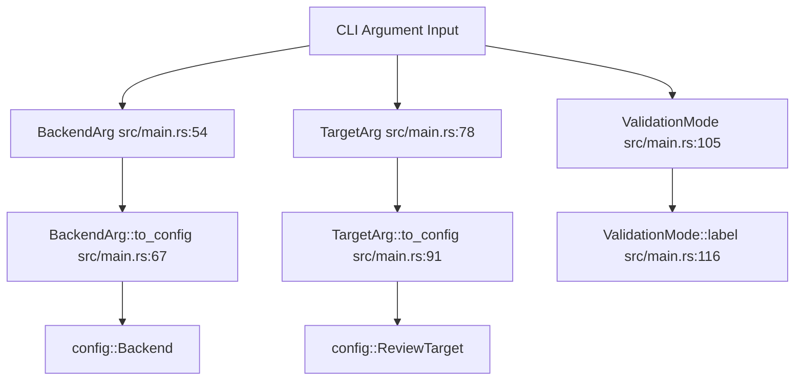
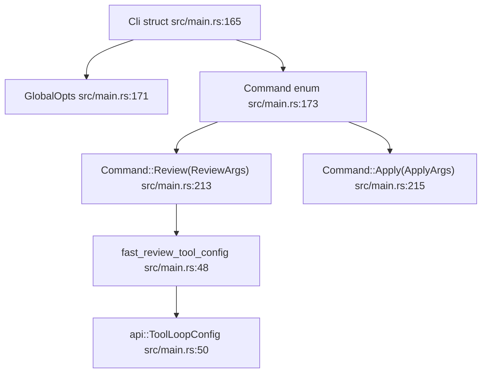

<!-- source: DeepWiki mcp.deepwiki.com · repo NVIDIA/boro · page 1.2 CLI Commands Reference · fetched 2026-10-26 -->

# CLI Commands Reference

Relevant source files

The following files were used as context for generating this wiki page:

- [README.md](README.md)
- [src/main.rs](src/main.rs)

## Purpose and Scope

This page details the command-line interface (CLI) surface, global options, argument structs, and subcommand routers defined in `src/main.rs`. As the entry point for the `boro` binary, `src/main.rs` uses the `clap` derive parser (`Parser`, `Args`, `Subcommand`) to process user inputs, configure global execution parameters, and dispatch control flow to downstream modules such as review orchestration, patch application, kernel building, and boot testing.

Sources: `[src/main.rs:1-42]`, `[src/main.rs:165-216]()`

---

## Global Options (`GlobalOpts`)

The `GlobalOpts` struct defines flags and options that apply across all subcommands. These options control repository selection, concurrency limits, model transport backends, execution dryness, verbosity, output formatting, and prompt caching behaviors.

*   `--source` (`-s`): Specifies the Linux or target git tree path to operate on. Defaults to the current working directory (`[src/main.rs:178-180]()`).
*   `--max-workers` (`-j`): Sets the maximum concurrent commit workers. Default concurrency thresholds are set to `8` for review operations and `1` for build or test routines (`[src/main.rs:182-184]()`).
*   `--backend` (`-b`): Selects the model transport backend via [`BackendArg`](#backend-and-target-value-enums). Defaults to `openai` (`[src/main.rs:186-189]()`).
*   `--dry-run` (`-d`): Prints context sizes for reviews or planned actions for apply, build, and test operations without executing them (`[src/main.rs:191-193]()`).
*   `--verbose` (`-v`): Streams model responses to `stderr` during generation (`[src/main.rs:195-197]()`).
*   `--json`: Emits a single pretty-printed JSON object on `stdout` for machine consumption while suppressing human-readable reports (`[src/main.rs:199-202]()`).
*   `--no-prompt-caching`: Disables Anthropic-style `cache_control` markers on outgoing requests. Enabled by default (`[src/main.rs:204-209]()`).

Sources: `[src/main.rs:176-209]()`

---

## Backend and Target Value Enums

To bridge user-facing CLI strings with internal configuration types, `src/main.rs` defines several `clap::ValueEnum` implementations:

### `BackendArg`
Maps CLI selections to `config::Backend` (`[src/main.rs:53-75]()`):
*   `openai`: OpenAI-compatible chat/completions endpoint (`BackendArg::Openai`).
*   `claude`: Shells out to the `claude` CLI (`BackendArg::Claude`).
*   `opencode`: Shells out to the `opencode` CLI (`BackendArg::Opencode`).
*   `codex`: Shells out to the `codex` CLI (`BackendArg::Codex`).

### `TargetArg`
Specifies the review target domain, mapping to `config::ReviewTarget` (`[src/main.rs:77-100]()`):
*   `kernel`: Linux kernel (default, `TargetArg::Kernel`).
*   `qemu`: QEMU (`TargetArg::Qemu`).
*   `libvirt`: libvirt (`TargetArg::Libvirt`).
*   `virt-manager`: virt-manager / virtinst (`TargetArg::VirtManager`).

### `ValidationMode`
Controls findings validation behavior and LKML narrative rendering (`[src/main.rs:102-123]()`):
*   `off`: Skips validation entirely, rendering raw findings and raw LKML (`ValidationMode::Off`).
*   `filter`: Validates findings and renders per-commit LKML narrative from survivors only (`ValidationMode::Filter`).
*   `findings`: Validates findings without rendering per-commit LKML prose (`ValidationMode::Findings`).

Sources: `[src/main.rs:53-123]()`

---

## Subcommand Routing and Argument Structs

The root `Cli` parser aggregates `GlobalOpts` and a `Command` subcommand enum (`[src/main.rs:165-216]()`). The primary subcommands include:

*   `Review`: Executes the multi-stage agentic code review pipeline over a given `COMMIT_RANGE` (`[src/main.rs:213]()`).
*   `Apply`: Applies commits from a `COMMIT_RANGE` or a `MESSAGE_ID`, handling automated conflict resolution (`[src/main.rs:215]()`).

Tool configuration helper functions like `fast_review_tool_config` inspect repository paths and `--no-tools` flags to configure `api::ToolLoopConfig` with `api::ToolVerification::SensitiveFindings` pre-requisites (`[src/main.rs:48-51]()`).

Sources: `[src/main.rs:32-51]`, `[src/main.rs:165-216]()`

---

